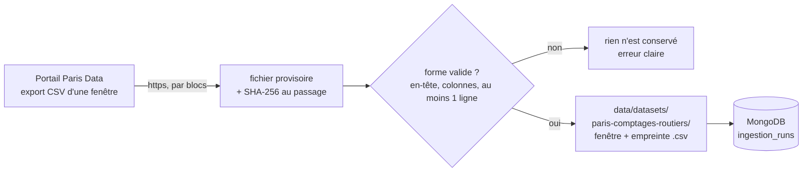

# Ingestion du comptage routier de Paris : fichier brut et journal MongoDB

Issue DAT-03 (#57). Premier maillon de l'ETL (Extract, Transform, Load, extraction, transformation, chargement) de l'[ADR-013](../01-architecture/adr/ADR-013-integration-donnees.md) : **télécharger, garder le brut sans y toucher, journaliser**. Le nettoyage et les rejets sont DAT-04, le chargement dans l'entrepôt est DAT-05.

Jeu : comptage routier des capteurs permanents de la Ville de Paris, licence ODbL (Open Database License), choisi en DAT-01 ([fiche du jeu](../../data/datasets/README.md), section 3). Code : [`data/etl/pipelines/`](../../data/etl/pipelines/). Tests : [`data/etl/tests/`](../../data/etl/tests/).

Abréviations : CSV (Comma-Separated Values, valeurs séparées par des virgules), SHA-256 (Secure Hash Algorithm, algorithme de hachage sécurisé), UTC (Coordinated Universal Time, temps universel coordonné), BOM (Byte Order Mark, marque d'ordre des octets).

## 1. Ce que fait une exécution



| Étape | Ce qui se passe |
|---|---|
| 1. Fenêtre | Un jour entier (`--day`) ou un intervalle (`--start`, `--end`) en UTC, 7 jours au plus. Une fenêtre sans fuseau, vide, à l'envers ou trop longue est refusée avant tout appel |
| 2. Téléchargement | Export CSV du portail, trié par heure puis tronçon (`order_by=t_1h, iu_ac`), reçu par blocs de 1 Mo dans un fichier provisoire. Seul l'hôte `opendata.paris.fr` en https est appelé ; au-delà de 512 Mo le téléchargement s'arrête |
| 3. Contrôle de forme | L'en-tête doit être exactement celui du portail (15 colonnes), chaque ligne doit avoir 15 colonnes, la fenêtre doit contenir au moins une ligne. **Aucune valeur n'est interprétée** : `q` et `k` vides, `etat_trafic` en texte, fuseau de `t_1h` restent tels que reçus |
| 4. Rangement | Le fichier est déplacé sous `data/datasets/paris-comptages-routiers/<début>_<fin>_<12 premiers caractères du SHA-256>.csv`. Octet pour octet ce que le portail a envoyé (BOM et fins de ligne compris) |
| 5. Journal | Une entrée dans la collection MongoDB `ingestion_runs` : source, date, volume, empreinte (dictionnaire, [section 10.7](dictionnaire-de-donnees.md)) |

## 2. Lancer

Prérequis : bases démarrées (`db-up`) et pymongo installé (`python -m pip install -r data/etl/requirements.txt`).

| Action | Linux (bash) | Windows (PowerShell) |
|---|---|---|
| Un jour entier | `python3 scripts/dev/dev.py etl-paris --day 2026-10-18` ou `make etl-paris DAY=2026-10-18` | `py -3 scripts/dev/dev.py etl-paris --day 2026-10-18` |
| Un intervalle | `python3 scripts/dev/dev.py etl-paris --start 2026-10-18T10:00:00Z --end 2026-10-18T11:00:00Z` | `py -3 scripts/dev/dev.py etl-paris --start 2026-10-18T10:00:00Z --end 2026-10-18T11:00:00Z` |
| Tests (sans réseau ni base) | `make test-etl` | `py -3 -m unittest discover -s data/etl/tests` |

`etl-paris` lit `.env`, se connecte avec le compte `svc_traitement` et transmet l'adresse au pipeline par une variable d'environnement (le mot de passe n'apparaît jamais sur une ligne de commande). Ordre de grandeur : une heure fait environ 3 000 lignes et 1 Mo ; un jour, environ 68 000 lignes et 22 Mo.

Résultat d'une exécution :

```text
Fichier   : …/data/datasets/paris-comptages-routiers/20261018T100000Z_20261018T110000Z_66bb1a4eacb8.csv (écrit)
Volume    : 982821 octets, 2978 lignes de données
Empreinte : sha256 66bb1a4eacb8120e…
Journal   : nouvelle entrée (reçu 1 fois)
```

## 3. Garanties

| Situation | Résultat | Test |
|---|---|---|
| Même fenêtre, source inchangée (seconde exécution) | Aucun fichier écrit, aucune entrée créée ; `executions` passe à 2 et `last_seen_at` avance | `test_la_seconde_execution_ne_cree_ni_fichier_ni_entree` |
| Donnée corrigée à la source (empreinte différente) | Nouveau fichier et nouvelle entrée ; l'ancien fichier reste | `test_une_donnee_corrigee_a_la_source_donne_un_second_fichier_et_garde_le_premier` |
| Fichier modifié sur le disque entre deux exécutions | Arrêt (`ErreurIntegrite`), rien n'est journalisé | `test_un_fichier_modifie_sur_le_disque_est_detecte_et_rien_n_est_journalise` |
| Journal en panne après le rangement du fichier | Le fichier reste ; la relance ne journalise que l'entrée manquante | `test_un_journal_en_panne_laisse_le_fichier_et_la_relance_complete_l_entree` |
| Réponse invalide (en-tête changé, page d'erreur, texte non UTF-8, aucune ligne) | Rien n'est conservé ni journalisé | `test_une_reponse_invalide_ne_laisse_rien_et_n_ecrit_rien`, classe `Analyse` |
| Deux exécutions simultanées sur le même fichier | La seconde retrouve l'entrée de la première (clé unique `uniq_load_key`, une relance) | `test_une_course_sur_la_cle_est_rejouee_une_fois` |
| Adresse hors du portail | Refusée avant tout appel | `test_une_adresse_hors_du_portail_n_est_jamais_appelee` |
| Document du journal | Conforme au validateur MongoDB du script d'initialisation (même source que le dictionnaire) | `test_le_document_cree_par_une_premiere_execution_est_accepte_par_le_validateur` |

Réconciliation (ADR-013, section 4.4) à ce stade : lignes reçues = lignes conservées, aucune n'est écartée (les rejets commencent à DAT-04). Chaque entrée porte `run_id` et `source_type` = `REAL_HISTORICAL`, conformément à la [règle de provenance de l'ADR-027](../01-architecture/adr/ADR-027-jeux-de-donnees-et-provenance.md).

## 4. Choix à valider par les deux membres

| N° | Choix | Raison | Autre option |
|---|---|---|---|
| 1 | Les lignes brutes restent **dans des fichiers** ; MongoDB ne garde que le journal | C'est la lettre de l'issue (« stocker la donnée brute sans modification », « journaliser source, date et volume dans MongoDB »). `raw_events` ne convient pas : son validateur exige l'enveloppe d'événement et son index supprime tout après 14 jours | Charger aussi les lignes dans une collection dédiée (volume : environ 71 000 lignes par jour) |
| 2 | Nouvelle collection `ingestion_runs` | `processing_stats` décrit des fenêtres de traitement, `model_runs` des entraînements | Réutiliser `processing_stats` |
| 3 | Compte `svc_traitement` (lire, insérer, modifier `ingestion_runs`) | L'ETL appartient au service de traitement ([ADR-008](../01-architecture/adr/ADR-008-microservices.md)) ; aucun nouveau compte à gérer | Compte `svc_etl` dédié |
| 4 | Export du portail par fenêtre, pas le fichier annuel de l'historique | Une fenêtre de 1 à 7 jours se rejoue vite et se teste ; le ZIP annuel pèse de 186 à 247 Mo | Ajouter plus tard un adaptateur pour les ZIP annuels |

## 5. Preuves

### 5.1 Faites le 29/10/2026 (poste Windows 11, Python 3.14.3, pymongo 4.19.0)

| Preuve | Résultat |
|---|---|
| `python -m unittest discover -s data/etl/tests` | 38 tests OK, sans réseau ni base (un garde-fou fait échouer tout test qui atteindrait le réseau) |
| Huit défauts introduits volontairement dans le code (réécriture systématique du fichier, intégrité non vérifiée, journal toujours « nouveau », compteur figé, hôte non vérifié, zéro ligne accepté, en-tête non vérifié, tri retiré) | Tous détectés par les tests |
| Pipeline lancé deux fois sur le **vrai portail** (heure du 18/10/2026 à 10:00 UTC, journal en mémoire) | 1re exécution : fichier écrit, 982 821 octets, 2 978 lignes, `66bb1a4e…`. 2e exécution : fichier non réécrit, aucune nouvelle entrée, `executions` = 2. Un seul fichier sur le disque ; son SHA-256 égale celui du journal ; `source_modified_at` = 19/10/2026 01:02:43 UTC relevé auprès du portail |
| Deux téléchargements successifs de la même fenêtre triée | Empreintes identiques (`66bb1a4e…`) : l'export est reproductible tant que le portail ne change pas ses données |
| Dictionnaire (11 tests), `dev.py` (commande `etl-paris`, 8 tests ajoutés), 283 tests de `scripts/dev` | Verts, sauf 2 tests de `test_ci.py`, déjà en échec sur `main` (le `bash` du poste Windows est le lanceur WSL, sans distribution) |
| `db-check` : 23 contrôles, dont 2 nouveaux sur `ingestion_runs` (le traitement la lit, la collecte ne la lit pas) | **Non exécutés** (voir 5.2) : seule leur liste est testée |

### 5.2 Reste à rejouer : la seconde exécution contre un vrai MongoDB

Le moteur Docker du poste ne répondait pas pendant la session (Docker Desktop « en arrêt »), donc le journal n'a été essayé que contre un faux (tests) et contre le validateur lu dans le script d'initialisation, pas contre un serveur MongoDB. À faire sur chaque poste (le volume doit être neuf : le script d'initialisation ne s'exécute qu'au premier démarrage, voir la section 6) :

| Étape | Linux (bash) | Windows (PowerShell) |
|---|---|---|
| Projet jetable | `export COMPOSE_PROJECT_NAME=novaria-dat03 POSTGRES_PORT=5546 MONGO_PORT=27120` | `$env:COMPOSE_PROJECT_NAME="novaria-dat03"; $env:POSTGRES_PORT="5546"; $env:MONGO_PORT="27120"` |
| Démarrer et vérifier | `python3 scripts/dev/dev.py db-up` puis `db-check` : 23 lignes `[OK]` | `py -3 scripts/dev/dev.py db-up` puis `db-check` |
| Ingérer deux fois | `python3 scripts/dev/dev.py etl-paris --start 2026-10-18T10:00:00Z --end 2026-10-18T11:00:00Z` (deux fois de suite) | `py -3 scripts/dev/dev.py etl-paris --start 2026-10-18T10:00:00Z --end 2026-10-18T11:00:00Z` (deux fois) |
| Compter | `python3 scripts/dev/dev.py mongosh` puis `db.ingestion_runs.find({}, {sha256:1, bytes:1, rows:1, executions:1})` | `py -3 scripts/dev/dev.py mongosh` puis la même requête |
| Nettoyer | `docker compose -p novaria-dat03 down -v` | `docker compose -p novaria-dat03 down -v` |

Résultat attendu : 1re exécution « nouvelle entrée (reçu 1 fois) », 2e « déjà journalisé (reçu 2 fois) », un seul document avec `executions: 2`, `bytes: 982821`, `rows: 2978`.

Résultat obtenu sous Docker : [À COMPLÉTER : sorties des deux exécutions et du `find`, poste et date. Passer ensuite l'état d'EXG-DON-02 à « Prouvé » dans `docs/02-specifications/exigences.md` et le bilan de la même page à 2 / 23 / 28.]

## 6. Limites et suite

| Limite | Conséquence ou suite |
|---|---|
| **Base créée avant DAT-03** | Elle n'a pas la collection `ingestion_runs` ni le droit d'y écrire : `etl-paris` s'arrête avec un message qui renvoie à `db-reset` (efface les données locales). Une migration MongoDB pour une base existante reste à prévoir dans une issue dédiée ([bases locales](base-de-donnees-locale.md), section 6) |
| Fuseau de `t_1h` | Le portail annonce l'heure de Paris mais l'export renvoie `+00:00` : non tranché. Le brut est gardé tel quel ; la conversion et sa vérification relèvent de DAT-04 |
| Taux d'absence élevés (environ 45 % de `q` vides, 43 % de `k` vides sur le jeu courant) | Gardés dans le brut ; rejet ou marquage en DAT-04 |
| Fraîcheur du jeu courant | Relevé le 29/10/2026 : dernière mise à jour annoncée le 19/10/2026 à 01:02 UTC, ligne la plus récente du 18/10/2026 à 22:00. La mise à jour « quotidienne » de la fiche du jeu n'est donc pas garantie ; une fenêtre récente peut être vide (refusée, rien n'est conservé) ou incomplète, donc changer d'empreinte plus tard (nouveau fichier, ancien conservé). `source_modified_at` du journal sert à le constater |
| Pas de contrôle automatique en CI | Le contrôle obligatoire `backend` ne parcourt que `services/` ; `make test-etl` et `make test` lancent les tests de `data/etl`, un job CI dédié reste à ajouter |
| Licence | Pas de redistribution des fichiers (règle 7 de l'ADR-027) ; toute publication de résultats cite : « Source : Ville de Paris, Direction de la Voirie et des Déplacements, Comptage routier (licence ODbL). » |
