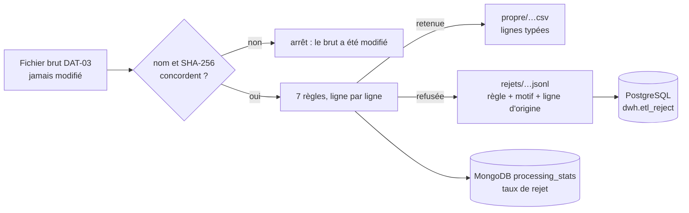

# Nettoyage du comptage routier de Paris : règles de qualité, rejets tracés et taux de rejet

Issue DAT-04 (#58). Deuxième maillon de l'ETL (Extract, Transform, Load, extraction, transformation, chargement) de l'[ADR-013](../01-architecture/adr/ADR-013-integration-donnees.md) : **appliquer des règles de qualité au fichier brut, écrire chaque ligne refusée avec sa raison, journaliser le taux de rejet**. L'ingestion du brut est DAT-03 ([mode d'emploi](ingestion-paris.md)), le chargement dans l'entrepôt est DAT-05.

Code : [`data/etl/transforms/`](../../data/etl/transforms/) (les règles, fonctions pures) et [`data/etl/pipelines/`](../../data/etl/pipelines/) (`nettoyer_paris.py`, `sorties.py`). Tests : [`data/etl/tests/`](../../data/etl/tests/).

Abréviations : CSV (Comma-Separated Values, valeurs séparées par des virgules), JSON Lines (un objet JSON par ligne), SHA-256 (Secure Hash Algorithm, algorithme de hachage sécurisé), UTC (Coordinated Universal Time, temps universel coordonné).

## 1. Ce que fait une exécution



| Étape | Ce qui se passe |
|---|---|
| 1. Contrôle du brut | Le nom du fichier (`<début>_<fin>_<12 caractères du SHA-256>.csv`) doit correspondre à son empreinte, et sa forme (en-tête, 15 colonnes) est revérifiée. Un brut modifié arrête tout : la couche brute est immuable ([ADR-013](../01-architecture/adr/ADR-013-integration-donnees.md), section 4.2) |
| 2. Règles | Chaque ligne passe les règles du paragraphe 3, dans l'ordre. La première violée la refuse ; sinon la ligne est typée et retenue |
| 3. Fichiers | `propre/<fichier>.csv` et `rejets/<fichier>.jsonl`, à côté du brut, écrits dans un fichier provisoire puis renommés : une exécution interrompue laisse les sorties précédentes intactes. Ils sont **reconstruits à chaque exécution** et identiques d'une exécution à l'autre, octet pour octet |
| 4. `dwh.etl_reject` | Les rejets du fichier remplacent ceux de l'exécution précédente, dans une transaction (suppression puis insertion) : rejouer ne les duplique pas |
| 5. Taux de rejet | Un document `processing_stats` (`kind` = `rejects`) par fichier brut, mis à jour sur place à chaque exécution |

La réconciliation de l'ADR-013 (section 4.4) est vérifiée à chaque exécution : **lignes lues = lignes retenues + lignes refusées**, et la somme des refus par règle égale le nombre de lignes refusées. Un écart arrête le nettoyage avant toute écriture dans une base.

## 2. Lancer

Prérequis : bases démarrées (`db-up`), l'ingestion du jour faite (`etl-paris --day …`) et les pilotes installés (`python -m pip install -r data/etl/requirements.txt` : pymongo et psycopg).

| Action | Linux (bash) | Windows (PowerShell) |
|---|---|---|
| Nettoyer le fichier d'un jour entier | `python3 scripts/dev/dev.py etl-nettoyer-paris --day 2026-10-17` ou `make etl-nettoyer-paris DAY=2026-10-17` | `py -3 scripts/dev/dev.py etl-nettoyer-paris --day 2026-10-17` |
| Nettoyer un fichier précis | `python3 scripts/dev/dev.py etl-nettoyer-paris --file <fichier>.csv` | `py -3 scripts/dev/dev.py etl-nettoyer-paris --file <fichier>.csv` |
| Changer le seuil d'alerte | ajouter `--alert-threshold 0.6` | ajouter `--alert-threshold 0.6` |
| Tests (sans réseau ni base) | `make test-etl` | `py -3 -m unittest discover -s data/etl/tests` |

`--file` désigne un fichier brut **du dossier `data/datasets/paris-comptages-routiers/`** : son nom suffit, et un chemin n'est accepté que s'il mène à ce dossier. Le nom doit être celui d'un fichier brut de DAT-03 ; un chemin ailleurs, un `../` ou un fichier de nom quelconque est refusé avant toute ouverture. Le dossier des données n'est pas une option de la ligne de commande.

La commande se connecte avec le compte `svc_traitement` (droits : lire et écrire `dwh`, lire et écrire `processing_stats`) ; les adresses passent par l'environnement du processus, jamais par la ligne de commande. Une variable du shell (par exemple un autre port pour un projet Docker jetable) l'emporte sur `.env`, comme avec Docker Compose. Le pipeline n'écrit dans une base que si on lui donne son adresse (`--postgres-url`, `--mongo-url`) : sans adresse il écrit les fichiers, affiche le bilan et le dit.

Sortie d'une exécution (jour du 17/10/2026) :

```text
Fichier brut : …/paris-comptages-routiers/20261017T000000Z_20261018T000000Z_b10505cca6f6.csv (empreinte vérifiée)
Lignes lues  : 71472
Propres      : 42213 -> …/propre/20261017T000000Z_20261018T000000Z_b10505cca6f6.csv
Rejetées     : 29259 (40.94%) -> …/rejets/20261017T000000Z_20261018T000000Z_b10505cca6f6.jsonl
  MISSING_REQUIRED : 29259
Retenues avec le drapeau MISSING_OCCUPANCY : 6717
dwh.etl_reject : 29259 lignes écrites
Taux de rejet : journalisé dans MongoDB processing_stats (kind rejects)
```

## 3. Les sept règles

Évaluées dans cet ordre ; une ligne n'est refusée qu'**une fois**, pour la première règle violée, ce qui garde le bilan juste. Codes repris dans le [dictionnaire](dictionnaire-de-donnees.md) (section 8.2). Dernière colonne : lignes touchées sur les **71 472 lignes réelles** du 17/10/2026 (fichier de 23,6 Mo).

| N° | Code | Famille | Règle | Lignes réelles |
|---|---|---|---|---|
| 1 | `MISSING_REQUIRED` | valeur manquante | `iu_ac`, `t_1h` ou `q` vide. Le débit est obligatoire : le fait horaire de l'entrepôt exige un comptage (ADR-027, section 3.2) et la fiche du jeu dit « rejet si absent » (section 3.7) | **29 259** |
| 2 | `TYPE_INVALID` | type | `iu_ac` : 1 à 9 chiffres ASCII. `t_1h` : horodatage ISO 8601 **avec** fuseau. `q`, `k` : nombres finis (ni `nan`, ni `inf`, ni virgule décimale, ni chiffres non ASCII). `date_debut`, `date_fin` : AAAA-MM-JJ. `etat_trafic`, `etat_barre` : l'une des valeurs de leur liste, ou son rang (0 à 4 et 0 à 3 dans les fichiers historiques). Tous les défauts de la ligne sont cités dans le motif | 0 |
| 3 | `OUT_OF_RANGE` | borne | `q` de 0 à 15 000 véhicules par heure ; `k` de 0 à 100 % ; `t_1h` de 2012 à 2030 (le calendrier de `dwh.dim_date` : un fait hors de cette période serait refusé au chargement) | 0 |
| 4 | `NOT_ON_THE_HOUR` | cohérence | `t_1h` est une heure pleine, jugée en UTC (pas de temps du jeu : 1 h) | 0 |
| 5 | `FUTURE_TIMESTAMP` | cohérence | `t_1h` n'est pas postérieur à l'horloge, à 5 s près (même tolérance que DQ-10) | 0 |
| 6 | `STATE_MISMATCH` | cohérence | `etat_trafic` s'accorde avec `k` selon les seuils officiels du producteur (notice du 7 juin 2019) : moins de 15 % fluide, 15 à 30 pré-saturé, 30 à 50 saturé, 50 et plus bloqué. Sur un seuil exact les deux états voisins passent (la notice est ambiguë). `Inconnu` si et seulement si `k` est vide. Un état vide n'est pas comparé | 0 |
| 7 | `DUPLICATE_KEY` | doublon | Un seul enregistrement par (`iu_ac`, `t_1h`) dans le fichier. La première ligne est gardée ; le motif dit si la seconde a les mêmes valeurs ou non. Zéros de tête (`04392`) et autre écriture du même instant (`+02:00`) comptent comme le même enregistrement | 0 |

**Valeurs absentes tolérées** : un taux d'occupation `k` vide ne refuse pas la ligne (DQ-06) : elle est retenue avec le drapeau `MISSING_OCCUPANCY` (**6 717** lignes le 17/10/2026), jamais en silence. Les dates de validité `date_debut`, `date_fin` vides (768 lignes) et un état vide ne sont ni refusés ni signalés : ce sont des attributs du tronçon, pas de la mesure.

**Normalisations** (les seules) : `iu_ac` sans zéros de tête ; `t_1h` ramené en UTC ; états en entier remplacés par leur libellé ; accents décomposés recomposés. Aucune valeur n'est corrigée ni imputée. Le fuseau de `t_1h` reste celui que l'API annonce (`+00:00`) : le portail dit « heure de Paris », la question est ouverte (fiche du jeu, section 3.3).

**Constat sur les vraies données** : sur ce jour, une seule règle refuse des lignes, et c'est l'absence de débit (41 %). Les six autres règles ne touchent rien : le producteur est cohérent (états toujours conformes aux seuils, aucun doublon, aucune heure décalée, aucun nombre mal formé). Elles protègent contre un changement de format ou de source, et ont chacune leurs cas de test ; elles ne seront « vues » en vrai que si les données se dégradent. Le débit est non entier sur 742 lignes (moyennes) : ce n'est pas un défaut, `q` reste un nombre.

## 4. Sorties

**`propre/<fichier>.csv`** (UTF-8, séparateur « ; », fins de ligne LF, une ligne par ligne retenue, dans l'ordre du brut) :

| Colonne | Contenu |
|---|---|
| `road_segment_id`, `label` | `iu_ac` normalisé, `libelle` |
| `hour_utc` | `t_1h` en UTC, `AAAA-MM-JJTHH:MM:SSZ` |
| `vehicle_count`, `occupancy_pct` | `q`, `k` (en %, la division par 100 attendue par le contrat `iot-measurement` est celle du chargement, fiche du jeu section 3.7) ; vide si absent |
| `traffic_state`, `barrier_state` | Libellés (`Fluide`, `Ouvert`…), vide si absent |
| `upstream_node_id`, `downstream_node_id` | `iu_nd_amont`, `iu_nd_aval` |
| `quality_flags` | `MISSING_OCCUPANCY` ou vide |
| `source_line` | Rang de la ligne dans le brut (pour remonter à la source) |

**`rejets/<fichier>.jsonl`** et **`dwh.etl_reject`** : une ligne par refus, mêmes quatre informations ([dictionnaire](dictionnaire-de-donnees.md), section 8.1) :

```json
{"payload": {"iu_ac": "1", "q": "", "k": "7.73611", "t_1h": "2026-10-17T00:00:00+00:00", "…": "…"},
 "reason": "champ(s) obligatoire(s) vide(s) : q (débit absent : station de taux d'occupation seul, ou panne du comptage)",
 "rule": "MISSING_REQUIRED",
 "source_ref": "20261017T000000Z_20261018T000000Z_b10505cca6f6.csv#1"}
```

`payload` est la ligne d'origine complète, colonne par colonne, valeurs textuelles telles que reçues : on peut corriger la règle ou la source puis rejouer.

**`processing_stats`** : voir la [section 10.5 du dictionnaire](dictionnaire-de-donnees.md). Document du 17/10/2026 :

```text
kind: 'rejects'   window_start: 2026-10-17T00:00:00Z
values: { dataset: 'paris-comptages-routiers', source_file: '…b10505cca6f6.csv', source_sha256: 'b10505cc…',
          rows_read: 71472, rows_clean: 42213, rows_rejected: 29259, reject_rate: 0.409377,
          by_rule: { MISSING_REQUIRED: 29259 }, flags: { MISSING_OCCUPANCY: 6717 },
          alert_threshold: 0.5, alert: false, cleaned_at: …, run_id: 'net-20261029T182910Z-4487a96d' }
```

## 5. Taux de rejet journalisé

`taux de rejet = lignes refusées / lignes lues`. Il est affiché, écrit dans `processing_stats` avec son détail par règle, et comparé à un **seuil d'alerte** (valeur de départ **0,5**, option `--alert-threshold`) : au-dessus, le bilan porte `alert: true` et la commande affiche `ALERTE`. Elle ne s'arrête pas pour autant (code de sortie 0) : le fichier propre reste utilisable, l'alerte est un signal à lire.

Le taux réel du 17/10/2026 est de **40,94 %**, presque entièrement structurel : les stations de taux d'occupation seul n'ont pas de débit (fiche du jeu, section 3.5). Il est donc sous le seuil de départ, mais assez proche pour que le seuil soit à revoir après quelques jours de mesure.

## 6. Garanties et tests

103 tests dans `data/etl/tests/` (dont 38 pour l'ingestion DAT-03). Pour DAT-04 :

| Garantie | Test |
|---|---|
| **Chaque règle a un tableau de cas** (refusés et acceptés, bornes comprises) ; un test échoue si une règle est ajoutée sans cas | `ChaqueRegleATonTest.test_toutes_les_regles_ont_un_tableau_de_cas` et les tests des cas |
| Chaque règle refuse bien par elle-même, avec le bon code et un motif précis | `test_chaque_regle_de_ligne_se_declenche_seule_sur_ses_cas_refuses` |
| La première règle violée l'emporte, un seul rejet par ligne | `OrdreDesRegles` |
| Réconciliation lues = retenues + refusées ; un bilan faux est refusé | `BilanDuLot`, `test_aucune_ligne_n_est_perdue_ni_comptee_deux_fois` |
| Chaque rejet porte règle, motif, `source_ref` et la ligne d'origine | `test_chaque_ligne_refusee_est_ecrite_avec_sa_regle_son_motif_et_sa_ligne_d_origine` |
| Rejouer donne les mêmes fichiers octet pour octet, sans fichier provisoire | `test_rejouer_donne_les_memes_fichiers_octet_pour_octet` |
| Une exécution interrompue laisse les sorties précédentes intactes | `test_une_exécution_interrompue_laisse_les_sorties_precedentes_intactes` |
| Un brut modifié ou renommé est refusé, rien n'est écrit | `ContrôleDuBrut` |
| Rejeter de nouveau remplace les rejets PostgreSQL et met à jour le bilan MongoDB | `RejetsDansPostgres`, `test_rejouer_met_le_bilan_a_jour_sans_en_creer_un_second`, `SortiePostgres`, `SortieMongo` |
| Le seuil d'alerte (strictement au-dessus) | `test_le_taux_au_dessus_du_seuil_declenche_l_alerte` |
| Les colonnes écrites existent dans la migration de `etl_reject`, et le document `processing_stats` respecte le validateur MongoDB du script d'initialisation | `test_les_colonnes_ecrites_existent_dans_la_migration`, `test_le_document_cree_respecte_le_validateur_de_processing_stats` |

## 7. Preuves

### 7.1 Faites le 29/10/2026 (poste Windows 11, Python 3.14.3, pymongo 4.19.0, psycopg 3.3.6)

| Preuve | Résultat |
|---|---|
| `python -m unittest discover -s data/etl/tests` | 103 tests OK (4 ignorés sans psycopg) ; ruff sans remarque ; couverture de 95 % de `pipelines/` et `transforms/` (coverage.py) |
| 31 défauts introduits volontairement (une règle affaiblie ou retirée, un seuil déplacé, un rejet non écrit, un `upsert` retiré, un mauvais `kind`, la réconciliation désactivée…) | Tous détectés par les tests ; deux mutants d'abord survivants ont conduit à renforcer deux tests |
| Règles lancées sur **71 472 lignes réelles** (17/10/2026, ingérées par `etl-paris`) | Voir le paragraphe 3 ; bilan juste ; 7 s pour les règles |

### 7.2 Sous Docker, avec de vraies bases (projet jetable à volumes neufs, mêmes conditions que DAT-03)

```text
> etl-nettoyer-paris --day 2026-10-17   (1re exécution, 40 s au total)       > etl-nettoyer-paris --day 2026-10-17   (2e exécution)
Lignes lues  : 71472                                                          mêmes chiffres
Propres      : 42213     SHA-256 du CSV propre   38E6BEA178907904…           SHA-256 identique
Rejetées     : 29259     SHA-256 du JSONL        617FEA4FE3CBD22F…            SHA-256 identique
dwh.etl_reject : 29259 lignes écrites                                         29259 lignes écrites

> SELECT count(*), count(DISTINCT source_ref), string_agg(DISTINCT rule, ',') FROM dwh.etl_reject;
 29259 | 29259 | MISSING_REQUIRED          (après deux exécutions : pas de doublon)

> db.processing_stats.countDocuments({kind: "rejects"})   ->  1   (reject_rate 0.409377, mis à jour à la 2e exécution)
```

Droits vérifiés : `svc_lecture` ne peut pas écrire dans `dwh.etl_reject` (`permission denied`). Reste à faire : la même preuve sur le poste Linux (Manoa).

### 7.3 Contrôle SonarQube de la pull request

La première pull request a échoué à la porte de qualité (couverture des nouvelles lignes à 0 % : `data/etl` n'avait aucun rapport de couverture ; une vulnérabilité « Path Traversal » sur l'argument `--file` ; 14 défauts de maintenabilité). Corrigé : le job CI `etl` mesure la couverture et la dépose, `--file` ne construit plus le chemin qu'à partir d'un nom de fichier brut dans le dossier des données (tests `test_un_chemin_ne_peut_pas_faire_ouvrir_un_autre_fichier`), et les défauts sont résolus (complexité de deux fonctions réduite, classes de caractères simplifiées, constante pour la famille « cohérence », exceptions redondantes retirées). Le résultat de la nouvelle analyse est visible sur la pull request après le prochain push.

## 8. Choix à valider et limites

| N° | Sujet | Position actuelle | Autre option |
|---|---|---|---|
| 1 | **Lignes sans débit (41 %)** | Refusées, comme l'indique la fiche du jeu. Les stations de taux d'occupation seul (taux et état connus) ne rejoignent pas l'entrepôt | Les garder dans la couche propre avec un drapeau `MISSING_FLOW` pour un usage « congestion par occupation » (demande un fait dédié en DAT-05) |
| 2 | Bornes de départ | Débit 15 000 véhicules par heure (maximum observé 6 648), occupation 100 %, calendrier 2012 à 2030, seuil d'alerte 0,5 | À ajuster après plusieurs jours. Le calendrier fait refuser les années 2010 et 2011 de l'historique : étendre `dwh.dim_date` par une nouvelle migration si elles servent |
| 3 | Doublon écrit comme rejet | `DUPLICATE_KEY` figure dans `etl_reject` pour tracer la ligne ignorée ; l'ADR-013 disait « ignorée, comptée » | Ne compter que dans `flags` sans écrire la ligne |
| 4 | Fuseau de `t_1h` | Gardé tel quel (`+00:00`). Si le portail veut dire l'heure de Paris, toutes les heures seraient décalées d'une ou deux heures | À vérifier avant DAT-05 |
| 5 | `payload` complet | 22 Mo de JSON Lines pour 29 259 rejets d'un jour (géométrie comprise), autant dans PostgreSQL | Retirer `geo_point_2d` et `geo_shape` du `payload` (ils sont dans le brut, retrouvable par `source_ref`) |

Limites : les doublons ne se détectent que **dans un fichier** (deux fichiers qui se chevauchent sont départagés par la clé du chargement, DAT-05). Le ratio de vitesse de l'ADR-028 ne se calcule pas sur ce jeu (pas de vitesse). Les règles propres à d'autres jeux (UCI, METR-LA) ne sont pas écrites. Les tests de `data/etl` tournent dans la CI par le job d'appui `etl` (couverture remise à SonarQube) ; le contrôle obligatoire `backend` ne parcourt que `services/`.
