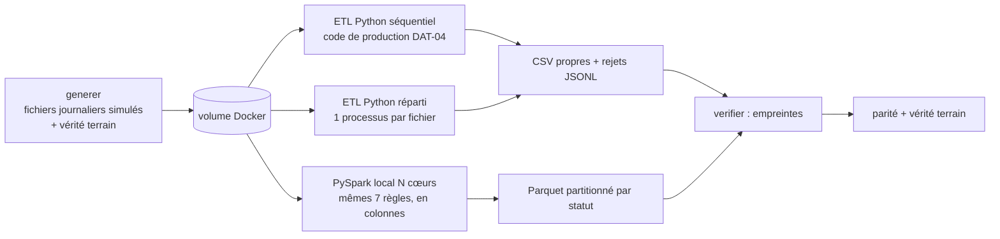

# Prototype Big Data : PySpark en mode local contre l'ETL Python (DAT-08)

| Champ | Valeur |
|---|---|
| Issue | #83 (DAT-08) |
| Compétence BC05 | Big Data et traitement massif (Hadoop, Spark), niveau « Prototype ciblé » |
| Décisions | [ADR-016](../01-architecture/adr/ADR-016-big-data.md) (prototype Spark sans cluster Hadoop), [ADR-023](../01-architecture/adr/ADR-023-execution-locale-d-abord.md) (exécution locale, aucune ressource AWS), [ADR-025](../01-architecture/adr/ADR-025-equivalents-locaux-des-services-aws.md) (équivalents locaux) |
| Code | [`data/bigdata/`](../../data/bigdata/README.md) |
| Tests | `data/bigdata/tests/`, `scripts/dev/test_bigdata.py` |
| Date des mesures | 15/11/2026 |

Abréviations : AWS (Amazon Web Services), EMR (Elastic MapReduce, Spark géré d'AWS), S3 (Simple Storage Service, stockage d'objets d'AWS), IAM (Identity and Access Management, gestion des identités et des accès), ETL (Extract, Transform, Load, extraction, transformation, chargement), CSV (Comma-Separated Values, valeurs séparées par des virgules), CRC-32 (Cyclic Redundancy Check, contrôle de redondance cyclique), PSS (Proportional Set Size, mémoire proportionnelle d'un processus), JVM (Java Virtual Machine, machine virtuelle Java), CI (Continuous Integration, intégration continue).

## 1. En bref

**Critère de l'issue** : « le rapport indique ce que le prototype démontre et ce qu'il ne démontre pas ».

| Ce qui est demandé | Résultat | Où |
|---|---|---|
| Traiter un jeu volumineux avec PySpark | **Fait** : jusqu'à 90 jours simulés du comptage routier de Paris, 6,4 millions de lignes, 1,6 Go de CSV, nettoyés par PySpark 4.1.4 en mode local | sections 2 à 4 |
| Comparer le temps avec l'ETL Python | **Fait** : même travail, mêmes règles, résultats identiques ; durée et mémoire mesurées sur quatre tailles | sections 5 et 6 |
| Documenter les limites et l'équivalent EMR non exécuté | **Fait** | sections 8 à 10 |
| Dire ce que le prototype démontre et ne démontre pas | **Fait** | sections 7 et 8 |

**Conclusion en trois phrases.** PySpark rend exactement les mêmes lignes propres et les mêmes rejets que l'ETL Python de production, sur tous les volumes essayés. Sur ce poste (4 cœurs, 6 Go), il **n'est jamais plus rapide** que l'ETL Python réparti sur 4 processus : il est 3,7 fois plus lent à 1 jour et encore 10 % plus lent à 90 jours (101,6 s contre 92,8 s), en consommant près de 14 fois plus de mémoire. Le prototype établit la maîtrise de l'outil et un ordre de grandeur, **pas un besoin de Big Data** : au volume de Novaria Core, l'ETL Python suffit ([ADR-016](../01-architecture/adr/ADR-016-big-data.md), compromis accepté).

## 2. Ce qui a été construit



| Élément | Choix | Raison |
|---|---|---|
| Travail comparé | Le **nettoyage** du comptage de Paris ([DAT-04](nettoyage-paris.md)) : sept règles de qualité, première règle violée, doublons par fichier | C'est un vrai maillon de l'ETL, avec un code de production à égaler |
| ETL Python | `pipelines.nettoyer_paris.nettoyer_fichier`, **non modifié** | La référence est le code qui tourne, pas une réécriture |
| Deux lancements Python | Séquentiel (comme `lot.py`), et réparti par fichier avec `multiprocessing` | Spark local utilise N cœurs : la comparaison honnête donne N cœurs à Python aussi |
| PySpark | Les mêmes règles écrites en expressions de colonnes (`bigdata/nettoyage_spark.py`), sortie Parquet | L'usage normal de Spark : pas de fonction Python ligne à ligne |
| Exécution | Un conteneur (Python 3.12, Java 21, PySpark 4.1.4 installé avec ses empreintes), dépôt monté en lecture seule | Même résultat sous Linux et Windows ; rien d'installé sur le poste |
| Hadoop | **Non déployé** : ni HDFS (Hadoop Distributed File System) ni YARN (Yet Another Resource Negotiator) | [ADR-016](../01-architecture/adr/ADR-016-big-data.md), option B écartée |

## 3. Le jeu de données

**Simulé, et dit comme tel.** Le jeu réel de Paris est sous licence ODbL (Open Database License) et n'est pas redistribué ([ADR-027](../01-architecture/adr/ADR-027-jeux-de-donnees-et-provenance.md)). Le générateur (`bigdata/generer.py`) écrit des fichiers **de même forme** que l'export du portail : mêmes 15 colonnes, même en-tête, BOM (Byte Order Mark), fins de ligne CRLF, séparateur « ; », nom `<début>_<fin>_<empreinte>.csv`. Les valeurs sont inventées ; les débits et taux d'occupation suivent un profil journalier simple, sans prétention de réalisme.

| Propriété | Valeur |
|---|---|
| Un jour | 2 960 capteurs × 24 heures, environ 71 600 lignes et 18 Mo (un vrai jour du portail : environ 71 000 lignes) |
| Tailles mesurées | 1, 7, 30 et 90 jours : de 71 625 à 6,4 millions de lignes, de 18 Mo à 1,6 Go |
| Déterminisme | Mêmes graine, jour et nombre de capteurs : mêmes octets (testé) |
| Défauts injectés | Un défaut au plus par ligne, en proportions connues : débit absent (18 %), champ obligatoire vide, type, borne, heure non pleine, date future, état incohérent (0,2 à 0,6 % chacun), doublons (1 % des lignes valides) |
| Vérité terrain | Le générateur sait, **sans rien nettoyer**, combien de lignes chaque règle doit refuser. Elle est indépendante des deux moteurs |

Environ 20 % des lignes sont refusées, presque toutes pour débit absent : c'est l'ordre de grandeur du vrai fichier (41 % observés le 17/10/2026, [nettoyage](nettoyage-paris.md)), en plus faible.

**« Volumineux » est relatif.** 1,6 Go tient dans la mémoire d'un ordinateur portable : ce n'est pas du Big Data. C'est 90 fois le lot quotidien de l'ETL, assez pour que les durées se mesurent en minutes.

## 4. Protocole de mesure

| Point | Règle |
|---|---|
| Machine | Poste Linux à 12 cœurs ; le conteneur est limité à **4 cœurs et 6 Go** (`--cpus 4 --memory 6g`), machine au repos |
| Isolation | Chaque moteur tourne dans **son propre processus** ; la vérification des résultats se fait après, hors mesure |
| Durée | Du début du travail au bilan, écriture des sorties comprise. Pour PySpark, le **démarrage de la JVM est compris** (coût réel) et donné à part |
| Mémoire | Pic de la somme des PSS de l'arbre de processus, relevé toutes les 0,2 s dans `/proc` |
| Répétitions | 3 essais pour 1, 7 et 30 jours (la médiane est donnée) ; **1 seul essai pour 90 jours** |
| Réglages de PySpark | `local[N]`, mémoire du pilote 3 Go, une partition par fichier, Parquet compressé snappy |
| Sorties | Python : CSV et JSONL (comme en production). PySpark : Parquet. Les formats diffèrent ; les **contenus** sont comparés (section 6) |

Environnement relevé par l'outil : Python 3.12.16, PySpark 4.1.4, openjdk version "21.0.13" 2026-10-20, noyau 7.0.0-43-generic ; 12 cœurs visibles, limite du conteneur `cpu.max` = 400000 100000 (quota et période en µs), `memory.max` = 6442450944 octets.

Les jeux de 1, 7 et 30 jours sont les premiers jours d'un même jeu (à partir du 01/09/2026). Le jeu de 90 jours est un **autre tirage** du même générateur (01/06 au 29/08/2026, 6 444 512 lignes) : voir la section 11.

## 5. Résultats

### 5.1 Durée (médiane) et débit

| Jours | Lignes | Taille | python-sequentiel | python-parallele (4 cœurs) | spark (1 cœur) | spark (4 cœurs) |
|---|---:|---:|---:|---:|---:|---:|
| 1 | 71 625 | 18 Mo | 3,5 s (20 308 l/s) | 4,5 s (16 034 l/s) | 15,7 s (4 557 l/s) | 16,6 s (4 324 l/s) |
| 7 | 501 338 | 126 Mo | 23,2 s (21 638 l/s) | 9,0 s (55 482 l/s) | 33,5 s (14 951 l/s) | 24,3 s (20 594 l/s) |
| 30 | 2 148 351 | 540 Mo | 94,5 s (22 722 l/s) | 33,9 s (63 411 l/s) | 90,9 s (23 638 l/s) | 49,2 s (43 656 l/s) |
| 90 | 6 444 512 | 1 621 Mo | 285,6 s (22 566 l/s) | 92,8 s (69 463 l/s) | 257,1 s (25 069 l/s) | 101,6 s (63 402 l/s) |

### 5.2 Combien de fois PySpark (4 cœurs) est plus rapide (> 1) ou plus lent (< 1)

| Jours | ETL séquentiel ÷ PySpark | ETL réparti ÷ PySpark |
|---|---:|---:|
| 1 | 0,21 | 0,27 |
| 7 | 0,95 | 0,37 |
| 30 | 1,92 | 0,69 |
| 90 | 2,81 | 0,91 |

### 5.3 Pic de mémoire

| Jours | python-sequentiel | python-parallele (4 cœurs) | spark (1 cœur) | spark (4 cœurs) |
|---|---:|---:|---:|---:|
| 1 | 60 Mio | 125 Mio | 837 Mio | 809 Mio |
| 7 | 62 Mio | 260 Mio | 1 315 Mio | 1 318 Mio |
| 30 | 62 Mio | 265 Mio | 1 950 Mio | 3 357 Mio |
| 90 | 62 Mio | 265 Mio | 3 594 Mio | 3 606 Mio |

### 5.4 Part du démarrage dans la durée de PySpark

| Jours | Moteur | Démarrage | Durée totale | Part |
|---|---|---:|---:|---:|
| 1 | spark (1 cœur) | 4,6 s | 15,7 s | 29 % |
| 1 | spark (4 cœurs) | 4,4 s | 16,6 s | 27 % |
| 7 | spark (1 cœur) | 4,2 s | 33,5 s | 13 % |
| 7 | spark (4 cœurs) | 4,4 s | 24,3 s | 18 % |
| 30 | spark (1 cœur) | 3,9 s | 90,9 s | 4 % |
| 30 | spark (4 cœurs) | 4,4 s | 49,2 s | 9 % |
| 90 | spark (1 cœur) | 4,5 s | 257,1 s | 2 % |
| 90 | spark (4 cœurs) | 4,0 s | 101,6 s | 4 % |

### 5.5 Lecture

| Constat | Chiffres |
|---|---|
| À petit volume, PySpark perd nettement | 1 jour : 16,6 s contre 3,5 s pour l'ETL séquentiel. Le démarrage de la JVM (environ 4,5 s) dépasse à lui seul la durée de l'ETL Python |
| Contre l'ETL **séquentiel**, PySpark à 4 cœurs passe devant entre 7 et 30 jours | 7 jours : 24,3 s contre 23,2 s ; 30 jours : 49,2 s contre 94,5 s |
| Contre l'ETL **réparti** sur 4 processus, PySpark ne passe jamais devant | L'écart se resserre : rapport de 0,27 à 1 jour, 0,69 à 30 jours, 0,91 à 90 jours |
| À cœurs égaux et grand volume, PySpark traite plus de lignes par seconde et par cœur que Python | 90 jours, 1 cœur : 257,1 s pour PySpark contre 285,6 s pour l'ETL séquentiel |
| PySpark coûte beaucoup plus de mémoire | 3 606 Mio contre 265 Mio (ETL réparti) à 90 jours |
| L'ETL Python a un débit constant | Environ 21 000 lignes par seconde et par processus, à toutes les tailles ; sa mémoire ne dépend pas du volume (un fichier à la fois) |

**Point de croisement.** Avec l'ETL séquentiel : entre 7 et 30 jours (entre 0,5 et 2,1 millions de lignes). Avec l'ETL réparti : **pas atteint à 90 jours**. La tendance suggère qu'il existe au-delà, mais ce n'est **pas mesuré** : toute valeur donnée serait une extrapolation.

## 6. Les deux moteurs rendent-ils la même chose ?

Trois contrôles, du plus fin au plus large :

| Contrôle | Portée | Résultat |
|---|---|---|
| Décision ligne à ligne sur des cas limites | 80 lignes construites pour toucher les bornes de chaque règle (seuils exacts, zéros de tête, fuseaux, 29 février, états en rang entier…), plus les doublons | Mêmes décisions et mêmes valeurs propres, par test automatique |
| Bilan contre la vérité terrain du générateur | Chaque mesure | Égal, pour tous les moteurs et toutes les tailles |
| Empreinte des sorties | Chaque mesure : nombre de lignes, somme des CRC-32 d'une ligne canonique, sommes entières des débits et des occupations, rejets par règle | Identique entre les quatre lancements, à chaque taille |

| Jours | Moteurs comparés | Empreintes identiques | Bilan = vérité terrain |
|---|---|---|---|
| 1 | python-sequentiel:1, python-parallele:4, spark:1, spark:4 | oui | oui |
| 7 | python-sequentiel:1, python-parallele:4, spark:1, spark:4 | oui | oui |
| 30 | python-sequentiel:1, python-parallele:4, spark:1, spark:4 | oui | oui |
| 90 | python-sequentiel:1, python-parallele:4, spark:1, spark:4 | oui | oui |

Une égalité d'empreintes ne **prouve** pas l'égalité ligne à ligne (deux jeux différents peuvent avoir la même somme) ; elle la rend invraisemblable, et le premier contrôle compare des lignes une à une.

**Écarts connus et voulus** (chacun a un test qui le montre) :

| Cas | ETL Python | PySpark |
|---|---|---|
| Horodatage avec une espace à la place du `T` | accepté | refusé (`TYPE_INVALID`) |
| Horodatage avec fraction de seconde | refusé (`NOT_ON_THE_HOUR`) | refusé (`TYPE_INVALID`) |
| Espace insécable autour d'un nombre | accepté | refusé |
| Libellé non normalisé (accent combinant) | normalisé en NFC | laissé tel quel |
| Motif du refus et ligne brute du rejet | texte complet | la règle, le fichier, le numéro de ligne et un extrait |

Aucun de ces cas n'existe dans le jeu généré. Sur un fichier réel, ils sont **non vérifiés** : un essai sur un vrai export serait nécessaire avant de remplacer l'ETL par PySpark.

## 7. Ce que le prototype démontre

| N° | Démontré | Preuve |
|---|---|---|
| 1 | Un traitement de production se réécrit en PySpark **sans changer son résultat** | Section 6 |
| 2 | La mise en œuvre de Spark : lecture de CSV, expressions de colonnes, fonction de fenêtre (doublons), écriture Parquet partitionnée, réglage des partitions | `bigdata/nettoyage_spark.py` |
| 3 | Une mesure reproductible de durée et de mémoire, par une seule commande | Section 12 ; fichiers JSON dans `data/bigdata/resultats/` |
| 4 | L'effet du nombre de cœurs sur Spark à partir d'un certain volume | 30 jours : 90,9 s sur 1 cœur, 49,2 s sur 4 |
| 5 | Qu'à ce volume, **Spark n'est pas nécessaire** | Section 5 |
| 6 | Un piège réel de Spark et sa correction | Section 11 |

## 8. Ce que le prototype ne démontre pas

| N° | Non démontré | Pourquoi |
|---|---|---|
| 1 | Le **traitement distribué** : plusieurs machines, réseau, panne d'un nœud, reprise d'une tâche | Un seul processus Java sur un seul poste (`local[N]`) |
| 2 | Un volume qui **dépasse la mémoire ou le disque** d'une machine | 1,6 Go au plus |
| 3 | Que Spark devient plus rapide que l'ETL réparti | Non atteint à 90 jours ; au-delà, non mesuré |
| 4 | Hadoop (HDFS, YARN) | Non déployé ([ADR-016](../01-architecture/adr/ADR-016-big-data.md)) |
| 5 | Le fonctionnement sur Amazon EMR, ses durées et son coût | Non exécuté ([ADR-023](../01-architecture/adr/ADR-023-execution-locale-d-abord.md)) ; section 9 |
| 6 | La lecture depuis S3 | Fichiers locaux |
| 7 | La parité sur des **données réelles** | Jeu simulé ; écarts connus de la section 6 |
| 8 | Un réglage optimal de Spark | Réglages simples, non explorés (mémoire, partitions, format d'entrée) |
| 9 | Le chargement dans l'entrepôt ([DAT-05](etl-planifie-local.md)) | Seul le nettoyage est porté |
| 10 | Des durées valables ailleurs | Un seul poste, un seul jour de mesure ; 1 essai à 90 jours |

## 9. L'équivalent Amazon EMR, non exécuté

Aucun compte AWS n'est ouvert et aucune application EMR n'est créée ([ADR-023](../01-architecture/adr/ADR-023-execution-locale-d-abord.md)). Cette section décrit **ce qui changerait**, pour que le jour où AWS est autorisé par écrit, la reprise ne soit pas une réécriture. Rien ici n'a été essayé : la syntaxe vient de la documentation d'AWS ([Running Spark jobs, EMR Serverless](https://docs.aws.amazon.com/emr/latest/EMR-Serverless-UserGuide/spark-jobs.html)) et reste **à vérifier** à l'exécution.

| Sujet | Prototype local | Équivalent sur EMR Serverless |
|---|---|---|
| Moteur | PySpark 4.1.4, maître `local[N]` dans un conteneur | PySpark de la version EMR choisie : la plateforme fixe le maître et les exécuteurs |
| Programme | `bigdata/nettoyage_spark.py` | Le même fichier, déposé sur S3 (Simple Storage Service) ; `ouvrir_session` ne doit plus fixer `master` (adaptation **non écrite**) |
| Entrée | Fichiers CSV du volume Docker | Fichiers CSV sur S3 (`s3://…/paris/`) |
| Sortie | Parquet partitionné par statut, dans le volume | Parquet partitionné par statut, sur S3 |
| Droits | Aucun (conteneur local) | Un rôle IAM (Identity and Access Management) d'exécution qui lit l'entrée et écrit la sortie |
| Lancement | `dev.py bigdata -- nettoyer --moteur spark` | `aws emr-serverless start-job-run` (ci-dessous) |
| Coût | Le poste | À l'usage, facturé : **non chiffré ici** (GES-09) |

Commande prête (non exécutée) ; les identifiants entre chevrons sont à créer :

```bash
aws emr-serverless start-job-run \
    --application-id <identifiant-de-l-application> \
    --execution-role-arn <arn-du-role-d-execution> \
    --job-driver '{"sparkSubmit": {
        "entryPoint": "s3://<seau>/prototype/nettoyage_spark.py",
        "entryPointArguments": ["s3://<seau>/paris/", "s3://<seau>/sortie/"],
        "sparkSubmitParameters": "--conf spark.executor.cores=4 --conf spark.executor.memory=8g --conf spark.driver.memory=4g"}}'
```

Deux écarts à prévoir avant de la lancer : le point d'entrée doit lire ses chemins dans `entryPointArguments` (aujourd'hui `python -m bigdata` les lit dans sa ligne de commande), et le moteur qui compte les lignes d'une partition (`monotonically_increasing_id`) suppose **une partition par fichier**, réglage fait ici dans `ouvrir_session` et à reproduire dans `sparkSubmitParameters`.

**Ce que cette équivalence ne dit pas** : que le programme tourne sur EMR sans changement, que les coûts sont ceux d'un cluster mesuré, ni que le gain de Spark apparaît à un volume que ce poste ne permet pas d'atteindre.

## 10. Limites de l'exécution locale

| Limite | Conséquence |
|---|---|
| Un seul nœud | Le « cluster » est un processus : aucun échange réseau entre exécuteurs, aucune tolérance aux pannes mise à l'épreuve |
| 4 cœurs, 6 Go | Au-delà de quelques Go de données, la mémoire du pilote deviendrait la limite ; non essayé |
| Disque local | Lectures et écritures sur le même disque : pas de débit de stockage distant |
| Une partition par fichier | Nécessaire pour numéroter les lignes ; un très gros fichier unique ne serait pas découpé |
| Entrée en CSV | Spark lit le CSV ligne à ligne, sans lecture vectorisée : un format en colonnes en entrée changerait les durées (non essayé) |
| Mesure de mémoire | Lit `/proc` : Linux seulement (dans le conteneur, donc aussi sous Docker Desktop ; **non vérifié sous Windows**) |

## 11. Deux leçons de la mise au point

**Le code généré trop gros.** La première version écrivait les sept règles en une seule expression imbriquée. Spark y recopiait les mêmes sous-expressions des dizaines de fois ; le code Java qu'il génère dépassait la limite de la JVM, et Spark retombait, avec un simple avertissement, sur une évaluation interprétée. Mesures d'essai, 30 jours, 4 cœurs : 83 s avant, 49,2 s après (l'essai « avant » a tourné sur une machine moins au repos : l'écart exact n'est pas établi, le sens l'est). Correction : matérialiser les colonnes nettoyées, puis les colonnes typées, par des projections successives, et ne les citer ensuite que par leur nom. Sans cette correction, le rapport aurait conclu à tort que Spark est 2 à 4 fois plus lent que Python.

**La vérité terrain et l'horloge.** La première série de 90 jours allait du 01/09 au 29/11/2026, alors que l'horloge du nettoyage est fixée au 15/11/2026 : les 14 derniers jours étaient refusés pour date future, ce que la vérité terrain du générateur ne prévoyait pas. Les quatre moteurs étaient d'accord entre eux (empreintes identiques), mais pas avec la vérité terrain. Le générateur refuse maintenant un jour postérieur à l'horloge (testé), et la série a été refaite sur 90 jours antérieurs. L'ancien résultat est conservé, marqué « à refaire », dans `data/bigdata/resultats/`.

## 12. Lancer

Docker est la seule exigence ; les données vont dans le volume `novaria-bigdata`, jamais dans le dépôt.

| Action | Linux (bash) | Windows (PowerShell) |
|---|---|---|
| Construire l'image | `python3 scripts/dev/dev.py bigdata-build` | `py -3 scripts/dev/dev.py bigdata-build` |
| Tests (PySpark compris) | `python3 scripts/dev/dev.py bigdata-test` | `py -3 scripts/dev/dev.py bigdata-test` |
| Générer 30 jours | `python3 scripts/dev/dev.py bigdata -- generer --dossier /data/paris --jours 30` | `py -3 scripts/dev/dev.py bigdata -- generer --dossier /data/paris --jours 30` |
| Mesurer | `python3 scripts/dev/dev.py bigdata -- mesurer --dossier /data/paris --jours 1,7,30 --repetitions 3` | `py -3 scripts/dev/dev.py bigdata -- mesurer --dossier /data/paris --jours 1,7,30 --repetitions 3` |
| Supprimer les données | `docker volume rm novaria-bigdata` | `docker volume rm novaria-bigdata` |

La construction de l'image télécharge PySpark (450 Mo) : plusieurs minutes la première fois. L'image pèse 1,45 Go. Détail des commandes : [`data/bigdata/README.md`](../../data/bigdata/README.md).

## 13. Preuves du 15/11/2026

| Contrôle | Résultat |
|---|---|
| Tests du prototype dans l'image (PySpark et Java présents) | 44 tests réussis, aucun ignoré |
| Tests des commandes Docker (`scripts/dev/test_bigdata.py`) et de la CI (`test_ci.py`) | Réussis |
| Mesures | Fichiers JSON de `data/bigdata/resultats/` (les tableaux de la section 5 en sont tirés par `python -m bigdata rapport`) |
| Parité | Section 6 |

## 14. Choix à valider, écarts et limites

| Point | État |
|---|---|
| Un job `bigdata` est ajouté à la CI (tests et couverture du prototype, remise à SonarQube) | **Modifie la CI** : à approuver par l'autre membre. Non vérifié sur GitHub (Java 21 préinstallé, durée d'installation de PySpark) |
| PySpark 4.1.4 et l'image de 1,45 Go | Dépendance lourde, limitée à `data/bigdata/` ; l'analyse Snyk de cette image n'est pas faite |
| Jeu simulé, parité non essayée sur un export réel | À faire si PySpark devait un jour remplacer l'ETL |
| 1 essai à 90 jours ; un seul poste | À répéter pour une mesure plus sûre |
| Polars ou Dask comme autre point de comparaison (ADR-016, option G) | Non fait : la comparaison porte sur l'ETL de production |
| EMR Serverless | Décrit, non exécuté ; la commande reste à vérifier |
| Windows | Non vérifié |

## 15. Questions probables du jury

| Question | Réponse courte |
|---|---|
| Aviez-vous besoin de Spark ? | Non, et le rapport le montre : à ce volume l'ETL Python est aussi rapide ou plus rapide, avec près de 14 fois moins de mémoire |
| Alors pourquoi l'avoir fait ? | Le référentiel BC05 demande la compétence ; le prototype la montre sur un vrai traitement, avec une mesure honnête plutôt qu'une affirmation |
| Comment savez-vous que Spark rend le même résultat ? | Trois contrôles indépendants : cas limites ligne à ligne, vérité terrain du générateur, empreintes des sorties (section 6) |
| Est-ce du Big Data ? | Non : 1,6 Go sur un poste. Le prototype montre l'outil, pas le volume |
| Et Hadoop ? | Non déployé ; HDFS serait remplacé par S3 et YARN par le service géré ([ADR-016](../01-architecture/adr/ADR-016-big-data.md)) |
| Quand Spark deviendrait-il utile ? | Quand les données ne tiennent plus sur une machine, ou quand plusieurs machines sont disponibles. Le point de croisement avec l'ETL réparti n'est pas atteint à 90 jours |
| Votre comparaison est-elle équitable ? | Python reçoit autant de cœurs que Spark ; le démarrage de la JVM est compté et donné à part ; les formats de sortie diffèrent et c'est dit |
| Qu'avez-vous appris ? | Qu'un programme Spark correct peut être plusieurs fois trop lent sans erreur visible (section 11) : il faut lire le plan et les avertissements |
