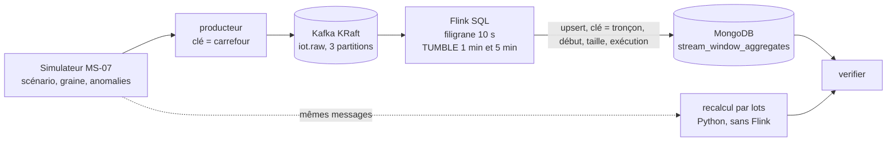

# Prototype de flux temps réel : Kafka local et Flink SQL (DAT-09)

| Champ | Valeur |
|---|---|
| Issue | #84 (DAT-09) |
| Compétence BC05 | Traitement de flux en temps réel (Kafka, Flink), niveau « Prototype ciblé » ([note de cadrage](../00-cadrage/note-de-cadrage.md)) |
| Décisions | [ADR-009](../01-architecture/adr/ADR-009-bus-evenements.md) (Kafka), [ADR-011](../01-architecture/adr/ADR-011-temps-reel-et-batch.md) (Flink, fenêtres, retard), [ADR-023](../01-architecture/adr/ADR-023-execution-locale-d-abord.md) (exécution locale, Amazon MSK documenté et non exécuté), [ADR-025](../01-architecture/adr/ADR-025-equivalents-locaux-des-services-aws.md) (équivalents locaux) |
| Code | [`data/streaming/`](../../data/streaming/README.md) |
| Tests | `data/streaming/tests/` (42 tests, sans Docker), `scripts/dev/test_flux_proto.py` |
| Date des mesures | 16/11/2026, Windows 11, Docker Desktop 29.1.3 (machine virtuelle de 3 Go), Flink 1.20.5, Kafka 4.3.1, MongoDB 7 |

Abréviations : MSK (Managed Streaming for Apache Kafka, Kafka géré d'AWS), KRaft (Kafka Raft, sans ZooKeeper), IAM (Identity and Access Management, gestion des identités et des accès), TLS (Transport Layer Security), KPU (Kinesis Processing Unit, unité de calcul du service géré Flink), DLQ (Dead Letter Queue, file des messages rejetés), AWS (Amazon Web Services), S3 (Simple Storage Service).

## 1. En bref

**Critère de l'issue** : « les agrégats par fenêtre sont visibles dans MongoDB et les limites sont documentées ».

| Ce qui est demandé | Résultat | Où |
|---|---|---|
| Simulateur d'événements | **Fait** : le simulateur MS-07 du dépôt est rejoué tel quel (même graine, mêmes messages), avec ses anomalies à la demande | section 2 |
| Sujet Kafka et agrégation par fenêtre avec Flink | **Fait** : un job Flink SQL lit `iot.raw` et agrège en temps d'événement par tronçon, en fenêtres de 1 et de 5 minutes | sections 2 et 3 |
| Écriture du résultat dans MongoDB | **Fait** : collection `stream_window_aggregates`, écriture idempotente, compte dédié à droits minimaux | sections 3 et 4 |
| Les agrégats sont visibles dans MongoDB | **Fait, vérifié** : 312 fenêtres fermées dans MongoDB, **toutes égales** à un recalcul par lots écrit à part | section 4 |
| Les limites sont documentées | **Fait** : treize limites écrites, dont quatre **mesurées** (deux sont des défauts du flux : doublon compté deux fois, retard perdu sans trace) ; les autres viennent de la conception ou n'ont pas été éprouvées | sections 5 et 6 |
| Documenter l'équivalent Amazon MSK (non exécuté) | **Fait**, sans aucune ressource AWS | section 7 |

**Conclusion en quatre phrases.** Flink 1.20 en SQL tient dans la machine virtuelle de 3 Go de Docker Desktop (de 1,2 à 1,3 Go utilisés) et produit exactement les agrégats d'un recalcul indépendant sur un flux sans anomalie. Il a deux défauts, mesurés : il compte un message livré deux fois **deux fois**, et il **perd sans trace** un message trop en retard (aucune DLQ n'est possible en SQL pur). Ce prototype ne change pas le moteur de production, qui reste le consommateur Python de `services/traitement` ([flux](flux.md), section 3) : il montre que la branche Flink de l'ADR-011 est praticable, pas qu'elle doit être adoptée. La décision est dans la section 9.

## 2. Ce qui a été construit



| Pièce | Ce qu'elle est |
|---|---|
| Simulateur | `simulator/app.py run --stdout` (MS-07) : 24 capteurs, un message toutes les 10 s, anomalies `doublon`, `retard`, `aberrante`, `muet`. Le prototype ne réécrit pas de simulateur |
| Kafka | Le broker du dépôt (LOC-04, `apache/kafka:4.3.1`, mode KRaft), les sujets de `kafka-init`, dont `iot.raw` (3 partitions). Aucun sujet n'est ajouté. Le message est celui du contrat `novaria.iot.measurement.v1`, la clé est `subject` (le carrefour), comme celle de la collecte |
| Flink | Image `flink:1.20.5-java17` (épinglée par empreinte) et deux connecteurs SQL (Kafka 3.4.0, MongoDB 2.0.0) épinglés par SHA-256. JobManager et TaskManager à un emplacement, mémoire bornée. Le job est un seul fichier SQL, [`sql/agregats.sql`](../../data/streaming/sql/agregats.sql) : aucune fonction Python |
| MongoDB | Le MongoDB du dépôt (LOC-02). Collection `stream_window_aggregates` avec validateur et index ; compte `svc_flux_proto` limité à `find`, `insert` et `update` sur cette collection. Le prototype ne modifie ni `db/mongo/init/` ni les comptes existants |
| Recalcul | `streaming/recalcul.py` : les mêmes règles écrites en Python, sur les mêmes messages (le simulateur est relancé avec la même graine). C'est le contrôle de cohérence « flux contre recalcul » de l'ADR-011, section 4.2 |

Isolation : le prototype a ses fichiers (`data/streaming/compose.yml` s'ajoute au `docker-compose.yml` de la racine) et il ne démarre pas avec `make up`. Chaque démonstration (`dev.py flux-proto demo`) crée un projet Compose jetable, avec des ports libres et un mot de passe en mémoire, puis le supprime : aucun volume ni conteneur ne reste.

## 3. Le job et ses réglages

| Réglage de l'ADR-011 | Dans le job | État |
|---|---|---|
| Moteur : Flink SQL, fenêtres déclaratives | Flink SQL, deux `TUMBLE` dans un seul `EXECUTE STATEMENT SET` | **Fait** |
| Fenêtres de 1 minute (alertes) et de 5 minutes (tendances) | Les deux, dans le même job | **Fait** |
| Temps d'événement | Champ `time` du message (UTC), pas l'heure d'arrivée | **Fait** |
| Désordre admis de 10 s | `WATERMARK FOR time AS time - INTERVAL '10' SECOND` | **Fait** |
| Retard autorisé de 30 s | `table.exec.emit.allow-lateness = 30 s` et émission des mises à jour tardives | **Réglé, effet non démontré** (section 5, limite 2) |
| Au-delà : message vers `errors.dlq`, compteur | Impossible en SQL : un message trop en retard est ignoré | **Non fait** (limite 1) |
| Points de contrôle, écriture transactionnelle | Points de contrôle toutes les 10 s, mode « au moins une fois » ; aucun écrit vers Kafka | **Réglé, jamais éprouvé par une panne** (limite 6) |
| Écriture idempotente, clé (tronçon, début, taille, exécution) | Clé primaire du puits MongoDB : rejouer un flux réécrit les mêmes documents | **Fait** |
| Sorties `traffic.indicators` et PostgreSQL | Hors de cette issue : seul MongoDB est écrit | **Non fait** (demandé ainsi par l'issue) |

**Pourquoi l'ancienne syntaxe de fenêtre.** Flink propose deux syntaxes : les fonctions de table de fenêtre (`TUMBLE(TABLE …)`, la plus récente) et `GROUP BY TUMBLE(…)`. Seule la seconde offre un retard autorisé qui met à jour une fenêtre déjà écrite ; d'après la documentation de Flink, la première écarte tout retard (non essayé ici). Le prototype prend la seconde pour respecter l'ADR-011. La documentation de Flink la donne comme remplacée par la première : sa disparition dans une version future, et donc la réécriture de ce fichier, n'est pas vérifiée ici (limite 7).

**Valeurs agrégées**, par tronçon, par exécution du simulateur et par fenêtre : nombre de mesures (`sample_count`), véhicules, débit en véhicules par minute, vitesse moyenne **pondérée par les véhicules** (comme dans le service de traitement), taux d'occupation moyen, file maximale, nombre de mesures de qualité différente de `VALID`. Les valeurs réelles sont arrondies à 3 décimales (arrondi « moitié vers le haut », comme le `ROUND` de Flink).

Exemple de document écrit (fenêtre de 5 minutes du tronçon ROAD_001) :

```json
{
  "_id": { "road_segment_id": "ROAD_001", "run_id": "proto-flux-anomalies", "window_size_s": 300, "window_start": "2026-10-20T08:00:00Z" },
  "window_end": "2026-10-20T08:05:00Z", "intersection_id": "INT_01", "source_type": "SIMULATED",
  "sample_count": 30, "vehicle_count": 90, "flow_veh_per_min": 18, "average_speed_kmh": 45.106,
  "occupancy_rate": 0.072, "max_queue_length_m": 0, "non_valid_count": 0
}
```

La clé est dans `_id` ; les champs de la clé sont aussi écrits à plat. Les dates sont de vraies dates MongoDB (affichées ici en texte).

## 4. Résultats mesurés

Un essai : le scénario `incident-ponctuel`, graine 7, 12 minutes simulées à partir de 08:00 UTC, soit **1 728 messages** (24 capteurs × 72 intervalles de 10 s), publiés à 60 messages par seconde. Les fenêtres concernées : 24 tronçons × (13 fenêtres de 1 minute, de 08:00 à 08:12, + 3 de 5 minutes) = 384. Avec le filigrane de fin d'essai (08:11:50), **312 sont fermées** et **72 restent ouvertes** (les deux dernières minutes et la dernière fenêtre de 5 minutes de chaque tronçon : le temps d'événement ne les ferme qu'à l'arrivée d'un message plus récent, ce qui est le comportement attendu).

### 4.1 Sans anomalie

| Mesure | Valeur |
|---|---|
| Documents dans MongoDB | **312** |
| Fenêtres fermées attendues par le recalcul | 312 |
| Fenêtres égales (entiers identiques, réels à 0,001 près) | **312 sur 312** |
| Fenêtres manquantes, en trop, ou avec un écart | 0, 0, 0 |
| Fenêtres encore ouvertes à la fin | 72 (normal) |

### 4.2 Avec trois anomalies

Un doublon (`SENSOR_001`, une copie 5 s plus tard), un retard de 45 s (`SENSOR_010`) et un retard de 600 s (`SENSOR_011`).

| Anomalie injectée | Effet mesuré dans MongoDB | Lecture |
|---|---|---|
| **Doublon** : un message livré deux fois | La fenêtre de 1 minute et celle de 5 minutes du tronçon ont **une mesure de trop** (6 au lieu de 5, 30 au lieu de 29) ; véhicules, vitesse et occupation faussés | **Défaut du flux** : le job ne déduplique pas |
| **Retard de 45 s** | Aucun écart | Compté comme il faut. On ne sait pas si c'est le retard autorisé qui a joué ou si le message n'était pas en retard pour le filigrane global (limite 2) |
| **Retard de 600 s** | Une mesure de moins dans la fenêtre de 1 minute **et** dans celle de 5 minutes du tronçon (5 au lieu de 6, 28 au lieu de 29) | **Défaut du flux** : le message est écarté sans trace, aucune compensation |

Résultat : 308 fenêtres égales sur 312, 4 écarts, tous expliqués par ces anomalies. Un premier essai avec un retard de 120 s n'avait **aucun** effet visible : il ne montrait donc rien et n'est pas compté comme preuve.

### 4.3 Délai et mémoire

| Mesure | Valeur | À ne pas lire comme |
|---|---|---|
| Publication de 1 729 messages à 60 par seconde | 36,4 s | un débit : le débit était fixé, pas mesuré |
| Fin de publication → agrégats complets dans MongoDB | 6,4 s, 8,4 s et 20,1 s (trois essais) | la latence de Flink : la mesure inclut la lecture de MongoDB toutes les 3 s, l'attente du délai d'inactivité de 5 s qui ferme les dernières fenêtres, et les 1 s de regroupement du puits. L'objectif de l'ADR-011 (fermeture de fenêtre → écriture en 2 s) **n'est pas mesuré** |
| Mémoire en fin d'essai | Sans anomalie : JobManager 302 Mo, TaskManager 352 Mo, Kafka 373 Mo, MongoDB 125 Mo, soit **1,15 Go** ; avec anomalies : 274, 402, 385 et 249 Mo, soit 1,3 Go ; sur 2,8 Go disponibles | la place disponible pour le reste de la pile : ce chiffre est celui du prototype **seul** (limite 13) |

## 5. Les limites mesurées ou propres à la conception

| # | Limite | Preuve | Effet |
|---|---|---|---|
| 1 | **Un message trop en retard est perdu sans trace** : pas de DLQ ni de compteur, contrairement à l'ADR-011. Flink SQL ne sait pas router un message en retard ; il faudrait l'API DataStream (sortie annexe) | retard de 600 s, section 4.2 | une fenêtre sous-estimée, sans alerte |
| 2 | **Le retard autorisé de 30 s n'est pas démontré.** Les retards de 45 s et de 120 s n'ont rien changé. Cause probable : le filigrane est le **minimum** des trois partitions Kafka, et sur un sujet rejoué il reste en arrière d'une partition lente ; un message n'est donc « en retard » que s'il l'est pour la partition la plus lente. Seuil réel de perte : entre 120 s et 600 s de retard, non mesuré | sections 4.2 | la règle écrite dans l'ADR n'est pas vérifiée |
| 3 | **Le job ne déduplique pas** : un message livré deux fois compte deux fois. Aujourd'hui, la collecte déduplique avant `iot.raw` (règle DQ-03), donc le défaut ne se voit que si un message passe deux fois par Kafka | doublon, section 4.2 | fenêtres faussées par chaque doublon |
| 4 | **La dernière fenêtre ne se ferme qu'avec un message plus récent** (ou après le délai d'inactivité) : à la fin d'un flux, 72 fenêtres sur 384 restent ouvertes | section 4.1 | une fenêtre « en cours » n'est pas écrite avant sa fermeture |
| 5 | **Un secret dans la configuration du job** : l'adresse de MongoDB, mot de passe compris, est visible dans le tableau de bord de Flink (réseau local seulement) | conception | à remplacer par Secrets Manager sur AWS (section 7) |
| 6 | **Aucune reprise après panne n'a été essayée** : les points de contrôle sont réglés (10 s, « au moins une fois »), mais ni l'arrêt du TaskManager ni le redémarrage depuis un point de contrôle ne sont éprouvés | non fait | les garanties « au moins une fois » et l'idempotence ne sont pas vérifiées sous panne |

## 6. Ce qui n'est pas démontré

| # | Point | Pourquoi |
|---|---|---|
| 7 | **Syntaxe de fenêtre en voie de remplacement** (section 3) : le fichier SQL pourrait ne pas passer tel quel sur une version de Flink plus récente ou sur le service géré | non essayé sur une autre version de Flink |
| 8 | **Débit et montée en charge** : un seul emplacement de tâche, 1 728 messages. L'ADR-011 demande 10 fois le débit nominal du simulateur | à mesurer avec MS-15 |
| 9 | **Latence** (objectifs de la section 4.3 de l'ADR-011) | voir section 4.3 |
| 10 | **Exactement une fois** : le mode des points de contrôle est « au moins une fois » ; le puits MongoDB est idempotent, ce qui donne un effet équivalent seulement si la clé est stable | non éprouvé |
| 11 | **Données réelles** : tout est simulé (`SIMULATED`), un scénario, une graine, 12 minutes | prototype |
| 12 | **Linux, macOS, la CI GitHub, Snyk et SonarQube** sur `data/streaming/` et sur l'image : rien n'a été exécuté hors de ce poste Windows ; le job de CI n'existe pas (le modifier est une décision de l'équipe) | voir section 9 |
| 13 | **Mémoire et ports en parallèle d'une pile complète** : l'essai tourne seul ; avec la pile des services, la machine virtuelle de 3 Go ne suffit pas | mesuré entre 1,15 et 1,3 Go pour le prototype seul |

## 7. Équivalent Amazon MSK et service géré Flink (documenté, non exécuté)

**Aucune ressource AWS n'a été créée** ([ADR-023](../01-architecture/adr/ADR-023-execution-locale-d-abord.md)). Cette section décrit ce qui changerait ; elle repose sur la documentation d'AWS telle qu'on la connaît et **n'a pas été revérifiée contre les versions actuellement offertes** (versions de Kafka et de Flink prises en charge, ports, noms de propriétés) : à contrôler avant tout déploiement.

| Sujet | Local (prototype) | Sur AWS |
|---|---|---|
| Bus | Un courtier Kafka en mode KRaft (LOC-04), `kafka:9092` | **Amazon MSK** : au moins trois courtiers dans trois zones de disponibilité (région `eu-west-1`, [ADR-006](../01-architecture/adr/ADR-006-region-eu-west-1.md)), réplication 3 et un minimum de 2 répliques synchrones ([ADR-009](../01-architecture/adr/ADR-009-bus-evenements.md)). La version de Kafka offerte par MSK peut être en retard sur celle du poste (4.3.1) : à vérifier |
| Sujets | `kafka-init` (3 partitions, réplication 1) | Création par script ou Terraform ([ADR-020](../01-architecture/adr/ADR-020-terraform.md)) avec la réplication 3 ; mêmes noms (`iot.raw`, …) |
| Réseau | `127.0.0.1` et réseau Compose | Réseau privé (VPC) ; groupes de sécurité entre l'application Flink, MSK et la base ; aucun accès depuis Internet |
| Authentification et chiffrement | Aucun (accès local seulement) | Chiffrement TLS et authentification **IAM** (SASL) ou SCRAM. Côté Flink : ajouter au `CREATE TABLE mesures` les propriétés `properties.security.protocol`, `properties.sasl.mechanism`, `properties.sasl.jaas.config` et le gestionnaire de rappel d'IAM, et mettre la bibliothèque d'authentification IAM de MSK dans le classpath. **Seul le bloc `WITH` de la source change** |
| Moteur de flux | JobManager et TaskManager dans Compose | **Amazon Managed Service for Apache Flink** : l'application est un paquet déposé sur S3 (JAR ou archive Python) et exécuté dans le VPC. **Le fichier SQL ne s'y exécute pas tel quel** : il faut soit un carnet « Studio », soit une petite application qui envoie le fichier à `TableEnvironment.executeSql` avec les connecteurs empaquetés (non écrite) |
| État et points de contrôle | Volume Docker, système de fichiers local | Gérés par le service (stockage S3), mêmes réglages d'intervalle ; l'état des fenêtres tient dans la mémoire du service |
| Parallélisme et taille | 1 emplacement, TaskManager de 1 Go | Parallélisme en unités de calcul (KPU) ; dimensionnement à mesurer avec MS-15 |
| Base | `mongo:7` | Selon l'[ADR-022](../01-architecture/adr/ADR-022-hebergement-mongodb.md) (Atlas en repli 1, MongoDB sur EC2 en repli 2) ; le connecteur Flink vise MongoDB lui-même : **une base seulement « compatible » avec son interface n'est pas garantie de fonctionner avec lui**, à tester avant de la retenir |
| Identités et secrets | Compte `svc_flux_proto`, mot de passe dans `.env` | Rôle IAM d'exécution de l'application, limité par ressource (cluster, sujet, groupe) ; adresse et mot de passe de la base dans **Secrets Manager**, injectés comme propriétés d'exécution (ce qui supprime la limite 5 côté fichier, pas côté tableau de bord) |
| Observation | Tableau de bord de Flink | CloudWatch (retard de lecture, mémoire, points de contrôle) |
| Coût | Aucun | Facturation **à l'heure** du cluster MSK et des unités de calcul : essais courts, puis destruction ([ADR-011](../01-architecture/adr/ADR-011-temps-reel-et-batch.md)). Non chiffré ici |

**Ce que l'on gagnerait et ce que l'on perdrait** : AWS gère les courtiers, les mises à jour et les points de contrôle ; en échange, l'application doit être empaquetée (les connecteurs, l'authentification IAM), le SQL n'est plus lancé à la main, et le déploiement dépend du réseau privé. Le **code de fenêtre** (la partie SQL des deux `INSERT`) est celui du prototype.

## 8. Reproduire

```bash
python3 scripts/dev/dev.py init-env        # une fois
python3 scripts/dev/dev.py flux-proto build
python3 scripts/dev/dev.py flux-proto demo --debit 60
python3 scripts/dev/dev.py flux-proto demo --debit 60 --run-id proto-flux-anomalies \
  --anomalie "doublon:sensor=SENSOR_001,at=+20,copies=1,lag=5" \
  --anomalie "retard:sensor=SENSOR_010,at=+40,delay=45" \
  --anomalie "retard:sensor=SENSOR_011,at=+100,delay=600"
make test-flux-proto                       # tests sans Docker
```

Sous Windows, remplacer `python3` par `py -3`. Le premier lancement télécharge 1,4 Go. La commande `demo` sort avec le code 0 si les agrégats égalent le recalcul, 1 sinon (le second essai sort donc avec 1 : c'est son but). Détails dans le [README du prototype](../../data/streaming/README.md).

## 9. Décisions à valider (Daddy et Manoa)

| # | Décision | Proposition |
|---|---|---|
| 1 | Le moteur de production du flux reste le consommateur Python de `services/traitement` ; Flink est gardé comme **prototype** | Oui : les deux défauts (limites 1 et 3) obligent à écrire de la logique en plus (déduplication, sortie des retards), et le gain de Flink ne se justifie pas au volume simulé (ADR-011, « Réserve assumée ») |
| 2 | Mettre à jour le statut de l'ADR-011 (« Flink opérationnel en prototype ») et de [flux](flux.md), section 3 | Fait dans cette issue pour `flux.md` et l'ADR-025 ; l'ADR-011 reçoit un encart de mise à jour, sans changer sa décision |
| 3 | Ajouter un job `streaming` à la CI (tests sans Docker de `data/streaming/tests/`) | À décider : cela modifie `ci.yml`, un contrôle de la CI, qui demande l'accord écrit des deux membres (CLAUDE.md, section 6). Non fait |
| 4 | Si Flink est un jour retenu pour de bon : DataStream (sortie annexe pour les retards, déduplication par état) et une version de Flink à jour | Hors de cette issue |
