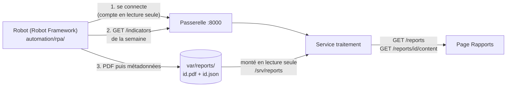

# Rapports automatiques : robot, dépôt, API et page (IA-07, FE-06)

Dernière mise à jour : 10/11/2026 · Décision : [ADR-019](../01-architecture/adr/ADR-019-rpa-automatisation.md) · Contrat : `GET /api/v1/reports` et `GET /api/v1/reports/{report_id}/content` (**Proposition**, à relire par Daddy)

Abréviations : RPA (Robotic Process Automation, automatisation robotisée des processus), PDF (Portable Document Format), API (Application Programming Interface), SHA-256 (Secure Hash Algorithm, empreinte de 256 bits), UTC (Temps universel coordonné), ISO (norme de numérotation des semaines).

## 1. La chaîne

Un robot produit chaque semaine un rapport PDF, le **dépose** dans un dossier, et la page « Rapports » du front-end le liste et le télécharge. L'API ne reçoit jamais le rapport du robot : elle le **lit** dans le dossier.

| Élément | Où | Rôle |
|---|---|---|
| Robot | `automation/rpa/` (`rapport_hebdomadaire.robot`, paquet `rapport/`) | lit l'API, assemble le PDF, le dépose, notifie |
| Dépôt | `var/reports/` (non versionné) | deux fichiers par rapport, plus `notifications.log` |
| API | `services/traitement/app/api/v1/reports.py` | liste paginée et téléchargement, en lecture seule |
| Page | `frontend/src/features/reports/` | liste, taille, empreinte, bouton « Télécharger » |

## 2. Le dépôt : deux fichiers par rapport

| Fichier | Contenu | Écrit |
|---|---|---|
| `<report_id>.pdf` | le rapport | **en premier** |
| `<report_id>.json` | métadonnées du contrat (`report_id`, `title`, `period_start`, `period_end`, `generated_at`, `file_name`, `size_bytes`, `content_type`, `sha256`) | **en dernier** |

Règles de l'API :

| Règle | Pourquoi |
|---|---|
| Un rapport n'existe que si ses métadonnées sont valides **et** son PDF présent | un rapport listé est toujours téléchargeable |
| Métadonnées invalides, au nom d'un autre rapport, ou sans PDF : ignorées | un fichier mal formé ne casse pas la liste |
| `file_name` : lettres, chiffres, `.`, `_`, `-`, espace ; ni guillemet ni barre | il devient l'en-tête `Content-Disposition` |
| Le chemin du PDF est construit depuis un UUID analysé | aucune lecture hors du dossier (`../` donne 404 ou 422) |
| Au téléchargement : taille et empreinte SHA-256 vérifiées | un fichier modifié après le dépôt répond 500, jamais servi |
| Sans `REPORTS_DIR` : 503 `UPSTREAM_UNAVAILABLE`, après la validation de la requête | comme une base non configurée |

Tri : `generated_at` décroissant, puis `report_id`. Pagination par curseur (`limit` de 1 à 500, 100 par défaut).

## 3. Le robot

La partie API de l'[ADR-019](../01-architecture/adr/ADR-019-rpa-automatisation.md) (plan de repli du § 6). **L'étape d'interface (capture du tableau de bord) n'est pas faite.**

| Étape | Mot-clé Robot Framework | Détail |
|---|---|---|
| Période | `Choisir la période` | semaine ISO précédente (lundi 00:00 UTC inclus au lundi suivant exclu), ou `--debut` / `--fin` |
| Connexion | `Se connecter` | compte `rpa-rapport` en **lecture seule**, mot de passe lu dans l'environnement ; le jeton reste dans la bibliothèque |
| Lecture | `Lire les indicateurs` | fenêtres de 5 minutes de la période, pages de 500, plafond de 200 pages (annoncé dans le rapport) |
| Synthèse | `Résumer` | par tronçon : fenêtres, ratio de vitesse moyen, part de congestion et de ralentissement |
| PDF | `Assembler le rapport` | PDF 1.4 écrit en bibliothèque standard, accents compris |
| Dépôt | `Déposer le rapport` | écriture atomique ; **même période = même identifiant** (UUID v5) : relancer remplace, ne duplique pas |
| Notification | `Notifier` | ligne JSON dans `var/reports/notifications.log` (équivalent local d'un courriel) ; une ligne `ERREUR` si le robot échoue |

Le rapport dit que les données sont **simulées** quand leur source l'est, liste les scénarios et exécutions lus, et signale une lecture tronquée ou une période vide. Le robot ne commande aucun équipement et ne modifie aucune donnée.

### Lancer

| Action | Linux (bash) | Windows (PowerShell) |
|---|---|---|
| Installer Robot Framework (facultatif) | `pip install -r automation/rpa/requirements.txt` | `py -3 -m pip install -r automation\rpa\requirements.txt` |
| Créer le compte de service (une fois ; mot de passe = celui de `.env`) | `python3 scripts/dev/dev.py user-create rpa-rapport --role viewer` | `py -3 scripts/dev/dev.py user-create rpa-rapport --role viewer` |
| Produire le rapport | `python3 scripts/dev/dev.py rpa-report` | `py -3 scripts/dev/dev.py rpa-report` |
| Une période précise | `python3 scripts/dev/dev.py rpa-report --debut 2026-10-19` | `py -3 scripts/dev/dev.py rpa-report --debut 2026-10-19` |
| Sans Robot Framework | ajouter `--sans-robot` | ajouter `--sans-robot` |
| Tests du robot | `python3 -m unittest discover -s automation/rpa/tests -t automation/rpa` | `py -3 -m unittest discover -s automation\rpa\tests -t automation\rpa` |

Le compte vient de `NOVARIA_RPA_USER` et `NOVARIA_RPA_PASSWORD` (variables d'environnement ou `.env`, jamais un argument de ligne de commande). `init-env` génère le mot de passe ; créer le compte avec **ce même mot de passe**. Journaux de Robot Framework : `var/rpa/log.html`.

`docker compose` monte `./var/reports` dans le service de traitement ; `dev.py up` crée ce dossier avant de démarrer (sans lui, Docker le créerait au nom de root).

## 4. Preuves

| Preuve | Contenu |
|---|---|
| `services/traitement/tests/unit/test_report_store.py` | tri, validité des métadonnées (10 cas refusés), PDF sans métadonnées, intégrité (taille, empreinte), pagination, chemin jamais hors du dossier |
| `services/traitement/tests/contract/test_reports_contract.py` | réponses valides contre `Report` et `ReportPage`, paramètres du contrat, téléchargement octet pour octet avec `Content-Disposition`, 401, 404, 422, 500 sans chemin, 503, lecture seule, audit |
| `automation/rpa/tests/` | période ISO, PDF (table `xref`, longueurs, pages, accents relus par `pdftotext`), synthèse, client de l'API (aucun secret dans les erreurs), dépôt (ordre PDF puis métadonnées, remplacement, droits 0644, métadonnées acceptées par le validateur de l'API), chaîne et ligne de commande |
| `automation/rpa/tests/test_robot.py` | la **suite Robot Framework** contre une fausse API HTTP : rapport déposé ; **aucun secret dans `output.xml` ni `log.html`** ; échec de connexion : suite en échec et notification d'erreur |
| `scripts/dev/test_dev.py` | commande `rpa-report` : arguments, compte lu dans `.env`, aucun mot de passe en argument |

### Essai de bout en bout sur la pile Docker (10/11/2026, Linux)

| Étape | Résultat |
|---|---|
| Avant le robot | `GET /api/v1/reports` : 200, `{"items": [], "next_cursor": null}` (la route répondait 404 avant ce changement) |
| `dev.py rpa-report --debut 2026-10-19` | suite Robot Framework **PASS** ; rapport `rapport-hebdomadaire-2026-S43.pdf`, 6 755 octets, 24 tronçons, 1 488 fenêtres ; ligne `INFO` dans `notifications.log` |
| `GET /api/v1/reports` | le rapport apparaît, avec ses métadonnées |
| `GET /api/v1/reports/<id>/content` | 200, `application/pdf`, `content-disposition: attachment; filename="rapport-hebdomadaire-2026-S43.pdf"` ; taille et SHA-256 identiques aux métadonnées |
| Relance la même semaine | toujours **1** rapport dans la liste (même identifiant, `generated_at` mis à jour) |
| Mauvais mot de passe | suite en **FAIL** (`connexion : réponse 401 (INVALID_CREDENTIALS)`) ; ligne `ERREUR` dans `notifications.log` ; le mot de passe n'apparaît nulle part |
| Page dans Chrome (session ouverte par un compte de lecture) | le rapport est listé ; le clic sur « Télécharger » enregistre `rapport-hebdomadaire-2026-S43.pdf` dont l'empreinte est celle affichée par la page (`664af6fce0f6…`) |

Captures (`docs/Capture d'ecran/`) : [`FE-06-API-01-liste-bureau.png`](../Capture%20d'ecran/FE-06-API-01-liste-bureau.png), [`FE-06-API-02-pdf-telecharge.png`](../Capture%20d'ecran/FE-06-API-02-pdf-telecharge.png) (première page du PDF téléchargé), [`FE-06-API-03-mobile-360.png`](../Capture%20d'ecran/FE-06-API-03-mobile-360.png), [`FE-06-API-04-theme-sombre.png`](../Capture%20d'ecran/FE-06-API-04-theme-sombre.png).

## 5. Limites

| Limite | Conséquence |
|---|---|
| **Contrat en Proposition** | les deux routes et le schéma `Report` ne sont pas encore relus par Daddy ; le dépôt par fichiers est une décision de cette tranche (équivalent local d'un seau S3, [ADR-025](../01-architecture/adr/ADR-025-equivalents-locaux-des-services-aws.md)), à confirmer |
| Pas de planification | le robot se lance à la main (`rpa-report`) ; la tâche « planification hebdomadaire » d'IA-07 (cron, Planificateur de tâches Windows) reste à faire |
| Pas d'étape d'interface | la capture du tableau de bord (la seule vraie étape de RPA) n'existe pas ; le robot est un automate d'API |
| Notification simulée | un fichier de journal, pas un courriel |
| Données simulées | le rapport de l'essai agrège les trois exécutions de la semaine du 19/10/2026 (calme, pointe, essai de liaison) : il décrit le simulateur, pas un trafic |
| Liste lue à chaque requête | l'API parcourt le dossier à chaque appel ; sans effet à quelques rapports, à revoir au-delà de quelques milliers |
| Windows et macOS | non vérifiés (essai sous Linux) ; sous Windows, les droits POSIX du dépôt (0644) n'existent pas |
| Le front n'a pas de rôle propre | tout compte `viewer` voit tous les rapports |
