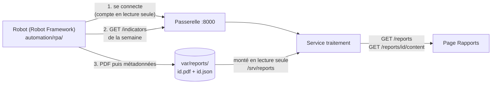

# Rapports automatiques : robot, dépôt, API et page (IA-07, FE-06)

Dernière mise à jour : 12/11/2026 · Décision : [ADR-019](../01-architecture/adr/ADR-019-rpa-automatisation.md) · Contrat : `GET /api/v1/reports` et `GET /api/v1/reports/{report_id}/content` (**Proposition**, à relire par Daddy)

Abréviations : RPA (Robotic Process Automation, automatisation robotisée des processus), PDF (Portable Document Format), API (Application Programming Interface), SMTP (Simple Mail Transfer Protocol, protocole d'envoi de courrier), STARTTLS (passage d'une connexion SMTP en connexion chiffrée), SHA-256 (Secure Hash Algorithm, empreinte de 256 bits), UTC (Temps universel coordonné), ISO (norme de numérotation des semaines).

## 1. La chaîne

Un robot produit chaque semaine un rapport PDF, le **dépose** dans un dossier, et la page « Rapports » du front-end le liste et le télécharge. L'API ne reçoit jamais le rapport du robot : elle le **lit** dans le dossier.

| Élément | Où | Rôle |
|---|---|---|
| Robot | `automation/rpa/` (`rapport_hebdomadaire.robot`, paquet `rapport/`) | lit l'API, assemble le PDF, le dépose, notifie |
| Dépôt | `var/reports/` (non versionné) | deux fichiers par rapport, plus `notifications.log` |
| API | `services/traitement/app/api/v1/reports.py` | liste paginée et téléchargement, en lecture seule |
| Page | `frontend/src/features/reports/` | liste, taille, empreinte, bouton « Télécharger » |

## 2. Le dépôt : deux fichiers par rapport

| Fichier | Contenu | Écrit |
|---|---|---|
| `<report_id>.pdf` | le rapport | **en premier** |
| `<report_id>.json` | métadonnées du contrat (`report_id`, `title`, `period_start`, `period_end`, `generated_at`, `file_name`, `size_bytes`, `content_type`, `sha256`) | **en dernier** |

Règles de l'API :

| Règle | Pourquoi |
|---|---|
| Un rapport n'existe que si ses métadonnées sont valides **et** son PDF présent | un rapport listé est toujours téléchargeable |
| Métadonnées invalides, au nom d'un autre rapport, ou sans PDF : ignorées | un fichier mal formé ne casse pas la liste |
| `file_name` : lettres, chiffres, `.`, `_`, `-`, espace ; ni guillemet ni barre | il devient l'en-tête `Content-Disposition` |
| Le chemin du PDF est construit depuis un UUID analysé | aucune lecture hors du dossier (`../` donne 404 ou 422) |
| Au téléchargement : taille et empreinte SHA-256 vérifiées | un fichier modifié après le dépôt répond 500, jamais servi |
| Sans `REPORTS_DIR` : 503 `UPSTREAM_UNAVAILABLE`, après la validation de la requête | comme une base non configurée |

Tri : `generated_at` décroissant, puis `report_id`. Pagination par curseur (`limit` de 1 à 500, 100 par défaut).

## 3. Le robot

La partie API de l'[ADR-019](../01-architecture/adr/ADR-019-rpa-automatisation.md) (plan de repli du § 6). **L'étape d'interface (capture du tableau de bord) n'est pas faite.**

| Étape | Mot-clé Robot Framework | Détail |
|---|---|---|
| Période | `Choisir la période` | semaine ISO précédente (lundi 00:00 UTC inclus au lundi suivant exclu), ou `--debut` / `--fin` |
| Connexion | `Se connecter` | compte `rpa-rapport` en **lecture seule**, mot de passe lu dans l'environnement ; le jeton reste dans la bibliothèque |
| Lecture | `Lire les indicateurs` | fenêtres de 5 minutes de la période, pages de 500, plafond de 200 pages (annoncé dans le rapport) |
| Synthèse | `Résumer` | par tronçon : fenêtres, ratio de vitesse moyen, part de congestion et de ralentissement |
| PDF | `Assembler le rapport` | PDF 1.4 écrit en bibliothèque standard, accents compris |
| Dépôt | `Déposer le rapport` | écriture atomique ; **même période = même identifiant** (UUID v5) : relancer remplace, ne duplique pas |
| Notification | `Notifier` | ligne JSON dans `var/reports/notifications.log` ; **courriel en plus** si `NOVARIA_RPA_SMTP` est défini (section 6) ; une ligne `ERREUR` (et un courriel) si le robot échoue |
| Reprises | dans `Se connecter` et `Lire les indicateurs` | si l'API est occupée (injoignable, délai, 429, 502, 503, 504) : **3 tentatives**, attente de 60 s doublée à chaque échec ; un refus (401, 404, 422) échoue tout de suite (section 7) |

Le rapport dit que les données sont **simulées** quand leur source l'est, liste les scénarios et exécutions lus, et signale une lecture tronquée ou une période vide. Le robot ne commande aucun équipement et ne modifie aucune donnée.

### Lancer

| Action | Linux (bash) | Windows (PowerShell) |
|---|---|---|
| Installer Robot Framework (facultatif) | `pip install -r automation/rpa/requirements.txt` | `py -3 -m pip install -r automation\rpa\requirements.txt` |
| Créer le compte de service (une fois ; mot de passe = celui de `.env`) | `python3 scripts/dev/dev.py user-create rpa-rapport --role viewer` | `py -3 scripts/dev/dev.py user-create rpa-rapport --role viewer` |
| Produire le rapport | `python3 scripts/dev/dev.py rpa-report` | `py -3 scripts/dev/dev.py rpa-report` |
| Une période précise | `python3 scripts/dev/dev.py rpa-report --debut 2026-10-19` | `py -3 scripts/dev/dev.py rpa-report --debut 2026-10-19` |
| **Planifier chaque semaine** (section 5) | `python3 scripts/dev/dev.py rpa-planifier` ou `make rpa-planifier` | `py -3 scripts/dev/dev.py rpa-planifier` |
| Sans Robot Framework | ajouter `--sans-robot` | ajouter `--sans-robot` |
| Tests du robot | `python3 -m unittest discover -s automation/rpa/tests -t automation/rpa` | `py -3 -m unittest discover -s automation\rpa\tests -t automation\rpa` |

Le compte vient de `NOVARIA_RPA_USER` et `NOVARIA_RPA_PASSWORD`, les reprises et le courriel de `NOVARIA_RPA_TENTATIVES`, `NOVARIA_RPA_ATTENTE_S`, `NOVARIA_RPA_SMTP` et suivantes (variables d'environnement ou `.env`, jamais un argument de ligne de commande ; l'environnement du shell prime sur `.env`). `init-env` génère le mot de passe ; créer le compte avec **ce même mot de passe**. Journaux de Robot Framework : `var/rpa/log.html`.

`docker compose` monte `./var/reports` dans le service de traitement ; `dev.py up` crée ce dossier avant de démarrer (sans lui, Docker le créerait au nom de root).

## 4. Une nouvelle semaine : où le robot cherche sa période

Le robot rapporte la **semaine ISO précédente en UTC** (lundi 00:00 inclus au lundi suivant exclu). Il ne peut donc pas tourner avant le lundi 00:00 UTC : à 07:00 heure locale, l'heure convient aux fuseaux de UTC-12 à UTC+7. Au-delà (Lundi 07:00 à UTC+14 est encore dimanche en UTC), le planificateur **refuse** le créneau et le fichier `cron` le dit.

## 5. La planification hebdomadaire (IA-07)

Trois façons de lancer **la même commande**, `dev.py rpa-report`. Dans chacune, personne n'a rien à faire : le poste (pile démarrée) produit le rapport de la semaine précédente.

| Moyen | Mise en place | Retrait |
|---|---|---|
| **Linux : `cron`** (chaque lundi 07:00) | remplacer `/CHEMIN/VERS/novaria-core` dans `automation/rpa/planification/novaria-rapport.cron`, puis `crontab -e` et coller la ligne | `crontab -e`, supprimer la ligne |
| **Windows : Planificateur de tâches** | `powershell -ExecutionPolicy Bypass -File automation\rpa\planification\installer-tache-windows.ps1 -Heure 07:00` (tâche « Novaria Rapport », compte courant, session ouverte, **aucun mot de passe stocké**, `StartWhenAvailable` rattrape un poste éteint) | même script avec `-Supprimer` |
| **Portable : planificateur intégré** (aucun outil système) | `python3 scripts/dev/dev.py rpa-planifier` (Windows : `py -3 ...`), au premier plan, Ctrl+C l'arrête ; options `--jour`, `--heure`, `--sans-rattrapage` | arrêter le processus |

Le **planificateur intégré** (`automation/rpa/rapport/planificateur.py`) attend le prochain créneau (lundi 07:00, heure du poste, par pas de 30 s : une veille ou une horloge corrigée ne le décale pas), lance la commande, journalise, recommence. **Au démarrage, si le rapport de la dernière semaine n'est pas déposé, il le produit tout de suite** (rattrapage). Relancer est sans effet de bord : un rapport par semaine.

| Cible AWS (non exécutée) | Équivalent local |
|---|---|
| EventBridge Scheduler lance une tâche ECS (Elastic Container Service) | `cron`, Planificateur de tâches ou `rpa-planifier` ([ADR-025](../01-architecture/adr/ADR-025-equivalents-locaux-des-services-aws.md)) |
| Nouvelle tentative du déclencheur, puis alarme | reprises du robot (section 7), ligne `ERREUR`, code de sortie 1 |
| Courriel via un service de messagerie (SNS, SES) | courriel SMTP facultatif (section 6) |

## 6. La notification

Toujours : une ligne JSON dans `var/reports/notifications.log` (`INFO` rapport déposé, `ERREUR` rapport non produit, `AVERTISSEMENT` courriel impossible). **En plus**, un courriel si `NOVARIA_RPA_SMTP` est défini : un message court (niveau, nom du rapport), **sans pièce jointe et sans donnée du rapport**.

| Règle | Détail |
|---|---|
| Désactivé par défaut | sans `NOVARIA_RPA_SMTP`, aucun courriel ne part |
| Réglages par l'environnement | `NOVARIA_RPA_SMTP` (`hôte:port`), `NOVARIA_RPA_DESTINATAIRE` (une seule adresse), `NOVARIA_RPA_EXPEDITEUR` ; compte facultatif : `NOVARIA_RPA_SMTP_UTILISATEUR` et `NOVARIA_RPA_SMTP_MOT_DE_PASSE` ([secrets](../04-devsecops/secrets.md), L14) |
| Chiffrement | un serveur **hors de la machine** doit offrir STARTTLS (exigé) ; seul un serveur local d'essai (127.0.0.1) se parle en clair ; **un compte n'est jamais présenté sur un canal en clair** |
| Injection d'en-tête | adresses validées (une seule, sans saut de ligne) ; sujet ramené à une ligne |
| Un courriel impossible ne fait jamais échouer le rapport | une ligne `AVERTISSEMENT` est écrite, sans secret ni contenu |

## 7. Les reprises

ADR-019 : « nouvelle tentative limitée, puis notification d'erreur ». Seule une indisponibilité **passagère** est rejouée : API injoignable, délai dépassé, réponses 429, 502, 503, 504. Un mot de passe refusé (401), une route absente (404) ou une requête invalide (422) échouent **tout de suite** : les rejouer masquerait une panne de configuration. Par défaut 3 tentatives, attente de 60 s doublée à chaque échec (`NOVARIA_RPA_TENTATIVES` de 1 à 10, `NOVARIA_RPA_ATTENTE_S` de 0 à 3 600). Après la dernière, l'erreur est notée (`ERREUR`, courriel) et le code de sortie vaut 1.

## 8. Preuves

| Preuve | Contenu |
|---|---|
| `services/traitement/tests/unit/test_report_store.py` | tri, validité des métadonnées (10 cas refusés), PDF sans métadonnées, intégrité (taille, empreinte), pagination, chemin jamais hors du dossier |
| `services/traitement/tests/contract/test_reports_contract.py` | réponses valides contre `Report` et `ReportPage`, paramètres du contrat, téléchargement octet pour octet avec `Content-Disposition`, 401, 404, 422, 500 sans chemin, 503, lecture seule, audit |
| `automation/rpa/tests/` | période ISO, PDF (table `xref`, longueurs, pages, accents relus par `pdftotext`), synthèse, client de l'API (aucun secret dans les erreurs), dépôt (ordre PDF puis métadonnées, remplacement, droits 0644, métadonnées acceptées par le validateur de l'API), chaîne et ligne de commande |
| `automation/rpa/tests/test_robot.py` | la **suite Robot Framework** contre une fausse API HTTP : rapport déposé ; **aucun secret dans `output.xml` ni `log.html`** ; échec de connexion : suite en échec et notification d'erreur |
| `scripts/dev/test_dev.py` | commandes `rpa-report` et `rpa-planifier` : arguments, compte et courriel lus dans `.env`, aucun mot de passe en argument |
| `automation/rpa/tests/test_planificateur.py` | créneaux (jour, heure pile, heure d'été, fuseau du poste), horaires refusés (lundi 07:00 à UTC+14), rattrapage, attente par pas de 30 s, boucle avec une horloge simulée |
| `automation/rpa/tests/test_planification.py` | la ligne `cron` (5 champs valides, commande, journal sous `var/`, aucun secret) et le script Windows (déclencheur hebdomadaire, `StartWhenAvailable`, aucun mot de passe, syntaxe PowerShell si `pwsh` est installé) |
| `automation/rpa/tests/test_reprises.py` | seule une erreur transitoire est rejouée, l'attente double, 3 tentatives puis l'erreur, un refus échoue tout de suite, chaîne entière contre une API qui redémarre |
| `automation/rpa/tests/test_courriel.py`, `test_notification.py` | réglages stricts, STARTTLS hors de la machine, compte jamais en clair, aucun secret dans les erreurs, un vrai serveur SMTP local reçoit le message, un courriel impossible ne fait pas échouer le rapport |
| `automation/rpa/tests/test_robot.py` | en plus : une API qui renvoie deux 503 donne quand même le rapport ; le mot de passe du courriel n'entre dans aucun journal |

### Essai de planification sans intervention (12/11/2026, Linux, pile Docker locale)

Transcription brute : [`automation/rpa/preuves/planification-2026-11-12.txt`](../../automation/rpa/preuves/planification-2026-11-12.txt). Compte de service d'essai en lecture seule (mot de passe aléatoire, jamais écrit, supprimé ensuite) ; courriels reçus par un **serveur SMTP d'essai local** : aucun courriel réel.

| Étape | Résultat |
|---|---|
| `dev.py rpa-planifier --jour jeudi --heure 17:50 --executions 2`, puis plus rien à faire | **17:48:35** : le rapport de la semaine précédente (S45) manque, le planificateur le produit seul (rattrapage), suite Robot **PASS** ; **17:50:00** : il se déclenche au créneau, suite **PASS** |
| `GET /api/v1/reports` | S45 et S43 listés ; téléchargement du PDF : taille et **SHA-256 conformes** aux métadonnées ; un seul S45 (même identifiant : la relance remplace) |
| Journal de notifications | pour chaque lancement : « Rapport déposé » puis « courriel envoyé » |
| Courriels | 2 messages `rapport hebdomadaire déposé`, sans pièce jointe ni donnée |
| Échec volontaire (`--api http://127.0.0.1:9`, API injoignable) | tentatives 1/3 et 2/3 (attentes de 1 s et 2 s), puis `Échec`, code de sortie **1**, ligne `ERREUR` au journal, courriel `NON produit` |
| Secrets | **0** occurrence du mot de passe dans `output.xml`, `log.html`, le journal, les courriels, la sortie du planificateur |

**Le rapport S45 de cet essai est vide** : le simulateur n'a produit aucun indicateur du 02 au 08/11/2026 ; le rapport le dit (« Aucun indicateur n'existe sur cette période »). Il a été retiré après l'essai. Le rapport S43 (essai de FE-06) contient, lui, des données.

### Essai de bout en bout sur la pile Docker (10/11/2026, Linux)

| Étape | Résultat |
|---|---|
| Avant le robot | `GET /api/v1/reports` : 200, `{"items": [], "next_cursor": null}` (la route répondait 404 avant ce changement) |
| `dev.py rpa-report --debut 2026-10-19` | suite Robot Framework **PASS** ; rapport `rapport-hebdomadaire-2026-S43.pdf`, 6 755 octets, 24 tronçons, 1 488 fenêtres ; ligne `INFO` dans `notifications.log` |
| `GET /api/v1/reports` | le rapport apparaît, avec ses métadonnées |
| `GET /api/v1/reports/<id>/content` | 200, `application/pdf`, `content-disposition: attachment; filename="rapport-hebdomadaire-2026-S43.pdf"` ; taille et SHA-256 identiques aux métadonnées |
| Relance la même semaine | toujours **1** rapport dans la liste (même identifiant, `generated_at` mis à jour) |
| Mauvais mot de passe | suite en **FAIL** (`connexion : réponse 401 (INVALID_CREDENTIALS)`) ; ligne `ERREUR` dans `notifications.log` ; le mot de passe n'apparaît nulle part |
| Page dans Chrome (session ouverte par un compte de lecture) | le rapport est listé ; le clic sur « Télécharger » enregistre `rapport-hebdomadaire-2026-S43.pdf` dont l'empreinte est celle affichée par la page (`664af6fce0f6…`) |

Captures (`docs/Capture d'ecran/`) : [`FE-06-API-01-liste-bureau.png`](../Capture%20d'ecran/FE-06-API-01-liste-bureau.png), [`FE-06-API-02-pdf-telecharge.png`](../Capture%20d'ecran/FE-06-API-02-pdf-telecharge.png) (première page du PDF téléchargé), [`FE-06-API-03-mobile-360.png`](../Capture%20d'ecran/FE-06-API-03-mobile-360.png), [`FE-06-API-04-theme-sombre.png`](../Capture%20d'ecran/FE-06-API-04-theme-sombre.png).

## 5. Limites

| Limite | Conséquence |
|---|---|
| **Contrat en Proposition** | les deux routes et le schéma `Report` ne sont pas encore relus par Daddy ; le dépôt par fichiers est une décision de cette tranche (équivalent local d'un seau S3, [ADR-025](../01-architecture/adr/ADR-025-equivalents-locaux-des-services-aws.md)), à confirmer |
| **`cron` et Planificateur de tâches non éprouvés en réel** | la ligne `cron` et le script Windows sont vérifiés par des tests (syntaxe, commande, absence de secret), **pas exécutés** par `cron` ni par Windows ; la preuve « sans intervention » est celle du planificateur intégré. Le poste doit être allumé et la pile démarrée à l'heure dite (le rattrapage de `rpa-planifier` et `StartWhenAvailable` couvrent un poste éteint, le `cron` non) |
| Pas d'étape d'interface | la capture du tableau de bord (la seule vraie étape de RPA) n'existe pas ; le robot est un automate d'API |
| Courriel éprouvé seulement contre un serveur d'essai local | aucun serveur réel (STARTTLS, compte) n'a été essayé : le code appelle `starttls` puis `login` (testé avec un faux client), **non vérifié** contre un vrai fournisseur |
| Données simulées | le rapport de l'essai agrège les trois exécutions de la semaine du 19/10/2026 (calme, pointe, essai de liaison) : il décrit le simulateur, pas un trafic |
| Liste lue à chaque requête | l'API parcourt le dossier à chaque appel ; sans effet à quelques rapports, à revoir au-delà de quelques milliers |
| Windows et macOS | non vérifiés (essai sous Linux) ; sous Windows, les droits POSIX du dépôt (0644) n'existent pas ; la syntaxe PowerShell du script n'a pas été vérifiée par `pwsh` ici |
| Planificateur intégré au premier plan | un processus à garder ouvert (terminal, `tmux`, service) ; pas de supervision ni de redémarrage automatique |
| Fuseau et heure d'été | le créneau est calculé à l'heure du poste, jour visé compris (testé pour un changement d'heure) ; une horloge qui saute pendant l'attente est rattrapée au pas de 30 s |
| Le front n'a pas de rôle propre | tout compte `viewer` voit tous les rapports |
