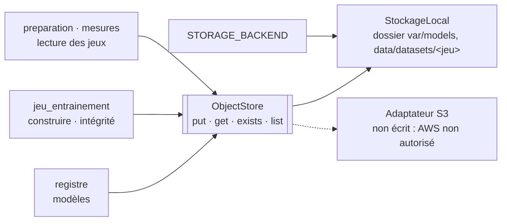

# Stockage d'objets : le port `ObjectStore`, son adaptateur local et le test d'absence de SDK AWS (LOC-05)

| Champ | Valeur |
|---|---|
| Issue | #152 (LOC-05) |
| Décisions | [ADR-025](../01-architecture/adr/ADR-025-equivalents-locaux-des-services-aws.md) (équivalents locaux, ports et adaptateurs), [ADR-023](../01-architecture/adr/ADR-023-execution-locale-d-abord.md) (aucune ressource AWS), [ADR-010](../01-architecture/adr/ADR-010-architecture-hexagonale.md) |
| Code | [`ml/src/stockage/`](../../ml/src/stockage/objets.py) |
| Tests | [`ml/tests/test_stockage.py`](../../ml/tests/test_stockage.py), [`ml/tests/test_absence_sdk_aws.py`](../../ml/tests/test_absence_sdk_aws.py) |
| Lien | [Remplacer AWS en local](../05-cloud-aws/remplacer-aws-en-local.md) |

Abréviations : S3 (Simple Storage Service, stockage d'objets d'AWS), AWS (Amazon Web Services), SDK (Software Development Kit, kit de développement), CI (Continuous Integration, intégration continue), SHA (Secure Hash Algorithm).

## 1. En bref

**Critère de l'issue** : « le stockage des modèles et des jeux de données passe par le port ; le test d'absence de SDK AWS est vert ».

| Ce qui est demandé | Résultat | Où |
|---|---|---|
| Port `ObjectStore` (écrire, lire, lister) | **Fait** : `put`, `get`, `exists`, `list` | section 2 |
| Adaptateur local, `STORAGE_BACKEND=local` | **Fait** : un dossier ; toute autre valeur est refusée | sections 2 et 3 |
| Les modèles passent par le port | **Fait** (déjà le cas depuis IA-04 ; le port a été sorti du registre et complété) | section 4 |
| Les jeux de données passent par le port | **Fait** : construction, vérification d'intégrité et lecture | section 4 |
| Test qui échoue si un SDK AWS est importé | **Fait**, vert ; essayé en introduisant `import boto3`, puis une dépendance `boto3` : le test échoue, puis le retrait le rend vert | section 5 |
| Relire la table de l'ADR-025 | **Fait** : écarts corrigés | section 6 |

**Écart avec l'énoncé de l'issue.** L'issue parle de `backend/` ; ce dossier n'existe pas. Les services sont dans `services/`, et les modèles et jeux de données dans `ml/`. Le port est donc dans `ml/src/stockage/` (là où sont les modèles et les jeux), et le test d'absence de SDK regarde tout le code (`services/`, `ml/`, `simulator/`, `data/`, `automation/`, `gateway/`, `scripts/`, `frontend/`). Il est dans `ml/tests/` plutôt que dans `scripts/dev/` parce que la CI lance `ml/tests/` (job `ml`) et ne lance pas `scripts/dev/`.

## 2. Le port

| Opération | Effet |
|---|---|
| `put(cle, octets, remplacer=False)` | Écrit et rend le SHA-256. Une clé déjà écrite **n'est jamais réécrite** (`ObjetDejaEcrit`), sauf `remplacer=True` (le pointeur « en service » seulement) |
| `get(cle)` | Rend les octets ; `ObjetAbsent` si la clé n'existe pas |
| `exists(cle)` | Vrai si la clé existe |
| `list(prefixe="")` | Les clés qui commencent par le préfixe, triées (comme `ListObjectsV2` de S3). Un préfixe n'est pas un dossier : `run-1/mo` trouve `run-1/modele.json` |

Pas de `delete` : le projet n'en a pas besoin (objets versionnés immuables).

| Règle de l'adaptateur local | Raison |
|---|---|
| Clés relatives strictes : segments en minuscules, chiffres, `.`, `-`, `_` ; quatre segments au plus ; jamais `..` ni chemin absolu | Aucune clé ne sort du dossier. Sur un système de fichiers qui ignore la casse, `A/b` et `a/b` seraient le même objet |
| Majuscules permises **sur demande** (`majuscules=True`), pour les jeux de données (`PROVENANCE.md`) | Nom de fichier déjà établi |
| Écriture atomique (fichier temporaire, `fsync`, lien dur), fichiers en lecture seule | Jamais de fichier à moitié écrit ni d'écrasement |
| Taille maximale : 16 Mio (modèles), 256 Mio (jeux) | Un fichier Parquet du jeu v1 pèse 11 Mo |
| `list` ignore les liens symboliques, les fichiers d'écriture en cours et les noms hors règle ; refuse un préfixe avec `..`, `//` ou `/` initial ; s'arrête au-delà de 10 000 clés | Ce que `list` rend, `get` peut le lire |

## 3. Choisir l'adaptateur : `STORAGE_BACKEND`

| Valeur | Effet |
|---|---|
| absente ou `local` | Dossier local |
| toute autre (`s3`, `seaweedfs`, vide) | Erreur de configuration : « seul « local » existe ; S3 est documenté, non exécuté » |

La variable est déclarée dans `.env.example` (aucun secret). La ligne de commande du registre rend le code de sortie 2 sur une valeur inconnue.

## 4. Ce qui passe par le port

| Donnée | Dossier | Passage |
|---|---|---|
| Modèles et manifestes (`model_runs`, pointeur « en service ») | `var/models/` (ignoré par Git) | `registre` : enregistrer, charger, lignée |
| Jeu d'entraînement : fichiers Parquet, `manifest.json`, `PROVENANCE.md` | `data/datasets/<jeu>/` | `jeu_entrainement.construire` (écriture), `integrite.verifier` (SHA-256 et fichiers en trop), `preparation.donnees` et `mesures.reference` (lecture) |
| Sauvegardes des bases | `backups/` | **Pas encore** : `pg_dump` et `mongodump` écrivent directement |
| Rapports hebdomadaires du robot | `var/reports/` | **Pas encore** : le robot écrit, `traitement` lit en lecture seule |

**Ce qui change pour le jeu.** Un jeu est un objet versionné : reconstruire un jeu **identique** est sans effet (les octets sont comparés) ; reconstruire dans un dossier qui contient un **autre** contenu est refusé. Pour changer un jeu, on supprime son dossier ou on crée une nouvelle version. Les fichiers d'un jeu construit sont en lecture seule.

## 5. Le test d'absence de SDK AWS

`ml/tests/test_absence_sdk_aws.py`, bibliothèque standard seulement. Il échoue si l'un de ces éléments apparaît dans les dossiers surveillés :

| Forme | Exemples |
|---|---|
| Importation Python (y compris `__import__("x")` et `importlib.import_module("x")`) | `import boto3`, `from botocore import …`, `s3fs`, `sagemaker`, `aws_cdk…`, `moto`, `localstack` |
| Dépendance Python déclarée | `requirements*.txt` et `.in`, `pyproject.toml`, `setup.cfg` |
| Importation ou dépendance JavaScript | `@aws-sdk/*`, `aws-sdk`, `aws-cdk-lib`, `@smithy/*`, dans le code et dans `package.json` |
| Installation par un script | `pip install boto3` dans un `Dockerfile` ou un script shell |

Il ne regarde pas : `infra/` (Terraform nomme le fournisseur AWS, cible documentée), `.github/` (`deploy.yml`, inactif), `docs/`, ni le texte des chaînes et des commentaires.

Il a ses propres tests : les formes d'importation Python, JavaScript, les dépendances et les installations sont détectées ; des noms voisins qui ne le sont pas (`botox`, `from . import boto3`), les dossiers d'environnements ignorés. Une liste d'exceptions (`EXCEPTIONS`) est vide : le jour où l'adaptateur S3 sera autorisé, il sera le seul fichier à y figurer, avec son ADR.

## 6. Relecture de la table de l'ADR-025

Écarts constatés le 13/11/2026 et corrigés dans l'ADR :

| Ligne | Écart | Correction |
|---|---|---|
| S3 | La table disait « dossier `var/` » ; en réalité modèles dans `var/models/`, jeux dans `data/datasets/<jeu>/`, sauvegardes et rapports **hors du port** | Précisé ; deux usages marqués « pas encore » (section 4) |
| ECR | « Étiquette = SHA du commit » ; en réalité le SHA est un **argument de construction** (`GIT_SHA`) lu par la sonde de santé, l'image n'est pas étiquetée au SHA | Corrigé ; l'étiquette au SHA sera nécessaire pour le retour de version (CLD-16) |
| CloudWatch | `/metrics` annoncé pour les services (MS-16) ; en réalité seul `traitement` l'expose | Précisé |
| Vérification | « Recherche de `boto3` relancée le 27/10/2026 » ; la recherche est maintenant un test automatique de la CI | Remplacé par le test |

Les autres lignes (Docker Compose, PostgreSQL, MongoDB, Kafka, SageMaker, Glue, Secrets Manager, IAM, EventBridge, VPC) ont été relues contre le dépôt et sont exactes. EMR reste « à faire » (DAT-08, #83).

## 7. Lancer

| Action | Linux (bash) | Windows (PowerShell) |
|---|---|---|
| Tests du port | `python3 -m unittest tests.test_stockage` (depuis `ml/`) | `py -3 -m unittest tests.test_stockage` (depuis `ml\`) |
| Test d'absence de SDK AWS | `python3 -m unittest tests.test_absence_sdk_aws` | `py -3 -m unittest tests.test_absence_sdk_aws` |
| Toute la suite de `ml/` | `python3 -m unittest discover -s tests -t .` | `py -3 -m unittest discover -s tests -t .` |
| Reconstruire le jeu (sans effet s'il est identique) | `python3 ml/src/construire_jeu.py` | `py -3 ml/src/construire_jeu.py` |
| Vérifier le jeu | `python3 -m jeu_entrainement --verifier` (depuis `ml/src/`) | `py -3 -m jeu_entrainement --verifier` (depuis `ml\src\`) |

## 8. Preuves du 13/11/2026

| Contrôle | Résultat |
|---|---|
| Suite de `ml/` sans scikit-learn | 386 tests réussis, 27 ignorés (scikit-learn ou MongoDB absents) |
| Suite de `ml/` avec scikit-learn 1.9.1 | 386 tests réussis, 6 ignorés (MongoDB d'essai absent) ; couverture totale 95 % (seuil de la CI : 80 %), 100 % pour `stockage/objets.py` et `integrite.py` |
| Jeu v1 réel (11 Mo par fichier d'entraînement) | `python -m jeu_entrainement --verifier` : « Jeu intact » ; `construire_jeu.py` relancé : reconstruit à l'identique, sans erreur ni changement des fichiers suivis par Git |
| Test d'absence de SDK AWS sur le dépôt | Vert. Rouge avec `import boto3` ajouté dans `services/collecte/`, puis avec `boto3` ajouté à `ml/requirements.in` ; les deux ajouts ont été retirés |
| Tests de `dev.py` (`.env.example`, compose, secrets) | Réussis |

Non vérifié : Windows (`py -3`, droits de fichier en lecture seule, liens durs), la CI GitHub et SonarQube (les nombres ci-dessus sont locaux).

## 9. Choix à valider, écarts et limites

| Point | État |
|---|---|
| Une proposition d'ADR sur SeaweedFS existe sur la branche locale `docs/ADR-029-stockage-objets-seaweedfs` (non publiée). Son numéro 029 est déjà pris (passerelle) ; elle prévoit un adaptateur « compatible S3 » avec un client S3, que le test d'absence de SDK interdit | À décider à deux : renuméroter, et dire si l'adaptateur S3 aurait droit à l'exception, ou s'écrirait sans SDK |
| `delete` absent du port (la proposition SeaweedFS en prévoit un) | À décider si un adaptateur en a besoin |
| Sauvegardes et rapports hors du port | À faire si le critère « tout le stockage » est voulu |
| Un test d'absence de SDK ne prouve pas que le code marche sur AWS | Voulu : AWS n'est pas exécuté |
| Windows | Non vérifié |

## 10. Questions probables du jury

| Question | Réponse courte |
|---|---|
| Comment prouvez-vous que le code ne dépend pas d'AWS ? | Un test automatique, lancé par la CI, échoue si un SDK est importé, déclaré ou installé ; il a été vu échouer puis réussir (section 5) |
| Si AWS est autorisé demain ? | Un adaptateur de plus derrière `ObjectStore` ; la table de l'ADR-025 dit lequel. Il serait l'unique exception du test |
| Pourquoi pas `boto3` avec un serveur S3 local ? | Le test l'interdit : un SDK AWS reste un SDK AWS, même vers un serveur local. L'option est discutée, non décidée (section 9) |
| Que se passe-t-il si on reconstruit le jeu ? | Identique : sans effet. Différent : refus, une version ne se réécrit pas |
