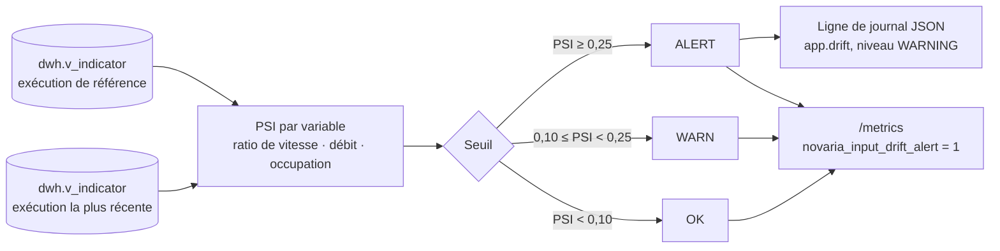

# Surveillance de la dérive des entrées (IA-06)

Dernière mise à jour : 10/11/2026 · Exigence : EXG-IA-05 · Décision : [ADR-017](../01-architecture/adr/ADR-017-mlops-mlsecops.md)

Abréviations : IA (intelligence artificielle), PSI (Population Stability Index, indice de stabilité de population), DWH (Data WareHouse, entrepôt de données), API (Application Programming Interface), UTC (Temps universel coordonné).

## 1. Ce que fait la surveillance

Un modèle de prévision apprend sur des données passées. Si les données reçues ensuite ne leur ressemblent plus (vitesses plus basses, débit plus fort), ses prévisions ne valent plus rien sans qu'aucune erreur ne le montre. La surveillance **compare la distribution des entrées de l'exécution la plus récente à celle d'une exécution de référence** (le jeu d'entraînement) et **alerte si elles s'écartent trop**.

Ce n'est **pas** un contrôle du modèle (il n'y en a pas encore : IA-10) mais de ses futures entrées. La référence est une exécution simulée choisie par `DRIFT_REFERENCE_RUN_ID`.

## 2. La méthode : le PSI

Pour chaque variable, les valeurs de référence sont coupées en 10 tranches de même effectif (les déciles). On compte la part des valeurs courantes dans chaque tranche :

`PSI = somme de (part courante − part de référence) × ln(part courante ÷ part de référence)`

| PSI | Lecture | État |
|---|---|---|
| < 0,10 | distributions stables | `OK` |
| 0,10 à 0,25 | décalage modéré | `WARN` |
| ≥ 0,25 | décalage important | `ALERT` |

Une variable au-dessus de 0,25 suffit à déclarer la dérive. Ce sont des valeurs de départ ([ADR-017](../01-architecture/adr/ADR-017-mlops-mlsecops.md) : « révisées après essai avec dérive simulée »).

| Règle | Valeur |
|---|---|
| Variables surveillées | `speed_ratio`, `flow_veh_per_min`, `occupancy_rate` (fenêtres d'une minute) |
| Valeurs minimales | 100 par variable et par exécution ; en dessous : `INSUFFICIENT_DATA`, jamais d'alerte |
| Valeurs vides | ignorées (route vide : pas de ratio de vitesse) |
| Plafond de lecture | 20 000 fenêtres par exécution, les plus récentes d'abord |
| Part minimale d'une tranche | 0,0001 (évite un logarithme infini quand une tranche est vide) |

Les états sans verdict : `NO_REFERENCE` (aucune référence configurée), `NO_DATA` (entrepôt vide), `INSUFFICIENT_DATA`. Aucun ne déclenche l'alerte.

## 3. Lancer le script

Prérequis : la pile Docker démarre (`up`) et l'entrepôt contient au moins deux exécutions.

| Action | Linux (bash) | Windows (PowerShell) |
|---|---|---|
| Comparer l'exécution la plus récente à une référence | `python3 scripts/dev/dev.py drift-check --reference-run <run_id>` | `py -3 scripts/dev/dev.py drift-check --reference-run <run_id>` |
| Raccourci | `make drift-check REF=<run_id>` | (`make` n'existe pas sous Windows) |
| Rapport JSON | ajouter `--json` | ajouter `--json` |
| Comparer deux exécutions précises | ajouter `--current-run <run_id>` | ajouter `--current-run <run_id>` |

| Code de sortie | Sens |
|---|---|
| 0 | stable, ou décalage modéré (`WARN`) |
| 1 | dérive : le seuil d'alerte est dépassé ; la ligne d'alerte est écrite dans le journal |
| 2 | comparaison impossible (pas de référence, entrepôt vide, trop peu de valeurs, entrepôt injoignable) |

## 4. Les deux formes de l'alerte locale

Équivalent local d'une alarme CloudWatch ([ADR-025](../01-architecture/adr/ADR-025-equivalents-locaux-des-services-aws.md)).

**Entrée de journal** : une ligne JSON sur la sortie standard du service de traitement, une seule par dérive (pas une par lecture). Une ligne `dérive des entrées terminée` (niveau INFO) suit le retour à la normale.

| Champ | Contenu |
|---|---|
| `level`, `logger`, `message` | `WARNING`, `app.drift`, `dérive des entrées détectée` |
| `event`, `status` | `input_drift`, `ALERT` |
| `reference_run_id`, `current_run_id` | les deux exécutions comparées |
| `features` | PSI des seules variables au-dessus du seuil |
| `means` | moyenne de référence et moyenne courante de ces variables |

**Indicateur** : `GET /metrics` du service de traitement (texte au format Prometheus), `http://127.0.0.1:8002/metrics`. Sans jeton ; hors de `/api/v1` et du contrat OpenAPI ; **non routé par la passerelle** ; le port n'est publié que sur 127.0.0.1.

| Indicateur | Sens |
|---|---|
| `novaria_input_drift_alert` | **1 si une variable dépasse le seuil d'alerte**, sinon 0 |
| `novaria_input_drift_psi{feature="…"}` | PSI de chaque variable |
| `novaria_input_drift_status{status="…"}` | l'état, une seule valeur à 1 |
| `novaria_input_drift_check_ok` | 1 si la comparaison a pu être faite |
| `novaria_input_drift_threshold{level="warn|alert"}` | seuils en vigueur |
| `novaria_input_drift_runs_info{reference_run_id,current_run_id}` | exécutions comparées |
| `novaria_input_drift_checked_timestamp_seconds` | dernière comparaison (UTC) |

La comparaison est refaite au plus toutes les 30 secondes (`DRIFT_CACHE_S`) : un collecteur qui interroge chaque seconde ne relit pas l'entrepôt à chaque fois.

## 5. Réglages

| Variable | Défaut | Rôle |
|---|---|---|
| `DRIFT_REFERENCE_RUN_ID` | vide | exécution de référence ; vide : `NO_REFERENCE`, rien ne se déclenche |
| `DRIFT_WARN_PSI` | 0,10 | seuil d'avertissement |
| `DRIFT_ALERT_PSI` | 0,25 | seuil d'alerte (doit dépasser l'avertissement, vérifié au démarrage) |
| `DRIFT_MIN_SAMPLES` | 100 | valeurs minimales par variable |
| `DRIFT_MAX_ROWS` | 20 000 | plafond de fenêtres lues par exécution |
| `DRIFT_CACHE_S` | 30 | durée de conservation de la dernière comparaison |

`DRIFT_REFERENCE_RUN_ID` est transmise au conteneur par `docker-compose.yml` ; l'exemple est dans `.env.example`. Aucun de ces réglages n'est un secret.

## 6. Preuves

| Preuve | Contenu |
|---|---|
| `services/traitement/tests/unit/test_drift_stats.py` | PSI nul sur la même série, stable sur deux tirages d'une même loi, croissant avec le décalage, jamais négatif, calcul refait à la main sur deux tranches, référence constante, tranche vide |
| `services/traitement/tests/unit/test_drift_monitor.py` | **dérive simulée (vitesses effondrées, débit et occupation en hausse) : `ALERT` sur les trois variables** ; série stable : `OK` ; léger décalage : `WARN` ; trop peu de valeurs : aucun verdict ; seuils |
| `services/traitement/tests/unit/test_drift_service.py` | lecture page par page, plafond, comparaison entre deux exécutions de l'entrepôt, état sans verdict, **alerte journalisée une seule fois par dérive**, sortie de dérive |
| `services/traitement/tests/contract/test_metrics_endpoint.py` | `/metrics` : indicateur d'alerte à 1 avec dérive simulée et ligne de journal, à 0 sans ; hors contrat ; sans jeton ; 503 sans adresse de base |
| `services/traitement/tests/unit/test_drift_cli.py`, `scripts/dev/test_dev.py` | script : codes de sortie 0, 1 et 2, rapport JSON, référence prise dans l'environnement ; commande `drift-check` |

### Essai de bout en bout sur la pile Docker (10/11/2026)

Capture complète : [`derive-captures/ia-06-alerte-locale-2026-11-10.txt`](derive-captures/ia-06-alerte-locale-2026-11-10.txt).

| Étape | Résultat |
|---|---|
| Référence | `simulator/app.py run --scenario journee-calme --seed 1 --duration 2h --run-id ia06-ref-calme --collecte-url http://127.0.0.1:8001 --rate 300` : 17 280 mesures acceptées, 0 rejet |
| Dérive simulée | même commande avec `--scenario heure-de-pointe --seed 42 --duration 3h --run-id ia06-deriv-pointe` : 25 920 mesures acceptées, 0 rejet |
| Entrepôt | `dwh.v_indicator` (fenêtres d'une minute) : 2 880 fenêtres pour la référence, 4 282 pour la pointe (la fin de l'exécution attend la fenêtre suivante) |
| `/metrics` avant les deux runs | `INSUFFICIENT_DATA`, `novaria_input_drift_alert 0` : la référence n'existait pas encore, aucune fausse alerte |
| `/metrics` après | **`novaria_input_drift_alert 1`**, `status="ALERT"`, PSI : `speed_ratio` 0,94 · `flow_veh_per_min` 4,79 · `occupancy_rate` 6,00 |
| Journal du service | une ligne `WARNING` `dérive des entrées détectée`, avec les deux exécutions, les PSI et les moyennes (ratio de vitesse 0,901 → 0,669) |
| `drift-check` | affiche les trois variables en `ALERT` ; code de sortie **1** |
| Témoin : référence contre elle-même | `OK`, PSI 0,0000 sur les trois variables ; code de sortie **0** |

**Critère de l'issue : la dérive simulée déclenche l'alerte locale** : oui, sur la pile réelle, sous Linux, par les deux formes (journal et `/metrics`). Les deux exécutions ne sont pas comparables heure pour heure : voir la section 7.

## 7. Limites

| Limite | Conséquence |
|---|---|
| Aucun modèle entraîné n'existe (IA-05 et IA-10 non faits) | la « référence » est une exécution simulée choisie à la main, pas un vrai jeu d'entraînement ; la surveillance est prête, pas branchée à un modèle |
| Données simulées | la dérive détectée est celle d'un changement de scénario du simulateur ; elle ne prouve rien sur des données réelles |
| Essai de bout en bout : deux plages horaires différentes | la référence (00:00 à 02:00 UTC) est une nuit calme : débit moyen 0,53 véh/min, occupation 0,003, et seulement 1 058 fenêtres sur 2 880 ont un ratio de vitesse (route vide sans ratio). La pointe (06:00 à 09:00) est plus chargée par construction. Le décalage du **débit** et de l'**occupation** mêle donc heure de la journée et congestion ; seul celui du **ratio de vitesse** (0,90 → 0,67) est un ralentissement. Le test contrôlé de la dérive est celui des séries synthétiques décalées (`test_drift_monitor.py`) ; une référence réelle devra couvrir les mêmes heures que la période surveillée |
| Seuils 0,10 et 0,25 | valeurs usuelles du PSI, essayées sur trois situations simulées ; à régler sur un vrai historique |
| Pas de bascule automatique vers la référence | l'[ADR-017](../01-architecture/adr/ADR-017-mlops-mlsecops.md) la prévoit ; ici seule l'alerte existe |
| Sensibilité du PSI | un décalage d'un écart-type suffit à dépasser 0,25 sur une variable peu bruitée : l'alerte est franche, pas progressive |
| Un seul processus de service | l'état « déjà annoncé » est en mémoire : après un redémarrage, une dérive qui dure est annoncée à nouveau |
| Windows et macOS | non vérifiés (essai sous Linux) |
