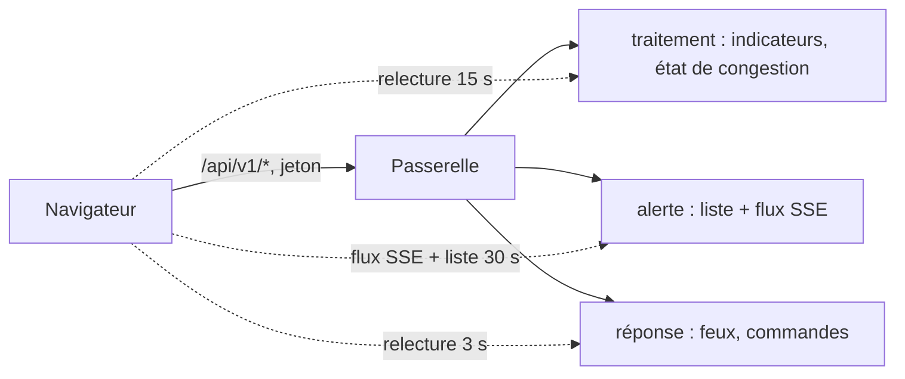

# Tableau de bord : indicateurs, alertes en direct, état des feux, commande manuelle (MS-14)

| Champ | Valeur |
|---|---|
| Issue | #133 (reprend FE-02 et FE-08) |
| Exigences | EXG-TDB-02, EXG-TDB-03 (alertes et feux en direct), EXG-REP-04 (commande manuelle, côté interface) |
| Décisions | [ADR-029](../01-architecture/adr/ADR-029-passerelle-et-authentification.md) (jeton et rôles à la passerelle), [ADR-028](../01-architecture/adr/ADR-028-etats-de-congestion-et-alertes.md) |
| Code | [`frontend/src/features/overview/`](../../frontend/src/features/overview/Overview.tsx), [`frontend/src/features/signals/`](../../frontend/src/features/signals/Signals.tsx), [`frontend/src/hooks/usePolling.ts`](../../frontend/src/hooks/usePolling.ts) |
| Tests | `frontend/tests/features/signals/`, `frontend/tests/features/overview/`, parcours [`frontend/e2e/tableau-de-bord.e2e.ts`](../../frontend/e2e/tableau-de-bord.e2e.ts) |
| Services lus | traitement, alerte, réponse (par la passerelle) ; collecte : voir section 3 |

## 1. En bref

**Critère de l'issue** : « le tableau de bord affiche en direct les données des quatre services et une commande manuelle y est appliquée et journalisée ».

| Ce qui est demandé | Résultat | Où |
|---|---|---|
| Client d'API par service (FE-02) | **Fait** : `services/{apiMetier,traitement,alerte,reponse}.ts`, types générés des contrats ; les types de la réponse sont maintenant exportés | `frontend/src/services/` |
| Indicateurs par carrefour | **Fait** : tableau « Indicateurs par carrefour » (tronçons congestionnés, vitesse, débit, feux) | section 2 |
| Flux d'alertes en temps réel | **Fait avant MS-14** (MS-11) : page Alertes, SSE ; son compteur est repris dans la vue d'ensemble | [alertes](alertes.md) |
| État des phases | **Fait** : page « Feux de circulation », un carte par carrefour, plan et phase en cours | section 2 |
| Historique des commandes | **Fait** : journal par carrefour, du plus récent au plus ancien, lecture page par page | section 4 |
| Commande manuelle protégée par rôle | **Fait** : formulaire pour `operator` et `admin` ; le `viewer` ne le voit pas, et la passerelle refuse sa requête (403) | section 5 |
| Tests de composants et parcours de bout en bout (FE-08) | **Fait** : voir section 7 | section 7 |
| Preuves : capture et test de bout en bout | **Faites** sur la pile locale réelle | section 8 |

## 2. Ce que montrent les pages

| Page | Contenu | Rythme |
|---|---|---|
| Tableau de bord, « En direct » | Quatre cartes (une par service) et le tableau par carrefour qui réunit indicateurs et feux | indicateurs 15 s, alertes par le flux, feux 3 s |
| Tableau de bord, suite | Filtres, indicateurs clés, graphiques, états, détail par tronçon (FE-04, inchangé) | à la demande |
| Feux de circulation | Une carte par carrefour : mode, signal (vert ou tout au rouge), phase en cours, fin prévue, décision, provenance, plan appliqué ; commande manuelle ; historique | 3 s |

Chaque carte dit sa provenance (« Simulé » tant que les données viennent du simulateur). Un service en panne affiche « Indisponible » **sans masquer les autres** ; une relecture qui échoue garde les dernières valeurs et affiche « Connexion perdue : dernières valeurs connues ».

## 3. Les quatre services

| Service | Ce que la carte montre | Source |
|---|---|---|
| Collecte | Fin de la dernière fenêtre de mesures traitée | `GET /api/v1/indicators/latest` |
| Traitement | Tronçons à l'état « Congestionné » sur le total | `GET /api/v1/indicators/latest` |
| Alertes | Alertes à traiter, état du flux | `GET /api/v1/alerts` + `GET /api/v1/events/stream` |
| Réponse | Carrefours en mode manuel sur le total | `GET /api/v1/signals` |

**Limite à connaître.** La collecte n'a **aucune lecture destinée aux usagers** (ses mesures brutes sont internes, la passerelle ne les expose pas). Sa carte se lit donc par la **fraîcheur** de la dernière fenêtre que le traitement en a tirée : si la collecte s'arrête, cette heure ne bouge plus. Elle ne donne pas le nombre de mesures reçues. Si un indicateur propre à la collecte est voulu, il faut une route de lecture dans son contrat (hors périmètre de MS-14).

**Pourquoi une relecture et non un flux pour les feux.** Le service de réponse calcule l'état à la demande et n'a pas de flux ; le flux SSE de l'alerte ne relaie que les alertes. La page relit `GET /api/v1/signals` toutes les 3 s (`SIGNALS_REFRESH_MS`). Le plus gros écart possible entre le feu réel et l'écran est donc de l'ordre de 3 s.

## 4. Historique des commandes

`GET /api/v1/signals/{id}/commands`, lu 20 par 20 avec le curseur `next_cursor` (« Afficher les commandes plus anciennes »). Colonnes : date (UTC), opérateur, action, phase, durée, motif, statut (`APPLIED`, `REFUSED`) et motif du refus.

L'API journalise l'**identifiant du compte** (le `sub` du jeton), pas son nom : la page écrit « Vous » pour son propre compte et abrège les autres (identifiant entier en infobulle). Le nom d'un autre compte n'est pas lisible par un opérateur (`GET /api/v1/users` est réservé à l'administrateur).

## 5. Commande manuelle protégée par rôle

| Rôle | Formulaire | Requête directe `POST …/commands` |
|---|---|---|
| `viewer` | caché, remplacé par une note | refusée par la passerelle (403) : **vérifié de bout en bout** |
| `operator`, `admin` | visible | acceptée ou refusée par les garde-fous |

Le formulaire demande la **confirmation** avant l'envoi (« Imposer la phase P2 pendant 30 s sur INT_01 ? »), vérifie le motif (3 à 500 caractères) et la durée (10 à 90 s) avant d'appeler l'API, et dit le résultat :

| Réponse de l'API | Message affiché |
|---|---|
| `202` | « Commande appliquée et journalisée (identifiant) » |
| `422 UNSAFE_COMMAND` | « Commande refusée : … » suivi du motif des garde-fous, « Le refus est journalisé. » |
| `409 COMMAND_IN_PROGRESS` | « Une commande est déjà en cours pour ce carrefour. » |
| `403`, `429`, `503` | message générique du client d'API |

Motifs de refus nommés par l'interface : `PHASE_TOO_SHORT`, `PHASE_TOO_LONG`, `CONFLICTING_GREENS`, `CYCLE_OUT_OF_BOUNDS`, `CYCLE_MISMATCH`, `PHASE_LAYOUT_MISMATCH`, `UNKNOWN_PHASE`, `MIN_DURATION_NOT_ELAPSED`, `CLEARANCE_IN_PROGRESS`, `COMMAND_IN_PROGRESS`. Un code inconnu est affiché tel quel. `MANUAL_OVERRIDE` existe dans le contrôleur, sans libellé (non vérifié : usage).

**Règle de temps découverte pendant le parcours de bout en bout** : une autre phase ne s'impose qu'après **10 s de vert** de la phase en cours et pas pendant le dégagement de 4 s (`MIN_DURATION_NOT_ELAPSED`, `CLEARANCE_IN_PROGRESS`). Une commande faite trop tôt est refusée et **journalisée**. Le formulaire le dit ; ce n'est pas un défaut de l'interface. « Rendre la main » obéit aux 10 s aussi, et ramène au mode **automatique** seulement si des recommandations sont récentes, sinon au **plan fixe** (mode dégradé) : l'écran n'annonce donc pas « Automatique » à coup sûr.

## 6. Journalisation

Le service écrit la commande dans `audit_logs` (MongoDB) **avant** de la rendre effective ([feux](feux.md), section 6). L'historique de la page est lu depuis ce journal : une commande qui y figure y est donc enregistrée. Le parcours de bout en bout le vérifie par l'API (statut, auteur = identifiant du compte connecté, motif) pour une commande appliquée et pour un refus (durée de 5 s).

## 7. Tests

| Niveau | Fichier | Ce qui est vérifié |
|---|---|---|
| Composant | `tests/features/signals/Signals.test.tsx` | cartes, relecture à intervalle fixe, dernières valeurs gardées en cas de panne, erreur et « Réessayer », liste vide, historique (refus, pagination par curseur), choix du carrefour |
| Composant | `tests/features/signals/CommandPanel.test.tsx` | rôles, validation (motif, durée), confirmation avant envoi, corps envoyé, « Rendre la main », refus des garde-fous, 409, 403 |
| Composant | `tests/features/overview/` | regroupement par carrefour (vitesse pondérée), carte « Indisponible » sans masquer les autres |
| Bout en bout | `e2e/tableau-de-bord.e2e.ts` | connexion, quatre cartes en direct, état des feux égal à l'API, commande appliquée, effet visible sans rechargement, historique, refus journalisé, retour au mode non manuel, lecteur sans commande et refusé (403) |

### Lancer

| Linux (bash) | Windows (PowerShell) |
|---|---|
| `python3 scripts/dev/dev.py db-up` (puis la pile : `make up`) | `py -3 scripts/dev/dev.py db-up` (puis la pile) |
| `cd frontend && npm ci` | `cd frontend; npm ci` |
| `npm test` | `npm test` |
| `export E2E_OPERATOR_USER=… E2E_VIEWER_USER=… E2E_PASSWORD=…` | `$env:E2E_OPERATOR_USER="…"; $env:E2E_VIEWER_USER="…"; $env:E2E_PASSWORD="…"` |
| `export E2E_SHOTS="../docs/Capture d'ecran"` (facultatif : enregistre les captures) | `$env:E2E_SHOTS="../docs/Capture d'ecran"` |
| `npm run e2e` | `npm run e2e` |

Le parcours demande Chrome installé (`E2E_CHROME_PATH` pour un autre chemin), la pile Docker démarrée, et **deux comptes** (un `operator`, un `viewer`) créés par `python -m app.cli create-user` ([authentification](../02-specifications/authentification.md)). Les identifiants viennent de l'environnement : **jamais** dans un fichier du dépôt. `npm run e2e` n'est pas lancé par la CI (elle n'a pas la pile).

## 8. Preuves

Le 12/11/2026, sur la pile locale (13 conteneurs sains, données simulées), Chrome 1280 px, `npm run e2e` : **2 réussis sur 2** (parcours opérateur, parcours lecteur). Captures dans [`docs/Capture d'ecran/`](../Capture%20d'ecran/) :

| Capture | Montre |
|---|---|
| `MS-14-01-tableau-de-bord.png` | les quatre cartes en direct et le tableau par carrefour (6 carrefours) |
| `MS-14-02-etat-des-feux.png` | l'état des feux, le plan et la phase en cours |
| `MS-14-03-confirmation.png` | la confirmation avant l'envoi |
| `MS-14-04-commande-appliquee-et-journal.png` | carrefour en mode manuel, message de succès, commande dans l'historique |
| `MS-14-05-retour-automatique.png` | après « Rendre la main » |
| `MS-14-06-lecteur-sans-commande.png` | le lecteur, sans formulaire |

## 9. Choix à valider, écarts et limites

| Point | État |
|---|---|
| Collecte lue par la fraîcheur des fenêtres traitées, pas par ses propres mesures | À valider : route de lecture à ajouter au contrat de la collecte, ou accepter |
| Feux relus toutes les 3 s (pas de flux côté réponse) | À valider : un flux `signal.status` côté alerte ou réponse supprimerait la relecture |
| Opérateur affiché par identifiant de compte (« Vous » pour soi) | À valider : une route qui donne le nom d'un compte à un opérateur |
| Les exécutions du parcours ajoutent des commandes réelles au journal d'audit (écriture seule, conçu ainsi) | Connu ; les comptes de test sont supprimés après l'essai |
| Playwright (`@playwright/test` 1.64.1, dépendance de développement) ajouté | À faire : Snyk de la CI, relecture de Daddy |
| Windows (`py -3`, PowerShell), Firefox, Safari, lecteur d'écran | **Non vérifié** |
| Accessibilité : rôles, libellés, `aria-current` sur la phase, pas d'audit automatisé | Non vérifié par un outil |
| Le parcours n'est pas dans la CI | Choix : la CI n'a pas la pile |
