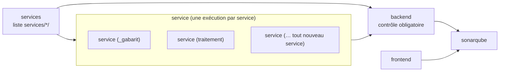

# CI multi-services

Projet : Novaria Core, socle d'UrbanHub (bloc de compétences BC05)
Responsable : Manoa Robel (issue MS-05), relecture par Daddy Luciano
Dernière mise à jour : 27/10/2026

La CI (Continuous Integration, intégration continue) contrôle chaque service de `services/` sans qu'on la modifie quand un service s'ajoute. Ce document dit comment elle est construite, comment lire un résultat, et comment on prouve qu'un échec dans un seul service bloque la fusion.

Abréviations : SCA (Software Composition Analysis, analyse des dépendances), SAST (Static Application Security Testing, analyse statique du code).

## 1. Les six contrôles obligatoires

La protection de `main` exige six contrôles, par leur nom. Ils gardent leur nom et n'ont **aucun filtre de chemin** : un contrôle que GitHub ignorerait resterait « en attente » et bloquerait la fusion sans fin.

| Contrôle | Ce qu'il couvre | Mécanisme |
|---|---|---|
| `backend` | Tous les services : lint, tests, construction de l'image | Job agrégateur de la matrice `service` |
| `frontend` | Le tableau de bord React | Lint, format, tests, build |
| `gitleaks` | Les secrets, dans tout l'historique | Image `gitleaks` |
| `snyk` | Les dépendances de chaque service (SCA), du frontend, le code (SAST, sur `main`), l'infrastructure | Boucle sur `services/*/` |
| `docker` | Une image par service et pour le frontend, analysées au seuil `high` | Boucle sur `services/*/` |
| `sonarqube` | Qualité et couverture de tous les services | Analyse unique sur `services/` |

## 2. La matrice des services

| Job | Rôle |
|---|---|
| `services` | Liste les dossiers de `services/` qui ont un `requirements-dev.txt` (le gabarit `_gabarit` compris : c'est un vrai service). Échoue s'il n'en trouve aucun |
| `service` | Une exécution par service : `pip install -r requirements-dev.txt`, `ruff check .`, `ruff format --check .`, `pytest` (avec couverture), construction de l'image Docker, dépôt du rapport de couverture. `fail-fast` est désactivé : un service en échec n'arrête pas les autres, le rapport montre tous les écarts |
| `backend` | Réussit **seulement si** `services` et `service` ont réussi. Il s'exécute même après un échec (`always()`), sinon il serait « ignoré » et donc en attente |

Un test en échec dans **un seul** service rend `service (<nom>)` rouge, donc `service` rouge, donc `backend` rouge : la pull request ne peut pas être fusionnée. Un nouveau service créé par `dev.py new-service` est découvert, contrôlé et lié à `backend` sans modifier `ci.yml`.

### Lire un résultat

| Où | Ce qu'on voit |
|---|---|
| Onglet « Checks » de la pull request | `backend` (obligatoire), et sous « CI » les lignes `service (<nom>)` : celle qui est rouge dit quel service échoue |
| Journal de `service (<nom>)` | L'étape en échec : `ruff check`, `ruff format`, `pytest` ou la construction de l'image |
| Journal de `backend` | Deux lignes : « Découverte des services : success » et « Services (matrice) : failure » |

## 3. Images et Snyk

| Élément | Règle |
|---|---|
| Une image par service | Le job `docker` construit `novaria-<service>` pour chaque dossier de `services/` (le préfixe `_` du gabarit est retiré) et celle du frontend |
| Analyse | Une boucle lance `snyk container test` sur chaque image de service, avec `--severity-threshold=high` et `--policy-path=.snyk` (exceptions datées : [exceptions.md](exceptions.md)). La boucle analyse **tous** les services, puis un seul échec fait échouer le job |
| Gabarit | Construit, mais non analysé : c'est un modèle, pas un déploiement |
| Dépendances | Le job `snyk` analyse le `requirements.txt` de chaque service sauf le gabarit |

## 4. Sonar

`sonar-project.properties` couvre tous les services par motifs : aucun service n'y est nommé.

| Propriété | Valeur | Effet |
|---|---|---|
| `sonar.sources` | `services,…` | Le code de chaque service |
| `sonar.test.inclusions` | `**/tests/**,…` | Les tests de chaque service |
| `sonar.python.coverage.reportPaths` | `services/*/coverage.xml` | La couverture de chaque service |

Chaque exécution de la matrice dépose son rapport sous le nom `coverage-service-<nom>`. Le job `sonarqube` les télécharge tous et copie chacun dans `services/<nom>/coverage.xml`, là où Sonar le cherche.

## 5. Vérifier

| Contrôle | Linux (bash) | Windows (PowerShell) |
|---|---|---|
| Structure et logique de la CI | `python3 -m unittest discover -s scripts/dev -p "test_ci.py"` | `py -3 -m unittest discover -s scripts/dev -p "test_ci.py"` (bash et jq requis : Git Bash) |
| Syntaxe du workflow | `docker run --rm -v "$PWD:/repo" -w /repo rhysd/actionlint:latest .github/workflows/ci.yml` | `docker run --rm -v "${PWD}:/repo" -w /repo rhysd/actionlint:latest .github/workflows/ci.yml` |
| Lint, tests et image d'un service, comme la CI | `cd services/<nom> && ruff check . && ruff format --check . && pytest && docker build -t novaria-<nom> .` | `cd services/<nom>; ruff check .; ruff format --check .; pytest; docker build -t novaria-<nom> .` |

`test_ci.py` lit `ci.yml` et **exécute** les scripts des étapes dans un dossier temporaire : la découverte (avec un dossier de services factice), l'agrégateur `backend` avec chaque combinaison de résultats, la remise en place des rapports de couverture. Il vérifie aussi que les six noms n'ont pas changé, qu'aucun filtre de chemin n'existe et qu'aucun contrôle n'est contourné. Il ne remplace pas un vrai run : le comportement de GitHub (nom des lignes de matrice, résumé du résultat d'une matrice) se prouve par les deux runs de la section 6.

## 6. Preuve : un run vert et un run rouge volontaire

| Étape | Commande | Résultat attendu |
|---|---|---|
| 1. Pousser la branche de l'issue et ouvrir sa pull request | `git push -u origin feature/MS-05-ci-multi-services` puis `gh pr create --base dev --head feature/MS-05-ci-multi-services --reviewer ravalison99 --title "ci: matrice par service et contrôle backend agrégé (MS-05)" --body "Closes #124"` | Run **vert** : `service (_gabarit)`, `service (traitement)` et `backend` verts. Noter le lien du run |
| 2. Pousser la branche de preuve | `git push -u origin ci/ms-05-preuve-rouge` | Aucun run (la CI s'exécute sur pull request) |
| 3. L'ouvrir en brouillon vers la branche de l'issue | `gh pr create --draft --base feature/MS-05-ci-multi-services --head ci/ms-05-preuve-rouge --title "Preuve MS-05 : échec volontaire dans un seul service (ne pas fusionner)" --body "Un test échoue volontairement dans services/traitement."` | Run **rouge** : `service (traitement)` rouge, `service (_gabarit)` vert, **`backend` rouge**. Noter le lien du run |
| 4. Fermer sans fusionner et supprimer la branche | `gh pr close <numéro> --delete-branch` | La preuve reste visible dans l'historique des runs |
| 5. Coller les deux liens dans l'issue #124 | | Preuve attendue de l'issue |

La branche `ci/ms-05-preuve-rouge` ne contient qu'un commit : un test qui échoue dans `services/traitement` (`tests/unit/test_preuve_rouge.py`, `assert False`).

## 7. Limites et points à vérifier

| Point | État |
|---|---|
| Comportement sur GitHub | Le workflow est valide pour `actionlint` et sa logique est testée en local, mais le premier run réel reste à observer (section 6) : **non vérifié** avant ce run |
| Fusion dans `main` | Les six noms ne changent pas, donc la protection de `main` n'est pas modifiée. Les lignes `service (<nom>)` ne sont **pas** des contrôles obligatoires : seul `backend` les représente |
| Coût | L'image de chaque service est construite deux fois : dans la matrice (pour vérifier le Dockerfile) puis dans le job `docker` (pour l'analyse Snyk). Acceptable avec deux services ; à revoir (cache de construction) si le temps de CI augmente |
| Duplication Sonar | Le code commun copié dans chaque service (journaux, modèles d'événements) peut être compté comme duplication quand plusieurs services existeront. Seul le gabarit est exclu (`sonar.cpd.exclusions`) ; ce réglage n'a pas été modifié ici |
| Scan hebdomadaire | Inchangé : seuls `snyk` et `docker` tournent le lundi ; `services`, `service` et `backend` sont ignorés (événement `schedule`) |
| Dépendances de la CI | `jq` est préinstallé sur les machines `ubuntu-latest` de GitHub |
