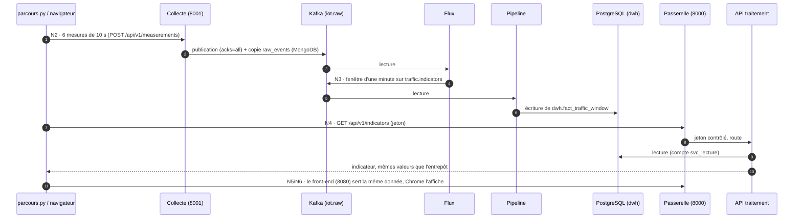

# Test d'intégration de bout en bout : parcours nominal et cas d'échec (CLD-13)

Projet : Novaria Core, socle d'UrbanHub (bloc de compétences BC05)
Responsables : Daddy Luciano et Manoa Robel (relecture croisée)
Dernière mise à jour : 21/11/2026 (section 10 : le parcours avec l'usager, CIT-07)
Issues de suivi : CLD-13 (#86), dépend de FE-04 (#72) et BE-07 (#67), tous deux fermés · CIT-07 (#275), dépend de CIT-05 (#273) et CIT-06 (#274)
Statut : à valider par les deux membres (relecture de la pull request)

Critère d'acceptation : **le parcours nominal et chaque cas d'échec sont rejoués en CI ou documentés.** Ici, ils sont **rejoués par une commande et documentés avec leur résultat** (section 4) ; la CI ne rejoue pas la chaîne complète, pour la raison de la section 7. Preuve attendue : ce document.

Abréviations : **API** (Application Programming Interface, interface de programmation), **CI** (Continuous Integration, intégration continue), **DLQ** (Dead Letter Queue, file des messages refusés : le sujet `errors.dlq`), **JWT** (JSON Web Token, jeton signé de l'API), **HTTP** (HyperText Transfer Protocol).

## 1. En bref

| Tâche de l'issue | Réalisé | Où | Preuve |
|---|---|---|---|
| Parcours : donnée brute → entrepôt → API → dashboard | Six étapes N1 à N6 sur la pile Docker réelle : une minute de mesures est envoyée à la collecte, le flux et le pipeline l'écrivent dans l'entrepôt, l'API la lit par la passerelle, un navigateur Chrome l'affiche | `scripts/dev/parcours.py`, `frontend/e2e/parcours-bout-en-bout.e2e.ts` | Section 4 : 9 cas sur 9 satisfaits |
| Cas d'échec : donnée invalide | E1 : une mesure hors contrat est refusée à l'entrée (422) et tracée ; une mesure datée du futur passe la collecte et est refusée par le flux | idem | Section 4 |
| Cas d'échec : jeton expiré | E2 : un jeton expiré, un jeton à la signature altérée et l'absence de jeton donnent 401, à la passerelle comme au service ; le navigateur ferme la session | idem | Section 4 |
| Cas d'échec : base indisponible | E3 : PostgreSQL arrêté, l'API répond 503 sans détail technique, la collecte continue, et les mesures reçues pendant la panne arrivent dans l'entrepôt après le redémarrage | idem | Section 4 |

Aucune valeur n'est simulée côté serveur : le navigateur parle à la passerelle, qui parle aux services, qui parlent aux bases et au bus. Seules les **mesures** sont fabriquées (provenance `SIMULATED`, jamais présentée comme réelle).

## 2. Le parcours



| Cas | Étape | Ce qui est vérifié | Échoue si |
|---|---|---|---|
| N1 | Compte et jeton | Compte jetable `parcours-<hex>` (rôle `viewer`) créé par `app.cli`, connexion par la passerelle | pas de jeton |
| N2 | Donnée brute | 6 mesures valides acceptées (`202 ACCEPTED`), 6 copies dans `raw_events` | un statut autre, une copie manquante |
| N3 | Entrepôt | Une ligne `dwh.fact_traffic_window` (fenêtre de 60 s, run du parcours) **égale au recalcul** des 6 mesures : véhicules, débit, vitesse pondérée, occupation, file maximale, complétude | pas de ligne en 150 s, une valeur qui diffère |
| N4 | API | `GET /api/v1/indicators?run_id=…` par la passerelle : 200, une ligne, mêmes valeurs, provenance `SIMULATED` | autre statut, une valeur qui diffère |
| N5 | Front-end | Le proxy du tableau de bord (nginx, port 8080) sert le même indicateur | indicateur absent |
| N6 | Navigateur | Chrome se connecte, le tableau de bord affiche `exécution <run>`, 30,1 km/h, 30 véhicules, 30,0 véh/min, le tronçon `ROAD_001` | un texte à l'écran diffère |
| E1 | Donnée invalide | Hors contrat : `422 VALIDATION_ERROR`, absente de `raw_events`, un rejet de plus dans `rejects`. Datée du futur : acceptée par la collecte (conforme au contrat), **refusée par le flux** (DQ-10), un rejet de plus, aucune ligne dans l'entrepôt | un statut inattendu, un rejet non tracé, une ligne écrite |
| E2 | Jeton expiré | Jeton expiré depuis une minute, signature altérée, aucun jeton : `401`. Témoin : le même sujet avec un jeton valable donne `200`. Le service seul (sans passerelle) refuse aussi. Le navigateur renvoie à la connexion et efface la session | un 200, ou une réponse qui montre une trace ou la clé |
| E3 | Base indisponible | `docker compose stop postgres` : l'API répond `503 UPSTREAM_UNAVAILABLE` sans adresse, compte ni trace ; la collecte accepte 6 mesures ; après `start`, l'API répond 200 et **la ligne des mesures reçues pendant la panne apparaît dans l'entrepôt**, égale au recalcul | un autre statut, un détail technique, une ligne perdue |

Les valeurs attendues ne viennent **pas** du système testé : `indicateur_attendu` les recalcule dans le banc, avec les formules de [flux](../03-donnees/flux.md) (section 5.1) et l'arrondi moitié vers le haut de l'[entrepôt](../03-donnees/entrepot.md) (section 3.1). Exemple de la minute du parcours : (4×31,5 + 6×28 + 5×30,5 + 3×33 + 7×29,5 + 5×30) ÷ 30 = 30,0667, donc 30,1 km/h.

## 3. Lancer

Prérequis : `.env` créé, pile démarrée, Docker, Node avec `npm ci` dans `frontend/` et Chrome pour N6 et la partie navigateur de E2.

| Action | Linux (bash) | Windows (PowerShell) |
|---|---|---|
| Démarrer la pile | `python3 scripts/dev/dev.py up` | `py -3 scripts/dev/dev.py up` |
| Tout rejouer (9 cas, environ 1 minute) | `python3 scripts/dev/dev.py parcours` ou `make parcours` | `py -3 scripts/dev/dev.py parcours` |
| Une partie | `python3 scripts/dev/dev.py parcours N1 N2 N3 N4` ou `make parcours C="N1 N2 N3 N4"` | `py -3 scripts/dev/dev.py parcours N1 N2 N3 N4` |
| Un cas d'échec seul | `python3 scripts/dev/dev.py parcours E1` | `py -3 scripts/dev/dev.py parcours E1` |
| Tests du banc (sans pile) | `python3 -m unittest discover -s scripts/dev -p "test_parcours.py"` | `py -3 -m unittest discover -s scripts/dev -p "test_parcours.py"` |
| Installer le navigateur de test | `cd frontend && npm ci` | `cd frontend; npm ci` |

Le code de sortie est 0 si tous les cas jouent, 1 sinon. Les cas E1 à E3 ne dépendent pas de N2 à N6 ; N2 à N6 sont « non joués » si N1 échoue.

Ce que la commande touche dans la pile : un compte jetable (supprimé en fin d'exécution, même après un échec), des mesures d'un run `cld13-<hex>` dans MongoDB et l'entrepôt (provenance simulée, repérables par leur run), et un arrêt suivi d'un redémarrage de PostgreSQL (E3, rétabli dans un `finally`). **N'exécutez pas la commande sur une pile qui sert à autre chose.** Le mot de passe du compte est tiré au hasard à chaque exécution et ne passe que par l'entrée standard et l'environnement des processus enfants.

## 4. Résultat de l'exécution

Exécution du 17/11/2026, poste Linux (Ubuntu), Docker 29.9, Docker Compose 5.7, Python 3.14, Chrome installé, pile démarrée par `dev.py up`, sortie de `dev.py parcours` (identifiants raccourcis, aucun secret affiché) :

```text
Parcours de bout en bout sur la pile locale (la pile doit tourner : dev.py up).
[OK] N1  Compte et jeton (1.6 s) : compte parcours-8a2f1c (viewer) créé, connexion par la passerelle : jeton reçu
[OK] N2  Donnée brute : collecte, bus, copie MongoDB (0.6 s) : 6 mesures de 2026-11-17T12:57:00Z acceptées (202 ACCEPTED), 6 copie(s) dans raw_events, run cld13-4e5d91
[OK] N3  Entrepôt : le flux et le pipeline écrivent la fenêtre (15.6 s) : 1 ligne dans dwh.fact_traffic_window : 30 véhicules, 30.1 km/h, état FREE_FLOW, égale au recalcul des 6 mesures
[OK] N4  API : lecture par la passerelle, valeurs recalculées : GET /api/v1/indicators par la passerelle : 200, 1 indicateur, mêmes valeurs que l'entrepôt, provenance SIMULATED
[OK] N5  Tableau de bord : le front-end sert la même donnée : le front-end (nginx, port du tableau de bord) sert le même indicateur : le navigateur le lira par ce chemin
[OK] N6  Tableau de bord : un navigateur affiche la donnée (2 s) : Chrome, front-end sur http://127.0.0.1:8080 : connexion puis écran « exécution cld13-4e5d91 », 30,1 km/h, 30 véhicules, 30,0 véh/min, tronçon ROAD_001 (1 passed (1.4s))
[OK] E1  Donnée invalide (3.2 s) : hors contrat : 422 VALIDATION_ERROR, absente de raw_events, rejet tracé (rejects 5 à 6) ; datée du futur : acceptée par la collecte, refusée par le flux (rejet tracé), aucune ligne dans l'entrepôt
[OK] E2  Jeton expiré (2 s) : passerelle : expiré depuis 1 min : 401 ; signature altérée : 401 ; absent : 401 ; valide, expire dans 10 min (témoin) : 200 ; jeton expiré directement sur le service : 401 ; navigateur : retour à la connexion, session effacée, aucune donnée (1 passed (1.2s))
[OK] E3  Base indisponible (19.5 s) : API : 503 UPSTREAM_UNAVAILABLE sans détail ; collecte pendant la panne : 6 mesures acceptées (elle ne dépend pas de PostgreSQL) ; PostgreSQL redémarré : l'API répond de nouveau 200 ; les mesures reçues pendant la panne sont dans l'entrepôt, égales au recalcul (rien perdu)
9/9 cas satisfaits.
```

| Mesure | Valeur | Lecture |
|---|---|---|
| De la mesure brute à la ligne de l'entrepôt (N3) | 15,6 s | Le délai de fermeture de fenêtre de [flux](../03-donnees/flux.md) section 5.3 (15 s sans message) explique l'essentiel ; la part du flux et celle du pipeline ne sont pas mesurées séparément |
| Panne de PostgreSQL jusqu'à la ligne rattrapée (E3) | 19,5 s | Arrêt, 503, envoi, redémarrage, reprise des deux services d'écriture |
| Parcours complet | environ 45 s | Une seule exécution sur le poste ; non mesuré sur d'autres machines |

Tests du banc : `test_parcours.py`, 18 tests, sans pile ni réseau (valeurs attendues recalculées à la main, jetons lus par la bibliothèque de l'API, cas qui échoue, cas non joués, compte supprimé après un échec).

## 5. Les trois cas d'échec : pourquoi cette réponse est la bonne

| Cas | Réponse constatée | Pourquoi | Où c'est défini |
|---|---|---|---|
| Donnée hors contrat | `422`, `application/problem+json`, code `VALIDATION_ERROR` | Le contrat d'événement est vérifié **avant** toute publication : une valeur absurde n'atteint ni le bus ni l'entrepôt ; le motif est gardé pour l'analyse (DLQ et `rejects`) | [collecte](../03-donnees/collecte.md) sections 3.1 et 4 |
| Donnée conforme mais irrecevable | `202`, puis rejet par le flux | La collecte ne juge pas l'horloge ; le flux refuse un horodatage à plus de 5 s dans le futur (DQ-10) et trace le rejet sans la valeur refusée | [flux](../03-donnees/flux.md) sections 4 et 8 |
| Jeton expiré ou altéré | `401`, sans trace ni clé | Le jeton est vérifié à la passerelle puis par le service (deux contrôles, MS-13) ; l'algorithme est fixé à HS256 ; aucun détail n'est donné au client | [sécurité applicative](securite-applicative.md), `contracts/openapi/README.md` |
| Base indisponible | `503 UPSTREAM_UNAVAILABLE`, sans adresse ni compte | Une panne de dépendance est une indisponibilité, pas une erreur du client ni du serveur ; le message ne révèle rien de la base | [tests et couverture](tests-et-couverture.md), `app/core/errors.py` |
| Base indisponible, côté écriture | Rien n'est perdu | Le pipeline s'arrête sans valider d'offset Kafka et relit depuis le dernier offset sûr au redémarrage ; la clé de la table rend la reprise idempotente | [entrepôt](../03-donnees/entrepot.md) section 3 |

## 6. Ce que le banc ne peut pas faire croire

- **Un test qui ne peut pas échouer ne prouve rien.** Les valeurs attendues viennent d'un calcul indépendant ; E2 contient un **témoin** (le même sujet, un jeton valable, répond 200) qui montre que le 401 vient bien de l'expiration et non d'un compte ou d'une route cassés ; E3 vérifie que l'API **répond de nouveau** après la panne, pas seulement qu'elle a échoué.
- **Un cas qui plante est un échec, pas un arrêt** : la suite est jouée et le compte jetable supprimé.
- **Rien n'est écrit dans un fichier du dépôt.** Le compte rendu est la sortie standard ; pour le garder : `python3 scripts/dev/dev.py parcours > parcours.txt` (Linux) ou `py -3 scripts/dev/dev.py parcours | Out-File -Encoding utf8 parcours.txt` (Windows : la redirection `>` de PowerShell 5.1 écrit en UTF-16).
- **Le jeton expiré est construit avec `JWT_SECRET` lu dans `.env`** : la clé ne quitte jamais le processus, n'est pas affichée, et la réponse de chaque cas 401 est vérifiée pour ne pas la contenir.

## 7. Ce que la CI rejoue, et ce qu'elle ne rejoue pas

| Élément | Rejoué par la CI ? | Où |
|---|---|---|
| Chaque cas d'échec, **service par service**, sans pile | Oui | Jeton expiré : `services/traitement/tests/unit/test_security.py`, `test_auth_service.py`. Donnée invalide : `services/collecte/tests/unit/test_measurements_api.py`. 503 : tests de contrat et unitaires des services. Session expirée côté navigateur : `frontend/tests/app/auth-routes.test.tsx`, `tests/services/session.test.ts` |
| Les calculs et l'orchestration du banc | Non (le dossier `scripts/dev` n'a pas de job de CI) ; se lance en local, `test_parcours.py` | section 3 |
| La chaîne complète sur la pile Docker | **Non** | section 4, résultat documenté |

La chaîne n'est pas dans la CI : elle demande de construire les images de la pile, de démarrer treize conteneurs (services, bases, bus) et d'installer Chrome, soit bien plus que les contrôles actuels, et l'ajout d'un job modifie les contrôles de la CI, ce que `CLAUDE.md` réserve à un accord écrit des deux membres. **Proposition à valider** : un job manuel (`workflow_dispatch`) qui lance `dev.py up` puis `dev.py parcours`. Il n'est pas créé ici.

## 8. Limites et points ouverts pour la relecture croisée

| N° | Point | État |
|---|---|---|
| 1 | Exécution vérifiée **sous Linux seulement**. Les commandes PowerShell du tableau de la section 3 sont écrites mais **non vérifiées** sous Windows : à rejouer par Daddy Luciano | À vérifier |
| 2 | Une seule exécution complète est consignée (section 4). Aucune mesure de variabilité n'est faite, notamment sur la durée de N3 | Limite |
| 3 | E3 n'arrête que PostgreSQL. Les pannes de MongoDB et de Kafka sont couvertes service par service (tests d'intégration de `collecte` et du flux), pas par ce parcours | Limite |
| 4 | Le parcours laisse dans l'entrepôt des lignes d'un run `cld13-*` (et `cld13-*-b`). Elles ne sont pas supprimées : l'entrepôt est écrit par le pipeline seul, le banc n'y fait aucune écriture. `dev.py db-reset` les efface avec le reste, **sur demande explicite seulement** | Choix à valider |
| 5 | Le tableau de bord affiche le run de la fenêtre la plus récente. Si le simulateur écrit en même temps, N6 peut voir son run et non celui du parcours : arrêter `simulateur` avant (`docker compose stop simulateur`) en cas d'échec de N6 | Limite |
| 6 | Sept tests de `scripts/dev/test_dependances.py` (verrous de dépendances) échouent déjà sur `dev-ia`, sans lien avec ce travail ; ils n'ont pas été analysés ici | Constat, hors périmètre |

## 9. Dépannage

| Symptôme | Cause probable | Remède |
|---|---|---|
| `Cas inconnu` | Faute de frappe | Cas possibles : N1 à N6, E1 à E3 |
| N1 : création du compte refusée | Pile non démarrée ou migrations non appliquées | `dev.py up`, puis `dev.py health` |
| N3 : aucune ligne après 150 s | `traitement-flux` ou `traitement-pipeline` arrêté | `docker compose ps`, puis `docker compose logs traitement-flux traitement-pipeline` |
| N6 : « navigateur non vérifié » | `npm ci` non fait dans `frontend/`, ou Chrome absent | `cd frontend && npm ci` ; `E2E_CHROME_PATH` donne le chemin d'un autre Chrome (lu par `playwright.config.ts`) |
| E3 échoue et PostgreSQL reste arrêté | Interruption de la commande pendant la panne | `docker compose start postgres` |

## 10. Le parcours avec l'usager (CIT-07, 21/11/2026)

Critère d'acceptation de CIT-07 : **le parcours de bout en bout inclut l'usager et passe deux fois de suite.** Cinq cas s'ajoutent à `dev.py parcours`, entre le parcours nominal et les cas d'échec (14 cas en tout : N1 à N6, U1 à U5, E1 à E3). Même principe qu'avant : la pile Docker réelle, des mesures **simulées**, un vrai navigateur ; ici Chromium sur un écran de téléphone, devant l'application citoyenne construite.

### 10.1 Les cas

| Cas | Ce qui est joué | Ce qui est vérifié |
|---|---|---|
| U1 | Quatre minutes de mesures congestionnées (4 capteurs, 96 mesures) d'un carrefour libre, entre INT_06 et INT_02, run `cit07-…` | Les 96 mesures sont acceptées (202) |
| U2 | Lecture de l'indicateur par l'API d'équipe (jeton `viewer`) | Chacun des 4 tronçons a, minute par minute, l'état annoncé par la règle de seuils (calculé avec le classificateur du traitement) : `FREE_FLOW → CONGESTED → CONGESTED → CONGESTED` |
| U3 | Le service des alertes crée les alertes ; lecture par l'API **publique**, sans jeton | 4 alertes `congestion.persistante` (une par tronçon), et l'API publique en rend exactement les six champs de la liste blanche, `simulated` vrai, `Cache-Control: public, max-age=5` |
| U4 | Chromium ouvre l'application citoyenne (« Mes trajets », ADR-031) | Première visite : des trajets proposés, rien de gardé sur l'appareil. Le citoyen **ajoute son trajet** (deux tronçons du carrefour de l'essai) et lit le verdict que la règle donne pour l'état **public** de ces tronçons, avec sa phrase de décision ; « Me prévenir » est gardé après rechargement ; une seule clé sur l'appareil, aucun cookie, aucun code du système à l'écran ; bandeau « Données simulées » |
| U5 | **Échec : le service de circulation (`traitement`) est arrêté** | L'API publique répond 503 sans détail ni cache. Page ouverte : le trajet reste et « Mise à jour impossible… dernière information connue ». Page neuve : « momentanément indisponible », bouton « Réessayer », aucun mot technique. Service relancé : tout se rétablit |

U1 à U4 forment une chaîne (un échec rend les suivants « non joués »). U5 suit U1 à U3 ; un échec de l'affichage (U4) ne masque pas l'essai de la panne. Les alertes d'essai sont **refermées à la fin** (minutes fluides envoyées) et le service arrêté est **toujours relancé** (passerelle rechargée), même après un échec. Captures : `docs/Capture d'ecran/CIT-07-parcours-usager-affichage.png`, `-avant-panne.png` et `-panne.png`.

### 10.2 Résultat : deux exécutions de suite (21/11/2026, poste Linux)

| Exécution | Cas satisfaits | Durée | Code de sortie |
|---|---|---|---|
| 1 | **14/14** | 1 min 53 | 0 |
| 2, lancée aussitôt après | **14/14** | 1 min 44 | 0 |

À chaque exécution, le carrefour libre change (INT_06 puis INT_05, puis INT_04) : le service des feux ignore une recommandation plus ancienne que la dernière reçue. U5 dure environ 30 s (arrêt, deux pages, relance, reprise). Sortie complète des deux exécutions : [parcours-usager-2026-11-21.txt](sorties-parcours/parcours-usager-2026-11-21.txt).

### 10.3 Défauts trouvés en jouant le parcours

| Défaut | Comment trouvé | Correction |
|---|---|---|
| **Un service arrêté mettait 60 s à répondre 503.** La première requête vers un service qui ne répond pas du tout attend le délai de connexion par défaut de nginx (60 s) : un citoyen ne verrait aucun message clair dans ce délai | U5 : l'appel à l'API publique pendant la panne expirait (HTTP 0 après 15 s) ; mesuré à la main : 60,0 s la première fois, 3,1 s ensuite | `proxy_connect_timeout 2s` dans `gateway/citoyen.conf` (routes publiques seulement). Le test de la passerelle réelle ne reproduit pas le cas (un service factice arrêté refuse la connexion tout de suite) : la preuve est U5, sur la pile réelle |
| **E1 (CLD-13) échouait selon l'offset du message.** Il comptait les documents de `rejects`, or le flux **ignore** la copie d'un rejet dont l'identifiant `dlq:…:partition:offset` existe déjà (`DuplicateKeyError` avalée) ; après une réinitialisation de Kafka, les offsets repartent de zéro et retombent sur des identifiants de rejets du 17 au 20/11 : le rejet était fait, sa copie ignorée, le décompte ne bougeait pas | Seconde exécution : E1 en échec, puis en échec à chacun des cinq essais suivants (seul, après les cas U, après un redémarrage du flux). Vérifié : `dlq:traitement:iot.raw:1:1375` existait déjà (rejet du 20/11 à 09:45) | E1 compte `processing_stats` (`kind: rejects`, `values.FUTURE_TIMESTAMP`), qui s'incrémente dans tous les cas (`parcours.rejets_futurs`). **Conséquence à connaître** : après une réinitialisation de Kafka, un nouveau rejet peut ne pas avoir de copie dans `rejects` ; ses compteurs et l'événement `errors.dlq` existent, eux |
| La passerelle gardait d'anciennes adresses après le redémarrage des services (503 sur la connexion) | Premier essai de U2 | Piège connu : `docker compose exec -T passerelle nginx -s reload` (CLAUDE.md, section 11) |

### 10.4 Le front citoyen, sans réseau extérieur

| Test | Ce qu'il prouve | Commande |
|---|---|---|
| `citizen/tests/parcours.test.tsx` (3 tests) | Un parcours du citoyen de l'ouverture au lendemain : trajets proposés, garder un trajet, « Me prévenir », un message quand une alerte s'ouvre, panne du service de circulation (dernier état gardé, message clair), reprise seule, retour le lendemain avec son trajet. Le vrai code du réseau (`src/api.ts`) parle à un faux serveur qui remplace `fetch` : **toute adresse qui n'est pas l'une des deux routes publiques est refusée** ; chaque appel est un `GET` relatif, sans jeton ni cookie. Ouverture pendant la panne : « Réessayer » relit tout de suite | `python3 scripts/dev/dev.py citoyen test` (Windows : `py -3 scripts/dev/dev.py citoyen test`) |
| Tests de composants, d'accessibilité et de contraste (CIT-04 à CIT-06) | Chaque écran et chaque état | idem |
| `scripts/dev/test_parcours_usager.py` (29 tests) | Chaque cas sait échouer (un état faux, un champ interne en trop, un cache faux, une alerte absente) ; les nettoyages sont joués même après un échec ; l'enchaînement des cas ; la borne de connexion de la passerelle | `python3 -m unittest discover -s scripts/dev -p "test_parcours_usager.py"` (Windows : `py -3 -m unittest discover -s scripts/dev -p "test_parcours_usager.py"`) |

Vitest : **184 tests**, couverture 97,6 % des instructions (v2 « Mes trajets », ADR-031). Tests de `scripts/dev` : voir la section 10.6.

### 10.5 CI, Linux et Windows : ce qui est vrai

| Élément | État |
|---|---|
| Le front citoyen en CI | **Aucun job ne le lance.** `ci.yml` ne mentionne pas `citizen/` : ni `npm test`, ni lint, ni build. Les 184 tests ne sont donc jamais rejoués par la CI. Un job est **proposé** dans [ci-application-citoyenne.md](ci-application-citoyenne.md), **non appliqué** : modifier les contrôles de la CI demande l'accord écrit des deux membres (CLAUDE.md, section 6) |
| Les tests de `scripts/dev` et de la passerelle en CI | Non lancés non plus (déjà dit en section 7) : `test_parcours_usager.py` et `test_acces_abus_public.py` ne sont rejoués que sur un poste |
| Le parcours complet en CI | Non, pour la raison de la section 7 (treize conteneurs et Chromium) |
| **Windows** | **Non vérifié.** La CI n'a aucun poste Windows. Le parcours a été joué sous Linux seulement. Le script du navigateur a été rendu portable (`npx.cmd`, `taskkill`) sans pouvoir l'essayer. À rejouer par Daddy Luciano : voir 10.7 |

Le quatrième point de l'issue (« CI verte sur les deux postes ») n'est donc **pas atteint** : ni job pour le front citoyen, ni poste Windows. Ce document le dit plutôt que de laisser croire le contraire.

### 10.6 Chiffres du 21/11/2026

| Contrôle | Résultat |
|---|---|
| `dev.py parcours` deux fois de suite | 14/14 et 14/14 |
| Vitest (citoyen) | 184 tests |
| `scripts/dev` | 1084 tests, tous réussis |
| Passerelle réelle (Docker) | 43 tests |

### 10.7 Rejouer

| Action | Linux (bash) | Windows (PowerShell) |
|---|---|---|
| Préparer le navigateur du parcours usager | `cd citizen && npm ci` | `cd citizen; npm ci` |
| Rejouer tout (14 cas, environ 2 minutes) | `python3 scripts/dev/dev.py parcours` | `py -3 scripts/dev/dev.py parcours` |
| Seulement l'usager | `python3 scripts/dev/dev.py parcours U1 U2 U3 U4 U5` | `py -3 scripts/dev/dev.py parcours U1 U2 U3 U4 U5` |
| **Essai à la main** : créer puis refermer des alertes simulées pendant que vous regardez l'application | Terminal 1 : `python3 scripts/dev/dev.py citoyen` ; terminal 2 : `python3 scripts/dev/dev.py citoyen manuel` ; ouvrir http://127.0.0.1:5174 | Terminal 1 : `py -3 scripts/dev/dev.py citoyen` ; terminal 2 : `py -3 scripts/dev/dev.py citoyen manuel` ; ouvrir http://127.0.0.1:5174 |
| Si la connexion échoue en 503 après un redémarrage des services | `docker compose exec -T passerelle nginx -s reload` | idem |

### 10.8 Limites et points ouverts pour la relecture croisée

| N° | Point | État |
|---|---|---|
| 1 | Windows non vérifié ; la CI ne le couvre pas | À rejouer par Daddy Luciano |
| 2 | Aucun job de CI pour `citizen/` ; proposition non appliquée | Décision des deux membres |
| 3 | Deux exécutions de suite sur un poste : aucune mesure de variabilité plus large. La durée de U2 (15 à 17 s) suit celle du flux et du pipeline | Limite |
| 4 | U5 arrête `alerte` (l'API), pas `alerte-worker` : la création d'alertes continue pendant la panne ; l'arrêt du worker est joué par `dev.py flux-complet F2` | Choix |
| 5 | Après le redémarrage de PostgreSQL (E3), l'API publique des alertes répond 503 pendant environ une demi-minute avant de reprendre : constaté une fois, non analysé | Constat |
| 6 | Le parcours ne passe que sur des données **simulées** ; le message « Données simulées » est vérifié à l'écran (U4, U5) | Voulu |
| 7 | Les rejets du flux n'ont plus de copie dans `rejects` quand leur identifiant existe déjà (10.3) : un tableau de bord qui compterait `rejects` sous-compterait après une réinitialisation de Kafka | À décider : changer l'identifiant, ou le dire |
| 8 | Chromium seulement (pas de Firefox ni de Safari) ; pas de vrai téléphone | Non vérifié |
