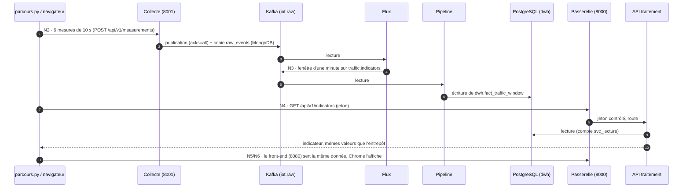

# Test d'intégration de bout en bout : parcours nominal et cas d'échec (CLD-13)

Projet : Novaria Core, socle d'UrbanHub (bloc de compétences BC05)
Responsables : Daddy Luciano et Manoa Robel (relecture croisée)
Dernière mise à jour : 17/11/2026
Issue de suivi : CLD-13 (#86), dépend de FE-04 (#72) et BE-07 (#67), tous deux fermés
Statut : à valider par les deux membres (relecture de la pull request)

Critère d'acceptation : **le parcours nominal et chaque cas d'échec sont rejoués en CI ou documentés.** Ici, ils sont **rejoués par une commande et documentés avec leur résultat** (section 4) ; la CI ne rejoue pas la chaîne complète, pour la raison de la section 7. Preuve attendue : ce document.

Abréviations : **API** (Application Programming Interface, interface de programmation), **CI** (Continuous Integration, intégration continue), **DLQ** (Dead Letter Queue, file des messages refusés : le sujet `errors.dlq`), **JWT** (JSON Web Token, jeton signé de l'API), **HTTP** (HyperText Transfer Protocol).

## 1. En bref

| Tâche de l'issue | Réalisé | Où | Preuve |
|---|---|---|---|
| Parcours : donnée brute → entrepôt → API → dashboard | Six étapes N1 à N6 sur la pile Docker réelle : une minute de mesures est envoyée à la collecte, le flux et le pipeline l'écrivent dans l'entrepôt, l'API la lit par la passerelle, un navigateur Chrome l'affiche | `scripts/dev/parcours.py`, `frontend/e2e/parcours-bout-en-bout.e2e.ts` | Section 4 : 9 cas sur 9 satisfaits |
| Cas d'échec : donnée invalide | E1 : une mesure hors contrat est refusée à l'entrée (422) et tracée ; une mesure datée du futur passe la collecte et est refusée par le flux | idem | Section 4 |
| Cas d'échec : jeton expiré | E2 : un jeton expiré, un jeton à la signature altérée et l'absence de jeton donnent 401, à la passerelle comme au service ; le navigateur ferme la session | idem | Section 4 |
| Cas d'échec : base indisponible | E3 : PostgreSQL arrêté, l'API répond 503 sans détail technique, la collecte continue, et les mesures reçues pendant la panne arrivent dans l'entrepôt après le redémarrage | idem | Section 4 |

Aucune valeur n'est simulée côté serveur : le navigateur parle à la passerelle, qui parle aux services, qui parlent aux bases et au bus. Seules les **mesures** sont fabriquées (provenance `SIMULATED`, jamais présentée comme réelle).

## 2. Le parcours



| Cas | Étape | Ce qui est vérifié | Échoue si |
|---|---|---|---|
| N1 | Compte et jeton | Compte jetable `parcours-<hex>` (rôle `viewer`) créé par `app.cli`, connexion par la passerelle | pas de jeton |
| N2 | Donnée brute | 6 mesures valides acceptées (`202 ACCEPTED`), 6 copies dans `raw_events` | un statut autre, une copie manquante |
| N3 | Entrepôt | Une ligne `dwh.fact_traffic_window` (fenêtre de 60 s, run du parcours) **égale au recalcul** des 6 mesures : véhicules, débit, vitesse pondérée, occupation, file maximale, complétude | pas de ligne en 150 s, une valeur qui diffère |
| N4 | API | `GET /api/v1/indicators?run_id=…` par la passerelle : 200, une ligne, mêmes valeurs, provenance `SIMULATED` | autre statut, une valeur qui diffère |
| N5 | Front-end | Le proxy du tableau de bord (nginx, port 8080) sert le même indicateur | indicateur absent |
| N6 | Navigateur | Chrome se connecte, le tableau de bord affiche `exécution <run>`, 30,1 km/h, 30 véhicules, 30,0 véh/min, le tronçon `ROAD_001` | un texte à l'écran diffère |
| E1 | Donnée invalide | Hors contrat : `422 VALIDATION_ERROR`, absente de `raw_events`, un rejet de plus dans `rejects`. Datée du futur : acceptée par la collecte (conforme au contrat), **refusée par le flux** (DQ-10), un rejet de plus, aucune ligne dans l'entrepôt | un statut inattendu, un rejet non tracé, une ligne écrite |
| E2 | Jeton expiré | Jeton expiré depuis une minute, signature altérée, aucun jeton : `401`. Témoin : le même sujet avec un jeton valable donne `200`. Le service seul (sans passerelle) refuse aussi. Le navigateur renvoie à la connexion et efface la session | un 200, ou une réponse qui montre une trace ou la clé |
| E3 | Base indisponible | `docker compose stop postgres` : l'API répond `503 UPSTREAM_UNAVAILABLE` sans adresse, compte ni trace ; la collecte accepte 6 mesures ; après `start`, l'API répond 200 et **la ligne des mesures reçues pendant la panne apparaît dans l'entrepôt**, égale au recalcul | un autre statut, un détail technique, une ligne perdue |

Les valeurs attendues ne viennent **pas** du système testé : `indicateur_attendu` les recalcule dans le banc, avec les formules de [flux](../03-donnees/flux.md) (section 5.1) et l'arrondi moitié vers le haut de l'[entrepôt](../03-donnees/entrepot.md) (section 3.1). Exemple de la minute du parcours : (4×31,5 + 6×28 + 5×30,5 + 3×33 + 7×29,5 + 5×30) ÷ 30 = 30,0667, donc 30,1 km/h.

## 3. Lancer

Prérequis : `.env` créé, pile démarrée, Docker, Node avec `npm ci` dans `frontend/` et Chrome pour N6 et la partie navigateur de E2.

| Action | Linux (bash) | Windows (PowerShell) |
|---|---|---|
| Démarrer la pile | `python3 scripts/dev/dev.py up` | `py -3 scripts/dev/dev.py up` |
| Tout rejouer (9 cas, environ 1 minute) | `python3 scripts/dev/dev.py parcours` ou `make parcours` | `py -3 scripts/dev/dev.py parcours` |
| Une partie | `python3 scripts/dev/dev.py parcours N1 N2 N3 N4` ou `make parcours C="N1 N2 N3 N4"` | `py -3 scripts/dev/dev.py parcours N1 N2 N3 N4` |
| Un cas d'échec seul | `python3 scripts/dev/dev.py parcours E1` | `py -3 scripts/dev/dev.py parcours E1` |
| Tests du banc (sans pile) | `python3 -m unittest discover -s scripts/dev -p "test_parcours.py"` | `py -3 -m unittest discover -s scripts/dev -p "test_parcours.py"` |
| Installer le navigateur de test | `cd frontend && npm ci` | `cd frontend; npm ci` |

Le code de sortie est 0 si tous les cas jouent, 1 sinon. Les cas E1 à E3 ne dépendent pas de N2 à N6 ; N2 à N6 sont « non joués » si N1 échoue.

Ce que la commande touche dans la pile : un compte jetable (supprimé en fin d'exécution, même après un échec), des mesures d'un run `cld13-<hex>` dans MongoDB et l'entrepôt (provenance simulée, repérables par leur run), et un arrêt suivi d'un redémarrage de PostgreSQL (E3, rétabli dans un `finally`). **N'exécutez pas la commande sur une pile qui sert à autre chose.** Le mot de passe du compte est tiré au hasard à chaque exécution et ne passe que par l'entrée standard et l'environnement des processus enfants.

## 4. Résultat de l'exécution

Exécution du 17/11/2026, poste Linux (Ubuntu), Docker 29.9, Docker Compose 5.7, Python 3.14, Chrome installé, pile démarrée par `dev.py up`, sortie de `dev.py parcours` (identifiants raccourcis, aucun secret affiché) :

```text
Parcours de bout en bout sur la pile locale (la pile doit tourner : dev.py up).
[OK] N1  Compte et jeton (1.6 s) : compte parcours-8a2f1c (viewer) créé, connexion par la passerelle : jeton reçu
[OK] N2  Donnée brute : collecte, bus, copie MongoDB (0.6 s) : 6 mesures de 2026-11-17T12:57:00Z acceptées (202 ACCEPTED), 6 copie(s) dans raw_events, run cld13-4e5d91
[OK] N3  Entrepôt : le flux et le pipeline écrivent la fenêtre (15.6 s) : 1 ligne dans dwh.fact_traffic_window : 30 véhicules, 30.1 km/h, état FREE_FLOW, égale au recalcul des 6 mesures
[OK] N4  API : lecture par la passerelle, valeurs recalculées : GET /api/v1/indicators par la passerelle : 200, 1 indicateur, mêmes valeurs que l'entrepôt, provenance SIMULATED
[OK] N5  Tableau de bord : le front-end sert la même donnée : le front-end (nginx, port du tableau de bord) sert le même indicateur : le navigateur le lira par ce chemin
[OK] N6  Tableau de bord : un navigateur affiche la donnée (2 s) : Chrome, front-end sur http://127.0.0.1:8080 : connexion puis écran « exécution cld13-4e5d91 », 30,1 km/h, 30 véhicules, 30,0 véh/min, tronçon ROAD_001 (1 passed (1.4s))
[OK] E1  Donnée invalide (3.2 s) : hors contrat : 422 VALIDATION_ERROR, absente de raw_events, rejet tracé (rejects 5 à 6) ; datée du futur : acceptée par la collecte, refusée par le flux (rejet tracé), aucune ligne dans l'entrepôt
[OK] E2  Jeton expiré (2 s) : passerelle : expiré depuis 1 min : 401 ; signature altérée : 401 ; absent : 401 ; valide, expire dans 10 min (témoin) : 200 ; jeton expiré directement sur le service : 401 ; navigateur : retour à la connexion, session effacée, aucune donnée (1 passed (1.2s))
[OK] E3  Base indisponible (19.5 s) : API : 503 UPSTREAM_UNAVAILABLE sans détail ; collecte pendant la panne : 6 mesures acceptées (elle ne dépend pas de PostgreSQL) ; PostgreSQL redémarré : l'API répond de nouveau 200 ; les mesures reçues pendant la panne sont dans l'entrepôt, égales au recalcul (rien perdu)
9/9 cas satisfaits.
```

| Mesure | Valeur | Lecture |
|---|---|---|
| De la mesure brute à la ligne de l'entrepôt (N3) | 15,6 s | Le délai de fermeture de fenêtre de [flux](../03-donnees/flux.md) section 5.3 (15 s sans message) explique l'essentiel ; la part du flux et celle du pipeline ne sont pas mesurées séparément |
| Panne de PostgreSQL jusqu'à la ligne rattrapée (E3) | 19,5 s | Arrêt, 503, envoi, redémarrage, reprise des deux services d'écriture |
| Parcours complet | environ 45 s | Une seule exécution sur le poste ; non mesuré sur d'autres machines |

Tests du banc : `test_parcours.py`, 18 tests, sans pile ni réseau (valeurs attendues recalculées à la main, jetons lus par la bibliothèque de l'API, cas qui échoue, cas non joués, compte supprimé après un échec).

## 5. Les trois cas d'échec : pourquoi cette réponse est la bonne

| Cas | Réponse constatée | Pourquoi | Où c'est défini |
|---|---|---|---|
| Donnée hors contrat | `422`, `application/problem+json`, code `VALIDATION_ERROR` | Le contrat d'événement est vérifié **avant** toute publication : une valeur absurde n'atteint ni le bus ni l'entrepôt ; le motif est gardé pour l'analyse (DLQ et `rejects`) | [collecte](../03-donnees/collecte.md) sections 3.1 et 4 |
| Donnée conforme mais irrecevable | `202`, puis rejet par le flux | La collecte ne juge pas l'horloge ; le flux refuse un horodatage à plus de 5 s dans le futur (DQ-10) et trace le rejet sans la valeur refusée | [flux](../03-donnees/flux.md) sections 4 et 8 |
| Jeton expiré ou altéré | `401`, sans trace ni clé | Le jeton est vérifié à la passerelle puis par le service (deux contrôles, MS-13) ; l'algorithme est fixé à HS256 ; aucun détail n'est donné au client | [sécurité applicative](securite-applicative.md), `contracts/openapi/README.md` |
| Base indisponible | `503 UPSTREAM_UNAVAILABLE`, sans adresse ni compte | Une panne de dépendance est une indisponibilité, pas une erreur du client ni du serveur ; le message ne révèle rien de la base | [tests et couverture](tests-et-couverture.md), `app/core/errors.py` |
| Base indisponible, côté écriture | Rien n'est perdu | Le pipeline s'arrête sans valider d'offset Kafka et relit depuis le dernier offset sûr au redémarrage ; la clé de la table rend la reprise idempotente | [entrepôt](../03-donnees/entrepot.md) section 3 |

## 6. Ce que le banc ne peut pas faire croire

- **Un test qui ne peut pas échouer ne prouve rien.** Les valeurs attendues viennent d'un calcul indépendant ; E2 contient un **témoin** (le même sujet, un jeton valable, répond 200) qui montre que le 401 vient bien de l'expiration et non d'un compte ou d'une route cassés ; E3 vérifie que l'API **répond de nouveau** après la panne, pas seulement qu'elle a échoué.
- **Un cas qui plante est un échec, pas un arrêt** : la suite est jouée et le compte jetable supprimé.
- **Rien n'est écrit dans un fichier du dépôt.** Le compte rendu est la sortie standard ; pour le garder : `python3 scripts/dev/dev.py parcours > parcours.txt` (Linux) ou `py -3 scripts/dev/dev.py parcours | Out-File -Encoding utf8 parcours.txt` (Windows : la redirection `>` de PowerShell 5.1 écrit en UTF-16).
- **Le jeton expiré est construit avec `JWT_SECRET` lu dans `.env`** : la clé ne quitte jamais le processus, n'est pas affichée, et la réponse de chaque cas 401 est vérifiée pour ne pas la contenir.

## 7. Ce que la CI rejoue, et ce qu'elle ne rejoue pas

| Élément | Rejoué par la CI ? | Où |
|---|---|---|
| Chaque cas d'échec, **service par service**, sans pile | Oui | Jeton expiré : `services/traitement/tests/unit/test_security.py`, `test_auth_service.py`. Donnée invalide : `services/collecte/tests/unit/test_measurements_api.py`. 503 : tests de contrat et unitaires des services. Session expirée côté navigateur : `frontend/tests/app/auth-routes.test.tsx`, `tests/services/session.test.ts` |
| Les calculs et l'orchestration du banc | Non (le dossier `scripts/dev` n'a pas de job de CI) ; se lance en local, `test_parcours.py` | section 3 |
| La chaîne complète sur la pile Docker | **Non** | section 4, résultat documenté |

La chaîne n'est pas dans la CI : elle demande de construire les images de la pile, de démarrer treize conteneurs (services, bases, bus) et d'installer Chrome, soit bien plus que les contrôles actuels, et l'ajout d'un job modifie les contrôles de la CI, ce que `CLAUDE.md` réserve à un accord écrit des deux membres. **Proposition à valider** : un job manuel (`workflow_dispatch`) qui lance `dev.py up` puis `dev.py parcours`. Il n'est pas créé ici.

## 8. Limites et points ouverts pour la relecture croisée

| N° | Point | État |
|---|---|---|
| 1 | Exécution vérifiée **sous Linux seulement**. Les commandes PowerShell du tableau de la section 3 sont écrites mais **non vérifiées** sous Windows : à rejouer par Daddy Luciano | À vérifier |
| 2 | Une seule exécution complète est consignée (section 4). Aucune mesure de variabilité n'est faite, notamment sur la durée de N3 | Limite |
| 3 | E3 n'arrête que PostgreSQL. Les pannes de MongoDB et de Kafka sont couvertes service par service (tests d'intégration de `collecte` et du flux), pas par ce parcours | Limite |
| 4 | Le parcours laisse dans l'entrepôt des lignes d'un run `cld13-*` (et `cld13-*-b`). Elles ne sont pas supprimées : l'entrepôt est écrit par le pipeline seul, le banc n'y fait aucune écriture. `dev.py db-reset` les efface avec le reste, **sur demande explicite seulement** | Choix à valider |
| 5 | Le tableau de bord affiche le run de la fenêtre la plus récente. Si le simulateur écrit en même temps, N6 peut voir son run et non celui du parcours : arrêter `simulateur` avant (`docker compose stop simulateur`) en cas d'échec de N6 | Limite |
| 6 | Sept tests de `scripts/dev/test_dependances.py` (verrous de dépendances) échouent déjà sur `dev-ia`, sans lien avec ce travail ; ils n'ont pas été analysés ici | Constat, hors périmètre |

## 9. Dépannage

| Symptôme | Cause probable | Remède |
|---|---|---|
| `Cas inconnu` | Faute de frappe | Cas possibles : N1 à N6, E1 à E3 |
| N1 : création du compte refusée | Pile non démarrée ou migrations non appliquées | `dev.py up`, puis `dev.py health` |
| N3 : aucune ligne après 150 s | `traitement-flux` ou `traitement-pipeline` arrêté | `docker compose ps`, puis `docker compose logs traitement-flux traitement-pipeline` |
| N6 : « navigateur non vérifié » | `npm ci` non fait dans `frontend/`, ou Chrome absent | `cd frontend && npm ci` ; `E2E_CHROME_PATH` donne le chemin d'un autre Chrome (lu par `playwright.config.ts`) |
| E3 échoue et PostgreSQL reste arrêté | Interruption de la commande pendant la panne | `docker compose start postgres` |
