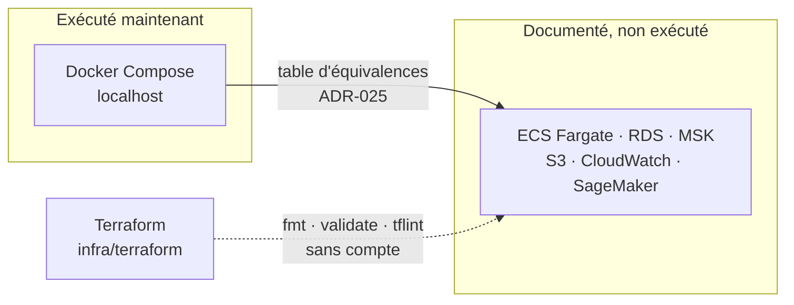

# Cloud AWS : cible documentée, non exécutée

> **Statut au 20/10/2026.** Le professeur indique que le projet peut tourner sur `localhost` pour le moment, mais pas sur des services AWS (Amazon Web Services). Ces documents sont **conservés** : ils décrivent la cible et permettent de reprendre AWS le jour où il est autorisé par écrit. Décision : [ADR-023](../01-architecture/adr/ADR-023-execution-locale-d-abord.md).

Abréviations : ECS (Elastic Container Service), RDS (Relational Database Service), MSK (Managed Streaming for Apache Kafka), S3 (Simple Storage Service).

## Où se trouve quoi

| Sujet | Document | État |
|---|---|---|
| Hébergement ECS Fargate et Docker | [ADR-003](../01-architecture/adr/ADR-003-aws-ecs-fargate-docker.md) | Cible documentée |
| Région eu-west-1 | [ADR-006](../01-architecture/adr/ADR-006-region-eu-west-1.md) | Cible documentée |
| Compte, plafond de dépense, plan B | [ADR-007](../01-architecture/adr/ADR-007-compte-aws.md) | Différée ; plan B appliqué |
| Infrastructure as Code | [ADR-020](../01-architecture/adr/ADR-020-terraform.md), `infra/terraform` | Écrit, validé statiquement, non appliqué |
| Docker, images, déploiement | [ADR-021](../01-architecture/adr/ADR-021-docker-deploiement.md) | Images locales ; publication documentée |
| Hébergement MongoDB | [ADR-022](../01-architecture/adr/ADR-022-hebergement-mongodb.md) | Local en conteneur ; AWS documenté |
| Équivalents locaux de chaque service | [ADR-025](../01-architecture/adr/ADR-025-equivalents-locaux-des-services-aws.md) | Table de référence |
| Procédure de remise en route d'AWS | Section ci-dessous | À suivre sur autorisation écrite |

## Remettre AWS en route (uniquement sur autorisation écrite)

| Ordre | Action | Issue |
|---|---|---|
| 1 | Obtenir l'autorisation écrite du professeur ; la consigner dans `docs/07-gestion/decisions-professeur.md` | GES-06 |
| 2 | Décider compte, plafond et budget d'alerte ([ADR-007](../01-architecture/adr/ADR-007-compte-aws.md)) | CLD-01 |
| 3 | Authentification GitHub → AWS par OIDC (OpenID Connect), sans clé longue durée | CLD-09 |
| 4 | Réseau et dépôt d'images, puis ECS Fargate | CLD-10, CLD-12 |
| 5 | Adaptateurs AWS derrière les ports (stockage, bus, secrets) | [ADR-025](../01-architecture/adr/ADR-025-equivalents-locaux-des-services-aws.md) |
| 6 | Créer la variable `AWS_ROLE_ARN` : c'est elle qui active `deploy.yml` et `terraform.yml` | CLD-09 |
| 7 | Essais courts, `terraform destroy` après chaque séance | [ADR-007](../01-architecture/adr/ADR-007-compte-aws.md) |

## Ce qu'on ne fait pas pour l'instant

| Interdit | Raison |
|---|---|
| Ouvrir un compte AWS ou créer une ressource | Consigne du professeur |
| Enregistrer une clé, un rôle ou une variable AWS dans GitHub | `deploy.yml` et `terraform.yml` s'activeraient |
| Lancer `terraform plan` ou `apply` | Exigent des identifiants |
| Supprimer ces documents | Ils servent à la reprise et à la soutenance |
