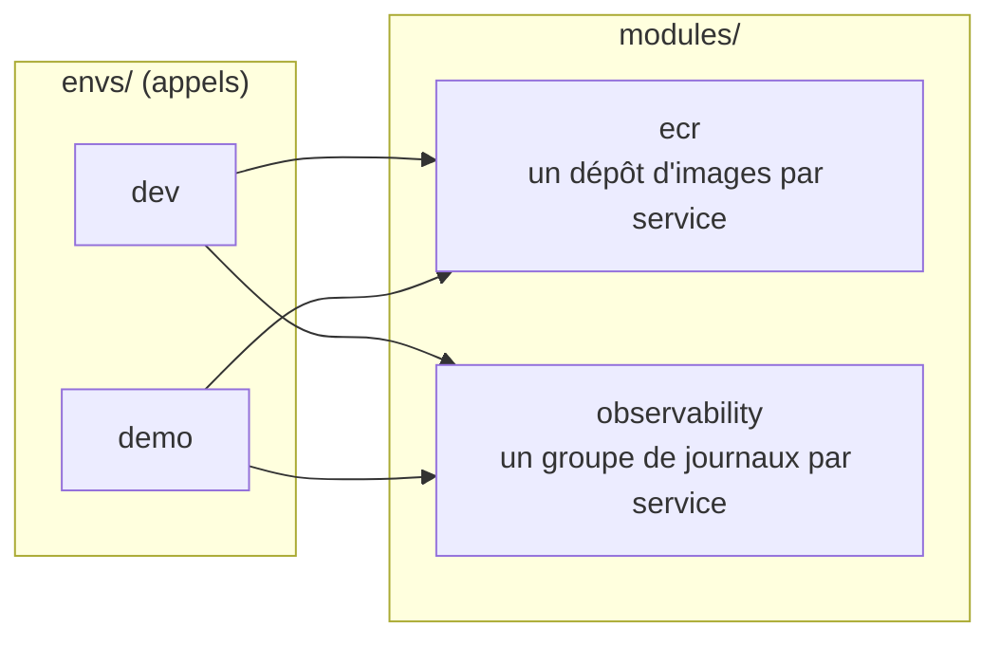

# Contrôles Terraform sans compte AWS (LOC-06)

Dernière mise à jour : 06/11/2026 · Responsable : Manoa Robel · Relecture : Daddy Luciano

Abréviations : Terraform (outil d'infrastructure as code, IaC), tflint (analyseur de code Terraform), Snyk IaC (analyse de sécurité de l'IaC), ECR (Elastic Container Registry), CI (Continuous Integration, intégration continue), OIDC (OpenID Connect).

Le projet ne crée aucune ressource AWS ([ADR-023](../01-architecture/adr/ADR-023-execution-locale-d-abord.md)). Le code Terraform reste utile comme cible documentée **à condition d'être contrôlé** : cette page décrit comment, sans identifiant AWS, sur les deux postes.

## 1. Ce qui est contrôlé

Avant LOC-06, `infra/terraform/` ne contenait que des `.gitkeep` : les contrôles auraient « réussi » sur du vide. Un **squelette** a donc été écrit. Il reste volontairement petit.



| Élément | Contenu | Écart avec l'[ADR-020](../01-architecture/adr/ADR-020-terraform.md) |
|---|---|---|
| `modules/ecr` | un dépôt par service, étiquettes immuables, analyse à la poussée, chiffrement, purge des anciennes images | l'ADR place les dépôts dans `envs/base`, qui n'existe pas encore |
| `modules/observability` | un groupe de journaux CloudWatch par service, durée de conservation réglable | conforme |
| `envs/dev`, `envs/demo` | fournisseur AWS (région `eu-west-1`, étiquettes `projet`, `env`, `proprietaire`), appel des deux modules | `demo` détruit les dépôts même pleins, conservation 7 jours |
| `.terraform.lock.hcl` (un par environnement) | version exacte du fournisseur et empreintes | conforme (versionné) |
| Réseau, RDS, MongoDB, état distant S3, rôle OIDC | **absents** | CLD-10 et CLD-11, différées |

Les cinq services de la liste par défaut sont les images construites par le job `docker` de la CI (`alerte`, `collecte`, `reponse`, `traitement`, `frontend`). Le simulateur et la passerelle ne sont pas dans la liste : **à décider** avec Daddy.

## 2. Lancer les contrôles

Prérequis : Docker, et rien d'autre (Terraform, tflint et Snyk tournent dans des conteneurs aux versions fixées dans `scripts/dev/terraform_check.py`).

| Action | Linux (bash) | Windows (PowerShell) |
|---|---|---|
| Tous les contrôles | `python3 scripts/dev/dev.py terraform-check` | `py -3 scripts/dev/dev.py terraform-check` |
| Sans Snyk (résultat « incomplet ») | `python3 scripts/dev/dev.py terraform-check --sans-snyk` | `py -3 scripts/dev/dev.py terraform-check --sans-snyk` |
| Voir la sortie de chaque outil | ajouter `--verbose` | ajouter `--verbose` |
| Régénérer les verrous | `python3 scripts/dev/dev.py terraform-check --lock` | `py -3 scripts/dev/dev.py terraform-check --lock` |
| Raccourci | `make terraform-check` | (`make` n'existe pas sous Windows) |

Jeton Snyk (compte gratuit, sans lien avec AWS) : variable d'environnement `SNYK_TOKEN`, ou ligne `SNYK_TOKEN=...` dans `.env` (ignoré par Git).

| | Linux (bash) | Windows (PowerShell) |
|---|---|---|
| Jeton pour la session | `export SNYK_TOKEN=...` | `$env:SNYK_TOKEN = "..."` |

Sans jeton, l'étape Snyk est **sautée** et la commande se termine avec le code 2 : un contrôle non lancé n'est jamais présenté comme réussi.

| Code de sortie | Sens |
|---|---|
| 0 | tout a réussi |
| 1 | au moins un contrôle a échoué (la sortie de l'outil est affichée) |
| 2 | rien n'a échoué, mais un contrôle n'a pas été lancé (jeton Snyk absent) |

## 3. Les étapes

| Étape | Commande exécutée dans le conteneur | Ce qu'elle prouve |
|---|---|---|
| Format | `terraform fmt -check -recursive -diff` | le code est au format canonique |
| Initialisation | `terraform init -backend=false -lockfile=readonly` | les modules se résolvent, le fournisseur correspond au verrou versionné, aucun état distant n'est contacté |
| Validation | `terraform validate` | la configuration est cohérente (types, références, arguments) |
| Lint | `tflint --recursive` (règles Terraform recommandées + règles AWS) | bonnes pratiques et erreurs que `validate` ne voit pas |
| Sécurité | `snyk iac test . --severity-threshold=high` | aucune alerte haute (même seuil que la CI) |

Garanties du script :

- le dépôt est monté **en lecture seule** ; l'état d'initialisation et les fournisseurs vont dans le volume Docker `novaria-terraform-cache` ;
- **aucune variable `AWS_*`** n'est transmise au conteneur, et celles du poste sont retirées du processus ;
- les chemins et les commandes sont identiques sous Linux et Windows (tests dans `scripts/dev/test_terraform_check.py`).

## 4. Résultats

| Poste | Date | Fmt | Init | Validate | tflint | Snyk IaC |
|---|---|---|---|---|---|---|
| Linux (Ubuntu), Manoa | 06/11/2026 | OK | OK (`dev` et `demo`) | OK (`dev` et `demo`) | OK (Terraform 1.17.0, tflint 0.65.0, règles AWS 0.50.0) | **non lancé** : pas de jeton Snyk sur ce poste |
| Windows, Daddy | | non vérifié | non vérifié | non vérifié | non vérifié | non vérifié |

Les contrôles ne sont pas vides. Sur une copie jetable avec trois défauts injectés, ils échouent : `fmt` signale deux fichiers mal formatés (code 3), `validate` refuse une référence inexistante (`module.ecr.n_existe_pas`, code 1), `tflint` signale une variable déclarée et non utilisée (code 2).

Mesures sur le poste Linux : premier lancement 399 s (téléchargement du fournisseur, connexion lente), lancements suivants environ 35 s. Le registre Terraform a une fois expiré depuis le conteneur (`init`, 21 s, puis réussite au second essai) : relancer la commande suffit.

## 5. Limites connues

| Limite | Conséquence |
|---|---|
| Premier lancement : téléchargement du fournisseur AWS (≈ 180 Mo), plusieurs minutes sur une connexion lente | le volume de cache évite de le répéter ; le second environnement le réutilise |
| Le plugin AWS de tflint se télécharge depuis GitHub | réseau nécessaire au premier lancement |
| Le verrou ne contient que la plateforme `linux_amd64` | suffisant avec Docker Desktop sous Windows (conteneurs Linux) ; un poste ARM doit ajouter sa plateforme (`LOCK_PLATFORMS`) |
| `terraform plan` n'est pas exécuté | il exige des identifiants AWS ; la validation de la **configuration réelle** (quotas, droits, valeurs acceptées par AWS) n'est donc pas couverte |
| Squelette volontairement petit | les contrôles prouvent que ce code est sain, pas que l'architecture AWS complète de l'ADR-020 est écrite |

## 6. Proposition de job de CI (à approuver avant fusion)

Elle modifie les contrôles de la CI : elle ne se fusionne qu'avec l'**accord écrit des deux membres** (CLAUDE.md, point 6). Elle fera l'objet d'une pull request séparée, après celle qui contient ce squelette et le script.

| Question | Proposition |
|---|---|
| Où | nouveau fichier `.github/workflows/terraform-controles.yml` ; `ci.yml` et `terraform.yml` ne changent pas |
| Quand | `pull_request` sur `infra/terraform/**` et `scripts/dev/terraform_check.py` |
| Identifiants | aucun : `permissions: contents: read`, pas de `id-token`, pas de rôle AWS |
| Quoi | la **même commande** que sur les postes : `python3 scripts/dev/dev.py terraform-check` (les exécuteurs `ubuntu-latest` ont Docker) |
| Secret | `SNYK_TOKEN`, déjà présent pour le job `snyk` ; absent sur une pull request venue d'un fork, le job échoue alors en code 2 (incomplet), ce qui est voulu |
| Protection de `main` | inchangée : le job n'est pas ajouté aux contrôles obligatoires sans accord séparé |

```yaml
name: Terraform (contrôles statiques)

on:
  pull_request:
    paths: ["infra/terraform/**", "scripts/dev/terraform_check.py"]

permissions:
  contents: read

jobs:
  controles:
    runs-on: ubuntu-latest
    env:
      SNYK_TOKEN: ${{ secrets.SNYK_TOKEN }}
    steps:
      - uses: actions/checkout@v7
      - run: python3 scripts/dev/dev.py terraform-check
```

| Avantage | Inconvénient |
|---|---|
| une seule définition des contrôles, identique en local et en CI | dépend de Docker et du réseau (téléchargement du fournisseur à chaque exécution, sans cache) |
| versions fixées au même endroit | le script devient un composant de la CI : sa modification est aussi un changement de contrôle |

Alternative écartée pour l'instant : les actions `hashicorp/setup-terraform` et `terraform-linters/setup-tflint`. Elles reproduisent la logique dans le YAML et peuvent diverger du poste. À rouvrir si le temps d'exécution gêne.

**Conséquence à connaître avant de fusionner le squelette :** le job `snyk` de `ci.yml` exécute déjà `snyk iac test infra/terraform --severity-threshold=high` dès que des `.tf` existent. Jusqu'ici il affichait « Pas encore de Terraform ». Une alerte haute sur le squelette ferait donc passer ce job au rouge. Lancer l'analyse Snyk IaC en local (avec `SNYK_TOKEN`) avant d'ouvrir la pull request.
