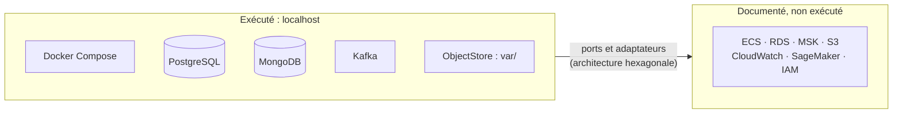

# Remplacer AWS par des équivalents locaux : état, issues ouvertes et questions du jury

| Champ | Valeur |
|---|---|
| Date | 13/11/2026 |
| Issues | LOC-05 (#152), DOC-11 (#156), CLD-13 à CLD-19 et CLD-21 (#86 à #92, #105), MS-15 à MS-17 (#134 à #136), DAT-08 (#83), DAT-09 (#84), GES-09 (#93) |
| Décisions | [ADR-023](../01-architecture/adr/ADR-023-execution-locale-d-abord.md) (exécution locale d'abord), [ADR-025](../01-architecture/adr/ADR-025-equivalents-locaux-des-services-aws.md) (table d'équivalences) |
| Lien | [Cloud AWS : cible documentée](README.md) |

Abréviations : AWS (Amazon Web Services), ECS (Elastic Container Service), ECR (Elastic Container Registry), RDS (Relational Database Service), MSK (Managed Streaming for Apache Kafka), S3 (Simple Storage Service), EMR (Elastic MapReduce), IAM (Identity and Access Management, gestion des identités et des accès), OIDC (OpenID Connect), SDK (Software Development Kit, kit de développement), ADR (Architecture Decision Record, enregistrement de décision d'architecture), CI (Continuous Integration, intégration continue).

## 1. En bref

**Consigne du professeur** : le projet tourne sur `localhost` ; **aucune ressource AWS n'est créée** ([ADR-023](../01-architecture/adr/ADR-023-execution-locale-d-abord.md)). La table d'équivalences de l'ADR-025 dit par quoi chaque service AWS est remplacé. Ce document ajoute ce que l'ADR ne dit pas :

| Question | Section |
|---|---|
| Quel service AWS est remplacé par quoi, et où est-ce dans le dépôt ? | 2 |
| Que reste-t-il à faire dans les issues ouvertes, et comment le faire sans AWS ? | 3 |
| Ce que le remplaçant **prouve** et **ne prouve pas** | 4 |
| Comment le vérifier soi-même | 5 |
| Questions probables du jury | 6 |

**Règle de lecture** : « équivalent local » signifie que la **compétence** est démontrée (conteneurs, flux, sauvegarde, contrôle d'accès). Cela ne signifie pas que le **service AWS** a été essayé. Chaque preuve le dit.

## 2. Table d'équivalences et état

État relevé dans le dépôt le 13/11/2026. « Non vérifié » signale ce qui n'a pas été contrôlé pour ce document.

| Service AWS prévu | Usage | Équivalent local | Où | État |
|---|---|---|---|---|
| ECS Fargate | Exécuter les conteneurs | Docker Compose | `docker-compose.yml` | En service |
| ECR | Stocker les images | Images construites localement, étiquette = SHA (Secure Hash Algorithm) du commit | `docker compose build` | En service ; publication documentée |
| RDS PostgreSQL | Base métier et entrepôt | Conteneur `postgres:16-alpine` | `db/postgres/` | En service |
| MongoDB hébergé | Journaux, événements, audit | Conteneur `mongo:7` | `db/mongo/` | En service |
| MSK | Bus d'événements | Kafka en mode KRaft (`apache/kafka:4.3.1`) | [kafka-local.md](../08-exploitation/kafka-local.md) | En service |
| Flink géré | Fenêtres temps réel | Consommateur Python (repli prévu par l'ADR-011) ; Flink si le temps le permet | `services/traitement/` | Fenêtres en service ; Flink : DAT-09 (#84) ouverte |
| EMR | Prototype Big Data | PySpark en mode local `local[*]` | DAT-08 (#83) | À faire |
| Glue | Catalogue, ETL (Extract, Transform, Load) | Scripts Python et [dictionnaire de données](../03-donnees/dictionnaire-de-donnees.md) | `data/etl/` | En service ; Glue non exécuté |
| S3 | Jeux de données, modèles, sauvegardes | Port `ObjectStore` sur `var/`, dossier `backups/` | `ml/src/stockage/objets.py` | Port `ObjectStore` (écrire, lire, lister) pour les modèles et les jeux ; test d'absence de SDK : LOC-05 (#152), fait le 13/11/2026 ([stockage d'objets](../03-donnees/stockage-objets.md)). Sauvegardes et rapports restent hors du port |
| SageMaker | Entraînement, service de modèles | scikit-learn ; registre MongoDB `model_runs` | `ml/` | En service ([ADR-017](../01-architecture/adr/ADR-017-mlops-mlsecops.md)) |
| CloudWatch | Journaux, métriques, alarmes | Journaux JSON ; `GET /metrics` au format Prometheus | `services/traitement/app/api/metrics.py` | `/metrics` dans `traitement` ; autres services : non vérifié. Alarmes : MS-16 (#135), à faire |
| Secrets Manager | Secrets d'exécution | `.env` généré, ignoré par Git | `dev.py init-env` | En service |
| IAM, OIDC | Identités, accès du CI | Rôles `viewer` / `operator` / `admin` à la passerelle ; comptes de base par service | `gateway/`, `db-check` | En service ; aucune clé AWS dans GitHub |
| EventBridge Scheduler | Tâches planifiées | `cron`, Planificateur de tâches Windows, profil Compose `ops` | `docker-compose.yml` (profil `ops`) | En service pour les sauvegardes |
| VPC, ALB | Réseau, entrée | Réseau Compose ; ports sur `127.0.0.1` ; seule la passerelle est l'entrée | `docker-compose.yml` | En service |

**Aucun SDK AWS dans le code.** Recherche faite le 13/11/2026 : `boto3` n'apparaît dans aucun fichier de `services/`, `ml/` ni `frontend/src/` ; il est seulement cité dans un script de gestion du backlog (`scripts/github/`). Un test automatique qui le garantit reste à écrire (LOC-05).

## 3. Issues ouvertes : comment les mener sans AWS

Légende : **Local** = faisable tel quel ; **À reformuler** = l'énoncé cite AWS, le critère doit être réécrit pour être satisfaisable en local ; **Documenté** = reste une cible écrite, rien n'est exécuté.

| Issue | Ce que l'énoncé suppose | Remplacement local | Type |
|---|---|---|---|
| **#152 LOC-05** | Port `ObjectStore` et test sans SDK AWS | **Fait le 13/11/2026** : port dans `ml/src/stockage/` (`backend/` n'existe pas), test dans `ml/tests/test_absence_sdk_aws.py` | Local |
| **#156 DOC-11** | Relire l'ADR-025 | Mettre cette table à jour avec ce qui est construit ; mettre à jour le risque R6 | Local |
| **#86 CLD-13**, **#134 MS-15** | Parcours de bout en bout, cas d'échec | Pile Compose réelle : capteur simulé → collecte → traitement → alerte → réponse ; pannes en arrêtant un conteneur | Local |
| **#88 CLD-15** | Sauvegarde et restauration | `dev.py backup`, `restore-check` ; [procédure existante](../08-exploitation/sauvegarde-restauration-locale.md) | Local (en grande partie fait) |
| **#135 MS-16** | Observabilité locale | Journaux JSON avec identifiant de corrélation, `/metrics` dans chaque service, règle d'alerte | Local |
| **#87 CLD-14** | « Détection dans CloudWatch » | Arrêter un service, détecter par `/metrics` et les journaux ; l'alarme est une règle d'alerte locale (Prometheus avec Alertmanager, ou script `dev.py`). Ces outils ne sont pas dans la pile aujourd'hui | À reformuler |
| **#89 CLD-16** | « Rollback d'ECS » | Redéployer l'image du SHA précédent avec Compose ; documenter que les données ne reviennent pas | À reformuler |
| **#90 CLD-17** | `terraform plan` à 0 changement | Le plan exige des identifiants : non exécuté. Contrôles statiques faits : [contrôles Terraform sans compte](controles-terraform-sans-compte.md). Option à évaluer : un module Terraform avec le fournisseur Docker pour montrer l'idempotence en local (non vérifié) | À reformuler |
| **#91 CLD-18** | Matrice d'accès IAM | Matrice rôles × ressources locale : rôles de la passerelle, comptes de base par service ; un essai autorisé et un refusé par rôle | À reformuler |
| **#136 MS-17** | ECR, ECS Fargate, MSK | Compose : un conteneur par service, révision du commit vérifiée, seule la passerelle exposée. Déploiement AWS : documenté | À reformuler ; AWS documenté |
| **#93 GES-09** | Chiffrage AWS | Coût **projeté**, tarifs publics, mention « projeté, non déployé » | Documenté |
| **#105 CLD-21** | `terraform destroy`, facture | Contrôle que **rien** n'a été créé : aucune variable `AWS_ROLE_ARN` ni `AWS_REGION`, aucun secret AWS dans GitHub | À reformuler |
| **#83 DAT-08** | EMR documenté | PySpark local ; paragraphe « équivalent EMR, non exécuté » | Local |
| **#84 DAT-09** | MSK documenté | Kafka local, fenêtres, MongoDB ; paragraphe « équivalent MSK, non exécuté » | Local |

Issues ouvertes **sans lien avec AWS** (rien à remplacer) : #92 CLD-19 (revue Snyk et SonarQube), #98 CLD-20, #95 DOC-06, #96 DOC-07, #99 DOC-08, #100 GES-12, #101 DOC-09, #102 GES-13, #103 GES-14, #104 GES-15.

### 3.1 Ordre proposé

| Rang | Issue | Pourquoi |
|---|---|---|
| 1 | #152 LOC-05 | Ferme le dernier trou de l'ADR-025 et donne le test « aucun SDK AWS » |
| 2 | #135 MS-16 | CLD-14 et le diagnostic en dépendent |
| 3 | #87, #91, #89 | Réutilisent l'observabilité, les rôles et les images déjà en place |
| 4 | #86, #134 | Parcours de bout en bout, une fois les pannes détectables |
| 5 | #90, #136, #93, #105 | Documents et contrôles sans exécution AWS |

Reformuler un énoncé d'issue est une modification publique du backlog : elle se décide à deux, relecture croisée comprise.

## 4. Ce que le remplaçant prouve, et ce qu'il ne prouve pas

| Sujet | Démontré en local | Non démontré |
|---|---|---|
| Conteneurs | Un conteneur par service, images reconstruites, démarrage par une commande | Ordonnancement ECS, mise à l'échelle automatique |
| Bus | Production et consommation Kafka, reprise après redémarrage | Débit, durabilité et réplication de MSK |
| Données | Sauvegarde, restauration dans une base jetable, comptages identiques | Réplication, sauvegarde automatique de RDS |
| Sécurité | Rôles de la passerelle, comptes de base par service, aucun secret dans le dépôt | Politiques IAM, chiffrement géré (KMS) |
| Observabilité | `/metrics`, journaux JSON, détection d'une panne injectée | Alarmes gérées, tableaux de bord CloudWatch |
| Infrastructure | Terraform contrôlé sans compte (fmt, validate, tflint) | `plan` et `apply` réels |
| Retour de version | Redéploiement d'une image précédente | Rollback ECS |
| Coûts | Projection sur tarifs publics | Facture réelle |

Les écarts assumés (durabilité, sécurité, mise à l'échelle, observabilité) sont aussi dans l'ADR-025, section 4.3.

## 5. Vérifier soi-même

| Contrôle | Linux (bash) | Windows (PowerShell) |
|---|---|---|
| Aucun SDK AWS dans le code | `grep -rIl "boto3" services ml frontend/src` | `Get-ChildItem -Recurse services,ml,frontend/src -File \| Select-String -Pattern "boto3" -List` |
| Aucune variable AWS dans le dépôt GitHub | `gh variable list` | `gh variable list` |
| Pile locale démarrée | `python3 scripts/dev/dev.py up` puis `docker compose ps` | `py -3 scripts/dev/dev.py up` puis `docker compose ps` |
| Bases vérifiées | `python3 scripts/dev/dev.py db-check` | `py -3 scripts/dev/dev.py db-check` |
| Sauvegarde relue | `python3 scripts/dev/dev.py backup` puis `restore-check` | `py -3 scripts/dev/dev.py backup` puis `restore-check` |
| Terraform sans compte (Docker requis) | `python3 scripts/dev/dev.py terraform-check` | `py -3 scripts/dev/dev.py terraform-check` |

Résultat attendu : le premier contrôle ne renvoie aucun fichier (relevé du 13/11/2026 : aucun résultat) ; `gh variable list` ne montre ni `AWS_ROLE_ARN` ni `AWS_REGION` (relevé du 13/11/2026 : la liste est vide). **Non vérifié sous Windows** : les deux colonnes n'ont été essayées que sous Linux, sauf `dev.py`, déjà utilisé par l'autre membre.

## 6. Questions probables du jury

| Question | Réponse courte | Preuve |
|---|---|---|
| Pourquoi n'avez-vous pas utilisé AWS ? | Consigne écrite du professeur : exécution locale, aucune ressource AWS ([ADR-023](../01-architecture/adr/ADR-023-execution-locale-d-abord.md)) | `docs/07-gestion/decisions-professeur.md` |
| Votre architecture est-elle prête pour AWS ? | Oui, par des ports et des adaptateurs : le domaine n'importe aucun SDK AWS ; passer à AWS coûte un adaptateur par port, pas une réécriture ([ADR-025](../01-architecture/adr/ADR-025-equivalents-locaux-des-services-aws.md)). Cela n'a **pas été essayé** | Test d'absence de SDK (LOC-05, à écrire) |
| Pourquoi pas LocalStack, qui émule AWS ? | Écarté : conteneur lourd, couverture partielle, dépendance de plus ; les services libres sont plus simples ([ADR-025](../01-architecture/adr/ADR-025-equivalents-locaux-des-services-aws.md), option A) | ADR-025, section 3 |
| Qu'est-ce qui prouve que le code marche sur AWS ? | Rien : nous ne le prétendons pas. Les contrôles Terraform sont statiques ; `plan` et `apply` n'ont pas été lancés | [Contrôles Terraform sans compte](controles-terraform-sans-compte.md) |
| Comment gérez-vous la montée en charge sans mise à l'échelle automatique ? | Elle se démontre avec le simulateur à débit réglable ; les limites sont dites | ADR-025, section 4.3 ; `scripts/dev/bench_collecte.py` |
| Comment prouvez-vous que vos sauvegardes servent ? | Restauration dans une base jetable et comparaison des comptages | [Sauvegarde et restauration](../08-exploitation/sauvegarde-restauration-locale.md) |
| Comment détectez-vous une panne sans CloudWatch ? | `/metrics`, journaux JSON, règle d'alerte locale (MS-16, #135, à faire) | À venir : `docs/08-exploitation/observabilite.md` |
| Et le contrôle d'accès sans IAM ? | Rôles `viewer`, `operator`, `admin` vérifiés à la passerelle ; comptes de base par service ; le lecteur reçoit 403 sur la commande des feux | [ADR-029](../01-architecture/adr/ADR-029-passerelle-et-authentification.md), parcours de bout en bout MS-14 |
| Combien coûterait AWS ? | Coût **projeté**, tarifs publics × durée, mention « projeté, non déployé » (GES-09, #93, à faire) | À venir : `docs/07-gestion/couts-aws.md` |
| Que se passe-t-il si AWS est autorisé demain ? | Procédure en sept étapes, dont l'autorisation écrite et le budget ; `deploy.yml` et `terraform.yml` ne s'activent qu'avec `AWS_ROLE_ARN` | [Remettre AWS en route](README.md) |
| Avez-vous créé des ressources AWS « pour voir » ? | Non : aucun compte, aucune clé, aucune variable AWS dans GitHub | Contrôles de la section 5 |
| Pourquoi garder des documents AWS ? | Ils décrivent la cible et servent à la reprise et à la soutenance : « voici la cible, voici ce qui a tourné » | [README du dossier](README.md) |

## 7. Choix à valider, écarts et limites

| Point | État |
|---|---|
| Reformulation des énoncés #87, #89, #90, #91, #136, #105 | À décider à deux ; non faite |
| Prometheus et Alertmanager pour les alarmes locales | À évaluer : absents de la pile actuelle, non essayés |
| Terraform avec le fournisseur Docker pour CLD-17 | À évaluer, non essayé |
| `/metrics` des autres services que `traitement` | Non vérifié |
| Commandes Windows de la section 5 | Non vérifiées |
| Issues déjà fermées | Non relues pour ce document |
