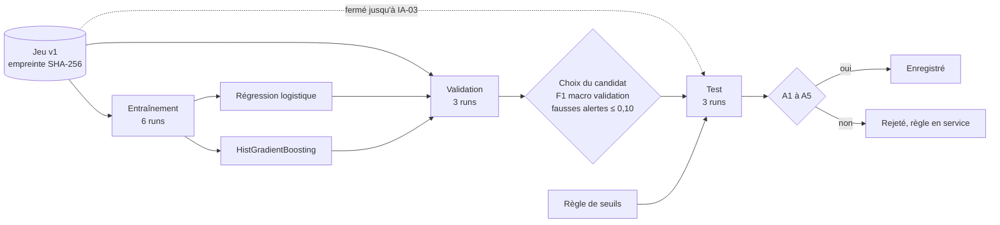

# Cadrage du cas d'usage ML : cible, métriques, référence, seuil d'acceptation et sécurité du cycle (IA-01)

Dernière mise à jour : 12/11/2026 · Issue IA-01 (#77) · Exigence : EXG-IA-01 · Décisions : [ADR-015](../01-architecture/adr/ADR-015-modeles-ia.md), [ADR-027](../01-architecture/adr/ADR-027-jeux-de-donnees-et-provenance.md), [ADR-028](../01-architecture/adr/ADR-028-etats-de-congestion-et-alertes.md) · Auteur : Manoa Robel · Relecture : Daddy Luciano (à faire)

Abréviations : ML (Machine Learning, apprentissage automatique), MLOps (Machine Learning Operations, exploitation des modèles), MLSecOps (Machine Learning Security Operations, sécurité de l'exploitation des modèles), SCA (Software Composition Analysis, analyse des dépendances), IA (intelligence artificielle), F1 (moyenne harmonique de la précision et du rappel), SHA-256 (Secure Hash Algorithm, empreinte de 256 bits), PSI (Population Stability Index, indice de stabilité de population), API (Application Programming Interface, interface de programmation).

## 0. Ce que ce document fixe, et quand

Ce document est écrit **avant tout entraînement**. Au 12/11/2026, `ml/training/` et `ml/evaluation/` sont vides : aucun modèle n'a été entraîné, et l'ensemble de test du jeu v1 n'a **pas été lu** (l'outil de mesure refuse de l'ouvrir, section 10 ; seule l'intégrité de ses octets est contrôlée, section 9).

| Fixé ici | Section |
|---|---|
| La cible | 2 |
| Les variables permises et interdites | 3 |
| Les quatre métriques et leur définition exacte | 4 |
| La référence à battre et les seuils de l'ADR-028 (définitifs) | 5 |
| Le seuil d'acceptation | 6 |
| Le protocole : qui voit quoi, dans quel ordre | 7 |
| Ce que l'exploitation (MLOps) exige de chaque modèle | 8 |
| Les menaces propres au ML, les contrôles décidés et les conditions de sécurité S1 à S5 (MLSecOps) | 9 |

Une valeur de ce document ne change **pas** après la lecture du test. Si une valeur doit changer, la modification s'écrit dans la section 12 (avenants), avec sa date et sa raison ; le commit de l'avenant précède l'évaluation qu'il concerne.

## 1. Périmètre : MLOps et MLSecOps

Le cadrage couvre le cycle de vie du modèle (MLOps) **et** sa sécurité (MLSecOps, Machine Learning Security Operations : la sécurité intégrée à chaque étape du cycle, dans le prolongement du DevSecOps). Les menaces propres au ML sont celles de l'[ADR-017](../01-architecture/adr/ADR-017-mlops-mlsecops.md), section 4.4, ramenées à l'échelle d'un projet local sur données simulées : la section 9 les reprend une à une, avec le contrôle décidé **avant** l'entraînement, sa preuve et son état réel.

| Étape du cycle | MLOps (ce que le cadrage fixe) | MLSecOps (ce que le cadrage protège) |
|---|---|---|
| Données | jeu v1 reproductible, découpage par run et par scénario | jeu intact (SHA-256 contre le manifeste), anomalies injectées dans le jeu |
| Entraînement | graine, révision du code, 12 combinaisons au plus | dépendances épinglées avec empreintes, aucun secret ni notebook dans le pipeline |
| Évaluation | quatre métriques, seuil d'acceptation, test lu une fois | fausses alertes mesurées sur des runs à anomalies, aucune fuite vers le test |
| Enregistrement | `model_runs`, barrière sous le seuil | empreinte du modèle, format sans exécution de code, écriture réservée au rôle du pipeline |
| Service et surveillance | repli sur la règle, dérive des entrées (PSI) | le modèle ne commande rien, entrées validées, fiche du modèle |

Les règles générales du dépôt restent valables : aucun secret, aucune donnée sous licence restrictive, dépôt public (`CLAUDE.md`, section 6).

## 2. La cible

| Élément | Valeur |
|---|---|
| Question posée | Dans quel état est un tronçon de route à cette minute ? |
| Cible | `label_state` ∈ {`FREE_FLOW` (fluide), `SLOW` (ralenti), `CONGESTED` (congestionné)} |
| Unité | un tronçon, une fenêtre de **1 minute** (ADR-028) |
| Vérité terrain | l'état **voulu par le scénario du simulateur**, jamais la sortie de la règle de seuils (ADR-027, section 3.3) |
| Second cas, plus tard | la prévision de vitesse à 5 et 15 minutes (IA-10), colonnes `speed_ratio_h5` et `speed_ratio_h15` : **hors de ce cadrage** |
| Pas de modèle pour `UNKNOWN` | complétude insuffisante : traitée par la règle de qualité (DQ-07), pas apprise |

Pourquoi cette règle de vérité terrain : si le label était la sortie de la règle de seuils, le score d'un modèle mesurerait sa fidélité à la règle, et il ne pourrait jamais la « battre » honnêtement.

## 3. Les variables

Le jeu `novaria-congestion-v1` ([fiche de provenance](../../data/datasets/novaria-congestion-v1/PROVENANCE.md)) a 36 colonnes. Toutes ne peuvent pas entrer dans le modèle.

| Groupe | Colonnes | Décision | Raison |
|---|---|---|---|
| Mesures de la minute | `vehicle_count`, `flow_veh_per_min`, `average_speed_kmh`, `occupancy_rate`, `max_queue_length_m`, `speed_ratio` | **Permises** | ce que la production reçoit à cet instant |
| Historique | `speed_ratio_lag1` à `lag5`, `flow_lag1` à `lag5`, `speed_ratio_ma5`, `speed_ratio_ma15`, `flow_ma5`, `flow_ma15` | **Permises** | uniquement du passé de la ligne (dictionnaire, section 9) |
| Tronçon | `lane_count`, `length_m`, `free_flow_speed_kmh`, `road_type` | **Permises** | statiques, connues du référentiel |
| Calendrier | `hour_of_day`, `iso_day_of_week`, `is_weekend`, `is_holiday` | **Interdites en v1** | un seul jour simulé : trois colonnes constantes ; `hour_of_day` suit le scénario, et deux runs d'un même scénario ont le même calendrier d'états (fiche, section 8) : le modèle apprendrait « 07 h 40 dans la pointe = congestion » et le test le récompenserait |
| Clés | `run_id`, `scenario_id`, `seed`, `road_segment_id`, `window_start` | **Interdites** | identifiants : mémoriser un run n'est pas détecter la congestion |
| Réponse de la détection | `label_state` | **Interdite** (c'est la cible) | |
| Réponses de la prévision | `speed_ratio_h5`, `speed_ratio_h15` | **Interdites** | elles contiennent l'**avenir** de la même série : fuite directe |

Cette classification est **dans le code** : `ml/src/preparation/variables.py` (chaque colonne du jeu y est variable, cible ou interdite avec sa raison ; une colonne ajoutée sans décision fait échouer les tests). Pour la **prévision** (IA-10), le calendrier est permis, calculé depuis l'instant (`calendrier.py`) ; l'état voulu de la minute et l'autre horizon restent interdits. Valeurs absentes : elles restent absentes. Gradient boosting : prises en charge telles quelles. Régression logistique : médiane de l'entraînement, calculée sur l'entraînement seul.

## 4. Les métriques

Calculées par `ml/src/mesures/metriques.py` (fonctions pures, testées à la main et par mutation). **F1 et rappel se calculent sur toutes les minutes réunies** de l'ensemble évalué, pas run par run : un run de journée calme ne contient qu'un état et son F1 macro vaut 1/3 quoi qu'on prédise.

| Métrique | Définition exacte | Pourquoi |
|---|---|---|
| **F1 macro** | moyenne non pondérée des F1 des trois états | les classes sont déséquilibrées (89 % / 7 % / 4 %) : l'exactitude seule récompenserait « toujours fluide » (F1 macro 0,314) |
| **Rappel de `CONGESTED`** | minutes congestionnées retrouvées ÷ minutes congestionnées réelles | rater une congestion est l'erreur qui coûte |
| **Délai de détection** | minutes entre le début réel d'un épisode `CONGESTED` et l'alerte (0 si l'alerte précède) ; médiane et maximum ; nombre d'épisodes **manqués** | c'est ce que l'usager ressent |
| **Fausses alertes par tronçon et par jour** | alertes fausses ÷ (minutes ÷ 1 440) | une alerte qui crie au loup est abandonnée |

Définition de l'alerte, identique pour la règle et pour le modèle ([ADR-028](../01-architecture/adr/ADR-028-etats-de-congestion-et-alertes.md)) : **une alerte naît à l'entrée de l'état annoncé dans `CONGESTED`**. Chaque épisode réel est réclamé par la **première** alerte arrivée entre 10 minutes avant son début et sa fin. Toute autre alerte est **fausse** : hors épisode, ou répétée dans un même épisode (un état qui clignote). Une alerte ne sert qu'un épisode.

Une matrice de confusion et la précision de chaque état accompagnent ces quatre mesures (ADR-015, section 3.2).

## 5. La référence à battre

### 5.1 Ce qu'elle est

La règle de seuils avec hystérésis de l'ADR-028, **exécutée par le code même du traitement en flux** (`services/traitement/app/flux/classifier.py`) : on mesure ce que la production calcule, pas une copie. Elle reste en service tant qu'aucun modèle ne la bat (ADR-015, section 6).

### 5.2 Les seuils : premier run, puis fixés

Premier run : la règle rejouée sur l'**entraînement** (6 runs, 28 tronçon-jours) et la **validation** (3 runs, 14 tronçon-jours). Le test n'est pas lu.

| Règle ou variante | F1 macro | Rappel `CONGESTED` | Délai médian / max (min) | Manqués | Fausses alertes par tronçon et jour |
|---|---|---|---|---|---|
| **Règle, valeurs de l'ADR-028 : entraînement** | 0,977 | 0,977 | 1 / 20 | 0 sur 18 | 0,00 |
| **Règle, valeurs de l'ADR-028 : validation** | 0,975 | 0,970 | 1 / 1 | 0 sur 9 | 0,07 |
| **Règle, entraînement + validation (référence de travail)** | **0,976** | **0,974** | **1 / 20** | **0 sur 27** | **0,02** |
| Même règle sans durée minimale (1 fenêtre partout) | 0,991 | 0,977 | 0 / 19 | 0 sur 27 | 0,74 |
| Toujours `FREE_FLOW` (plancher) | 0,314 | 0,000 | : | 27 sur 27 | 0,00 |

Deux lectures :

| Lecture | Conséquence |
|---|---|
| Les valeurs de l'ADR-028 sont sur un **plateau** : sur 15 variantes d'un seul réglage, 12 changent le F1 macro de moins de 0,01 (entraînement comme validation) ; les trois autres le **baissent** (de 0,009 à 0,034) : `slow_below` = 0,50, `recover_to_slow_above` = 0,50, `recover_windows` = 5 (tableau complet : `make reference-mesure SENS=1`) | rien ne justifie de les changer |
| **Le F1 seul récompense un état nerveux** : sans durée minimale, le F1 macro monte à 0,991 mais les fausses alertes passent de 0,02 à 0,74 par tronçon et jour | l'acceptation exige les fausses alertes (section 6) ; sinon un modèle « gagnerait » en clignotant |

**Décision : les valeurs de départ de l'ADR-028 deviennent définitives, sans changement.**

| Réglage | Valeur définitive |
|---|---|
| FREE_FLOW → SLOW | ratio de vitesse < 0,60 pendant 2 fenêtres |
| SLOW → CONGESTED, FREE_FLOW → CONGESTED | ratio < 0,35 pendant 2 fenêtres |
| CONGESTED → SLOW | ratio > 0,45 pendant 3 fenêtres |
| SLOW → FREE_FLOW, CONGESTED → FREE_FLOW | ratio > 0,70 pendant 3 fenêtres |
| tout état → UNKNOWN | complétude < 0,5 |
| Fenêtre de calcul | 1 minute |

Deux variantes font un peu mieux sur ce jeu (`recover_to_slow_above` = 0,40 : F1 macro 0,979 ; `recover_windows` = 2 : 0,982 à 0,984) et **ne sont pas retenues** : l'écart est de quelques millièmes, sur un jeu où les runs d'un même scénario ont le même calendrier d'états ; les valeurs actuelles sont déjà dans le code du traitement en flux (`rules.py`) et ses tests. Choisir la meilleure variante sur 9 runs serait régler les seuils sur le simulateur.

**Ce qui reste ouvert** : la question Q1 de [DAT-10](../03-donnees/revue-croisee-dat-10.md) (une valeur de la littérature ou de la ville est-elle attendue ?) n'a pas de réponse du professeur ([decisions-professeur.md](../07-gestion/decisions-professeur.md)). Les seuils sont définitifs **pour le simulateur**, avec les données du dépôt ; une autre consigne du professeur, ou un jeu réel, ouvre un avenant (section 12) et une nouvelle évaluation (conditions de réexamen de l'ADR-028).

### 5.3 Ce que cette référence ne voit pas

| Limite | Effet |
|---|---|
| Le jeu ne contient pas la complétude des fenêtres | la règle est rejouée avec une complétude de 1 : pas d'état `UNKNOWN`, et un capteur muet donne une fenêtre vide, comptée comme fluide |
| Un capteur muet pendant l'incident (run `ds1-incident-s32`) | la règle manque presque toute la congestion de ce run (rappel 0,2) ; un modèle qui ne voit pas non plus de mesures n'y changera rien |
| Le délai maximal de 20 minutes en entraînement | un seul épisode, celui du capteur muet ci-dessus |

## 6. Le seuil d'acceptation (fixé avant l'entraînement)

Un modèle n'est **accepté** que si, sur l'**ensemble de test**, il remplit les **cinq** conditions. La référence est mesurée sur ce même test, avec le même code (`ml/src/mesures/`), le même jour.

| N° | Condition | Valeur attendue si la référence reste à ses scores de travail |
|---|---|---|
| A1 | F1 macro du modèle ≥ F1 macro de la référence **+ 0,01** | ≥ 0,986 |
| A2 | Rappel de `CONGESTED` du modèle ≥ celui de la référence **+ 0,01** | ≥ 0,984 |
| A3 | Délai médian du modèle ≤ délai médian de la référence | ≤ 1 minute |
| A4 | **Aucun épisode manqué** | 0 |
| A5 | Fausses alertes ≤ **0,10 par tronçon et par jour** | au plus **1** fausse alerte sur les 14 tronçon-jours du test |

| Choix | Pourquoi cette valeur |
|---|---|
| Marge de 0,01 (A1, A2) | le plus grand écart entre entraînement et validation de la référence elle-même est de 0,0065 (rappel : 0,977 contre 0,970) ; une marge plus petite se confondrait avec le bruit d'un autre tirage de runs |
| 0,10 fausse alerte par tronçon et jour (A5) | la référence est à 0,02 ; les variantes nerveuses sont à 0,26 (une seule fenêtre pour dégrader) et 0,74 (aucune durée minimale). Au-dessus de 0,10, l'usager voit plus d'une fausse alerte tous les dix tronçon-jours |
| A5 absolue, pas relative | la référence a peu de fausses alertes : une borne relative serait presque nulle et dépendrait d'une alerte de plus ou de moins |
| 10 minutes de tolérance en avance | une alerte légèrement précoce reste une détection (délai 0) ; au-delà, elle est fausse |

**Règle de décision**

| Résultat sur le test | Suite |
|---|---|
| Les cinq conditions A1 à A5 remplies, **et** les conditions de sécurité S1, S2, S3 et S5 (section 9) | modèle **accepté** : il est enregistré (section 8) |
| A1 à A5 remplies, une condition de sécurité manquée | modèle **non enregistré** : un bon score ne rachète pas un jeu non vérifié, un artefact non tracé ou une fiche absente |
| Une condition manquée | modèle **rejeté** : il n'est pas enregistré, **la règle de seuils reste le classificateur en service**, l'écart est écrit dans `ml/evaluation/` (ADR-015, section 6). Un résultat négatif documenté est un résultat présentable |
| A1 et A2 remplies, A5 manquée | cas du modèle qui clignote : le rapport essaie le **même modèle avec une confirmation sur 2 fenêtres consécutives** (comme la règle). Cette variante est décidée ici, avant l'essai ; elle est évaluée sur la validation, puis sur le test, une seule fois |

Ce que A1 exige est difficile : la référence à 0,976 laisse 0,024 d'erreur ; atteindre 0,986 revient à en supprimer plus de 40 %. **Le modèle peut échouer.** Le jeu est simulé et ses états sont bien séparés par le ratio de vitesse (section 5.2) : la marge de progrès est faible par construction.

## 7. Le protocole

| Règle du protocole | Détail |
|---|---|
| Candidats | régression logistique multiclasse, puis `HistGradientBoostingClassifier` (scikit-learn) ; la forêt aléatoire seulement si le temps le permet (ADR-015, section 3.2) |
| Réglage | au plus **12 combinaisons** d'hyperparamètres par candidat, choisies sur la **validation** ; le pondérage des classes en fait partie |
| Choix du candidat | meilleur F1 macro de validation parmi ceux qui respectent A5 sur la validation ; à égalité (écart < 0,002), le plus simple |
| Graine | fixée (42), écrite dans `model_runs` ; deux entraînements identiques donnent les mêmes métriques |
| Test | lu **une seule fois**, pour le candidat choisi et pour la règle. Aucun réglage après cette lecture ; un second essai sur le test est un avenant (section 12) |
| Découpage | celui du jeu : par run et par scénario (ADR-027, règle 4) ; le test de non-recouvrement des `run_id` est vert (`ml/tests/`) |
| Calendrier et identifiants | exclus (section 3) |
| Bibliothèques | scikit-learn n'est pas encore une dépendance du dépôt : à ajouter, version épinglée avec empreintes, avec IA-05 (ADR-017) |

## 8. Ce que l'exploitation (MLOps) exige

| Exigence | Règle | Preuve |
|---|---|---|
| Reproductible | même jeu (empreinte), même graine, même code : mêmes métriques | `dataset_sha256` et `seed` dans `model_runs` |
| Tracé | un document `model_runs` par entraînement : `run_id`, `created_at`, `git_sha`, `dataset_sha256`, `seed`, `params`, `metrics`, `model_sha256`, `status` ([dictionnaire](../03-donnees/dictionnaire-de-donnees.md), section 10.6) | IA-04, IA-05 |
| Barrière | `status` = `trained` → `registered` **seulement** si A1 à A5 (performance) et S1, S2, S3, S5 (sécurité, section 9) sont remplies ; sinon `rejected` : la trace reste, **aucun fichier de modèle n'est enregistré** | EXG-IA-04, IA-05 |
| Jeu cité | empreinte du jeu v1 : `5fc6f1832bd9f02dcf86de0e56dfbafb0854b57041819e6452820325c195c19e` | fiche de provenance |
| Repli | la règle de seuils est servie, avec l'indication « modèle de référence » dans la réponse de l'API (ADR-015, section 6) | IA-06 (prévisions), à étendre à l'état |
| Surveillance | dérive des entrées par PSI ([surveillance](../03-donnees/surveillance-derive.md)) ; une fois un modèle enregistré, la référence de dérive devient ses runs d'entraînement | IA-06 fait ; branchement à un modèle : IA-05 |
| Chaque usage de l'IA | consigné dans `docs/ia/journal-usage-ia.md` | `CLAUDE.md`, section 4 |

## 9. Sécurité du cycle ML (MLSecOps)

Source : [ADR-017](../01-architecture/adr/ADR-017-mlops-mlsecops.md), section 4.4 (menaces tirées de l'OWASP Machine Learning Security Top 10, de MITRE ATLAS et du NIST AI Risk Management Framework), ramenées à l'échelle du projet : exécution locale, données simulées, aucun modèle encore. Les contrôles ci-dessous sont **décidés avant l'entraînement** ; la colonne « État » dit ce qui existe réellement au 12/11/2026.

### 9.1 Menaces et contrôles

| N° | Menace | Ce qui arriverait ici | Contrôle décidé | Preuve | État au 12/11/2026 |
|---|---|---|---|---|---|
| M1 | **Empoisonnement du jeu d'entraînement** | un fichier Parquet remplacé ou altéré, un jeu régénéré avec un autre code | **S1** : avant tout entraînement, les SHA-256 des fichiers sont comparés à `manifest.json` (versionné dans Git) ; l'empreinte du jeu est écrite dans `model_runs` (`dataset_sha256`) ; un écart interdit l'entraînement | `--verifier` ci-dessous ; `ml/tests/test_integrite.py` (10 tests : octet changé, taille, fichier manquant ou ajouté, manifeste incohérent, manifeste réécrit avec les fichiers) | **Contrôle prouvé** sur le jeu v1 (code 0) ; son appel par l'entraînement : IA-05 |
| M2 | **Capteur falsifié ou défaillant** | de fausses vitesses basses déclenchent de fausses congestions | le jeu contient des runs à anomalies (retards, doublons, capteur muet) et **les trois runs du test en ont** : A5 (au plus 0,10 fausse alerte) est donc mesurée avec anomalies ; la confirmation sur 2 fenêtres de la règle ; validation de schéma à la collecte, plausibilité des valeurs au nettoyage du flux (DQ-05) ; alerte `SENSOR_FAULT` distincte (ADR-028) | A5 sur le test ; tests de contrat et de qualité existants | **Partiel** : un capteur qui **ment** de façon cohérente n'est pas simulé dans le jeu v1 (pas de valeurs aberrantes injectées) : non évalué ; l'authentification du producteur à la collecte : non vérifiée ici |
| M3 | **Fichier de modèle piégé** (un fichier `pickle` exécute du code à la lecture) | un modèle remplacé dans `var/models/` s'exécute dans le service | **S2** : `model_sha256` écrit dans `model_runs` ; au chargement, le SHA-256 du fichier doit lui être égal, sinon refus et ligne de journal. **S3** : jamais de `pickle` ni de `joblib.load` sur un fichier non vérifié par S2 ; format visé : skops (types de confiance listés) ou, à défaut, ONNX ; jamais de modèle d'une source tierce | test « un fichier altéré est refusé » (à écrire avec IA-05) | **À faire** (aucun modèle). Le choix skops ou ONNX se confirme par un essai : la prise en charge de `HistGradientBoostingClassifier` dans chacun est **non vérifiée** |
| M4 | **Registre altéré** | une métrique ou un statut réécrit dans `model_runs` | un seul compte écrit : `svc_ml` (`role_ml`) ; l'inférence lit seulement ; `var/models/` n'est jamais versionné (`.gitignore`) ; un document `registered` n'est plus modifié | `dev.py db-check` (rôles et droits) ; initialisation MongoDB `db/mongo/init/01-collections-et-utilisateurs.js` | **Partiel** : `svc_ml` est bien le seul à écrire `model_runs`. Mais `svc_traitement`, qui servira l'inférence, n'a **aucun droit** sur `model_runs` : il faut lui ajouter `find` seul (le script ne s'exécute qu'à la création d'un volume vide, donc après `db-reset`). `role_ml` garde `update` : la base n'interdit pas de réécrire un document `registered`, seul le code s'en abstient |
| M5 | **Chaîne d'approvisionnement des bibliothèques ML** | une version piégée de scikit-learn ou d'une dépendance | **S4** : les bibliothèques ML sont dans un fichier de verrou avec empreintes (`ml/requirements.txt`, produit comme ceux des services avec `uv pip compile --generate-hashes`) ; analyse Snyk des dépendances ; aucune vulnérabilité haute connue, ou résultat « non vérifié » écrit dans la fiche | verrou et rapport Snyk | **À faire** : `ml/` n'a aujourd'hui aucune dépendance (bibliothèque standard). Le job Snyk de la CI ne parcourt que `services/*/` : y ajouter `ml/` modifie un contrôle de la CI, donc **accord écrit des deux membres** et pull request séparée (`CLAUDE.md`, section 6) |
| M6 | **Entrées hostiles sur l'endpoint d'inférence** | un corps de requête hors bornes, des champs en trop | validation stricte (Pydantic), bornes du contrat, aucune donnée brute renvoyée ; mêmes tests de contrat que `GET /api/v1/forecasts` | tests de contrat de la future route d'état | **À faire** (la route d'état n'existe pas) ; la limitation de débit n'est pas vérifiée ici |
| M7 | **Fuite de secrets ou de données dans les notebooks** | un jeton ou des lignes de données dans une sortie de notebook | `ml/notebooks/` sert à explorer seulement : le pipeline ne le lit jamais ; gitleaks parcourt tout le dépôt dans la CI (job `gitleaks`) ; `.env` ignoré ; le jeu ne contient aucune donnée personnelle (fiche, section 3) | contrôle gitleaks de la CI (non rejoué ici) | **Partiel** : aucun outil ne vide les sorties des notebooks ; règle écrite, **non contrôlée** : ne pas commiter un notebook avec ses sorties |
| M8 | **Modèle utilisé hors de son domaine** | un modèle appris sur 24 tronçons simulés présenté comme valable pour une ville réelle | **S5** : une fiche du modèle (`docs/06-ia-mlops/fiche-modele.md`) : usage prévu, jeu et empreinte, métriques A1 à A5, limites, mention « données simulées » ; usage de l'IA consigné au journal | la fiche | **À écrire** avec IA-05 |
| M9 | **Décision dangereuse issue du modèle** | une recommandation de feux fondée sur un état faux | le modèle ne commande jamais : les recommandations restent déterministes et passent par les garde-fous et le mode dégradé du service de réponse (ADR-015, cas 4) | tests du service de réponse (MS-12) | Service et `domain/safety.py` présents dans le dépôt ; ses tests **non rejoués** dans cette session |
| M10 | **Évaluation faussée** (fuite vers le test) | un réglage fait en regardant le test | le test est lu une seule fois ; l'outil de mesure refuse de l'ouvrir ; aucun `run_id` ni graine commun entre entraînement et test ; calendrier et clés exclus des variables (section 3) | `ml/tests/test_catalogue.py` (non-recouvrement), `ml/tests/test_mesures.py` (test refusé) | **Prouvé** pour l'outil de mesure ; la lecture unique du test se juge à l'historique Git et aux avenants |

### 9.2 Les conditions de sécurité de l'enregistrement

| N° | Condition | Bloquante |
|---|---|---|
| **S1** | Jeu intact : `construire_jeu.py --verifier` rend 0, et l'empreinte du jeu est celle de la fiche de provenance | oui |
| **S2** | Artefact tracé : `model_sha256` est dans `model_runs` et le fichier chargé a cette empreinte | oui |
| **S3** | Format sans exécution de code, et aucun `pickle` ni `joblib.load` sur un fichier non vérifié par S2 | oui |
| **S4** | Dépendances ML épinglées avec empreintes ; analyse Snyk jointe, ou « non vérifié » écrit dans la fiche | non : rapportée. Si l'outil n'est pas disponible, l'écrire ; ne jamais contourner un contrôle (`CLAUDE.md`, section 6) |
| **S5** | Fiche du modèle écrite et relue par l'autre membre | oui |

### 9.3 Vérifier le jeu avant d'entraîner (S1)

Le contrôle ne lit que les **octets** du jeu (il hache `test.parquet` sans en lire les lignes) : l'ensemble de test reste fermé.

| Action | Linux (bash) | Windows (PowerShell) |
|---|---|---|
| Vérifier le jeu v1 contre `manifest.json` | `python3 ml/src/construire_jeu.py --verifier` | `py -3 ml/src/construire_jeu.py --verifier` |
| Exiger en plus l'empreinte citée ailleurs | `python3 ml/src/construire_jeu.py --verifier --empreinte <sha256>` | `py -3 ml/src/construire_jeu.py --verifier --empreinte <sha256>` |

Code de sortie : 0 jeu intact, 1 écart (chaque écart est écrit sur la sortie d'erreur). Essai du 12/11/2026 sous Linux : jeu v1 intact (code 0) ; avec une empreinte attendue fausse, code 1.

### 9.4 Ce que cette section ne couvre pas

| Non couvert | Pourquoi |
|---|---|
| Attaques par exemples adverses contre le modèle (évasion) | aucun modèle ; le jeu simulé n'a pas de scénario d'attaque ; à reprendre si un modèle est retenu |
| Attaques sur la vie privée (inversion, appartenance) | aucune donnée personnelle, données simulées |
| Test d'intrusion de l'endpoint d'inférence | l'endpoint n'existe pas |
| Signature cryptographique des modèles | l'empreinte SHA-256 dans `model_runs` protège contre une altération du fichier, pas contre un attaquant qui réécrit aussi `model_runs` (voir M4) |
| Confiance dans `manifest.json` seul | il est versionné dans Git et son empreinte est citée dans la fiche ; qui peut réécrire fichiers, manifeste et fiche en même temps n'est pas arrêté par S1 : la relecture croisée des pull requests est le filet |

## 10. Reproduire les mesures

Prérequis : le jeu v1 existe (`python3 ml/src/construire_jeu.py`, environ 40 s). Bibliothèque standard seulement ; durée d'une mesure : environ 11 secondes.

| Action | Linux (bash) | Windows (PowerShell) |
|---|---|---|
| Mesurer la règle (entraînement, validation, les deux réunis) | `python3 scripts/dev/dev.py reference-mesure` | `py -3 scripts/dev/dev.py reference-mesure` |
| Raccourci | `make reference-mesure` | (`make` n'existe pas sous Windows) |
| Avec les variations d'un réglage à la fois | `make reference-mesure SENS=1` | `py -3 scripts/dev/dev.py reference-mesure --sensibilite` |
| Rapport JSON | ajouter `--json` | ajouter `--json` |
| Tests des métriques et de la mesure | `python3 -m unittest discover -s ml/tests -t ml` | `py -3 -m unittest discover -s ml\tests -t ml` |

Les chiffres des sections 5 et 6 sortent de cette commande. Un test (`ml/tests/test_mesures.py`) échoue si la règle ou le jeu change au point de déplacer ces valeurs : le cadrage doit alors être relu. **L'ensemble de test est refusé** par l'outil (`--ensemble test` : code 1, « réservé à l'évaluation finale ») ; IA-03 l'ouvrira avec son propre code.

## 11. Limites

| Limite | Conséquence |
|---|---|
| **Données simulées** | un modèle entraîné sur le simulateur apprend le simulateur : le résultat prouve la chaîne (données, modèle, service, surveillance), **pas** la précision en conditions réelles (ADR-015, ADR-027). Le rapport l'écrit en toutes lettres |
| Les états sont bien séparés par le ratio de vitesse | la référence est déjà à 0,976 ; peu de marge de progrès |
| Même calendrier d'états pour les runs d'un même scénario | le test mesure la généralisation à un **autre bruit**, pas à un **scénario jamais vu** (fiche, section 8) |
| Test de petite taille : 14 tronçon-jours, environ 9 épisodes par construction (même calendrier que la validation ; **non vérifié**, le test n'étant pas lu) | un épisode ou une alerte de plus déplace le délai et les fausses alertes : A3 à A5 sont grossières ; une fausse alerte vaut 0,07 |
| Marges 0,01 et 0,10, tolérance de 10 minutes | jugement du binôme appuyé sur les écarts observés (section 6), pas une valeur de la littérature ni de la ville ; **à relire par Daddy** ; validation du professeur à demander (ADR-015, point 1 de GES-06) |
| Le jeu n'a pas la complétude des fenêtres | `UNKNOWN` et capteur muet non évalués (section 5.3) |
| `label_state` d'une minute = l'état le plus fréquent de ses 6 intervalles | les minutes à états mélangés (jusqu'à 56 par run) sont une cible floue |
| Sécurité du cycle : décidée, presque pas encore exécutée | seul S1 (jeu intact) et l'outil de mesure ont du code et des tests ; S2, S3, S5 et le verrou des dépendances viennent avec IA-05 ; l'analyse Snyk des dépendances ML n'est pas dans la CI (section 9, M5) |
| Mesure faite sous Linux | Windows et macOS : **non vérifiés** (le calcul est en Python standard, sans compression ni aléa) |

## 12. Avenants

**Précision de mise en œuvre (IA-03, 12/11/2026, écrite après la lecture du test, code et sélection écrits avant).** Le cadrage (section 6) prévoit la confirmation sur 2 fenêtres quand A1 et A2 sont remplies et A5 manquée. Le code l'essaie dès qu'**aucun réglage brut n'est éligible** sur la validation. Les valeurs des sections 5 et 6 n'ont pas changé. Voir [`ml/evaluation/comparaison.md`](../../ml/evaluation/comparaison.md), section 8.

Aucun avenant de valeur au 12/11/2026. Un avenant donne : la date, la valeur changée, la raison, et le commit qui précède l'évaluation concernée.

## 13. À faire relire

| Question | Pour qui |
|---|---|
| Marge de 0,01 (A1, A2) et borne de 0,10 fausse alerte par tronçon et jour (A5) : acceptables ? | Daddy Luciano |
| Seuils de l'ADR-028 confirmés sans changement : d'accord ? | Daddy Luciano |
| Calendrier interdit en v1 : d'accord, ou une ablation (essai avec calendrier, jamais retenu) est-elle voulue ? | Daddy Luciano |
| Faut-il demander au professeur de valider le seuil d'acceptation ? | Binôme |
| Conditions de sécurité S1 à S5 : bloquantes comme proposé (S4 rapportée seulement) ? | Daddy Luciano |
| Ajouter `ml/` au job Snyk de la CI (pull request séparée, accord écrit des deux membres, `CLAUDE.md` section 6) ? | Binôme |
| Donner à `svc_traitement` le droit `find` sur `model_runs` (migration des droits MongoDB, avec IA-05) ? | Daddy Luciano |
