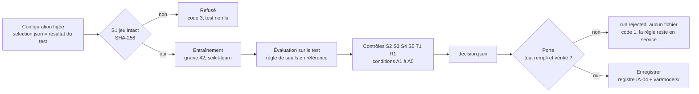

# Pipeline MLOps et MLSecOps : entraîner, évaluer, appliquer le seuil, enregistrer (IA-05)

Dernière mise à jour : 12/11/2026 · Issue IA-05 (#81) · Exigence : EXG-IA-04 · Cadre : [cadrage ML](cadrage-ml.md) (sections 6, 8, 9 et 12), [ADR-017](../01-architecture/adr/ADR-017-mlops-mlsecops.md) · Registre : [`ml/registry/`](../../ml/registry/README.md) · Fiche : [fiche du modèle](fiche-modele.md)

Abréviations : MLOps (Machine Learning Operations, exploitation des modèles), MLSecOps (Machine Learning Security Operations, sécurité de cette exploitation), CI (Continuous Integration, intégration continue), SBOM (Software Bill Of Materials, nomenclature des composants logiciels), OIDC (OpenID Connect, identité fédérée), IAM (Identity and Access Management), S3 (Simple Storage Service), AWS (Amazon Web Services).

> **Données simulées.** Le pipeline reproduit la chaîne sur le simulateur ; un modèle qui le traverse apprend le simulateur.

## 1. Ce que fait le pipeline

**Un modèle sous le seuil n'est pas enregistré.** Le pipeline entraîne la configuration **figée** par IA-03, l'évalue sur le test, applique le seuil d'acceptation du cadrage **et** des contrôles de sécurité, puis ferme une porte : tant qu'un critère manque, rien n'entre au registre.

| Étape | Commande | Ce qu'elle fait | Code de sortie |
|---|---|---|---|
| `evaluer` | `python -m pipeline evaluer` | jeu intact, entraînement, évaluation, contrôles, **décision** (`var/pipeline/decision.json`) ; écrit le run `trained` ; **n'enregistre aucun modèle** | 0 ; 3 si un contrôle d'intégrité refuse |
| `porte` | `python -m pipeline porte` | **bloque** : recalcule la décision depuis ses éléments ; si elle n'est pas « accepté », écrit le run `rejected` (la trace, jamais un fichier) | 0 porte ouverte ; **1 porte fermée** ; 3 décision incohérente |
| `enregistrer` | `python -m pipeline enregistrer` | seulement après la porte : promeut le modèle préparé (IA-04) ; **refuse** d'elle-même si la décision n'est pas « accepté » ou si le fichier a changé | 0 ; 1 porte fermée ; 3 fichier modifié |
| `tout` | `python -m pipeline tout` | les trois, dans l'ordre, arrêt à la porte | 0 ou 1 |

## 2. Le seuil et les contrôles de sécurité

**Performance** (A1 à A5 du [cadrage](cadrage-ml.md), section 6) : F1 macro et rappel de `CONGESTED` supérieurs de 0,01 à la règle, délai médian non supérieur, aucun épisode manqué, au plus 0,10 fausse alerte par tronçon et par jour. Les valeurs sont dans `ml/src/entrainement/acceptation.py` ; **le pipeline n'a aucun paramètre pour les changer** (ni la ligne de commande, ni le flux de travail).

| Code | Contrôle | Bloquant | Ce qu'il vérifie | Menace (cadrage, section 9) |
|---|---|---|---|---|
| S1 | jeu intact | oui | SHA-256 des fichiers = manifeste = empreinte de la sélection ; **avant** l'entraînement, avant la lecture du test | M1 empoisonnement |
| S2 | artefact tracé | oui | le fichier exporté, relu, prédit comme le modèle évalué (20 160 prédictions comparées) | M3 fichier piégé |
| S3 | format sûr | oui | `novaria-modele-lineaire` (JSON) ; un candidat sans format sûr (gradient boosting) ne s'enregistre pas | M3 |
| S4 | dépendances | **non** (rapporté) | `pip-audit` sur `ml/requirements.txt` ; nomenclature SBOM écrite ; outil absent ou réseau coupé : **non vérifié** | M5 chaîne d'approvisionnement |
| S5 | fiche du modèle | oui | [fiche](fiche-modele.md) complète, nomme le candidat, ligne « Relue par : » **de l'autre membre** | M8 hors domaine |
| T1 | code commité | oui | pas de code non commité : le modèle se refait depuis sa révision Git | traçabilité (avenant 1) |
| R1 | reproduction | oui | les métriques recalculées sont **identiques** à celles du test enregistré | M10 évaluation faussée (avenant 1) |

Un contrôle bloquant **non vérifié** bloque aussi : un contrôle qui n'a pas pu tourner n'est jamais déclaré réussi. `decision.json` se **recalcule** à chaque étape : un verdict « accepté » gonflé à la main avec une condition manquée est refusé (code 3).

## 3. La configuration figée

Le test du jeu v1 a été lu une fois (IA-03) et le modèle retenu a été rejeté. Le pipeline le relit pour **reproduire** ce résultat avec la même configuration, pas pour choisir : il exige que l'empreinte de `ml/evaluation/selection.json` soit celle que `resultat-test.json` a enregistrée. Un autre réglage ou un autre candidat change l'empreinte, donc le pipeline refuse : une nouvelle sélection demande un **test neuf** (jeu v2). Cette lecture est l'objet de l'[avenant 1 du cadrage](cadrage-ml.md), section 12.

## 4. Le flux de travail GitHub Actions `mlsecops.yml`

Déclenché **à la main** (`workflow_dispatch`), **sans aucun paramètre**.

| Étape du job | Rôle |
|---|---|
| Dépendances (empreintes exigées) | `pip install --require-hashes -r ml/requirements.txt` |
| Outil d'audit (environnement à part, empreintes exigées) | `ml/requirements-mlsecops.txt` : pip-audit |
| Reconstruire le jeu et le comparer à sa fiche | `construire_jeu.py` puis `git diff --exit-code -- data/datasets` : reproductibilité du jeu |
| **Entraîner et évaluer** | `evaluer` : décision, contrôles |
| **Porte** | `porte` : **échoue si le modèle est sous le seuil** ; les étapes suivantes sont sautées |
| Enregistrer le modèle | `enregistrer` (condition par défaut : après une porte ouverte) |
| Résumé, rapport, modèle | `$GITHUB_STEP_SUMMARY` et artefacts (`always()` pour le rapport) |

| Durcissement du flux de travail | Pourquoi | Fixé par le test |
|---|---|---|
| Aucune entrée au lancement | personne ne règle le seuil ni la configuration au déclenchement | `scripts/dev/test_mlsecops.py` |
| `permissions: contents: read`, pas de jeton d'identité | droits minimaux ; pas de rôle AWS (ADR-023) | idem |
| Aucune interpolation `${{ }}` dans un script | injection de commande ; les valeurs passent par `env:` | idem |
| Dépendances à empreintes, outil d'audit isolé | chaîne d'approvisionnement | idem |
| Pas de `continue-on-error`, pas de `secrets.*` | aucun contournement, aucun secret | idem |
| `persist-credentials: false`, délai, concurrence | le jeton n'est pas laissé dans le dépôt de travail ; pas d'exécution parallèle | idem |
| Ne commite ni ne pousse rien | tout vit sous `var/` et dans les artefacts | idem |

**Un échec à l'étape « Porte » est le résultat attendu aujourd'hui** : le seul modèle évalué (IA-03) est rejeté (A2 et A5). Le flux de travail n'est **pas** un contrôle obligatoire de `main` et n'est pas dans `ci.yml`.

### Lien d'exécution

| État | Détail |
|---|---|
| **À obtenir** | GitHub ne propose « Run workflow » que pour un flux de travail présent dans la branche par défaut (à vérifier) : après la fusion dans `main`, onglet *Actions*, « MLSecOps », *Run workflow*, ou la commande ci-dessous. L'adresse de l'exécution se consigne dans l'issue #81 et dans [`ml/evaluation/`](../../ml/evaluation/) |
| **Non vérifié** | aucune exécution sur GitHub n'a eu lieu. Les mêmes étapes ont été jouées en local (section 5) |
| **Attendu** | rouge à « Porte » ; résumé avec les quatre raisons si le code n'est pas commité (A2, A5, S5, T1), deux (A2, A5) avec un code commité et une fiche relue ; artefact `mlsecops-rapport` (décision, audit, SBOM) ; aucun artefact `mlsecops-modele` |

| Action | Linux (bash) | Windows (PowerShell) |
|---|---|---|
| Lancer le flux de travail (après fusion dans `main`) | `gh workflow run mlsecops.yml` | `gh workflow run mlsecops.yml` |
| Suivre et lire l'exécution | `gh run watch` puis `gh run view --log` | idem |

## 5. Rejouer en local

Prérequis : `ml-env` (scikit-learn, empreintes exigées) ; le jeu v1 construit (`python3 ml/src/construire_jeu.py`) ; pour S4, l'outil d'audit dans un environnement à part et la variable `PIP_AUDIT`.

| Action | Linux (bash) | Windows (PowerShell) |
|---|---|---|
| Le pipeline en entier | `make ml-pipeline` ou `python3 scripts/dev/dev.py ml-pipeline` | `py -3 scripts/dev/dev.py ml-pipeline` |
| Une étape | `make ml-pipeline ETAPE=porte` | `py -3 scripts/dev/dev.py ml-pipeline porte` |
| Avec le registre MongoDB (`model_runs`, compte `svc_ml`) | `make ml-pipeline MONGO=1` | `py -3 scripts/dev/dev.py ml-pipeline --mongo` |
| Sans l'audit des dépendances | `python3 scripts/dev/dev.py ml-pipeline --sans-audit` | `py -3 scripts/dev/dev.py ml-pipeline --sans-audit` |
| Audit : installer l'outil à part | `python3 -m venv /tmp/audit && /tmp/audit/bin/pip install --require-hashes -r ml/requirements-mlsecops.txt` puis `export PIP_AUDIT=/tmp/audit/bin/pip-audit` | `py -3 -m venv $env:TEMP\audit; & $env:TEMP\audit\Scripts\pip install --require-hashes -r ml\requirements-mlsecops.txt; $env:PIP_AUDIT = "$env:TEMP\audit\Scripts\pip-audit.exe"` |
| Tests (avec scikit-learn) | `ml/.venv/bin/python -m unittest discover -s ml/tests -t ml -p "test_pipeline.py"` | `ml\.venv\Scripts\python.exe -m unittest discover -s ml\tests -t ml -p "test_pipeline.py"` |

### Essai du 12/11/2026 (Linux, Python 3.14.4, scikit-learn 1.9.1)

Transcription brute : [`ml/evaluation/pipeline-local-2026-11-12.txt`](../../ml/evaluation/pipeline-local-2026-11-12.txt). Registre : un MongoDB **jetable** (supprimé ensuite), compte `svc_ml`.

| Constat | Valeur |
|---|---|
| S1, S2, S3, R1 | réussis : 20 160 prédictions de l'artefact identiques à celles du modèle ; **métriques recalculées identiques** au test enregistré |
| S4 | réussi : 9 dépendances auditées, aucune vulnérabilité connue, SBOM écrite |
| A1, A3, A4 | remplies (F1 macro 0,9814 ; délai médian 1 minute ; aucun épisode manqué) |
| **A2, A5** | **manquées** (rappel 0,9799 pour 0,9885 exigé ; 0,21 fausse alerte pour 0,10) |
| S5, T1 | en échec : fiche pas encore relue par Daddy ; code d'IA-05 non commité au moment de l'essai |
| Porte | **fermée, code 1** ; `enregistrer` appelé directement **refuse** (code 1) |
| Registre | le run `ia05-logistique-876c217f-ed043c25-modifie` est `rejected` dans `model_runs`, **sans fichier de modèle** ; aucun modèle en service ; `var/models/` n'est pas créé |
| Python 3.12 (version de la CI) | même résultat : R1 réussi, métriques identiques |

## 6. Équivalent SageMaker (documenté, non exécuté)

**Aucune ressource AWS n'est créée** (ADR-023). Ce tableau dit où irait chaque pièce si le projet passait sur AWS ; **aucune de ces correspondances n'a été essayée**.

| Pièce locale | Équivalent SageMaker / AWS | Remarque |
|---|---|---|
| `evaluer` : entraînement et évaluation | un `TrainingStep` (estimateur scikit-learn) puis un `ProcessingStep` d'évaluation qui écrit un fichier de métriques | même code Python, lancé sur une instance gérée |
| `porte` | un `ConditionStep` qui lit la métrique dans le fichier d'évaluation et enchaîne sur un `FailStep` si elle est sous le seuil | le seuil resterait dans le dépôt, pas dans un paramètre du pipeline |
| `enregistrer` | l'enregistrement dans SageMaker Model Registry (groupe de paquets de modèles, statut d'approbation) | l'approbation manuelle remplace S5 « relue par l'autre membre » |
| `model_runs` (MongoDB) | métadonnées du Model Registry, ou SageMaker Experiments | le document local reste la référence du projet |
| `var/models/` (port `ObjectStore`) | compartiment S3 versionné, chiffré | adaptateur S3 du port non écrit (IA-04) |
| `mlsecops.yml` | le même flux de travail, qui obtiendrait des droits AWS par fédération OIDC (rôle IAM à droits minimaux) et démarrerait l'exécution du pipeline | **interdit aujourd'hui** : pas de variable `AWS_ROLE_ARN` (`CLAUDE.md`, section 6) |
| S4 pip-audit, SBOM | analyse d'images et de dépendances du côté AWS (à choisir) | à vérifier |

## 7. Limites

| Limite | Conséquence |
|---|---|
| **Aucun modèle ne passe la porte** | le pipeline n'a enregistré aucun modèle ; le chemin « accepté » est testé (petit jeu, seuil forcé) et non éprouvé sur le jeu v1 |
| **Le test v1 est relu** | seulement pour reproduire une configuration figée (avenant 1) ; les essais du 12/11 l'ont relu **avant** l'écriture de l'avenant (résultats identiques à ceux d'IA-03) |
| Pas de jeu neuf | un nouveau modèle ou un nouveau réglage demande un jeu v2 (autres graines, quatrième scénario, complétude) et un nouveau test |
| Reproductibilité cross-machine | R1 exige des métriques identiques : vérifié sous Python 3.14 et 3.12 sur ce poste ; **non vérifié sur le serveur GitHub** (processeur et bibliothèques de calcul peuvent différer). Un échec de R1 en CI est un constat à traiter, pas une panne |
| Registre de la CI | sans MongoDB, les runs vivent dans des fichiers JSON de l'exécution (artefact) : pas de registre durable côté GitHub |
| Pas de signature, pas d'attestation d'artefact | les empreintes protègent d'une altération, pas d'un attaquant qui contrôle le magasin ; l'attestation de provenance GitHub n'est pas activée |
| S4 sans réseau | « non vérifié », jamais « réussi » ; le résultat dépend de la base d'avis publique du jour |
| Un seul format de modèle | un modèle non linéaire (gradient boosting) échoue à S2 et S3 : il ne s'enregistre pas |
| Flux de travail non exécuté sur GitHub | syntaxe et garanties fixées par 13 tests, pas par une exécution |
| Windows et macOS | non vérifiés (le flux de travail tourne sous Linux) |
