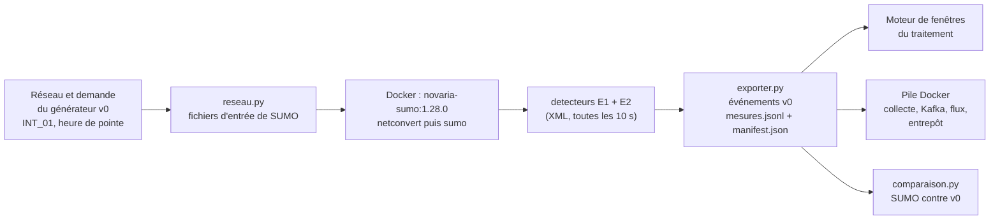

# Prototype SUMO : simulation microscopique d'un carrefour (IA-11)

Dernière mise à jour : 18/11/2026 · Issue IA-11 (#155) · Décisions : [ADR-015](../01-architecture/adr/ADR-015-modeles-ia.md), règle 7, et [ADR-027](../01-architecture/adr/ADR-027-jeux-de-donnees-et-provenance.md), option B · Chiffres : [`ml/evaluation/sumo-resultats.md`](../../ml/evaluation/sumo-resultats.md) (généré), `sumo.json`

Abréviations : SUMO (*Simulation of Urban MObility*, simulateur de trafic libre), E1 (détecteur « boucle » de SUMO, qui compte les véhicules à un point), E2 (détecteur « de zone » de SUMO, qui mesure les files sur un tronçon), EPL (*Eclipse Public License*), GPL (*General Public License*), DQ (*Data Quality*, règles de qualité des données), SHA-256 (*Secure Hash Algorithm*, empreinte de 256 bits).

> **Donnée simulée.** Rien ici ne décrit un trafic réel. SUMO donne des véhicules qui se suivent et attendent aux feux ; ce n'est pas plus « vrai » que le générateur v0 sans trafic réel de ce carrefour pour trancher. Le prototype **ne fournit aucune vérité terrain de congestion** : il ne remplace pas le générateur v0 comme source des jeux d'entraînement.

## 1. Décision de lancement

IA-11 est conditionnelle : « seulement si le v0 est livré et testé » et si le temps le permet.

| Condition | État le 18/11/2026 | Preuve |
|---|---|---|
| Générateur v0 livré | oui | simulateur MS-07 et ses tests ; jeu `novaria-congestion-v1` (IA-08) |
| Générateur v0 testé | oui | tests du simulateur ; détection de congestion évaluée (IA-03), anomalies (IA-09) et prévision (IA-10) faites sur ses runs |
| Temps disponible | oui, **borné** | soutenance le 10/12/2026, 22 jours ; les jalons M6 (partie citoyen) et M7 (site de soutenance) restent à faire |

**Décision : lancer le prototype**, avec une borne : un seul carrefour, une seule demande, une heure de pointe, et arrêt dès que la question « que démontre-t-il ? » a une réponse écrite. Il ne bloque aucune autre issue. Décision prise le 18/11/2026 ; **validation par Daddy Luciano : à faire**.

## 2. Ce qui est construit

| Élément | Choix | Pourquoi |
|---|---|---|
| Installation | image Docker `novaria-sumo:1.28.0`, SUMO installé depuis PyPI (`eclipse-sumo==1.28.0`) avec les empreintes de `ml/sumo/requirements.txt`, non-root | l'image officielle pèse 1,6 Go compressés ; celle-ci 1,2 Go décompressés (SUMO fait 90 Mo à télécharger), sans aucune installation sur le poste. Elle n'est **pas** un service de la pile |
| Carrefour | INT_01 du réseau v0 : 4 approches (N, E, S, W), 2 voies, 300 m, 50 km/h ; feux générés par SUMO (`netconvert`, programme statique à phases opposées, 42 s de vert, 3 s d'orange) | même géométrie que le v0 ; **pas de plan de feux Novaria** |
| Demande | la formule du v0 (profil horaire de l'ADR-027, heure de pointe de 06:00 à 11:00), identique sur les 4 approches, 70 % tout droit, 15 % à gauche, 15 % à droite, arrivées de Poisson | même entrée que le v0 |
| Mesure | une boucle E1 par voie à 100 m de la ligne d'arrêt (comptage, vitesse, occupation) et un détecteur E2 par voie (file), un message par approche toutes les 10 s | même grain que le capteur du v0 |
| Export | événements `novaria.iot.measurement.v1`, constructeur d'événements du v0, `source = sumo/<run>`, provenance `SIMULATED` (scénario `sumo-carrefour-int01-pointe`, graine de SUMO) | contrats inchangés : **aucun champ ajouté** |

Les événements du run sont **conformes aux contrats** (`contracts/validate_events.py`, 0 erreur sur les 7 200).

## 3. Rejeu par le pipeline

Le critère d'acceptation : « un run SUMO est rejoué par le pipeline ».

| Rejeu | Run | Résultat |
|---|---|---|
| Moteur de fenêtres du traitement (`app.flux`) | graine 42, 7 200 messages | **7 200 acceptés**, 1 200 fenêtres d'une minute (4 approches × 300 minutes), chacune de 6 mesures, **13 070 véhicules conservés**, 0 écart |
| Pile Docker complète : collecte, Kafka, flux, pipeline, entrepôt `dwh.fact_traffic_window` | graine 46 (run neuf), 7 200 messages en 68 s | **7 200 `ACCEPTED`** ; **1 197 fenêtres** dans l'entrepôt, **identiques une à une** aux fenêtres du moteur (véhicules, mesures, vitesse à 0,1 km/h près) ; 3 minutes retenues par le flux (section 3.1) |

Le premier rejeu de la graine 42 dans la pile avait aussi donné 1 200 fenêtres et 13 070 véhicules, une fois les dernières minutes closes par le flux ; un message y était déjà arrivé (`DUPLICATE`), ce qui est le comportement attendu de la collecte.

### 3.1 Ce que le rejeu a révélé : une minute sans véhicule disparaît

Le flux **retient** une minute sans aucun véhicule (`DEGRADED_WITHOUT_RATIO` : pas de vitesse, donc pas de rapport) et l'entrepôt ne la reçoit pas. Sur la graine 46, 3 minutes sur 1 200 (0,25 %) sont dans ce cas :

| Fenêtre | Véhicules | Occupation de la boucle | Lecture |
|---|---|---|---|
| ROAD_001, 09:08 | 0 | 0,50 | file arrêtée sur la boucle (feu rouge) |
| ROAD_003, 09:10 | 0 | 0,01 | route vide pendant la minute |
| ROAD_003, 09:11 | 0 | 0,78 | file arrêtée sur la boucle (feu rouge) |

C'est un **comportement du pipeline, pas une erreur du prototype** : un arrêt complet n'est pas distingué d'une route vide. Dans le v0 une minute sans véhicule ne vient que d'un capteur muet ou d'une nuit calme, donc le cas ne se voyait pas. Deux de ces trois minutes (occupation de 0,5 et de 0,78) sont des files arrêtées au feu rouge, donc précisément les minutes les plus chargées. Piste (non faite, à décider) : garder l'occupation et la file pour ces minutes.

## 4. Comparaison avec le générateur v0

Même carrefour, mêmes 300 minutes, même demande de départ. **Ce qui diffère est l'origine de l'état** : le v0 *impose* l'état (fluide, ralenti, saturé) puis en tire des mesures bruitées ; SUMO le *fait naître* de la demande, des feux et du comportement des véhicules. Les deux sont jugés par la même règle de seuils (ADR-028).

| Mesure (4 approches, 1 200 minutes) | SUMO | v0 |
|---|---|---|
| Véhicules par minute et approche | 10,9 | 15,8 |
| Ratio de vitesse moyen (écart type ; minimum) | 0,80 (0,15 ; 0,31) | 0,69 (0,27 ; 0,11) |
| File moyenne ; maximale (m) | 114 ; 280 | 53 ; 217 |
| Minutes FREE_FLOW / SLOW / CONGESTED | 76 % / 24 % / 0 % | 60 % / 25 % / 16 % |

| Début de tranche | File SUMO (m) | File v0 (m) | Ratio SUMO | Ratio v0 |
|---|---|---|---|---|
| 06:00 | 24 | 0 | 0,91 | 0,90 |
| 07:00 | 144 | 80 | 0,66 | 0,59 |
| 07:30 | 240 | 144 | 0,66 | 0,35 |
| 08:00 | 257 | 140 | 0,67 | 0,35 |
| 09:00 | 122 | 40 | 0,81 | 0,75 |
| 10:00 | 23 | 0 | 0,91 | 0,90 |

Ce que cela montre :

- **La même forme.** Dans SUMO, la file monte de 24 m à 257 m entre 06:00 et 08:00 puis redescend, comme la file imposée du v0, sans qu'aucun état ne soit écrit nulle part. En dehors de la pointe, les deux donnent un ratio d'environ 0,9.
- **Pas la même profondeur.** SUMO ne descend pas sous un ratio de 0,66 en moyenne à la pointe (0,35 pour le v0) et n'est jamais « congestionné » au sens de la règle de seuils, sauf 2 % des minutes sur les graines 43 et 44. Le v0 impose une saturation franche que SUMO, avec cette demande, ne produit pas.
- **Autre débit.** SUMO écoule moins de véhicules (10,9 contre 15,8 par minute) : voir 4.1.
- La corrélation des profils de débit par tranche de 30 minutes est de **0,58** : les deux courbes ne se superposent pas.

### 4.1 Deux choix de modélisation, faits en cours de route

Ces deux choix ont été faits **après avoir vu un résultat** ; le rapport publie les deux variantes pour que le lecteur juge.

| Choix | Constat de départ | Décision | Sensibilité publiée |
|---|---|---|---|
| **Capacité** | avec la demande du v0 (1 400 véhicules/h par approche à la pointe), le carrefour de SUMO était saturé toute la journée (avec la boucle à 10 m : ratio moyen de 0,56, file moyenne de 262 m sur les 280 m mesurables) : SUMO ne laisse passer que **855 véhicules/h** par approche (feux par défaut, gauches non protégées), mesurés par un essai de saturation (12 mesures, de 834 à 876) | la demande garde la **forme** du v0 mais son maximum est calé sur la capacité mesurée de SUMO | la constante `CAPACITE_MESUREE_VEH_H = 855` et la commande `ml-sumo calibrer` la refont |
| **Position de la boucle** | placée à 10 m de la ligne d'arrêt, elle ne voit que des véhicules qui freinent ou redémarrent : **98 % des minutes « ralenties »** même en circulation libre | boucle déplacée à 100 m, où le véhicule roule tant que la file ne l'atteint pas | graine 42 à 10 m : ratio moyen 0,53, 1 % / 98 % / 1 % ; graines 43 et 44 à 100 m : ratio 0,79, 68 % et 73 % de FREE_FLOW |

Le résultat dépend donc de la position du capteur autant que du trafic. Une boucle à 100 m ne voit pas les véhicules arrêtés (elle ne mesure que ceux qui la franchissent) : l'occupation et la file portent cette information, pas la vitesse.

## 5. Ce que le prototype démontre et ne démontre pas

| Il démontre | Il ne démontre pas |
|---|---|
| Un simulateur microscopique **tourne dans Docker**, sans installation sur le poste, de façon reproductible (graine, empreintes SHA-256 dans le manifeste) | Que SUMO est **plus réaliste** que le v0 : aucun trafic réel du carrefour ne permet de trancher |
| Ses sorties **entrent dans les contrats existants sans rien y ajouter** et traversent le pipeline complet, du message à l'entrepôt | Que les jeux d'entraînement doivent venir de SUMO : **il n'y a pas d'état voulu**, donc pas de label de congestion indépendant de la règle de seuils (ADR-027, règle 8) |
| La congestion peut **naître** d'une demande et de feux, avec une file qui monte et redescend comme celle que le v0 impose | Que la détection de congestion apprise sur le v0 vaut pour SUMO : **non testé** |
| Le pipeline a un **cas limite réel** : une minute sans véhicule disparaît de l'entrepôt, qu'il s'agisse d'une route vide ou d'une file arrêtée | Que le carrefour est bien réglé : 855 véhicules/h par approche est un résultat des feux par défaut, pas un plan d'ingénierie |
| Les mesures du v0 et de SUMO se **jugent par la même règle** (ADR-028) | Que la comparaison est générale : **un carrefour, une heure de pointe, 4 runs** (graines 42 à 44 et la variante à 10 m) |

## 6. Limites et coûts

- **Un seul carrefour, un seul scénario** (heure de pointe), 5 h simulées. Les scénarios « journée calme » et « incident ponctuel » du v0 n'ont pas d'équivalent SUMO.
- **Pas d'anomalie** (muet, retard, doublon, valeur aberrante) : le prototype ne les injecte pas.
- **Pas de plan de feux Novaria** ni de commande par le service de réponse extérieure : les feux sont ceux que SUMO génère.
- **Demande identique sur les 4 approches** : le v0 sature seulement le Nord et l'Ouest (états imposés) ; ici les quatre approches se valent.
- **Coût** : 1,2 Go pour l'image, environ 2 minutes pour la construire, environ 40 s pour simuler 5 h. L'image n'est pas construite par la CI et n'est pas dans `compose.yaml`.
- **Licence** : SUMO est sous EPL-2.0 (*Eclipse Public License*) ou GPL-2.0 et plus, d'après la fiche PyPI du paquet ; il n'est ni copié ni redistribué dans le dépôt, qui ne contient que le `Dockerfile` et les dépendances verrouillées. Les runs (`var/sumo/`) ne sont pas versionnés.
- **Empreintes** : `mesures.jsonl` donne la même empreinte à chaque rejeu de la même graine ; celle de `net.net.xml` change à chaque génération (`netconvert` y écrit la date). Le manifeste nomme la configuration `run.cfg` et non `run.sumocfg`, parce que gitleaks prenait « sumo… : empreinte de 64 caractères » pour un jeton (faux positif, [exceptions](../04-devsecops/exceptions.md), section 11).
- **Non vérifié sous Windows** (Docker Desktop) : la commande `docker run` y est la transposition directe.
- Les tests ne lancent pas Docker ; un essai réel facultatif existe (`NOVARIA_SUMO=1`).

## 7. Reproduire

| Action | Linux (bash) | Windows (PowerShell) |
|---|---|---|
| Construire l'image (environ 2 minutes) | `python3 scripts/dev/dev.py ml-sumo image` | `py -3 scripts/dev/dev.py ml-sumo image` |
| Simuler 5 h et exporter (environ 40 s) | `python3 scripts/dev/dev.py ml-sumo simuler` | `py -3 scripts/dev/dev.py ml-sumo simuler` |
| Rejouer dans le moteur de fenêtres | `python3 scripts/dev/dev.py ml-sumo rejouer` | `py -3 scripts/dev/dev.py ml-sumo rejouer` |
| Rejouer aussi dans la pile (`dev.py up` d'abord, run neuf) | `python3 scripts/dev/dev.py ml-sumo simuler --graine 46` puis `python3 scripts/dev/dev.py ml-sumo rejouer --pile --graine 46` | idem avec `py -3` |
| Comparer au v0 et écrire `ml/evaluation/sumo*` (environ 40 s) | `python3 scripts/dev/dev.py ml-sumo comparer` ou `make ml-sumo ETAPE=comparer` | `py -3 scripts/dev/dev.py ml-sumo comparer` |

## 8. Suite possible (non faite)

- Garder l'occupation et la file pour les minutes sans véhicule, dans le flux et l'entrepôt (le cas limite de la section 3.1).
- Protéger les virages à gauche et refaire l'essai de saturation, pour un carrefour moins saturé.
- Injecter les anomalies du v0 dans le run SUMO et rejouer la détection d'IA-09.

Rien de cela n'est nécessaire à la soutenance : le critère d'acceptation d'IA-11 est rempli (un run SUMO est rejoué par le pipeline) et la décision est consignée.
