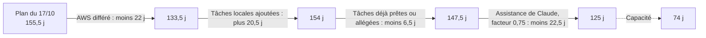

# Charge et calendrier : ce que le plan permet de tenir

Projet : Novaria Core (bloc de compétences BC05)
Responsables : Daddy Luciano et Manoa Robel (relecture croisée)
Dernière mise à jour : 20/10/2026
Issues de suivi : GES-08, GES-10, GES-06 (arbitrage du périmètre)

Abréviations : AWS (Amazon Web Services), BC05 (bloc de compétences 5), P0 (priorité essentielle), P1/P2 (priorités secondaires).

## 1. Constat

Les durées du plan sont des estimations de départ, jamais mesurées. Avec ces estimations, **la charge dépasse la capacité des deux personnes** entre le 21/10/2026 et le 10/12/2026.

| Mesure | Daddy | Manoa | Total |
|---|---|---|---|
| Capacité : 37 jours ouvrés du 21/10 au 10/12 | 37 j | 37 j | 74 j |
| Plan du 17/10 (avec AWS, sans assistance de Claude), toutes tâches | 73,8 j | 81,8 j | 155,5 j |
| Plan du 20/10, sans effet d'assistance | 57,0 j | 90,5 j | 147,5 j |
| **Plan du 20/10, avec assistance de Claude pour les deux (facteur 0,75)** | **50,8 j** | **74,2 j** | **125,0 j** |
| Même plan, seules les tâches P0 et leurs prérequis | 38,8 j | 52,2 j | 91,0 j |

Lecture : retirer AWS libère 22 jours, mais les tâches locales (bases, Kafka, jeu d'entraînement, détection d'anomalies, prévision) en ajoutent autant. Même avec l'assistance, il manque environ 51 jours pour tout faire, et 17 jours pour les seules tâches P0.

## 2. Effet du facteur d'assistance (hypothèse)

Le facteur multiplie la durée des tâches de **construction** (code, scripts, tests) des équipes Données, Back-end, Front-end, IA (intelligence artificielle) et Cloud. Les premiers essais réels (LOC-01, LOC-02, LOC-03), les relectures croisées (DAT-10, CLD-08), le tri des résultats de sécurité (CLD-19) et le test de bout en bout (MS-15) ne sont pas raccourcis.

| Facteur | Toutes les tâches | Tâches P0 et prérequis | Écart avec 74 j (P0) |
|---|---|---|---|
| 1,0 (aucun gain) | 147,5 j | 106,5 j | plus 32,5 j |
| 0,75 (valeur du plan) | 125,0 j | 91,0 j | plus 17,0 j |
| 0,6 | 108,0 j | 80,5 j | plus 6,5 j |
| 0,5 (gain de moitié) | 101,5 j | 75,5 j | plus 1,5 j |

Même avec un gain de moitié, le noyau P0 occupe toute la capacité, sans marge pour les imprévus, les relectures croisées et les répétitions de la soutenance. **Le facteur 0,75 reste une hypothèse** : le mesurer sur LOC-01, LOC-02 et IA-08 (durée réelle divisée par la durée estimée) et corriger le plan.

## 3. Où se trouve la charge

| Équipe | Daddy | Manoa |
|---|---|---|
| Back-end | 5,5 j | 9,0 j |
| Front-end | 0,0 j | 11,5 j |
| Données | 14,0 j | 2,5 j |
| IA | 1,0 j | 18,0 j |
| Cloud et livraison | 6,8 j | 15,2 j |
| Documentation | 18,0 j | 6,5 j |
| Gestion de projet | 5,5 j | 11,5 j |
| **Total (facteur 0,75)** | **50,8 j** | **74,2 j** |

Manoa porte 59 % de la charge (front-end, IA et une grande part du cloud). Rééquilibrer de 12 jours vers Daddy donnerait 62 j chacun : cela corrige l'écart entre les deux, pas le dépassement de la capacité.

## 4. Décisions à prendre (avec le professeur, point GES-06)

| N° | Décision | Effet | À vérifier d'abord |
|---|---|---|---|
| 1 | Retirer les tâches hors P0 qui ne portent pas une compétence BC05 : CLD-20, CLD-22 à CLD-24, DOC-10, DOC-11, FE-07, GES-11, LOC-05, LOC-06, MS-16 | Environ 12 j gagnés | Que ces tâches ne portent aucune preuve exigée dans la matrice BC05 (DOC-08) |
| 2 | Confirmer ou réduire les prototypes qui portent une compétence « Prototype ciblé » : IA-07 (RPA, *Robotic Process Automation*), DAT-08 (Big Data), DAT-06 (ETL planifié), IA-06, IA-09, IA-10 (apprentissage automatique) et les pages FE-05, FE-06 | Jusqu'à 13,5 j gagnés | Le niveau exigé par compétence (DOC-01) |
| 3 | Réduire l'étendue des plus grosses tâches P0 : MS-09, MS-10, MS-12 (4 j chacune), MS-14 (4 j) | À chiffrer tâche par tâche | Le parcours minimal de bout en bout (R-06) |
| 4 | Rééquilibrer les responsabilités entre Daddy et Manoa (par exemple une partie du front-end) | Écart de 23 j réduit | La préférence de chacun |
| 5 | Mesurer le facteur d'assistance sur les trois premières issues, puis recalculer | Remplace une hypothèse par une mesure | LOC-01, LOC-02, IA-08 terminées |

Ces cinq décisions ne sont pas appliquées dans le plan : elles changent le périmètre présenté au professeur.

Ordre de grandeur : les décisions 1 et 2 ensemble retirent 25,5 j et laissent 99,5 j, soit encore 25,5 j de plus que la capacité. Le noyau P0 lui-même (91 j) doit donc être réduit ou le facteur d'assistance mesuré à 0,5 ou moins. La question à poser au professeur est celle du parcours minimal de bout en bout à livrer pour le 10/12/2026.

## 5. Comment lire le fichier ProjectLibre

Le fichier `planning/novaria-core-projectlibre.xml` suit les dépendances **sans limite de charge** : ses dates de jalons sont donc optimistes (M6 au 11/12/2026). Pour voir la date réelle : dans ProjectLibre, menu des ressources, « Niveler les ressources ». Le tableau ci-dessous donne la date calculée avec la capacité de chaque personne (une tâche à la fois, ordre des jalons puis des priorités).

| Scénario | Fin de la dernière tâche | Tâches terminées après le 10/12 |
|---|---|---|
| Sans effet d'assistance | 25/02/2027 | 34 sur 75 (dont 20 P0) |
| Avec assistance (0,75) | 05/02/2027 | 32 sur 75 (dont 18 P0) |

## 6. Relancer le calcul

Le calcul tient dans deux scripts Python (`planning/model.py` et `planning/gen.py`). Le facteur se règle par une variable d'environnement.

| Action | Linux (bash) | Windows (PowerShell) |
|---|---|---|
| Rapport de charge | `python3 planning/model.py` | `py -3 planning/model.py` |
| Autre facteur | `FACTEUR_ASSISTANCE=0.6 python3 planning/model.py` | `$env:FACTEUR_ASSISTANCE="0.6"; py -3 planning/model.py` |
| Regénérer le fichier ProjectLibre | `python3 planning/gen.py` | `py -3 planning/gen.py` |
