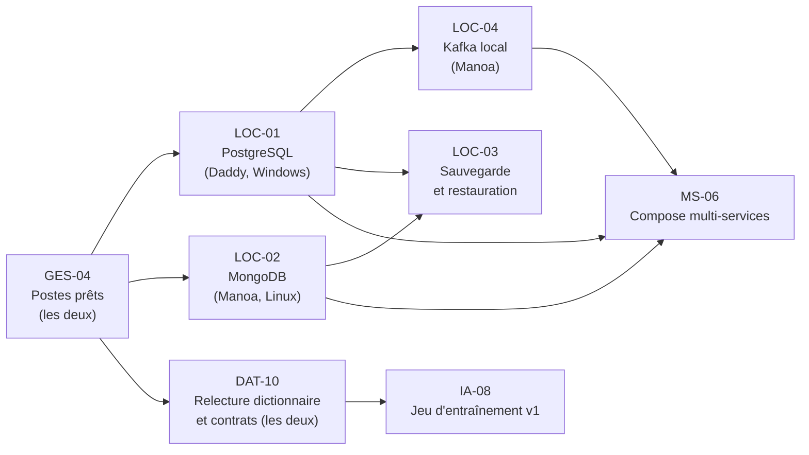

# Démarrage du binôme : ordre de travail et usage partagé de Claude

Projet : Novaria Core (bloc de compétences BC05)
Responsables : Daddy Luciano et Manoa Robel (relecture croisée)
Dernière mise à jour : 20/10/2026
Issue de suivi : GES-19

Ce document répond à une question : **qui fait quoi en premier, et comment ?** Les deux membres utilisent Claude ; les conventions sont donc écrites une fois, dans `CLAUDE.md`, et le prompt de chaque issue suit le gabarit de `docs/ia/prompt-modele-issue.md`.

Abréviations : ADR (Architecture Decision Record, enregistrement de décision d'architecture), CI (Continuous Integration, intégration continue), ETL (Extract, Transform, Load, extraction, transformation, chargement), IA (intelligence artificielle).

## 1. Vue d'ensemble

## 2. Premier jour : à faire dans cet ordre

| N° | Qui | Quoi | Issue | Preuve |
|---|---|---|---|---|
| 1 | Les deux | Installer les outils et lancer `check-tools` | GES-04 | Sortie de la commande, sans secret |
| 2 | Les deux | Lire `CLAUDE.md` et `docs/ia/prompt-modele-issue.md` | GES-19 | Aucune : lecture |
| 3 | Daddy | Premier démarrage de PostgreSQL sous Windows | LOC-01 | `db-check` : 9 lignes [OK] |
| 4 | Manoa | Premier démarrage réel de MongoDB sous Docker | LOC-02 | `db-check` : 12 lignes [OK] |
| 5 | Les deux | Relire le dictionnaire de données et les contrats d'événements | DAT-10 | Pull request approuvée |

Commandes du poste :

| Étape | Linux (bash) | Windows (PowerShell) |
|---|---|---|
| Vérifier les outils | `python3 scripts/dev/dev.py check-tools` | `py -3 scripts/dev/dev.py check-tools` |
| Créer `.env` | `python3 scripts/dev/dev.py init-env` | `py -3 scripts/dev/dev.py init-env` |
| Démarrer les bases | `python3 scripts/dev/dev.py db-up` | `py -3 scripts/dev/dev.py db-up` |
| Contrôler | `python3 scripts/dev/dev.py db-check` | `py -3 scripts/dev/dev.py db-check` |

Détails et dépannage : `docs/08-exploitation/poste-de-travail.md`.

## 3. Ensuite : deux pistes en parallèle

Les issues d'un même jalon se prennent dans l'ordre de leurs dépendances (champ « Dépend de » de l'issue).

| Piste | Daddy (back-end, développement) | Manoa (analyse, données, IA, documentation) |
|---|---|---|
| Jalon M1 | LOC-01, BE-01 (contrat OpenAPI), DAT-01 puis DAT-02, DOC-03, DOC-05, MS-03 | LOC-02, LOC-04, CLD-02 à CLD-07, MS-04, MS-06, GES-07, GES-08 |
| Jalon M2 | DAT-03 à DAT-07, BE-02 à BE-08, MS-09, MS-10, MS-12 | MS-07 (simulateur), MS-08, MS-11, MS-13, LOC-06 |
| En commun | LOC-03 (sauvegarde et restauration), DAT-10, GES-19 | LOC-03, DAT-10, GES-19 |
| Jalons M3 et M4 | LOC-05, appui sur le contrat d'API (Application Programming Interface, interface de programmation) pour le front-end, MS-15 (avec Manoa) | FE-01 à FE-08, MS-14, IA-01 à IA-03 puis IA-08 à IA-11 |

Les issues liées à AWS (Amazon Web Services) sont **différées** : CLD-09 à CLD-12, CLD-14 à CLD-18, CLD-21, GES-18 et MS-17 portent l'étiquette `aws:differe`. Ne pas les prendre.

## 4. Mettre le backlog à jour sur GitHub

Cette étape est faite **une seule fois**, par un seul des deux membres, après l'accord de l'autre.

| Étape | Linux (bash) | Windows (PowerShell) |
|---|---|---|
| Connexion | `gh auth login` | `gh auth login` |
| Tests sans réseau | `python3 -m unittest discover -s scripts/github -p "test_*.py"` | `py -3 -m unittest discover -s scripts/github -p "test_*.py"` |
| Essai (rien n'est écrit) | `python3 scripts/github/sync_backlog.py --dry-run` | `py -3 scripts/github/sync_backlog.py --dry-run` |
| Créer les 13 issues absentes | `python3 scripts/github/sync_backlog.py --create` | `py -3 scripts/github/sync_backlog.py --create` |
| Commenter et étiqueter les 40 issues amendées | `python3 scripts/github/sync_backlog.py --amend` | `py -3 scripts/github/sync_backlog.py --amend` |
| Réécrire les corps (après relecture des commentaires) | `python3 scripts/github/sync_backlog.py --rewrite-bodies` | `py -3 scripts/github/sync_backlog.py --rewrite-bodies` |

Propriétés du script :

| Propriété | Détail |
|---|---|
| Relançable | Un commentaire n'est publié qu'une fois (marqueur invisible) ; une issue existante n'est pas recréée |
| Retrouve les issues par identifiant | Un titre modifié n'empêche pas la correspondance |
| Protège le travail en cours | Un corps contenant une case cochée n'est jamais réécrit |
| Limitable | `--only LOC-01,CLD-09` agit sur ces issues seulement |
| Sans effet sur la configuration | Le script ne touche ni la protection de `main`, ni les paramètres du dépôt, ni la CI |

## 5. Travailler à deux avec Claude sans se gêner

| Règle | Raison |
|---|---|
| Une issue = une branche = une personne. Écrire « je prends <ID> » en commentaire de l'issue avant de commencer | Évite deux sessions Claude sur le même fichier |
| Chaque session commence par le système de la personne (Linux ou Windows) | Les commandes diffèrent |
| Ne jamais coller de mot de passe, de jeton ou de contenu de `.env` dans Claude | Dépôt public et conversation conservée |
| Les décisions prises avec Claude deviennent un ADR ou un commentaire d'issue, pas un message privé | L'autre membre doit pouvoir les relire |
| Le journal d'usage de l'IA est complété par chacun pour ses propres sessions | Déclaration d'usage exigée |
| La relecture d'une pull request est faite par l'autre membre, pas par la session qui a écrit le code | Contrôle croisé |

Conflits de fichiers fréquents : `docs/07-gestion/*` et `docs/01-architecture/adr/README.md`. On ouvre une pull request courte par modification de ces fichiers et on rebase avant de fusionner.

## 6. Points ouverts

| Point | État | Qui |
|---|---|---|
| Consigne « localhost, pas AWS » donnée oralement | **Confirmation écrite à obtenir** (GES-06, risque R7) | Les deux |
| Premier essai sous Windows | À faire (LOC-01) | Daddy |
| Premier essai réel de MongoDB sous Docker | À faire (LOC-02) | Manoa |
| Job de CI pour les contrôles Terraform | Proposition à approuver avant toute modification de la CI (LOC-06) | Les deux |
| Seuils de congestion | Valeurs de départ, à fixer après un premier run (IA-01, ADR-028) | Manoa |
