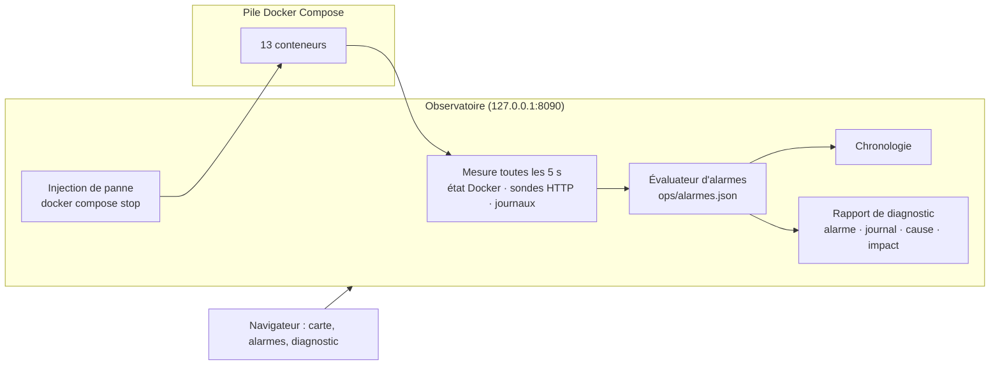

# Panne contrôlée : détection et diagnostic (CLD-14)

Projet : Novaria Core, socle d'UrbanHub (bloc de compétences BC05)
Responsables : Daddy Luciano et Manoa Robel (relecture croisée)
Dernière mise à jour : 17/11/2026
Issue de suivi : CLD-14 (#87), dépend de CLD-12 (#55, fermé)
Statut : à valider par les deux membres (relecture de la pull request)

Critère d'acceptation : **la panne est détectée par une alarme déjà configurée.** Preuve : ce document, section 9 (deux pannes rejouées, alarmes levées avant toute intervention). Les alarmes sont déclarées dans `ops/alarmes.json`, fichier versionné **avant** la panne.

Abréviations : **API** (Application Programming Interface, interface de programmation), **HTTP** (HyperText Transfer Protocol), **JSON** (JavaScript Object Notation), **CI** (Continuous Integration, intégration continue), **SSE** (Server-Sent Events), **SIGTERM** et **SIGKILL** (signaux d'arrêt d'un processus, courtois puis forcé), **OOM** (Out Of Memory, manque de mémoire).

## 1. En bref

| Tâche de l'issue | Réalisé | Où | Preuve |
|---|---|---|---|
| Arrêter volontairement un service | `dev.py panne <service>` (ligne de commande) ou le bouton « Arrêter ce service » de l'interface graphique ; un seul service à la fois, ceux de `ops/alarmes.json` seulement, confirmation pour le socle (bases et bus) | `scripts/dev/observatoire.py`, `ops/observatoire/index.html` | Section 9 |
| Retracer alarme, journal et cause | Le rapport de panne réunit les alarmes levées (avec leur délai), les lignes de journal utiles de chaque service touché, la cause déduite de ce que Docker a enregistré, l'impact prévu et l'impact constaté, la chronologie | `observatoire.rapport()`, onglet « Diagnostic » | Section 9 |
| Rédiger le guide de diagnostic | Sections 4 à 8 : trois gestes dans l'ordre, un arbre de décision, un tableau des causes, un tableau des symptômes par service | ce document | Relecture |
| Interface graphique pour la démonstration (demande de Manoa Robel) | L'observatoire : carte des services en direct, alarmes, chronologie, diagnostic, boutons d'arrêt et de rétablissement | `dev.py observatoire` | Section 10 |

**Ce que ce document ne fait pas** : il ne crée aucune alarme CloudWatch ni aucune ressource AWS (ADR-023). L'équivalent local est décrit section 2. Le titre de l'issue dit « CloudWatch » : voir la section 11, point 1.

## 2. CloudWatch et son équivalent local

| Dans CloudWatch | Ici | Où |
|---|---|---|
| Alarme (métrique, seuil, périodes d'évaluation, état OK ou ALARM) | Alarme déclarée dans un fichier : signal, condition, nombre d'évaluations de suite, états `OK`, `ALARM`, `INSUFFICIENT_DATA` | `ops/alarmes.json` |
| Métriques de conteneur | État et santé des conteneurs lus avec `docker compose ps` | `observatoire.Docker.conteneurs` |
| Contrôle synthétique (canary) | Requête `GET` sur la route de santé de chaque service, et sur deux chemins qui en traversent plusieurs (passerelle vers traitement, front-end vers traitement) | `sondes_declarees` |
| Journaux (Logs Insights) | Sortie standard JSON des services et journal de la passerelle, lus avec `docker compose logs` | `observatoire.Docker.journaux` |
| Tableau de bord | L'interface graphique de l'observatoire | `ops/observatoire/index.html` |



## 3. Les alarmes déjà configurées

Définies dans `ops/alarmes.json`, une famille par signal, une instance par service (ou par sonde) :

| Alarme | Signal | Condition | Évaluations de suite | Gravité | Instances |
|---|---|---|---|---|---|
| `service-arrete` | État du conteneur | Pas « running », ou sonde de santé Docker « unhealthy » | 2 | critique | 13 |
| `sonde-http` | Requête de contrôle | Échec, délai de 4 s dépassé, ou code différent de 200 | 2 | haute | 7 services avec port, plus 2 chemins |
| `erreurs-journal` | Journal des 30 dernières secondes | Au moins 3 lignes d'erreur (niveau ERROR ou CRITICAL, erreur nginx, réponse 5xx) | 1 | moyenne | 13 |

**Cadence mesurée : un tour de mesure dure environ 9 secondes** (5 s de période, plus la durée des sondes et des appels Docker). Deux évaluations de suite donnent donc une détection en 10 à 20 secondes (section 9).

Une alarme revient à `OK` dès la première mesure saine. Un service dont le conteneur n'existe pas donne `INSUFFICIENT_DATA`, pas une alarme.

## 4. Premier geste, l'alarme service-arrete

L'alarme `service-arrete` dit **quel conteneur** ne tourne plus. C'est la seule qui voit une panne sans visage : le flux, le pipeline et le travailleur d'alertes n'ont pas de port HTTP, et leur arrêt ne change rien à ce que voit un utilisateur (section 8).

| Étape | Linux (bash) | Windows (PowerShell) |
|---|---|---|
| Lister l'état de tous les conteneurs | `docker compose ps -a` | `docker compose ps -a` |
| Lire code de sortie, mémoire, dates | `docker inspect novaria-core-<service>-1 --format '{{.State.Status}} code={{.State.ExitCode}} oom={{.State.OOMKilled}} fin={{.State.FinishedAt}}'` | idem |
| Dernières lignes du service | `docker compose logs --tail 50 <service>` | idem |

Lire le code de sortie avec la table de la section 7. **Ne pas redémarrer avant d'avoir lu le journal** : un conteneur relancé repart d'un journal vide pour ses dernières secondes.

## 5. Deuxième geste, les sondes HTTP

Les alarmes `sonde-http` disent **ce qui ne répond plus du point de vue d'un client**. Lire les trois sondes ensemble :

| Sonde en échec | Lecture |
|---|---|
| Seulement la santé d'un service | Ce service est en cause (arrêté, bloqué) |
| La santé d'un service **et** `passerelle-vers-traitement` | La passerelle fonctionne, c'est l'amont qui manque : aller au journal de la passerelle |
| `passerelle-vers-traitement` **sans** la santé de traitement | Le service répond en direct mais pas par la passerelle : routage ou réseau |
| `frontend-vers-traitement` seule | Le proxy du front-end ou la passerelle est en cause, le service est sain |
| La santé de la passerelle | Plus aucune API n'est joignable depuis le tableau de bord |

| Étape | Linux (bash) | Windows (PowerShell) |
|---|---|---|
| Santé d'un service en direct (ports de `.env.example`) | `curl -s -o /dev/null -w "%{http_code}\n" http://127.0.0.1:8002/api/v1/health` | `(Invoke-WebRequest -UseBasicParsing http://127.0.0.1:8002/api/v1/health).StatusCode` |
| Même route par la passerelle | `curl -s -o /dev/null -w "%{http_code}\n" http://127.0.0.1:8000/api/v1/health` | `(Invoke-WebRequest -UseBasicParsing http://127.0.0.1:8000/api/v1/health).StatusCode` |
| Tous les contrôles de la pile | `python3 scripts/dev/dev.py health` | `py -3 scripts/dev/dev.py health` |

Sous PowerShell, `Invoke-WebRequest` lève une exception sur un code 4xx ou 5xx : c'est le signal d'échec.

## 6. Troisième geste, le journal

Les services écrivent **une ligne JSON par événement** sur la sortie standard : `ts`, `level`, `service`, `logger`, `message`, `correlation_id`. La passerelle écrit des lignes nginx : `[error]` pour une panne d'amont, puis une ligne d'accès avec le code de réponse et l'identifiant de requête.

| Ce qu'on cherche | Ce qu'on lit |
|---|---|
| Le service s'est-il arrêté proprement ? | `Shutting down`, `Application shutdown complete.` en dernières lignes : arrêt ordonné |
| Le service a-t-il planté ? | Une ligne `"level": "ERROR"` juste avant la fin, puis plus rien |
| Qui a vu la panne en premier ? | Les lignes `[error] ... connect() failed (...) while connecting to upstream` de la passerelle : `111` = connexion refusée (conteneur arrêté, port fermé), `113` = hôte injoignable (conteneur disparu du réseau) |
| Quelle requête a échoué ? | La ligne d'accès `"GET /api/v1/... " 503` donne le chemin et l'identifiant de requête ; dans un service, le `correlation_id` relie toutes les lignes d'une même requête |

| Étape | Linux (bash) | Windows (PowerShell) |
|---|---|---|
| Journal d'un service depuis 5 minutes | `docker compose logs --since 5m <service>` | idem |
| Suivre en direct | `docker compose logs -f <service>` | idem |
| Chercher les erreurs de la passerelle | `docker compose logs --since 5m passerelle \| grep -E "\[error\]\| 50[0-9] "` | `docker compose logs --since 5m passerelle \| Select-String '\[error\]',' 50\d '` |

Les journaux ne contiennent ni mot de passe ni jeton : un filet de masquage les retire avant l'écriture ([sécurité applicative](../04-devsecops/securite-applicative.md)). Si une valeur sensible apparaît quand même, c'est un défaut à corriger, pas une information à recopier dans un ticket.

## 7. Retrouver la cause

Le rapport déduit la cause de **ce que Docker a enregistré**, pas de l'injection (en situation réelle, on ne sait pas qui a arrêté quoi) :

| Constat Docker | Cause | Piste |
|---|---|---|
| `exited`, code 0, journal terminé par `Shutting down` | Arrêt ordonné : signal d'arrêt reçu, sortie propre. **Pas un plantage** | `docker compose stop`, redémarrage de l'hôte, ou outil d'orchestration |
| `exited`, code 143 | SIGTERM sans sortie propre | Arrêt demandé, le service ne l'a pas géré |
| `exited`, code 137, `OOMKilled` faux | SIGKILL | `docker kill`, ou arrêt forcé après le délai de grâce |
| `exited`, code 137, `OOMKilled` vrai | Manque de mémoire | Limite de mémoire du conteneur, fuite |
| `exited`, autre code | Plantage | Dernière ligne `ERROR` du journal |
| `running` et « unhealthy » | Processus vivant mais bloqué, ou dépendance coupée | Sonde du conteneur (fichier de vie du flux et du pipeline, route de santé des API) |

## 8. Ce que chaque panne change

Pour chaque service : ce qui est **prévu** (le fichier `ops/alarmes.json` décrit l'effet) et ce qui est **vérifié** par une panne rejouée.

| Service arrêté | Effet attendu | Alarmes attendues | Vérifié ? |
|---|---|---|---|
| `traitement` | La passerelle répond 503 sur l'API métier ; le tableau de bord affiche une erreur ; collecte, flux et pipeline ne sont pas touchés | `service-arrete`, 3 `sonde-http`, `erreurs-journal` sur la passerelle et le front-end | **Oui**, section 9 |
| `traitement-flux` | Panne silencieuse : aucune erreur visible, plus aucune nouvelle fenêtre ; les mesures attendent dans Kafka | `service-arrete` seule | **Oui**, section 9 (alarme seule ; le rattrapage des mesures n'a pas été rejoué ici) |
| `collecte`, `traitement-pipeline`, `alerte`, `alerte-worker`, `reponse`, `simulateur`, `passerelle`, `frontend` | Voir `ops/alarmes.json`, champ `effet` | `service-arrete` au moins | Non vérifié par une panne rejouée |
| `postgres`, `mongo`, `kafka` | Voir `ops/alarmes.json` ; le parcours de bout en bout ([tests d'intégration](../04-devsecops/tests-integration.md)) a prouvé le cas de PostgreSQL côté API et côté écriture | `service-arrete` au moins, plus les sondes des services qui en dépendent | Non vérifié ici (PostgreSQL : vérifié par CLD-13) |

## 9. Preuve : deux pannes rejouées le 17/11/2026

Poste Linux (Ubuntu), Docker 29.9, Docker Compose 5.7, Python 3.14, pile démarrée par `dev.py up` (13 conteneurs sains avant chaque panne). Sortie de `dev.py panne`, lignes raccourcies :

### 9.1 `dev.py panne traitement` (arrêt du service d'API)

```text
Panne contrôlée : Traitement (API) (traitement)
  Arrêt volontaire : 2026-11-17T13:34:37Z
  Première alarme  : 1.2 s après l’arrêt
  Rétablissement   : 2026-11-17T13:36:07Z

1. Alarmes
  [moyenne] Erreurs dans le journal sur passerelle : déclenchée (+1.2 s), retour à OK à +126.4 s
  [haute] Sonde HTTP en échec sur traitement : déclenchée (+10.2 s), retour à OK à +105.1 s
  [haute] Sonde HTTP en échec sur passerelle-vers-traitement : déclenchée (+10.2 s), retour à OK à +105.1 s
  [haute] Sonde HTTP en échec sur frontend-vers-traitement : déclenchée (+10.2 s), retour à OK à +105.1 s
  [critique] Service arrêté ou malsain sur traitement : déclenchée (+19.2 s), retour à OK à +105.1 s
  [moyenne] Erreurs dans le journal sur frontend : déclenchée (+60.5 s), retour à OK à +110.5 s

2. Journaux
  traitement :
    ... "logger": "uvicorn.error", "message": "Shutting down" ...
    ... "message": "Application shutdown complete." ...
  passerelle :
    [error] ... connect() failed (113: Host is unreachable) while connecting to upstream ... "GET /api/v1/health"
    172.19.0.1 "GET /api/v1/health" 503 3.057 f742b4141a6f3bdeae3f7cc12d8a48c4
  frontend :
    172.19.0.1 - - [17/Nov/2026:13:35:37 +0000] "GET /api/v1/health HTTP/1.1" 503 259 ...

3. Cause
  arrêt ordonné : signal d'arrêt reçu puis sortie propre (code 0), ce n'est pas un plantage
  - état Docker « exited », code de sortie 0
  - le journal se termine par la séquence d'arrêt (Shutting down)

4. Impact
  Prévu (services qui dépendent de traitement) : frontend, passerelle
  Observé (services avec une alarme) : frontend, passerelle

Retour à la normale (toutes les alarmes à OK) : oui
```

Lecture : l'impact **constaté** est égal à l'impact **prévu** par le fichier de configuration, ce que l'on attendait d'une panne de l'API métier. La première alarme (+1,2 s, journal de la passerelle et du front-end) vient des toutes premières requêtes refusées pendant l'arrêt du conteneur : le journal « voit » la panne avant que l'état du conteneur ne change. Les trois gestes de la section 4 à 6 donnent ici, dans l'ordre : le conteneur est « exited » (alarme critique à +19,2 s), la passerelle n'a plus d'amont (alarmes de sonde à +10,2 s, lignes `[error]`), la cause est un arrêt ordonné.

### 9.2 `dev.py panne traitement-flux --duree 15` (service sans HTTP)

```text
Panne contrôlée : Traitement en flux (traitement-flux)
  Première alarme  : 11.7 s après l’arrêt
1. Alarmes
  [critique] Service arrêté ou malsain sur traitement-flux : déclenchée (+11.7 s), retour à OK à +43.9 s
3. Cause
  arrêt ordonné : signal d'arrêt reçu puis sortie propre (code 0), ce n'est pas un plantage
4. Impact
  Prévu : aucun   ·   Observé (services avec une alarme) : aucun
Retour à la normale (toutes les alarmes à OK) : oui
```

Lecture : **une seule alarme, la bonne, et rien d'autre ne bouge.** Sans l'alarme d'état des conteneurs, cette panne passerait inaperçue : aucune sonde HTTP n'échoue et aucun journal d'erreur ne se remplit.

### 9.3 Ce que ces essais prouvent, et ce qu'ils ne prouvent pas

| Prouvé | Non prouvé |
|---|---|
| Les alarmes existent dans un fichier versionné avant la panne et s'allument sans intervention manuelle | Le délai de détection sur une autre machine : une seule exécution par panne |
| La détection prend 10 à 20 secondes (cadence de la section 3) | Les autres services arrêtés un à un (tableau de la section 8) |
| La cause est retrouvée depuis l'état Docker et le journal | Une vraie panne (plantage, manque de mémoire) : seule la panne volontaire a été rejouée |
| Tout est rétabli à la fin : 13 conteneurs sains, toutes les alarmes à OK | Le rattrapage des mesures après l'arrêt du flux |

## 10. L'interface graphique pour la démonstration

| Commande | Linux (bash) | Windows (PowerShell) |
|---|---|---|
| Lancer l'interface | `python3 scripts/dev/dev.py observatoire` ou `make observatoire` | `py -3 scripts/dev/dev.py observatoire` |
| Adresse | `http://127.0.0.1:8090/` | idem |
| Panne en ligne de commande | `python3 scripts/dev/dev.py panne traitement` ou `make panne S=traitement` | `py -3 scripts/dev/dev.py panne traitement` |

| Pile saine (13 conteneurs verts) | Panne de `traitement` : alarmes, journaux, cause |
|---|---|
|  |  |

Captures du 17/11/2026, faites avec Chrome sur la pile réelle (la seconde 30 secondes après l'arrêt).

Déroulé conseillé pour la soutenance (5 minutes) :

| Étape | Ce qu'on montre | Ce qu'on dit |
|---|---|---|
| 1 | La carte : 13 conteneurs verts, « Pile saine : aucune alarme » | « Voici l'architecture ; chaque flèche est une dépendance. » |
| 2 | Cliquer sur « Traitement (API) » : le panneau dit **ce qui devrait se passer** et la carte entoure en pointillés les services touchés | « Avant d'arrêter, on annonce l'impact prévu. » |
| 3 | « Arrêter ce service », confirmer | « Étape ① : la panne est volontaire. » |
| 4 | La bannière rouge, la carte qui passe à l'alarme, l'onglet « Alarmes » | « Étape ② : une alarme déjà configurée se déclenche, en moins de 20 secondes. » |
| 5 | L'onglet « Diagnostic » : journaux de la passerelle, puis de Traitement | « Étape ③ : le journal dit qui a vu la panne, et quand. » |
| 6 | La cause : arrêt ordonné, code 0 ; l'impact prévu comparé au constaté | « Étape ④ : la cause, retrouvée depuis Docker. » |
| 7 | « Rétablir », l'onglet « Chronologie » : retour à OK | « Le service est de retour ; la chronologie date chaque étape. » |

**Sécurité de l'interface** (elle peut arrêter des conteneurs) :

| Risque | Mesure | Test |
|---|---|---|
| Accès depuis le réseau | Écoute sur `127.0.0.1` seulement | `ServeurHttp` |
| Rebond DNS (une page hostile qui vise `127.0.0.1`) | Le nom d'hôte de la requête doit être `127.0.0.1:<port>` ou `localhost:<port>` | `test_un_hote_etranger_est_refuse` |
| Requête forgée depuis un autre site (CSRF) | Une écriture exige l'origine identique **et** un jeton aléatoire tiré à chaque lancement, lu dans la page | `test_arreter_sans_jeton_ou_sans_origine_est_refuse_et_rien_n_est_arrete` |
| Arrêter autre chose que la pile | Seuls les services nommés dans `ops/alarmes.json` ; le nom est comparé à la liste, jamais passé à un shell | `test_un_service_inconnu_est_refuse` |
| Arrêt accidentel du socle | Confirmation explicite, et seul le booléen vrai la vaut | `test_le_socle_demande_une_confirmation` |
| Lignes de journal hostiles dans la page | La page n'écrit que du texte (`textContent`), jamais de HTML | `test_la_page_n_ecrit_aucune_donnee_dans_du_html_en_clair` |
| Panne oubliée à la fermeture | Au `Ctrl-C` ou à un `kill` (SIGTERM, vérifié), le service arrêté est rétabli ; `dev.py panne` rétablit dans un `finally` | `test_rejouer_retablit_toujours_meme_si_l_alarme_ne_vient_pas` |

Tests : `python3 -m unittest discover -s scripts/dev -p "test_observatoire.py"` (34 tests, sans Docker ; Windows : `py -3 -m unittest ...`).

## 11. Limites et points ouverts pour la relecture croisée

| N° | Point | État |
|---|---|---|
| 1 | **L'issue dit « alarme déjà configurée » et « CloudWatch » ; aucune alarme n'existait dans le dépôt** (ni CloudWatch, ni Prometheus : voir [équivalents locaux](../05-cloud-aws/remplacer-aws-en-local.md), lignes CloudWatch et #87). Cette issue crée donc les alarmes locales (`ops/alarmes.json`) **avant** de rejouer la panne. Elle recouvre en partie MS-16 (#135, « tableau local, journaux JSON et /metrics »), qui reste ouverte pour la propagation de l'identifiant de corrélation, les reprises et le disjoncteur | À valider par les deux membres |
| 2 | Les alarmes ne sont **pas** des alarmes CloudWatch : aucun envoi de message, aucune action automatique. Elles s'allument dans l'interface et dans le rapport. La cible AWS (alarme CloudWatch, Terraform) reste à documenter | Limite |
| 3 | Prometheus et Alertmanager n'ont pas été essayés (cités dans le document des équivalents) : un script Python lisant Docker est plus simple à démontrer mais **ne remplace pas** `/metrics` (qui n'existe que dans `traitement`) | Choix à valider |
| 4 | Un tour de mesure dure environ 9 s, pas 5 : la détection prend 10 à 20 s, pas 10 s. La période est dans `ops/alarmes.json` (`periode_s`) | Mesuré |
| 5 | `erreurs-journal` peut **osciller** (OK puis ALARM) : la passerelle écrit ses erreurs avec quelques secondes de retard, par rafales (voir +36 s puis +44 s dans la section 9.1). Une seule évaluation suffit à la lever, c'est voulu : elle prévient, elle ne tranche pas | Limite |
| 6 | Le délai « depuis l'arrêt » inclut le temps de `docker compose stop` (environ 10 s de délai de grâce pour un service qui tarde à se terminer) | Limite |
| 7 | Les trois familles d'alarmes **ne couvrent pas** un service lent ou un résultat faux : ni latence, ni correction des données. Les indicateurs métier (dérive, complétude) ont leurs propres contrôles | Limite |
| 8 | Vérifié sous **Linux seulement** ; les commandes PowerShell ci-dessus et l'interface sous Windows sont **non vérifiées**. L'interface a été essayée dans le navigateur intégré de l'application (Chromium), pas dans Firefox ni Safari | À vérifier |
| 9 | La panne de `postgres`, `mongo` et `kafka` par l'interface n'a pas été rejouée ici (seul PostgreSQL l'a été, par CLD-13) | Non vérifié |

## 12. Dépannage de l'observatoire

| Symptôme | Cause probable | Remède |
|---|---|---|
| « Observatoire injoignable » dans la page | Le serveur est arrêté | Relancer `dev.py observatoire` |
| Toutes les cartes « inconnu » | La pile ne tourne pas | `dev.py up` |
| « Une panne est déjà en cours » | Une panne précédente n'a pas été rétablie | Bouton « Rétablir », ou `docker compose start <service>` |
| Port 8090 pris | Un autre programme | `dev.py observatoire --port 8091` |
| `403 requête refusée` | Page ouverte par une autre adresse que `127.0.0.1` ou `localhost` | Utiliser l'adresse affichée au lancement |
