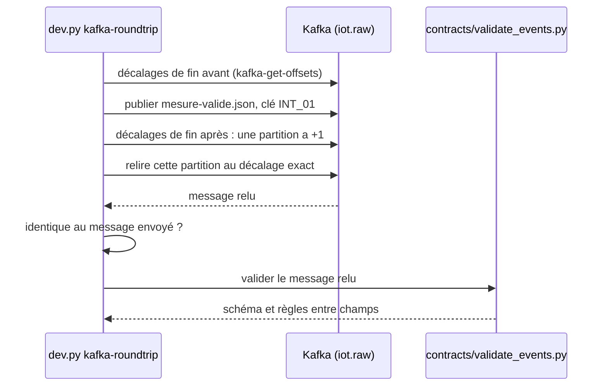

# Kafka local : sujets, publication et relecture

Projet : Novaria Core, socle d'UrbanHub (bloc de compétences BC05)
Responsable : Manoa Robel (issue LOC-04), relecture par Daddy Luciano
Décisions : [ADR-009](../01-architecture/adr/ADR-009-bus-evenements.md) (bus Kafka), [ADR-023](../01-architecture/adr/ADR-023-execution-locale-d-abord.md) (exécution locale d'abord), [ADR-025](../01-architecture/adr/ADR-025-equivalents-locaux-des-services-aws.md) (équivalent local de MSK)

Un seul broker Kafka tourne dans Docker Compose, en mode KRaft (Kafka Raft, sans ZooKeeper). Ce document donne les commandes pour le démarrer, créer les six sujets du bus et prouver qu'un événement publié sur `iot.raw` se relit et respecte son contrat.

Abréviations : DLQ (*Dead Letter Queue*, file des messages rejetés), MSK (Managed Streaming for Apache Kafka).

## 1. Ce qui est installé

| Élément | Valeur |
|---|---|
| Image | `apache/kafka:4.3.1` (image officielle du projet Apache, version fixée) |
| Mode | KRaft : le même processus est broker et contrôleur ; un seul nœud (`CLUSTER_ID` fixe en local) |
| Adresse depuis le poste | `127.0.0.1:9094` (variable `KAFKA_PORT` de `.env`, **publiée sur la boucle locale seulement**) |
| Adresse depuis un conteneur Compose | `kafka:9092` |
| Données | Volume `kafkadata`, conservé entre deux démarrages ; supprimé par `db-reset` (qui exécute `docker compose down -v`) |
| Création des sujets | Désactivée côté broker (`KAFKA_AUTO_CREATE_TOPICS_ENABLE=false`) : une faute de frappe dans un nom de sujet est une erreur, pas un nouveau sujet |
| Sonde de santé | `kafka-broker-api-versions.sh` : réussit quand le broker répond ; `--wait` de Compose attend ce résultat |
| Mémoire | Environ 435 Mo au repos (mesure du 26/10/2026, un seul relevé) |

Aucun client Kafka n'est à installer : les outils en ligne de commande sont dans le conteneur et `dev.py` les appelle.

## 2. Commandes

Préfixe : `python3 scripts/dev/dev.py` sous Linux, `py -3 scripts/dev/dev.py` sous Windows (PowerShell). Sous Linux, `make` fait la même chose. Prérequis : `.env` créé (`init-env`) et, pour `kafka-roundtrip`, `pip install jsonschema referencing` (une seule fois).

| Besoin | Linux (bash) | Windows (PowerShell) |
|---|---|---|
| Démarrer Kafka et attendre qu'il soit prêt | `python3 scripts/dev/dev.py kafka-up` (ou `make kafka-up`) | `py -3 scripts/dev/dev.py kafka-up` |
| Créer les 6 sujets manquants et les vérifier | `python3 scripts/dev/dev.py kafka-topics` (ou `make kafka-topics`) | `py -3 scripts/dev/dev.py kafka-topics` |
| Publier `mesure-valide.json` sur `iot.raw`, le relire, le valider | `python3 scripts/dev/dev.py kafka-roundtrip` (ou `make kafka-roundtrip`) | `py -3 scripts/dev/dev.py kafka-roundtrip` |
| Publier un autre événement ou sur un autre sujet | `python3 scripts/dev/dev.py kafka-roundtrip --file evenement.json --topic traffic.indicators` | `py -3 scripts/dev/dev.py kafka-roundtrip --file evenement.json --topic traffic.indicators` |
| Lister les sujets | `docker compose exec kafka /opt/kafka/bin/kafka-topics.sh --bootstrap-server localhost:9092 --list` | même commande |
| Décrire un sujet | `docker compose exec kafka /opt/kafka/bin/kafka-topics.sh --bootstrap-server localhost:9092 --describe --topic iot.raw` | même commande |
| Journaux du broker | `python3 scripts/dev/dev.py logs kafka` | `py -3 scripts/dev/dev.py logs kafka` |
| Arrêter (données conservées) | `docker compose stop kafka` | `docker compose stop kafka` |

`kafka-topics` démarre Kafka s'il est arrêté, **crée seulement les sujets absents** (un sujet existant n'est jamais modifié ni supprimé) et rend un code de sortie 1 si un sujet manque ou n'a pas la configuration attendue. Il est donc rejouable sans risque. `kafka-roundtrip` est en lecture et en écriture : il ajoute **un message** à chaque exécution.

## 3. Les six sujets

| Sujet | Producteur → consommateur | Partitions | Clé de partition | Rétention |
|---|---|---|---|---|
| `iot.raw` | Collecte → Traitement | 3 | `intersection_id` | 7 jours |
| `traffic.indicators` | Traitement → Alerte, tableau de bord | 3 | `intersection_id` | 7 jours (défaut du broker) |
| `traffic.recommendations` | Traitement → Réponse extérieure | 3 | `intersection_id` | 7 jours (défaut du broker) |
| `alerts.events` | Alerte → tableau de bord | 3 | `intersection_id` | 7 jours (défaut du broker) |
| `signal.status` | Réponse extérieure → tableau de bord | 3 | `intersection_id` | 7 jours (défaut du broker) |
| `errors.dlq` | Tous → revue manuelle | 3 | `intersection_id` | 7 jours (défaut du broker) |

La définition est une seule liste, `KAFKA_TOPICS` dans `scripts/dev/dev.py`. Un test (`scripts/dev/test_kafka.py`) vérifie qu'elle reste égale au tableau de l'ADR-009 §4.1. Les 3 partitions et la rétention de 7 jours de `iot.raw` viennent de l'ADR-009 §4.3 (« à ajuster par mesure »). Un seul broker : la réplication est de 1 (la réplication 3 de l'ADR vaut pour MSK).

**La clé est choisie par le producteur, pas par le sujet.** Le message d'un même carrefour va toujours dans la même partition, donc l'ordre est conservé par carrefour. La clé est le champ `subject` de l'enveloppe, égal à `data.intersection_id` : `contracts/validate_events.py` l'impose pour tous les types d'événements.

| Écart avec l'ADR-009 §4.1 | Détail |
|---|---|
| `alerts.events` | L'ADR indique la clé `alert_id` ; le contrat et l'issue LOC-04 indiquent `intersection_id`. Ce document suit le contrat |
| `errors.dlq` | L'ADR indique `source_topic` ; l'issue LOC-04 indique `intersection_id`. Ce document suit l'issue. Le contrat de ce sujet n'existe pas encore (hors v0) |

À trancher avec Daddy, puis corriger l'ADR-009 ou la liste `KAFKA_TOPICS`.

## 4. Aller-retour : publier, relire, valider



La commande ne cherche pas « un message qui ressemble » : elle compare les décalages de fin avant et après la publication pour trouver la partition et la position exactes du message, puis le relit à cet endroit. Elle sort avec le code 1 si le message relu diffère de l'envoyé ou si le contrat est violé, et avec le code 2 si la publication n'est pas confirmée (un seul message devait apparaître).

### Preuve du 26/10/2026 (poste Linux, sujets vides)

```text
$ python3 scripts/dev/dev.py kafka-topics
  sujet                    partitions  clé de partition  état
  iot.raw                  3           intersection_id   [OK] créé
  traffic.indicators       3           intersection_id   [OK] créé
  traffic.recommendations  3           intersection_id   [OK] créé
  alerts.events            3           intersection_id   [OK] créé
  signal.status            3           intersection_id   [OK] créé
  errors.dlq               3           intersection_id   [OK] créé
6 sujets présents et conformes.

$ python3 scripts/dev/dev.py kafka-roundtrip
  [OK] publié  : sujet iot.raw, partition 1, décalage 0, clé INT_01
  [OK] relu    : partition 1, décalage 0, clé INT_01, contenu identique à mesure-valide.json
  [contrat] [OK] relu-iot.raw-p1-o0.json
  [OK] conforme au contrat (schéma et règles entre champs)
```

Contre-épreuve : une mesure dont `vehicle_count` vaut -1 et `occupancy_rate` 1,7 est publiée et relue à l'identique, puis refusée par le contrat (code de sortie 1) :

```text
  [contrat] [KO] relu-errors.dlq-p1-o0.json
  [contrat]        - data/occupancy_rate : 1.7 is greater than the maximum of 1
  [contrat]        - data/vehicle_count : -1 is less than the minimum of 0
```

Après un redémarrage du broker (`docker compose restart kafka`), les six sujets sont toujours là : les données sont dans le volume.

## 5. Limites et points à vérifier

| Point | État |
|---|---|
| Authentification et chiffrement | Aucun en local (`PLAINTEXT`) ; le port n'est joignable que depuis ce poste. La matrice d'accès par service (producteur ou consommateur seulement) et TLS (Transport Layer Security) sont prévus par CLD-18 |
| Messages de test | Chaque `kafka-roundtrip` laisse un message dans `iot.raw` (`run_id` `run-demo-0001`), conservé 7 jours. Les consommateurs, idempotents par `id` (ADR-009 §4.3), l'ignorent à la seconde lecture. Pour repartir d'un sujet vide : `docker compose exec kafka /opt/kafka/bin/kafka-topics.sh --bootstrap-server localhost:9092 --delete --topic iot.raw`, puis `kafka-topics` |
| Contrats des sujets `traffic.recommendations`, `signal.status`, `errors.dlq` | Pas encore écrits (hors v0) : le validateur ne reconnaît que mesure, indicateur et alerte |
| Windows | Commandes écrites pour PowerShell, **non exécutées sous Windows** : à vérifier par Daddy lors de la relecture |
| Validation du professeur | L'ADR-009 retient Kafka **sous condition** (exigence de temps réel, registre des demandes B-03, décision au plus tard le 01/11/2026). Si un bus léger est retenu, les sujets, les clés et l'aller-retour restent valables ; seuls le service Compose et les outils du conteneur changent |
| Clé et partitions réelles | Les 3 partitions sont une configuration initiale ; l'ADR-009 demande de l'ajuster par mesure |

## 6. Dépannage

| Symptôme | Cause et solution |
|---|---|
| `address already in use` sur le port 9094 | Un autre programme du poste l'utilise : changer `KAFKA_PORT` dans `.env` (par exemple `9095`), puis `docker compose up -d kafka` |
| `kafka-up` attend longtemps puis échoue | Lire `dev.py logs kafka` ; au premier démarrage, l'image est téléchargée (686 Mo sur disque) |
| `Le sujet iot.raw n'existe pas` | Lancer `dev.py kafka-topics` d'abord |
| `Le validateur de contrats demande : pip install jsonschema referencing` | Installer les deux paquets Python (une seule fois) |
| Un client lancé depuis le poste se connecte puis échoue | Il doit utiliser `127.0.0.1:9094` ; l'adresse `kafka:9092` n'existe que dans le réseau Compose |
| Variable `KAFKA_BOOTSTRAP_SERVERS` des services | À définir dans Compose par service : `kafka:9092` (équivalent local de MSK, ADR-025) |
