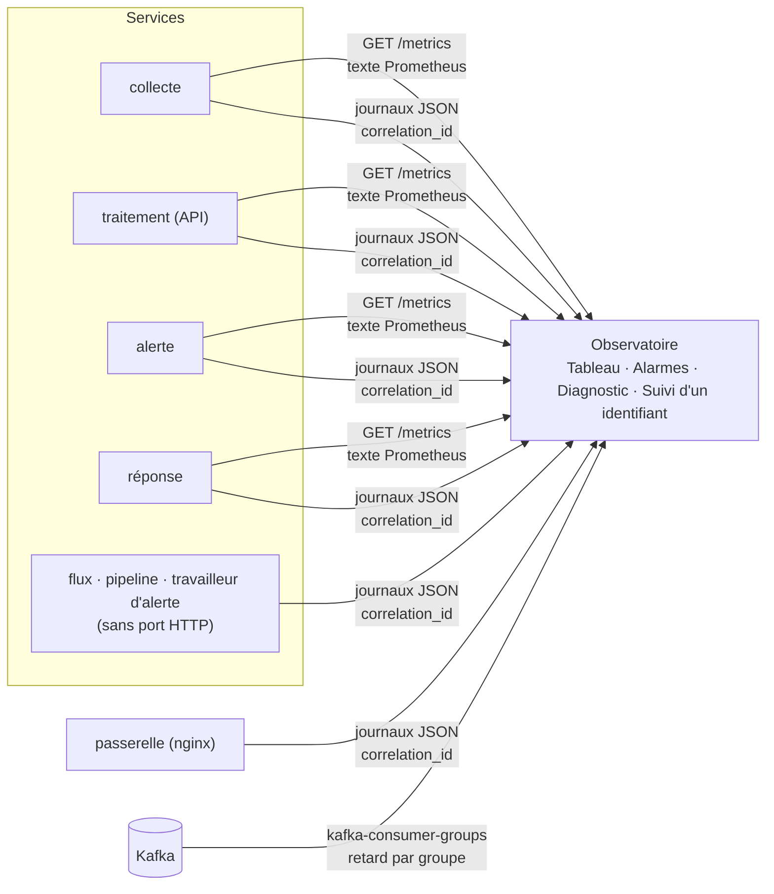
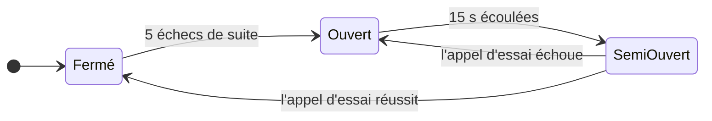

# Observabilité et résilience entre services (MS-16)

Projet : Novaria Core, socle d'UrbanHub (bloc de compétences BC05)
Responsables : Daddy Luciano et Manoa Robel (relecture croisée)
Dernière mise à jour : 17/11/2026
Issue de suivi : MS-16 (#135), dépend de MS-15 (#125)
Statut : à valider par les deux membres (relecture de la pull request)

Critère d'acceptation : **une panne injectée dans un service est détectée et diagnostiquée à partir des journaux et du tableau.** Preuve : ce document, section 8 (une panne de Kafka injectée sous trafic : chaque alarme, chaque ligne de journal et chaque case du tableau qui la décrivent, avec leurs délais, puis le gel d'un service).

Abréviations : **API** (Application Programming Interface), **HTTP** (HyperText Transfer Protocol), **JSON** (JavaScript Object Notation), **RED** (Rate, Errors, Duration : débit, erreurs, durée), **SSE** (Server-Sent Events), **p95** (95e centile : 95 % des requêtes vont plus vite), **MQTT** (Message Queuing Telemetry Transport), **lag** (retard de consommation : messages écrits sur un sujet Kafka et pas encore lus par un groupe), **DLQ** (Dead Letter Queue, file des messages refusés), **CI** (Continuous Integration, intégration continue).

## 1. En bref

| Tâche de l'issue | Réalisé | Où | Preuve |
|---|---|---|---|
| Journaux JSON avec identifiant de corrélation propagé d'un service à l'autre | Un identifiant par requête HTTP (de la passerelle aux services) **et** par message (du simulateur à la collecte, puis à travers Kafka dans le flux, le pipeline, l'alerte et la réponse). La recherche `dev.py trace <id>` et le champ de l'onglet « Tableau » le suivent dans tous les journaux | `app/core/logs.py` (`bound_correlation`, `correlation_of`), boucles de lecture des quatre consommateurs, `simulator/novaria_sim/sinks.py` | Section 3 |
| Délais d'attente, reprises avec attente croissante et disjoncteur vers les dépendances | Module `resilience.py` (reprises exponentielles avec aléa, disjoncteur à trois états) ; la collecte l'applique à Kafka et à MongoDB, le simulateur à la collecte ; chaque disjoncteur est visible dans `/metrics` et dans le journal | `services/collecte/app/core/resilience.py`, `app/adapters/guards.py`, `simulator/novaria_sim/resilience.py` | Sections 4 et 8 |
| Tableau local (journaux JSON et point `/metrics`) : débit, retard de consommation, erreurs par service | `GET /metrics` dans les **quatre** services (RED + dépendances) ; onglet « Tableau » de l'observatoire : débit, erreurs 5xx, taux, durée moyenne et p95, disjoncteurs, erreurs du journal, retard de consommation Kafka en messages et en secondes, débit d'écriture des sujets | `app/core/metrics.py`, `scripts/dev/tableau.py`, `ops/observatoire/index.html` | Sections 2, 5 à 7 |

L'interface demandée pour la démonstration est l'observatoire de CLD-14, étendu : voir la section 9.

## 2. Les trois signaux



| Signal | Ce qu'il dit | D'où il vient | Limite |
|---|---|---|---|
| **Métriques** (`GET /metrics`) | Combien, combien d'erreurs, combien de temps, état des disjoncteurs | Les quatre services avec port : collecte (8001), traitement (8002), alerte (8003), réponse (8004) | Le flux, le pipeline et le travailleur d'alertes n'ont pas de port : ils n'ont **pas** de `/metrics` (section 10) |
| **Journaux** | Ce qui s'est passé, pour qui (`correlation_id`), avec quelle erreur | Sortie standard JSON de chaque conteneur ; lignes nginx pour la passerelle | Un journal dit ce qui a été écrit : un service gelé n'écrit plus rien |
| **Retard de consommation** | Si les groupes lisent aussi vite que les producteurs écrivent | `kafka-consumer-groups.sh` lancé dans le conteneur du broker | Pas de point `/metrics` sur le broker local ; un appel Docker toutes les 10 s environ |

**`/metrics` ne sort que des nombres.** Les étiquettes sont le service, la méthode, le **modèle** de chemin (`/api/v1/alerts/{alert_id}`, jamais le chemin reçu) et la classe de statut (`2xx`, `5xx`). Aucun identifiant, aucune valeur de requête. Le point est hors du contrat OpenAPI, hors de `/api/v1` et **non routé par la passerelle** (404) : seul le poste le lit (ports en `127.0.0.1`).

| Métrique | Type | Étiquettes |
|---|---|---|
| `novaria_http_requests_total` | compteur | `service`, `method`, `route`, `status` (classe) |
| `novaria_http_request_duration_seconds` | histogramme (11 bornes de 5 ms à 10 s) | `service`, `method`, `route` |
| `novaria_http_requests_in_flight` | jauge | `service` |
| `novaria_circuit_state` | jauge : 0 fermé, 1 semi-ouvert, 2 ouvert | `dependency` |
| `novaria_circuit_opened_total` | compteur | `dependency` |
| `novaria_dependency_calls_total` | compteur | `dependency`, `outcome` (`ok`, `error`, `rejected`) |
| `novaria_dependency_retries_total`, `novaria_dependency_duration_seconds` | compteur, histogramme | `dependency` |
| `novaria_process_start_time_seconds` | jauge | — |

## 3. Journaux JSON et identifiant de corrélation

Chaque ligne est un objet JSON : `ts`, `level`, `service`, `logger`, `message`, `correlation_id`, plus des champs propres à l'événement. Même format dans les cinq services (`app/core/logs.py`) ; la passerelle écrit des lignes nginx dont la dernière colonne est le même identifiant.

### 3.1 Où l'identifiant naît et où il est repris

| Trajet | Identifiant | Comment il se propage |
|---|---|---|
| Navigateur vers passerelle vers service | `X-Correlation-ID` (reçu s'il est sobre, sinon généré) | La passerelle le passe au service ; chaque service le met dans ses lignes et dans l'en-tête de réponse ; l'audit MongoDB le garde |
| Simulateur vers collecte (HTTP) | `corr-<instant>` du **message**, envoyé en `X-Correlation-ID` | La collecte reprend l'identifiant du message : le journal d'accès, `mesure acceptée` et `publication échouée` portent le **même** identifiant que le message. Cet identifiant est celui de l'**instant** (un intervalle de 10 s) : il est partagé par les messages de tous les capteurs de cet instant ; `event_id` (run, capteur, instant) désigne un message |
| Collecte vers Kafka vers flux | Le `correlation_id` écrit **dans** le message | La boucle de lecture du flux pose l'identifiant du message autour de son traitement : tout rejet, toute erreur et tout avertissement écrits pendant ce message le portent |
| Flux vers pipeline, alerte, réponse | Le `correlation_id` de l'**indicateur** (`corr-<début de fenêtre>`) | Le flux écrit `indicateur publié` sous cet identifiant ; les boucles du pipeline, de l'alerte et de la réponse le reprennent à la lecture |

**Ce qui ne se propage pas** : un indicateur résume **plusieurs** mesures (une fenêtre d'une minute en contient six par capteur). Il a donc son propre identifiant, pas celui d'une des mesures. Le suivi d'une mesure s'arrête à la fenêtre ; on passe ensuite à l'identifiant de la fenêtre (section 7.2).

### 3.2 Les suivre

| Besoin | Linux (bash) | Windows (PowerShell) |
|---|---|---|
| Interface : champ « Suivre un identifiant » de l'onglet Tableau | `python3 scripts/dev/dev.py observatoire` | `py -3 scripts/dev/dev.py observatoire` |
| Chercher à la main dans tous les journaux (30 minutes) | `docker compose logs --since 30m --timestamps \| grep corr-1794923710000` | `docker compose logs --since 30m --timestamps \| Select-String corr-1794923710000` |

L'identifiant n'est jamais un secret ni une donnée personnelle : il est reçu seulement s'il est sobre (lettres, chiffres, `.`, `_`, `-`, 64 caractères au plus), sinon remplacé. La recherche de l'interface refuse tout autre texte.

## 4. Délais d'attente, reprises avec attente croissante et disjoncteur

`resilience.py` (bibliothèque standard, le même fichier dans la collecte et le simulateur, un test vérifie qu'ils sont identiques) :

| Mécanisme | Règle |
|---|---|
| **Délai d'attente** | Chaque dépendance a le sien : accusé Kafka 10 s (`KAFKA_PUBLISH_TIMEOUT_S`), MongoDB 3 s (`MONGO_TIMEOUT_MS`), collecte vue du simulateur 5 s. Sans délai, une dépendance muette gèle l'appelant |
| **Reprises** | `retry` : au plus N essais, attente `base`, puis ×2, plafonnée, avec ±20 % d'aléa. Seules les erreurs **de dépendance** sont rejouées : une erreur de logique ou un 422 ne l'est jamais |
| **Disjoncteur** | Après `CIRCUIT_FAILURE_THRESHOLD` échecs **de suite** (5), il s'ouvre : les appels échouent **tout de suite** (503), sans attendre le délai. Après `CIRCUIT_RESET_TIMEOUT_S` (15 s), **un** appel d'essai passe (semi-ouvert) ; il réussit : fermé ; il échoue : rouvert pour un nouveau délai |



| Qui appelle quoi | Délai | Reprises | Disjoncteur | Quand il est ouvert |
|---|---|---|---|---|
| Collecte vers Kafka (publication) | 10 s | Non : l'émetteur renvoie sur un 503 | `kafka` | `PublishFailed` immédiat, **503** pour l'émetteur ; rien n'est perdu côté collecte, le message n'a pas été accepté |
| Collecte vers MongoDB (`raw_events`, `rejects`) | 3 s | 3 essais, attente 0,1 s puis 0,2 s (écritures idempotentes : index unique sur l'`id`) | `mongo`, **partagé** par la copie brute et l'archive des rejets | `StoreFailed` immédiat, 503 |
| Simulateur vers collecte (HTTP) | 5 s | 3 essais sur une connexion tombée ou un 503, attente 0,1 s puis 0,2 s | `collecte` (5 envois en échec de suite, 10 s) | Le message est **compté** en erreur (`receipts.errors`, `last_error: disjoncteur ouvert`) : jamais caché |

Chaque disjoncteur est visible : jauge `novaria_circuit_state`, compteur d'ouvertures, appels par issue, et les lignes de journal `disjoncteur ouvert` (WARNING), `disjoncteur semi-ouvert`, `disjoncteur fermé`, `reprise`. **L'état est relu à chaque lecture de `/metrics`** : sans trafic, un disjoncteur ouvert devient semi-ouvert quand son délai est écoulé, la jauge ne reste pas bloquée à « ouvert ».

## 5. Premier geste, le tableau

L'onglet « Tableau » de l'observatoire. Les taux se calculent sur les **30 dernières secondes**, entre deux relevés de `GET /metrics`.

| Colonne | Ce qu'elle dit | Alarme | Seuil |
|---|---|---|---|
| Requêtes / s | Débit du service (la courbe montre les 60 derniers relevés) | — | — |
| 5xx / s, taux 5xx | Réponses d'erreur du service | `taux-erreurs-http` | 20 % des réponses, 5 requêtes au moins, 2 mesures de suite |
| Durée moy. / p95 | Lenteur : un p95 qui monte avant les erreurs annonce une dépendance qui souffre | — | — |
| Disjoncteurs | `fermé`, `semi-ouvert`, `OUVERT` par dépendance | `disjoncteur-ouvert` | Dès l'ouverture |
| Erreurs journal (30 s) | Lignes `ERROR` du service | `erreurs-journal` | 3 lignes |

**Lecture.** Un 5xx qui monte seul : le service lui-même ; un disjoncteur ouvert : la **dépendance** nommée est en cause, pas le service ; un `/metrics muet` : le service ne répond plus (arrêté ou gelé, voir [diagnostic](diagnostic.md)).

## 6. Deuxième geste, le retard de consommation

Un groupe de consommation a un **retard** : messages écrits sur le sujet et pas encore validés. Le tableau l'affiche en messages et en **secondes d'écriture** (retard ÷ le plus grand des débits d'écriture du sujet sur **30 s et sur 120 s** : sur 30 s seulement, l'arrêt d'un producteur ferait tomber le débit à zéro et exploser le retard sans que le consommateur ait rien fait ; sur 120 s seulement, le silence d'avant un trafic le gonflerait).

**Pourquoi le temps et pas le nombre.** Le flux et le pipeline ne valident leurs positions qu'à la **fermeture de leurs fenêtres** (une minute, plus 30 s de retard toléré) : en marche normale, leur retard est toujours d'environ `débit × 90 s` (mesuré : 1 282 messages à 12 messages par seconde, soit 107 s). Un seuil en messages donnerait une fausse alarme à chaque pic de trafic. L'alarme `retard-consommation` se déclenche à **150 s d'écriture**, 3 mesures de suite : un consommateur qui ne lit plus voit son retard croître sans limite (703 s mesurés après une panne de Kafka).

| Observation | Lecture |
|---|---|
| Retard en secondes autour de 90 s et stable | Normal : fenêtres du flux |
| Retard qui croît à chaque relevé | Le consommateur est arrêté, bloqué ou plus lent que le producteur |
| Retard à zéro partout sur un sujet qui n'écrit plus | Le **producteur** s'est tu : regarder la collecte |
| Groupe `traitement-entrepot` (pipeline) avec quelques dizaines de messages en permanence | Normal : le pipeline ne valide pas au-delà d'un indicateur qui attend ses voisins ([entrepôt](../03-donnees/entrepot.md), section 3) |

## 7. Troisième geste, le journal

### 7.1 Les lignes qui comptent

| Ligne (`message`, niveau) | Service | Ce qu'elle dit |
|---|---|---|
| `publication échouée` (ERROR), `error: KafkaTimeoutError` | collecte | Le bus n'a pas accusé réception dans le délai |
| `disjoncteur ouvert` (WARNING), `dependency`, `failures` | collecte | La collecte arrête d'appeler la dépendance |
| `reprise` (WARNING), `attempt`, `delay_s`, `error` | collecte | Une écriture MongoDB est rejouée |
| `arrêt sur panne` (ERROR), `error` | flux, pipeline, travailleur d'alertes | Le consommateur s'arrête **sans valider** d'offset et redémarre : rien n'est perdu |
| `No node available for metadata refresh`, `DNS lookup failed` | tous les clients Kafka | Le broker n'est pas joignable (arrêté : le nom `kafka` n'existe plus sur le réseau) |
| `[error] connect() failed (111 ou 113)` | passerelle | Un service en amont est arrêté (111) ou a disparu du réseau (113) |

### 7.2 Suivre un identifiant

Exemple réel (trafic simulé, 17/11/2026), recherche de l'identifiant d'une mesure : voir la section 8.3.

## 8. Preuve : pannes injectées le 17/11/2026

Poste Linux (Ubuntu), Docker 29.9, Docker Compose 5.7, Python 3.14, pile démarrée par `dev.py up` (13 conteneurs sains, images reconstruites avec MS-16), trafic simulé de 15 messages par seconde vers la collecte. Les essais partent d'un **départ propre** : la commande attend que toutes les alarmes soient à OK avant d'injecter, et **refuse d'injecter** sinon (un essai sur une pile déjà en alarme donnerait des délais faux).

### 8.1 Panne de Kafka sous trafic (`dev.py panne kafka --trafic --duree 45`)

**Ce que l'on regarde, dans l'ordre.** L'alarme sonne ; le tableau dit *qui souffre* ; le journal dit *pourquoi* ; la cause se retrouve dans l'état Docker.

| Délai | Alarme déclenchée | Ce que dit le tableau (onglet « Tableau ») | Ce que dit le journal |
|---|---|---|---|
| **+6,7 s** | `erreurs-journal` sur six services (collecte, flux, pipeline, alerte, travailleur d'alertes, réponse) : de 24 à 54 lignes d'erreur en 30 s | Colonne « Erreurs journal » rouge pour les six services | `Connection failed: KafkaConnectionError: 111 ECONNREFUSED`, `socket disconnected` chez les clients Kafka de chaque service : **tous voient le bus partir en même temps, donc la cause est commune** |
| **+12,5 s** | `service-arrete` sur **kafka** (critique) | — | Conteneur `exited`, code 143 |
| **+29,5 s** | `disjoncteur-ouvert` sur **collecte** | Pastille `kafka` : **OUVERT** (`mongo` reste fermé) : la collecte a décidé de ne plus appeler le bus | `publication échouée` (`KafkaTimeoutError`) puis `disjoncteur ouvert` (`dependency: kafka`, `failures: 5`), sous l'identifiant de la mesure en cours |
| **+40,7 s** | `taux-erreurs-http` sur collecte : 68 % de réponses 5xx | Taux 5xx de la collecte à 65 %, p95 à 10 s (les premières publications ont attendu leur délai de 10 s avant que le disjoncteur s'ouvre) ; traitement, alerte, réponse à 0 % | Lignes d'accès `POST /api/v1/measurements … 503` |
| **+85,1 s** | `retard-consommation` sur traitement-flux : 1 359 messages = 727 s d'écriture | Retard du groupe `traitement-flux` sur `iot.raw` qui croît (environ 100 s en marche normale, 107 s mesurés) | `arrêt sur panne` (`PublishFailed`) puis redémarrage du conteneur |

Au rétablissement (+59,0 s) : le service `kafka` revient à OK à +63,6 s, le disjoncteur de la collecte repasse fermé à +71,6 s **tout seul** (un appel d'essai part, réussit), le taux d'erreurs retombe à +85,1 s, les erreurs du journal à +98,3 s, le retard à +111,9 s. **Retour à la normale (toutes les alarmes à OK) : oui.**

Extrait du rapport de la commande (lignes raccourcies) :

```text
Panne contrôlée : Kafka (bus) (kafka)
  Arrêt volontaire : 2026-11-17T19:04:11Z    Première alarme : 6.7 s après l'arrêt

2. Journaux
  collecte :
    {"level": "ERROR", "logger": "app.kafka", "message": "publication échouée", "correlation_id": "corr-1792476290000", "topic": "iot.raw", "error": "KafkaTimeoutError"}
    {"level": "WARNING", "logger": "app.resilience", "message": "disjoncteur ouvert", "correlation_id": "corr-1792476290000", "dependency": "kafka", "before": "closed", "failures": 5}  (×2)
  traitement-flux :
    {"level": "ERROR", "logger": "app.flux", "message": "arrêt sur panne", "error": "PublishFailed"}  (×5)

3. Tableau (au moment du rétablissement)
  collecte   0.68 req/s · 5xx 0.44/s (65 %) · p95 10000.0 ms · disjoncteurs : kafka OUVERT, mongo fermé
  traitement 0.59 req/s · 5xx 0.0/s (0 %) · p95 5.0 ms · disjoncteurs : -
  kafka traitement-flux / iot.raw : retard 1178 message(s) = 96 s d'écriture

4. Cause
  arrêté par SIGTERM (code 143) : arrêt demandé ; normal pour un processus Java comme Kafka, sinon le service ne gère pas SIGTERM

5. Impact
  Prévu (services qui dépendent de kafka) : alerte, alerte-worker, collecte, frontend, passerelle, reponse, simulateur, traitement-flux, traitement-pipeline
  Observé (services avec une alarme) : alerte, alerte-worker, collecte, reponse, traitement-flux, traitement-pipeline
```

**Le diagnostic, rédigé comme on le ferait à partir des seules sources.**

1. *Le tableau* : seule la collecte répond en 5xx ; son disjoncteur `kafka` est ouvert ; `traitement`, `alerte`, `réponse` répondent normalement. Le problème est donc **entre la collecte et Kafka**, pas dans les services d'API.
2. *Le journal* : les six services qui parlent à Kafka écrivent la même erreur de connexion à la même seconde. Un défaut propre à la collecte ne toucherait pas le flux. **La dépendance commune est en cause.**
3. *Alarme et état Docker* : `service-arrete` sur `kafka`, conteneur `exited`, code 143. **Cause : le conteneur du bus est arrêté** (SIGTERM, donc arrêt demandé, pas un plantage).
4. *Impact constaté, comparé au prévu* : six des neuf services qui dépendent de Kafka en configuration ont une alarme ; la passerelle, le front-end et le simulateur n'en ont pas : ils ne parlent pas à Kafka et **continuent de répondre** (le tableau de bord affiche les dernières données connues).

### 8.2 Une seconde panne, sans rien redémarrer

Une première version de ce travail n'a **pas** passé cet essai : après plusieurs pannes de Kafka, le producteur de la collecte, gardé ouvert pendant des heures, ne se reconnectait plus (`KafkaTimeoutError` à chaque essai alors que le broker répondait), et le disjoncteur restait **ouvert pour toujours**. C'est le genre de défaut que le tableau rend visible : disjoncteur `OUVERT` en continu alors que le service d'à côté va bien. Corrigé : un producteur qui échoue est oublié et le suivant en crée un neuf (`kafka_publisher._discard`, testé). Deux pannes de Kafka rejouées **à la suite**, sans redémarrer la collecte : même déroulé (première alarme à 6,8 s puis 6,7 s, disjoncteur ouvert à 29,8 s puis 29,5 s, retour à la normale dans les deux cas).

### 8.3 Un service gelé (`dev.py panne collecte --trafic --mode pause`)

Même trafic. Le conteneur est gelé (`docker compose pause`) : le processus vit mais ne répond plus. Rien n'est arrêté, rien n'est écrit dans son journal.

| Délai | Ce qui se passe | Ce que dit le tableau | Ce que dit le journal |
|---|---|---|---|
| +14,1 s | Les alarmes `disjoncteur-ouvert` et `taux-erreurs-http` de la collecte passent à « manque de données » : `/metrics` ne répond plus (ce n'est **pas** une alarme : le service n'a pas dit qu'il allait mal, il n'a plus rien dit) | La ligne de la collecte affiche **`/metrics muet`** ; traitement, alerte, réponse sont normaux | **Silence** : la dernière ligne de la collecte date de l'instant du gel (`19:28:07`), alors qu'elle en écrivait deux par message reçu |
| **+28,2 s** | `service-arrete` (critique) : conteneur « paused » ; `sonde-http` : délai dépassé | Idem | Idem |
| +70,1 s | Dégel | — | La collecte reprend et rattrape ce qui était en attente : 12 lignes d'erreur en 30 s à +74,1 s |
| +79,7 s | `taux-erreurs-http` : 55 % de 5xx (le producteur Kafka repart de connexions périmées) | Taux 5xx du service qui remonte | `publication échouée` |
| +107,1 s | Toutes les alarmes à OK : **retour à la normale : oui** | — | — |

**Le diagnostic.** Le conteneur est « paused » (Docker, `State.Paused`), pas arrêté : **la cause est un gel, pas un plantage** (le rapport le dit : « service gelé : le processus vit mais ne répond plus »). Le tableau et le journal le disent aussi **sans** regarder Docker : un service dont le `/metrics` est muet **et** dont le journal s'est arrêté net à une heure précise est gelé ou arrêté, alors qu'un service qui plante écrit d'abord une erreur. Les sondes HTTP en échec par délai dépassé (et non par connexion refusée) distinguent le gel de l'arrêt : un conteneur arrêté **refuse** la connexion tout de suite, un conteneur gelé la laisse **expirer**.

| Observation | Panne arrêtée | Panne gelée |
|---|---|---|
| Sonde HTTP | connexion refusée | délai dépassé (4 s) |
| `/metrics` | muet | muet |
| Journal | séquence d'arrêt (`Shutting down`) | **rien**, dernière ligne à l'heure du gel |
| État Docker | `exited`, code de sortie | `paused` |
| Détection | 10 à 20 s | **28 s** (les sondes attendent leur délai) |


### 8.4 Suivre un identifiant

Recherche de l'identifiant `corr-1792476000000` (une fenêtre d'indicateurs) dans l'onglet Tableau, après le trafic :

```text
Chemin : traitement-flux → traitement-pipeline
18:39:23.226  traitement-flux      INFO  indicateur publié  {'event_id': 'obs-e655ee:ROAD_001:60:1792476000000', 'topic': 'traffic.indicators'}
18:39:23.226  traitement-flux      INFO  indicateur publié  {'event_id': 'obs-e655ee:ROAD_002:60:1792476000000', 'topic': 'traffic.indicators'}
18:39:23.237  traitement-pipeline  INFO  indicateur reçu    {'event_id': 'obs-e655ee:ROAD_001:60:1792476000000'}
18:39:23.237  traitement-pipeline  INFO  indicateur reçu    {'event_id': 'obs-e655ee:ROAD_002:60:1792476000000'}
```

**Précision importante.** L'identifiant d'un indicateur est `corr-<début de fenêtre>` : il est **partagé par tous les tronçons de la même minute** (et par deux exécutions du même scénario simulé). Il relie le flux au pipeline, il ne désigne pas **un** indicateur : le champ `event_id` (run, tronçon, taille, minute) le désigne. Pour une mesure, l'identifiant est celui de l'instant (`corr-<instant de la mesure>`), **partagé par les capteurs du même intervalle de 10 s** ; là aussi, `event_id` désigne un message. Dans les deux cas l'identifiant **regroupe** (un instant, une minute), il ne désigne pas un objet unique : c'est le compromis du contrat d'événements, qui fixe ce format.

### 8.5 Ce que MS-16 a trouvé

| N° | Constat | Gravité | État |
|---|---|---|---|
| 1 | Le producteur Kafka de la collecte ne se reconnectait plus après des pannes répétées du broker (section 8.2) | Haute : la collecte restait en 503 jusqu'à son redémarrage | **Corrigé**, testé |
| 2 | Un disjoncteur ouvert restait affiché « ouvert » sans trafic, son passage à « semi-ouvert » n'arrivant qu'à l'appel suivant | Moyenne : l'alarme ne retombait pas | **Corrigé** : l'état est relu à chaque lecture de `/metrics` |
| 3 | Le groupe `traitement-entrepot` (le pipeline) a **la partition 1 de `traffic.indicators` à l'offset 0** pour 686 messages écrits (et plus à chaque minute de trafic) : le pipeline retient les positions d'une fenêtre qui attend les autres tronçons de son carrefour, et un carrefour qui ne se complète jamais retient la partition pour toujours. Le retard croît sans limite (478 s d'écriture mesurés) | Moyenne : à chaque redémarrage, le pipeline relit tout ; rien n'est perdu (écritures idempotentes) mais le retard affiché est faux | **Non corrigé** (logique du pipeline, hors de ce périmètre). Groupe montré dans le tableau, **sans alarme** : elle serait levée en permanence (`ops/alarmes.json`, `groupes_kafka_non_surveilles`) |
| 4 | Un service gelé puis dégelé fait ouvrir de nouveau le disjoncteur de la collecte (section 8.3) | Faible : retour seul en 15 à 25 s | Constat |


## 9. L'interface pour la démonstration

L'onglet « **Tableau : débit, erreurs, retard** » de l'observatoire (`dev.py observatoire`, `http://127.0.0.1:8090/`) :

| Zone | Contenu |
|---|---|
| Barre | **Lancer le trafic simulé** / **Arrêter** (le simulateur envoie des mesures à 15 par seconde vers la collecte : sans trafic le tableau reste à zéro) ; champ « Suivre un identifiant de corrélation » |
| Services | Quatre lignes (collecte, traitement, alerte, réponse) : requêtes par seconde avec courbe, 5xx par seconde, taux, durée moyenne et p95, **pastilles des disjoncteurs**, erreurs du journal. Les services sans `/metrics` sont résumés dessous |
| Kafka | Retard par groupe en messages et en secondes avec courbe, messages écrits et débit par sujet |
| Alarmes levées | Rappel des alarmes actives |
| Suivi | Les lignes de journal de l'identifiant, tous services mêlés, dans l'ordre du temps, avec le chemin parcouru |

| Trafic normal : débit, disjoncteurs fermés, retard, suivi d'un identifiant | Panne de Kafka sous trafic : alarmes, disjoncteur, 5xx, retard |
|---|---|
|  |  |

Captures du 17/11/2026, faites avec Chrome sur la pile réelle (celle de droite 45 secondes après l'arrêt de Kafka : la collecte est à 40 % de 5xx et son disjoncteur `kafka` est semi-ouvert ; la ligne rouge du groupe `traitement-entrepot` est le défaut connu de la section 8.5).

Pour injecter une panne depuis l'interface : sélectionner un service sur la carte, **Arrêter** (conteneur arrêté) ou **Geler (bloquer)** (`docker compose pause` : le processus vit mais ne répond plus). **Rétablir** remet le service.

| Étape de la démonstration (5 minutes) | Ce qu'on montre | Ce qu'on dit |
|---|---|---|
| 1 | Onglet Tableau, **Lancer le trafic simulé** : débit de la collecte à 15 requêtes par seconde, disjoncteurs `fermé`, retard du flux autour de 90 s | « Voici l'état normal : le tableau n'est pas vide, les dépendances sont gardées. » |
| 2 | Carte : sélectionner **Kafka**, **Arrêter** | « On coupe le bus, sous trafic. » |
| 3 | Onglet Alarmes puis Tableau : erreurs du journal dans les six services, `taux 5xx` de la collecte qui monte, le disjoncteur `kafka` passe à **OUVERT** | « Le journal a vu la panne en 7 s, le tableau montre qui souffre et quelle dépendance est en cause. » |
| 4 | Onglet Diagnostic : lignes `publication échouée`, `disjoncteur ouvert`, `DNS lookup failed` ; cause : arrêt par SIGTERM | « Le journal et le tableau disent la même chose : le bus est parti. » |
| 5 | **Rétablir** ; le disjoncteur passe semi-ouvert puis fermé, le retard du flux monte puis redescend | « Le disjoncteur laisse passer un essai : la collecte revient d'elle-même. » |
| 6 | Suivi d'un identifiant d'une mesure : collecte, puis flux | « On suit une mesure d'un service à l'autre. » |

## 10. Limites et points ouverts pour la relecture croisée

| N° | Point | État |
|---|---|---|
| 1 | Vérifié sous **Linux seulement** ; les commandes PowerShell, `docker compose pause` et l'interface ne sont **pas vérifiées** sous Windows. L'interface a été essayée dans Chrome | À vérifier |
| 2 | **Le flux, le pipeline et le travailleur d'alertes n'ont pas de `/metrics`** : ils n'ont pas de port HTTP. Ils sont vus par leur journal, leur état Docker et le retard Kafka de leur groupe. Leur ajouter un point (un petit serveur HTTP dans un fil) est possible, non fait | Limite |
| 3 | **Disjoncteur et reprises : la collecte (Kafka, MongoDB) et le simulateur vers la collecte seulement.** Le service d'API (`traitement`) vers PostgreSQL a un délai (5 s de pool) mais ni reprise ni disjoncteur : une panne de PostgreSQL y coûte un délai par requête. L'alerte et la réponse ont leurs délais et leurs reprises propres (notifications, travailleurs qui s'arrêtent et redémarrent), pas ce disjoncteur. La passerelle n'a que les délais de nginx | Limite, choisie : le trajet temps réel (mesure vers bus) est celui où une dépendance muette coûte le plus |
| 4 | Le disjoncteur de la collecte met **30 à 40 secondes** à s'ouvrir sur une panne de Kafka : chaque publication attend son délai de 10 s avant d'échouer. Le p95 de la collecte monte à 10 s avant la chute. Baisser `KAFKA_PUBLISH_TIMEOUT_S` ou `CIRCUIT_FAILURE_THRESHOLD` accélère l'ouverture, au prix de plus de faux déclenchements | Mesuré, réglable |
| 5 | Après le gel puis le dégel de la collecte, son disjoncteur Kafka s'est rouvert une fois et a repris tout seul en 15 à 25 s : les connexions du producteur sont périmées après un gel. Le producteur fautif est maintenant remplacé, mais ce délai de reprise n'est pas mesuré à fond | Constat |
| 6 | **Le retard du pipeline (`traitement-entrepot`) n'est pas alarmé** et croît tant qu'un carrefour reste incomplet (section 8.5, n° 3). Tant que ce défaut n'est pas corrigé, ce retard n'est pas un signal fiable | Défaut connu, hors périmètre |
| 7 | Le retard en secondes dépend du débit d'écriture : sous 0,2 message par seconde, il n'est pas calculé (« écriture trop faible »). Seuils (20 % de 5xx, 150 s, 5 échecs, 15 s) **choisis d'après ces mesures, non réglés** : une exécution par essai | Limite |
| 8 | Le tableau garde environ **vingt minutes** en mémoire dans le processus de l'observatoire : redémarrer l'observatoire efface l'historique. Les taux se calculent sur 30 s : peu de trafic donne des chiffres bruités. Le p95 est la borne supérieure du seau d'histogramme (5 ms, 10 ms, 25 ms…), pas une valeur exacte | Limite |
| 9 | La recherche d'un identifiant lit **30 minutes de journaux** de tous les conteneurs : de l'ordre de la seconde, plus avec un trafic dense ; elle est bornée par la rétention des journaux de Docker | Limite |
| 10 | L'identifiant d'un indicateur est partagé par tous les tronçons d'une minute (section 8.4) ; le flux n'écrit **pas** une ligne par mesure acceptée (3 lignes par seconde de trafic pour rien) : le suivi d'une mesure s'arrête à la collecte, sauf si elle est rejetée par le flux (alors la ligne porte son identifiant) | Choix, limite |
| 11 | `/metrics` n'a pas d'authentification (comme un collecteur Prometheus) : il est lu depuis le poste, ports en `127.0.0.1`, non routé par la passerelle. Il ne contient aucun identifiant ni valeur de requête, mais **il dit quels chemins existent et combien de fois ils sont appelés** | À valider avant toute exposition |
| 12 | L'interface peut arrêter, geler des conteneurs et lancer un run du simulateur : mêmes protections que dans [diagnostic](diagnostic.md) (hôte local, jeton aléatoire, origine, liste de services) | Voir CLD-14 |
| 13 | Alarmes sans action : elles s'allument dans l'interface et le rapport, aucun message n'est envoyé. L'équivalent AWS (alarmes CloudWatch, Prometheus avec Alertmanager) n'est ni créé ni essayé (ADR-023) | Limite |


## 11. Lancer

| Besoin | Linux (bash) | Windows (PowerShell) |
|---|---|---|
| Reconstruire les images (nouveau `/metrics`, nouveaux disjoncteurs) | `docker compose build collecte traitement alerte reponse simulateur traitement-flux traitement-pipeline alerte-worker` puis `python3 scripts/dev/dev.py up` | idem avec `py -3 scripts/dev/dev.py up` |
| Lire les métriques d'un service | `curl -s http://127.0.0.1:8001/metrics` | `(Invoke-WebRequest -UseBasicParsing http://127.0.0.1:8001/metrics).Content` |
| Interface | `python3 scripts/dev/dev.py observatoire` ou `make observatoire` | `py -3 scripts/dev/dev.py observatoire` |
| Panne injectée sous trafic, en ligne de commande | `python3 scripts/dev/dev.py panne kafka --trafic --duree 45` | `py -3 scripts/dev/dev.py panne kafka --trafic --duree 45` |
| Même chose avec un service gelé | `python3 scripts/dev/dev.py panne collecte --trafic --mode pause` | `py -3 scripts/dev/dev.py panne collecte --trafic --mode pause` |
| Tests du tableau, sans Docker | `python3 -m unittest discover -s scripts/dev -p "test_tableau.py"` | `py -3 -m unittest discover -s scripts/dev -p "test_tableau.py"` |
| Tests des services | `cd services/collecte && python3 -m pytest` (idem les trois autres) | `cd services\collecte; py -3 -m pytest` |
| Tests du simulateur | `python3 -m unittest discover -s simulator/tests` | `py -3 -m unittest discover -s simulator/tests` |
