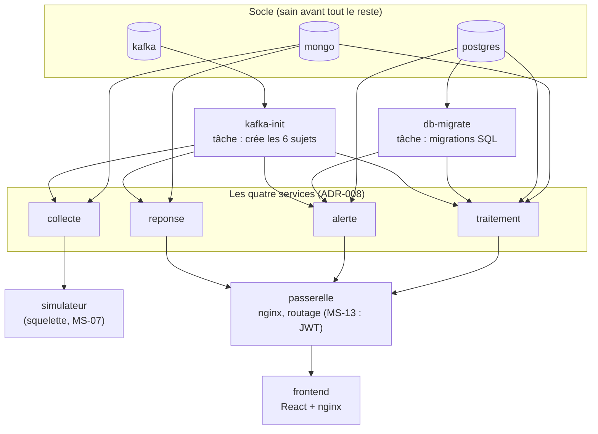

# Pile locale : tout démarrer avec Docker Compose

Projet : Novaria Core, socle d'UrbanHub (bloc de compétences BC05)
Responsable : Manoa Robel (issue MS-06), relecture par Daddy Luciano
Dernière mise à jour : 27/10/2026
Décisions : [ADR-008](../01-architecture/adr/ADR-008-microservices.md) (quatre services), [ADR-023](../01-architecture/adr/ADR-023-execution-locale-d-abord.md) (exécution locale d'abord), [ADR-024](../01-architecture/adr/ADR-024-bases-de-donnees-locales.md) (comptes de base par service)

Une seule commande démarre tout le projet sur le poste et vérifie que chaque conteneur répond : `dev.py up`. Ce document dit ce qui démarre, dans quel ordre, sur quels ports, et comment on le vérifie.

Abréviations : SSE (Server-Sent Events, flux du serveur vers le navigateur), KRaft (Kafka Raft, mode de Kafka sans ZooKeeper).

## 1. Ce qui démarre



| Conteneur | Rôle | Image | Compte de base |
|---|---|---|---|
| `postgres`, `mongo` | Bases de données ([ADR-024](../01-architecture/adr/ADR-024-bases-de-donnees-locales.md)) | `postgres:16-alpine`, `mongo:7` | administrateur |
| `kafka` | Bus d'événements, un broker en mode KRaft ([kafka-local.md](kafka-local.md)) | `apache/kafka:4.3.1` | aucun (local) |
| `db-migrate` | **Tâche** : applique les migrations SQL, puis s'arrête | `postgres:16-alpine` | administrateur |
| `kafka-init` | **Tâche** : crée les 6 sujets s'ils manquent, puis s'arrête (`infra/kafka/init-topics.sh`) | `apache/kafka:4.3.1` | — |
| `collecte` | Reçoit les mesures, les valide, les publie sur `iot.raw` | `services/collecte` | MongoDB `svc_collecte` |
| `traitement` | Fenêtres, indicateurs, recommandations | `services/traitement` | PostgreSQL et MongoDB `svc_traitement` |
| `alerte` | Cycle de vie des alertes | `services/alerte` | PostgreSQL `svc_alerte` |
| `reponse` | Commande des feux, avec garde-fous | `services/reponse` | MongoDB `svc_reponse` |
| `simulateur` | Capteurs simulés : **squelette**, répond à `/health`, ne produit pas encore de mesure (MS-07) | `simulator/` | aucun |
| `passerelle` | Point d'entrée de l'API, route par préfixe ; **sans** authentification pour l'instant (MS-13) | `nginxinc/nginx-unprivileged` + `gateway/nginx.conf` | aucun |
| `frontend` | Tableau de bord ; son nginx envoie `/api/` à la passerelle | `frontend/` | aucun |

Chaque service n'a que le compte de base qui lui revient : un service ne reçoit jamais le compte administrateur ni celui d'un autre (un test le vérifie). Les trois services `collecte`, `alerte` et `reponse` sont, comme `traitement`, des **squelettes créés depuis le gabarit** (`dev.py new-service`) : ils démarrent, répondent à `/api/v1/health` et attendent leur logique (MS-08, MS-11, MS-12).

### Ordre de démarrage

L'ordre n'est pas une pause : chaque dépendance (`depends_on`) attend une **condition**. Un service attend la sonde de santé (`service_healthy`) de ce dont il dépend ; une tâche est attendue par sa fin (`service_completed_successfully`). Aucune dépendance ne repose sur un simple « démarré ».

| Conteneur | Attend |
|---|---|
| `kafka-init` | `kafka` sain |
| `collecte` | `mongo` sain, `kafka-init` terminé |
| `traitement` | `postgres` et `mongo` sains, `db-migrate` et `kafka-init` terminés |
| `alerte` | `postgres` sain, `db-migrate` et `kafka-init` terminés |
| `reponse` | `mongo` sain, `kafka-init` terminé |
| `simulateur` | `collecte` saine |
| `passerelle` | `traitement`, `alerte` et `reponse` sains (pas la collecte : elle n'est pas exposée) |
| `frontend` | `passerelle` saine |

## 2. Ports

Tous sont publiés sur **127.0.0.1** : rien n'est joignable depuis le réseau. Chaque port se change dans `.env` (modèle : `.env.example`) si un autre programme du poste l'occupe.

| Conteneur | Adresse sur le poste | Variable de `.env` | Sonde de santé |
|---|---|---|---|
| `frontend` | <http://localhost:8080> | `FRONTEND_PORT` | `/` |
| `passerelle` | <http://localhost:8000/api/v1/> | `GATEWAY_PORT` | `/health` |
| `collecte` | `127.0.0.1:8001` | `COLLECTE_PORT` | `/api/v1/health` |
| `traitement` | `127.0.0.1:8002` | `TRAITEMENT_PORT` | `/api/v1/health` |
| `alerte` | `127.0.0.1:8003` | `ALERTE_PORT` | `/api/v1/health` |
| `reponse` | `127.0.0.1:8004` | `REPONSE_PORT` | `/api/v1/health` |
| `simulateur` | `127.0.0.1:8005` | `SIMULATOR_PORT` | `/api/v1/health` |
| `postgres` | `127.0.0.1:5432` | `POSTGRES_PORT` | `pg_isready` |
| `mongo` | `127.0.0.1:27017` | `MONGO_PORT` | `ping` authentifié |
| `kafka` | `127.0.0.1:9094` | `KAFKA_PORT` | `kafka-broker-api-versions` |

Entre conteneurs, chaque service écoute sur son port **interne** 8000 (`collecte:8000`, `traitement:8000`…) et Kafka sur `kafka:9092`. L'API se consomme **par la passerelle** : le tableau de bord appelle `/api/...` sur son propre port, son nginx transmet à la passerelle, qui route par préfixe selon la [table des contrats](../../contracts/openapi/README.md) (le détail est dans [gateway/README.md](../../gateway/README.md)).

## 3. Commandes

Préfixe : `python3 scripts/dev/dev.py` sous Linux, `py -3 scripts/dev/dev.py` sous Windows (PowerShell). Sous Linux, `make` fait la même chose.

| Besoin | Linux (bash) | Windows (PowerShell) |
|---|---|---|
| Créer `.env` (une seule fois) | `python3 scripts/dev/dev.py init-env` | `py -3 scripts/dev/dev.py init-env` |
| **Tout démarrer** et vérifier chaque `/health` | `python3 scripts/dev/dev.py up` (ou `make up`) | `py -3 scripts/dev/dev.py up` |
| Revérifier les sondes (réessaie 60 s) | `python3 scripts/dev/dev.py health --wait 60` (ou `make health`) | `py -3 scripts/dev/dev.py health --wait 60` |
| État des conteneurs, tâches terminées comprises | `docker compose ps --all` | `docker compose ps --all` |
| Journaux d'un service | `python3 scripts/dev/dev.py logs collecte` (ou `make logs S=collecte`) | `py -3 scripts/dev/dev.py logs collecte` |
| **Tout arrêter** et supprimer les conteneurs (données conservées) | `python3 scripts/dev/dev.py down` (ou `make down`) | `py -3 scripts/dev/dev.py down` |
| Effacer aussi les données | `python3 scripts/dev/dev.py db-reset` (confirmation demandée) | `py -3 scripts/dev/dev.py db-reset` |

`up` fait `docker compose up --build -d --remove-orphans`, puis interroge neuf sondes (réessais pendant 90 s au plus) : un `/health` par conteneur applicatif, plus deux chemins qui **traversent la chaîne** (l'API vue par la passerelle, puis par le front-end, ce qui prouve le routage et le proxy). Il rend le code 1 si une sonde échoue, avec la commande des journaux à lancer. `down` supprime les conteneurs et le réseau ; les volumes (données) restent, seul `db-reset` les efface. `--remove-orphans` retire aussi un conteneur d'une version précédente de la pile (l'ancien `backend`, par exemple).

## 4. Preuve du 27/10/2026 (poste Linux)

Ubuntu 26.04.1, Docker 29.9.1, Compose v5.6.0.

| Démarrage | Durée | Résultat |
|---|---|---|
| **Depuis zéro** : volumes neufs, aucune image (projet Compose jetable, autres ports) | 42 s (images déjà en cache pour les bases) | 9 sondes sur 9 ; `db-check` : toutes les vérifications passent ; les 6 sujets Kafka existent (créés par `kafka-init`) |
| Sur les bases habituelles du poste, première fois (images à construire, ancien `backend` retiré) | 51 s | 9 sondes sur 9 |
| Deuxième `up` (rien à changer) | 16 s | 9 sondes sur 9 |

```text
$ python3 scripts/dev/dev.py up
  [OK] collecte                             http://127.0.0.1:8001/api/v1/health            ok (révision local)
  [OK] traitement                           http://127.0.0.1:8002/api/v1/health            ok (révision local)
  [OK] alerte                               http://127.0.0.1:8003/api/v1/health            ok (révision local)
  [OK] reponse                              http://127.0.0.1:8004/api/v1/health            ok (révision local)
  [OK] simulateur                           http://127.0.0.1:8005/api/v1/health            ok (révision local)
  [OK] passerelle                           http://127.0.0.1:8000/health                   ok
  [OK] frontend                             http://127.0.0.1:8080/                         HTTP 200
  [OK] passerelle (route vers traitement)   http://127.0.0.1:8000/api/v1/health            ok (révision local)
  [OK] frontend (proxy vers la passerelle)  http://127.0.0.1:8080/api/v1/health            ok (révision local)
Les 9 sondes répondent.
Front-end : http://localhost:8080   ·   API (passerelle) : http://localhost:8000/api/v1/
```

```text
$ docker compose ps --all
SERVICE      STATUS
alerte       Up 46 seconds (healthy)
collecte     Up 45 seconds (healthy)
db-migrate   Exited (0) 58 seconds ago
frontend     Up 25 seconds (healthy)
kafka        Up About a minute (healthy)
kafka-init   Exited (0) 46 seconds ago
mongo        Up About a minute (healthy)
passerelle   Up 30 seconds (healthy)
postgres     Up About a minute (healthy)
reponse      Up 46 seconds (healthy)
simulateur   Up 30 seconds (healthy)
traitement   Up 46 seconds (healthy)
```

Les deux conteneurs `Exited (0)` sont les tâches uniques (`db-migrate`, `kafka-init`) : c'est leur état normal.

Contrôles complémentaires :

| Essai | Résultat |
|---|---|
| `GET /api/v1/intersections`, `/api/v1/alerts`, `/api/v1/signals/INT_01` par la passerelle | `404 {"detail":"Not Found"}` rendu **par le service** (route pas encore écrite), et le journal du service montre le même `X-Correlation-ID` que celui envoyé : le routage et la corrélation fonctionnent |
| `GET /api/v1/auth/login` | `503` au format `application/problem+json`, code `UPSTREAM_UNAVAILABLE` : le service API métier n'existe pas encore |
| `GET /api/v1/measurements` | `404` : le dépôt des mesures est interne |
| `docker compose stop alerte` puis `dev.py health` | `[KO] alerte … injoignable`, « 1 sonde(s) en échec », **code de sortie 1** |
| `dev.py down` puis `dev.py health` | 9 sondes en échec, code 1 ; les trois volumes de données sont conservés |

## 5. Dépannage

| Symptôme | Cause et solution |
|---|---|
| `address already in use` sur l'un des ports | Un autre programme occupe le port : changer la variable correspondante dans `.env` (section 2), puis relancer `up` |
| `up` échoue sur `variable is not set` | `.env` manquant ou ancien : `dev.py init-env` (ou ajouter les variables de `.env.example`) |
| Une sonde reste `[KO]` après 90 s | `dev.py logs <service>` ; `docker compose ps --all` dit quel conteneur n'est pas `healthy` |
| `up` ne finit pas, un conteneur reste `starting` | Le premier démarrage télécharge des images (plusieurs centaines de Mo) : attendre, ou suivre avec `docker compose ps --all` |
| Le front-end s'arrête (`host not found in upstream "passerelle"`) | Normal hors Compose : son nginx a besoin de la passerelle. Utiliser `dev.py up` |
| Un service n'atteint pas sa base | Le mot de passe de `.env` ne correspond plus à celui de la base déjà créée : `db-reset` (efface les données), puis `up` |

## 6. Limites et points à vérifier

| Point | État |
|---|---|
| **Windows** | Les commandes sont les mêmes (Compose, Python standard, aucune commande shell dans `dev.py`), les scripts montés ont des fins de ligne Unix (`.gitattributes`, test), mais `dev.py up` **n'a été exécuté que sous Linux** : à rejouer par Daddy sous PowerShell et à consigner ici (`dev.py up`, puis `docker compose ps --all`) avant de dire « vérifié sur les deux systèmes » |
| Squelettes | `collecte`, `alerte`, `reponse`, `simulateur` ne font que répondre à leur sonde. La pile prouve le **câblage** (ordre, comptes, réseau, routage), pas encore le flux de données de bout en bout (MS-15) |
| Passerelle | Routage seulement : pas d'authentification, de limitation de débit ni de CORS (MS-13). Tant que le service API métier n'existe pas (BE-02), `/api/v1/health` est servi par `traitement` |
| CI | Les quatre services et le gabarit sont contrôlés par la matrice de la CI ([ci-multi-services.md](../04-devsecops/ci-multi-services.md)). Le **simulateur et la passerelle ne le sont pas** (hors de `services/`) : leurs images ne sont ni construites ni analysées par Snyk dans la CI. À ajouter avec MS-07 et MS-13 |
| Ressources | Dix conteneurs en marche ; les images des services font environ 243 Mo chacune. Non mesuré sous charge |
| Premier téléchargement | Le temps de la section 4 suppose les images des bases et de Kafka déjà présentes |
