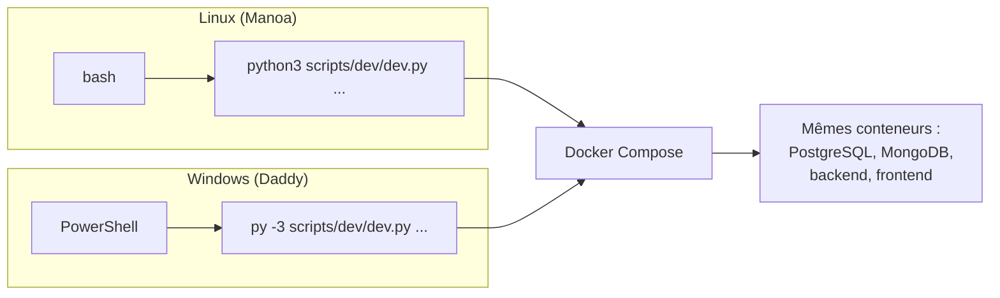

# Poste de travail : Linux (Ubuntu) et Windows

Le binôme travaille sur deux systèmes : Linux (Ubuntu) pour Manoa, Windows pour Daddy. Docker rend l'environnement identique ; ce guide couvre ce que Docker ne couvre pas (outils, terminal, fins de ligne). Décision : [ADR-026](../01-architecture/adr/ADR-026-postes-de-travail-windows-et-linux.md).

## 1. Règle d'or

Une seule commande de référence : `scripts/dev/dev.py` (Python, bibliothèque standard). Tout ce qui touche aux bases, à Docker et à la sauvegarde passe par elle. Les raccourcis `make` existent pour Linux ; sous Windows, `make` n'est pas nécessaire.

## 2. Outils à installer

| Outil | Pourquoi | Linux (Ubuntu) | Windows |
|---|---|---|---|
| Docker | Bases, backend, frontend | Docker Engine, puis `sudo usermod -aG docker $USER` et rouvrir la session | Docker Desktop (moteur WSL 2, *Windows Subsystem for Linux*, sous-système Windows pour Linux) |
| Git | Versionnement | `sudo apt install git` | Git for Windows (installe aussi **Git Bash**) |
| Python 3.12 | `dev.py`, backend, ML (Machine Learning, apprentissage automatique) | `sudo apt install python3.12 python3.12-venv` | python.org, cocher « Add python.exe to PATH » ; lancement par `py -3` |
| Node.js 22 (LTS : support à long terme) | Frontend | nvm ou nodejs.org | nodejs.org |
| GitHub CLI (`gh`) | Issues, pull requests | Paquet officiel `gh` | `winget install --id GitHub.cli` |
| Éditeur | Code et documentation | Visual Studio Code | Visual Studio Code |

Vérification en une commande, avec l'indication de l'installation de ce qui manque :

| Linux | Windows (PowerShell) |
|---|---|
| `python3 scripts/dev/dev.py check-tools` | `py -3 scripts/dev/dev.py check-tools` |

Docker Desktop sous Windows : activer « Use the WSL 2 based engine » (Settings → General), et garder le dépôt dans le système de fichiers Windows **ou** dans WSL, pas dans les deux. Allouer au moins 6 Go de mémoire à Docker (PostgreSQL, MongoDB et le backend tiennent dans moins ; l'entraînement ML et SUMO (Simulation of Urban MObility) demandent davantage).

## 3. Premier démarrage

| Étape | Linux | Windows (PowerShell) |
|---|---|---|
| Cloner | `git clone https://github.com/RobelManoa/novaria-core.git && cd novaria-core` | `git clone https://github.com/RobelManoa/novaria-core.git; cd novaria-core` |
| Se connecter à GitHub | `gh auth login` | `gh auth login` |
| Créer `.env` | `python3 scripts/dev/dev.py init-env` | `py -3 scripts/dev/dev.py init-env` |
| Démarrer les bases | `python3 scripts/dev/dev.py db-up` | `py -3 scripts/dev/dev.py db-up` |
| Contrôler | `python3 scripts/dev/dev.py db-check` | `py -3 scripts/dev/dev.py db-check` |

`gh auth login` ouvre le navigateur : aucun jeton n'est tapé dans le terminal ni dans une conversation. `.env` est créé avec des mots de passe aléatoires que personne n'a besoin de connaître ni de partager : chaque poste a les siens.

## 4. Correspondance des commandes

| Besoin | Linux (bash) | Windows (PowerShell) |
|---|---|---|
| Environnement virtuel Python | `python3 -m venv .venv` | `py -3 -m venv .venv` |
| Activer l'environnement | `source .venv/bin/activate` | `.\.venv\Scripts\Activate.ps1` |
| Dépendances du backend | `pip install -r backend/requirements-dev.txt` | `pip install -r backend\requirements-dev.txt` |
| Tests du backend | `cd backend && python -m pytest` | `cd backend; python -m pytest` |
| Dépendances et tests du frontend | `cd frontend && npm ci && npm test` | `cd frontend; npm ci; npm test` |
| Tests des scripts du poste | `python3 -m unittest discover -s scripts/dev` | `py -3 -m unittest discover -s scripts/dev` |
| Variable d'environnement (session) | `export NOM=valeur` | `$env:NOM = "valeur"` |
| Enchaîner si succès | `cmd1 && cmd2` | `cmd1; if ($?) { cmd2 }` (ou `&&` avec PowerShell 7) |
| Voir un fichier | `cat fichier` | `Get-Content fichier` |
| Chercher un texte | `grep -rn "texte" dossier` | `Select-String -Path dossier\* -Pattern "texte" -Recurse` |
| Copier un fichier | `cp a b` | `Copy-Item a b` |
| Raccourcis (facultatif) | `make db-up`, `make test` | non nécessaire |
| Scripts `.sh` du dépôt (`scripts/github/*.sh`) | `bash scripts/github/secrets.sh` | `bash scripts/github/secrets.sh` depuis **Git Bash** |

Si PowerShell refuse d'activer l'environnement virtuel (« l'exécution de scripts est désactivée ») : `Set-ExecutionPolicy -Scope CurrentUser RemoteSigned`, une seule fois.

## 5. Pièges propres à Windows

| Piège | Effet | Parade |
|---|---|---|
| Fins de ligne CRLF (*Carriage Return Line Feed*) dans un `.sh`, `.sql` ou `.js` | Le conteneur Linux échoue : `no such file or directory` | `.gitattributes` impose LF (*Line Feed*) à l'extraction ; `.editorconfig` demande LF à l'éditeur. VS Code : `"files.eol": "\n"`. |
| Redirection PowerShell `>` | Écrit en UTF-16 : les outils lisent des caractères illisibles | Utiliser l'option `--out fichier` du script concerné (par exemple `scripts/dev/gen_reseau.py --out`) ou `Out-File -Encoding utf8` |
| Chemins avec `\` | Les chemins des fichiers de configuration sont en `/` | Dans les fichiers du dépôt, toujours `/` ; PowerShell accepte aussi `/` |
| Accents dans le terminal | Caractères déformés | Les scripts forcent l'UTF-8 ; au besoin, `chcp 65001` |
| Antivirus ou OneDrive sur le dossier du dépôt | Lenteur, fichiers verrouillés | Cloner hors de OneDrive (par exemple `C:\dev\novaria-core`) |
| Port déjà pris (PostgreSQL installé en local) | `port is already allocated` | Changer `POSTGRES_PORT` dans `.env` |
| Nom de fichier trop long | Échec de l'extraction | `git config --global core.longpaths true` |

## 6. Pièges propres à Linux

| Piège | Effet | Parade |
|---|---|---|
| Utilisateur absent du groupe `docker` | `permission denied` sur le socket | `sudo usermod -aG docker $USER`, puis rouvrir la session |
| Fichiers `backups/` ou `var/` créés par root | Suppression impossible sans `sudo` | Les conteneurs de sauvegarde rendent les fichiers lisibles ; `sudo chown -R $USER backups` au besoin |
| Python système trop ancien | `check-tools` signale Python < 3.12 | Installer `python3.12` ou utiliser `pyenv` |

## 7. Travailler à deux avec Claude

Les deux membres utilisent Claude. Pour que les résultats soient comparables :

| Règle | Détail |
|---|---|
| Un fichier de consignes partagé | `CLAUDE.md` à la racine : contexte du projet, conventions, commandes des deux systèmes, interdits. Claude le lit au démarrage dans le dépôt. |
| Un gabarit de demande | [`docs/ia/prompt-modele-issue.md`](../ia/prompt-modele-issue.md) : on colle l'identifiant de l'issue, Claude lit l'issue, le dictionnaire de données et les ADR (*Architecture Decision Record*, enregistrement de décision d'architecture) concernés avant d'écrire du code. |
| Le système du poste est annoncé | Dire à Claude « je suis sous Windows » ou « sous Linux » : il donne les bonnes commandes. |
| Journal d'usage | Chaque usage significatif est inscrit dans [`docs/ia/journal-usage-ia.md`](../ia/journal-usage-ia.md) avec le but, le prompt et la vérification effectuée. |
| Aucun secret | Ni `.env`, ni jeton, ni mot de passe dans une conversation ou une capture. |
| Relecture humaine | Tout code produit avec Claude passe en pull request relue par l'autre membre ; les contrôles CI (Continuous Integration, intégration continue) ne sont jamais désactivés. |

## 8. Où trouver quoi

| Besoin | Document |
|---|---|
| Bases de données locales | [base-de-donnees-locale.md](../03-donnees/base-de-donnees-locale.md) |
| Sauvegarde et restauration | [sauvegarde-restauration-locale.md](sauvegarde-restauration-locale.md) |
| Dictionnaire de données | [dictionnaire-de-donnees.md](../03-donnees/dictionnaire-de-donnees.md) |
| Démarrage du binôme (qui fait quoi, dans quel ordre) | [demarrage-binome.md](../07-gestion/demarrage-binome.md) |
| Règles de contribution | [CONTRIBUTING.md](../../CONTRIBUTING.md) |
