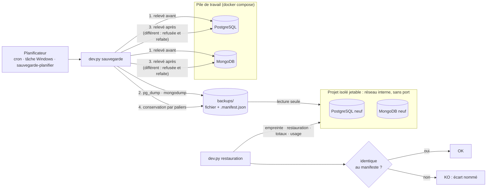

# Sauvegarde planifiée et restauration vérifiée de PostgreSQL et de MongoDB (CLD-15)

Projet : Novaria Core, socle d'UrbanHub (bloc de compétences BC05)
Responsables : Daddy Luciano (responsable de l'issue) et Manoa Robel (relecture croisée)
Dernière mise à jour : 17/11/2026
Issue de suivi : CLD-15 (#88), dépend de LOC-03 (#149, fermé : [sauvegarde et restauration locales](sauvegarde-restauration-locale.md))
Statut : à valider par les deux membres (relecture de la pull request)

Critère d'acceptation : **les données restaurées sont utilisables et les totaux sont identiques.** Preuve : ce document, section 8 (restauration dans un environnement isolé, lignes **et** sommes de contrôle de chaque table et de chaque collection identiques au manifeste, essais d'usage réussis, trois pannes injectées toutes détectées).

Abréviations : **CI** (Continuous Integration, intégration continue), **SHA-256** (Secure Hash Algorithm, empreinte de 256 bits), **TTL** (Time To Live, durée de vie d'un document MongoDB), **RPO** (Recovery Point Objective, perte de données maximale acceptée), **RTO** (Recovery Time Objective, durée maximale de reprise), **JSON** (JavaScript Object Notation).

## 1. En bref

| Tâche de l'issue | Réalisé | Où | Preuve |
|---|---|---|---|
| Sauvegardes planifiées et conservation | `dev.py sauvegarde-planifier` (attend le créneau, rattrape un oubli), modèles cron et Planificateur de tâches Windows ; conservation par paliers : 24 h, 7 jours, 4 semaines, 3 mois | `scripts/dev/sauvegarde.py`, `ops/planification/` | Sections 3 et 8 |
| Restauration dans un environnement isolé | `dev.py restauration` : deux serveurs neufs dans un projet Docker jetable, réseau interne, aucun port, mots de passe aléatoires, supprimé à la fin | `compose.restauration.yml` | Sections 5 et 8 |
| Contrôle d'intégrité des données restaurées | Manifeste par sauvegarde (empreinte du fichier, lignes et somme de contrôle de chaque table et collection, index, droits, validateurs) comparé à la restauration, puis essais d'usage | `sauvegarde.comparer`, `verifier_la_restauration` | Sections 6 et 8 |

**Ce que CLD-15 ajoute à LOC-03.** LOC-03 sauvegardait et vérifiait dans une « base jetable » **sur le même serveur** que la production, en comparant seulement un nombre de lignes. Ici : un serveur distinct, la comparaison du contenu, des essais d'usage, une planification, et MongoDB restauré pour de bon (LOC-03 notait « non testé »).

## 2. Principe



## 3. Planification et conservation

### 3.1 Politique de conservation

| Palier | Règle | Valeur par défaut |
|---|---|---|
| Récentes | Toutes les sauvegardes de moins de N heures (celles faites avant une migration ou une démonstration restent) | 24 h |
| Jours | La dernière de chaque jour | 7 jours |
| Semaines | La dernière de chaque semaine ISO | 4 semaines |
| Mois | La dernière de chaque mois | 3 mois |
| Toujours | **La plus récente n'est jamais supprimée**, même très ancienne | |

Une sauvegarde est supprimée **avec son comptage et son manifeste**, et rien d'autre dans le dossier. Exemple, calculé par `a_conserver` sur 130 sauvegardes quotidiennes à 02:00 (la plus récente date de la veille) :

| Âge des sauvegardes gardées (en jours) | Palier |
|---|---|
| 1, 2, 3, 4, 5, 6 | jours |
| 9, 16 ou 17, 23 | semaines |
| 48, 78 | mois |
| **12 gardées sur 130** | |

Le détail se voit sans rien supprimer avec `dev.py sauvegarde-liste` (colonne « conservée » ou « serait supprimée »). La politique est une constante de `scripts/dev/sauvegarde.py` (`POLITIQUE`) ; la rotation par nombre de LOC-03 (`BACKUP_KEEP`, 7 par défaut) s'applique seulement à `dev.py backup`, que `dev.py sauvegarde` appelle avec `BACKUP_KEEP=0` (pas de rotation par nombre).

### 3.2 Planifier

| Besoin | Linux (bash) | Windows (PowerShell) |
|---|---|---|
| Sans cron : attendre le créneau, sauvegarder, rattraper un oubli au démarrage | `python3 scripts/dev/dev.py sauvegarde-planifier --heure 02:00` | `py -3 scripts/dev/dev.py sauvegarde-planifier --heure 02:00` |
| Idem, avec restauration de contrôle après chaque sauvegarde | `python3 scripts/dev/dev.py sauvegarde-planifier --verifier` | `py -3 scripts/dev/dev.py sauvegarde-planifier --verifier` |
| Avec cron (sauvegarde chaque jour à 02:00, contrôle le dimanche à 03:00) | remplacer le chemin dans `ops/planification/novaria-sauvegarde.cron`, puis `(crontab -l ; cat ops/planification/novaria-sauvegarde.cron) \| crontab -` | — |
| Avec le Planificateur de tâches | — | `powershell -ExecutionPolicy Bypass -File ops\planification\installer-tache-windows.ps1 -Heure 02:00` |
| Retirer la planification | `crontab -e` (supprimer les lignes) | `powershell -ExecutionPolicy Bypass -File ops\planification\installer-tache-windows.ps1 -Supprimer` |
| Essai rapide du planificateur (3 sauvegardes, une toutes les 15 s) | `python3 scripts/dev/dev.py sauvegarde-planifier --toutes-les 15 --executions 3` | `py -3 scripts/dev/dev.py sauvegarde-planifier --toutes-les 15 --executions 3` |

Le planificateur n'arrête pas sur une erreur : il la journalise (`ÉCHEC : …`) et attend le créneau suivant. Au démarrage, si une des deux bases n'a aucune sauvegarde de moins de 24 h (poste éteint au créneau), il sauvegarde tout de suite.

## 4. Le manifeste

Chaque sauvegarde s'accompagne de `<fichier>.manifest.json`, écrit de façon atomique :

| Contenu | Rôle |
|---|---|
| `sha256`, `taille` du fichier | Détecte une altération **entre** la sauvegarde et la restauration (disque, copie) |
| PostgreSQL : par table, `lignes` et `controle` | `controle` = somme de `hashtextextended` du texte de chaque ligne, **indépendante de l'ordre** : deux tables de même nombre de lignes mais de contenu différent n'ont pas la même valeur |
| MongoDB : par collection, `lignes`, `controle`, `index`, `validateur` | Même principe sur le JSON de chaque document ; les index (dont les TTL) et le validateur sont comparés aussi |
| `totaux` | Lecture humaine : fenêtres, véhicules, runs, comptes, migrations (PostgreSQL) ; documents bruts, véhicules, rejets (MongoDB) |
| `indexes`, `vues`, `droits`, `contraintes_non_validees` | La structure : index, nombre de lignes de chaque vue (l'API lit des vues), droits des rôles de service, contraintes |
| Version du serveur | Savoir sur quoi la sauvegarde a été prise |

**Cohérence.** Le relevé est pris **avant et après** la sauvegarde. Si les lignes ou les sommes diffèrent (la base a bougé pendant `pg_dump`), la sauvegarde est supprimée et refaite (3 essais), puis refusée : un manifeste faux rendrait la vérification menteuse.

## 5. L'environnement isolé

`compose.restauration.yml`, lancé par `dev.py restauration` dans un projet `novaria-restauration-<hex>` :

| Propriété | Mesure | Vérifié par |
|---|---|---|
| Aucun accès à Internet ni au poste | Réseau Docker `internal: true` | Cas R3 à chaque essai (`docker network inspect`), et un test du fichier |
| Aucun port publié | Pas de `ports:` ; les commandes passent par `docker compose exec` | Cas R3 (0 port publié) |
| Sans rapport avec la pile de travail | Projet, réseau et conteneurs distincts ; rien n'est lu dans les volumes de production | Cas R3 (nom du projet) |
| Mots de passe jetables | Tirés au hasard à chaque essai, passés par l'environnement du processus, jamais écrits ni affichés | Test des mots de passe distincts |
| Sauvegardes protégées | Montées en lecture seule | Test du fichier |
| Rien ne subsiste | `down -v` dans un `finally`, même après un échec | Aucun conteneur ni réseau `restauration` après l'essai |
| Même initialisation que la production | Mêmes scripts de rôles, schémas et utilisateurs | Une restauration qui dépend d'un rôle absent échoue ici comme en vrai |

**Deux découvertes de la première exécution** (elles sont la raison d'être d'un environnement isolé) :

| Cas | Échec observé | Cause | Réponse |
|---|---|---|---|
| R4 | `pg_restore : role "novaria_admin" does not exist` | La sauvegarde cite l'administrateur de la pile (`ALTER DEFAULT PRIVILEGES FOR ROLE novaria_admin`) | L'administrateur de l'environnement isolé porte **le même nom** (pas le même mot de passe). À savoir pour une vraie reprise sur un serveur neuf |
| R5 | `ingestion_runs : absente de la sauvegarde` | Le script d'initialisation du dépôt crée une collection que la pile sauvegardée, plus ancienne, n'a pas : la base neuve avait donc une collection de plus | La base MongoDB isolée est **vidée avant** la restauration : on contrôle ce que la sauvegarde contient, pas ce que l'initialisation y ajoute. La pile de travail a un retard de version de l'initialisation sur ce point (`ingestion_runs`), non corrigé ici |

Une troisième remarque : `droits` différait d'abord, parce que `--no-owner` ne restaure pas les propriétaires et que les droits **du propriétaire** disparaissent des vues `information_schema`. Le relevé compare maintenant les droits explicites accordés aux rôles `svc_*`, pas ceux du propriétaire.

## 6. Le contrôle d'intégrité

| Cas | Ce qui est vérifié | Échoue si |
|---|---|---|
| R1 et R2 | Empreinte SHA-256 du fichier choisi égale à celle du manifeste | Un octet a changé depuis la sauvegarde, ou le manifeste manque |
| R3 | Isolement (section 5) | Réseau non interne, port publié |
| R4 | PostgreSQL : toutes les tables ont **les mêmes lignes et la même somme de contrôle**, les mêmes index, vues (nombre de lignes), droits, aucune contrainte non validée, mêmes totaux ; puis le rôle `svc_lecture` lit `dwh.v_indicator` (la vue de l'API) et **ne peut pas écrire** | Un écart, nommé table par table |
| R5 | MongoDB : mêmes collections, lignes, sommes de contrôle, index (TTL compris), validateurs ; puis le validateur de `raw_events` **refuse un document invalide** (code 121) et un document se lit | Un écart, ou un validateur absent |
| N1 à N3 (option `--controles-negatifs`) | **La vérification sait dire non** : un octet changé dans une copie du fichier, un total de plus dans un manifeste PostgreSQL, un total de plus dans un manifeste MongoDB doivent tous être détectés | Un des trois n'est pas détecté |

Les contrôles négatifs travaillent sur des copies datées de 1999, supprimées à la fin : les vraies sauvegardes ne sont pas touchées.

## 7. Lancer

| Besoin | Linux (bash) | Windows (PowerShell) |
|---|---|---|
| Sauvegarder (manifeste, conservation) | `python3 scripts/dev/dev.py sauvegarde` ou `make sauvegarde` | `py -3 scripts/dev/dev.py sauvegarde` |
| Lister, et voir ce qui serait supprimé | `python3 scripts/dev/dev.py sauvegarde-liste` | `py -3 scripts/dev/dev.py sauvegarde-liste` |
| Restaurer dans l'environnement isolé et comparer | `python3 scripts/dev/dev.py restauration` ou `make restauration` | `py -3 scripts/dev/dev.py restauration` |
| Idem, avec les trois pannes injectées | `python3 scripts/dev/dev.py restauration --controles-negatifs` | `py -3 scripts/dev/dev.py restauration --controles-negatifs` |
| Vérifier un fichier précis | `python3 scripts/dev/dev.py restauration --postgres novaria_20261117T020000Z.dump` | `py -3 scripts/dev/dev.py restauration --postgres novaria_20261117T020000Z.dump` |
| Tests, sans Docker (42 tests) | `python3 -m unittest discover -s scripts/dev -p "test_sauvegarde.py"` | `py -3 -m unittest discover -s scripts/dev -p "test_sauvegarde.py"` |

Prérequis : `.env` créé, pile démarrée (`dev.py up` ou `db-up`), Docker. La commande `dev.py restauration` ne touche **pas** à la pile de travail : elle ne lit que les fichiers de `backups/`. Le code de sortie est 0 si tous les cas sont satisfaits.

Pour une **vraie reprise** (remplacer les données de la pile de travail) : `dev.py restore` de LOC-03 ([procédure](sauvegarde-restauration-locale.md)), après avoir vérifié la sauvegarde avec `dev.py restauration`.

## 8. Preuve : exécution du 17/11/2026

Poste Linux (Ubuntu), Docker 29.9, Docker Compose 5.7, PostgreSQL 16.15, MongoDB 7.0.45, pile de travail avec ses données (17 tables, 6 collections).

### 8.1 Sauvegarde (`dev.py sauvegarde`) et restauration vérifiée (`dev.py restauration --controles-negatifs`)

```text
Sauvegarde :
  postgres : novaria_20261117T143126Z.dump (274859 octets, 17 tables relevées, empreinte 9c18668de746…)
  mongo : novaria_20261117T143135Z.archive.gz (1076195 octets, 6 collections relevées, empreinte 94dfb3591a64…)

Restauration dans un environnement isolé (réseau interne, mots de passe aléatoires, supprimé à la fin).
[OK] R1  Empreinte du fichier postgres : novaria_20261117T143126Z.dump : 274859 octets, empreinte 9c18668de746… conforme au manifeste
[OK] R2  Empreinte du fichier mongo : novaria_20261117T143135Z.archive.gz : 1076195 octets, empreinte 94dfb3591a64… conforme au manifeste
[OK] R3  Environnement isolé : projet novaria-restauration-8cd071 : 2 conteneurs neufs, réseau interne (sans accès extérieur), 0 port publié, mots de passe tirés au hasard, supprimé à la fin
[OK] R4  Restauration PostgreSQL et contrôle des totaux (1.1 s) : 17 tables et 16878 lignes restaurées, lignes et sommes de contrôle identiques au manifeste ; svc_lecture lit dwh.v_indicator (9792 lignes); svc_lecture ne peut pas écrire (droits restaurés)
[OK] R5  Restauration MongoDB et contrôle des totaux (10.3 s) : 6 collections et 52950 lignes restaurées, lignes et sommes de contrôle identiques au manifeste ; le validateur de raw_events refuse un document invalide (code 121); un document se lit
Contrôles négatifs (une panne injectée doit être détectée) :
[OK] N1  Fichier PostgreSQL altéré d'un octet : … a changé depuis la sauvegarde : empreinte 9f781de5f1f6… au lieu de 9c18668de746…
[OK] N2  Total PostgreSQL faux dans le manifeste (7.2 s) : totaux différents : alertes.alert : 9 lignes à la sauvegarde, 8 restaurées
[OK] N3  Total MongoDB faux dans le manifeste (16.1 s) : totaux différents : audit_logs : 1005 lignes à la sauvegarde, 1004 restaurées
8/8 cas satisfaits.
```

| Total | Pile de travail (manifeste) | Environnement isolé (restauré) |
|---|---|---|
| Tables PostgreSQL, lignes | 17 tables, 16 878 lignes | identique |
| `dwh.fact_traffic_window` | 9 792 fenêtres, 139 597 véhicules, 11 runs | identique |
| `dwh.v_indicator` (vue de l'API) | 9 792 lignes | 9 792 lignes |
| Collections MongoDB, documents | 6 collections, 52 950 documents | identique |
| `raw_events` | 44 684 documents, 40 461 véhicules | identique |

Un essai complet sans les contrôles négatifs (`dev.py restauration`, cinq cas) a duré **18 s** de bout en bout.

### 8.2 Planification (`dev.py sauvegarde-planifier --toutes-les 15 --executions 3`)

```text
[2026-11-17 18:32:56] sauvegarde planifiée (créneau)
  postgres : novaria_20261117T143257Z.dump (274859 octets, 17 tables relevées, empreinte 47e4022c09dd…)
  mongo : novaria_20261117T143305Z.archive.gz (1076173 octets, 6 collections relevées, empreinte 134f34715a9c…)
[2026-11-17 18:33:29] sauvegarde planifiée (créneau)
  …
[2026-11-17 18:34:02] sauvegarde planifiée (créneau)
  …
3 sauvegarde(s) planifiée(s) réussie(s).
```

Une sauvegarde complète des deux bases dure environ **18 s** ici (les 33 s entre deux cycles de l'essai sont les 15 s d'attente plus la durée du cycle ; le relevé de MongoDB, avant puis après, en prend environ 15). La première exécution de `dev.py sauvegarde` a aussi supprimé, par la politique, deux sauvegardes d'octobre (du 20/10) devenues trop anciennes : elles avaient été copiées avant l'essai.

### 8.3 Ce que ces essais prouvent, et ce qu'ils ne prouvent pas

| Prouvé | Non prouvé |
|---|---|
| Les données restaurées sont **identiques** (lignes et contenu), sur un serveur distinct, par PostgreSQL comme par MongoDB | La reprise sur un **autre poste** ou un autre disque : tout s'est fait sur la même machine |
| Elles sont **utilisables** : le rôle de lecture lit la vue de l'API sans pouvoir écrire, le validateur MongoDB refuse un document invalide | Le démarrage des **services applicatifs** sur la base restaurée (les services n'ont pas été lancés contre l'environnement isolé) |
| Un fichier altéré et deux totaux faux sont **détectés** | Une corruption **avant** la sauvegarde (le manifeste décrit ce qui était dans la base) |
| Le planificateur lance et journalise ses cycles | Un créneau réel de 02:00 (l'essai a utilisé l'intervalle de 15 s) ; la conservation par paliers sur des dates réelles étalées (elle est prouvée sur des dates fabriquées par les tests, section 3.1) |

## 9. Limites et points ouverts pour la relecture croisée

| N° | Point | État |
|---|---|---|
| 1 | Vérifié sous **Linux seulement**. Les commandes PowerShell, le script `installer-tache-windows.ps1` et Docker Desktop ne sont **pas vérifiés** : à rejouer par le responsable de l'issue, Daddy Luciano | À vérifier |
| 2 | Les sauvegardes sont sur le **disque du poste** : elles ne protègent pas de sa perte. Une copie hors du poste (autre disque, dépôt chiffré) reste à décider ; l'équivalent AWS (AWS Backup, instantanés RDS, S3) est documenté, non exécuté (ADR-023) | Limite |
| 3 | Sauvegardes **non chiffrées** (comme LOC-03). Le manifeste n'est pas signé : quelqu'un qui peut changer le fichier **et** son manifeste n'est pas détecté. Il détecte une corruption, pas une attaque | Limite |
| 4 | **RPO** : une sauvegarde par jour, donc jusqu'à 24 h de données perdues (pas de journal de transactions). **RTO** : la restauration de contrôle prend 18 s sur ce jeu (17 tables, 6 collections) ; non mesuré sur un jeu plus grand | Mesuré, limité |
| 5 | Le relevé de MongoDB lit tous les documents (8 s pour 52 950) : son coût grandit avec les données. Sur un jeu de plusieurs millions de lignes, il faudrait l'échantillonner ou le faire sur une réplique | Limite |
| 6 | `dev.py restore` (la vraie reprise de LOC-03) ne contrôle **pas** encore l'empreinte ni le manifeste. Recommandation : toujours passer par `dev.py restauration` d'abord | À valider |
| 7 | Les utilisateurs MongoDB et les propriétaires PostgreSQL ne sont pas restaurés (`--no-owner`, comptes recréés par l'initialisation) : comportement de LOC-03, conservé | Constat |
| 8 | La pile de travail a un retard de version de l'initialisation MongoDB : la collection `ingestion_runs` y manque (section 5). Le script d'initialisation ne s'exécute qu'au premier démarrage d'un volume vide | Constat, non corrigé ici |
| 9 | Si les écritures sont continues (simulateur actif à plein débit), la sauvegarde peut être refusée 3 fois de suite (« la base change trop vite ») : l'arrêter pendant la sauvegarde, ou la laisser tourner à un moment calme | Limite |
| 10 | Les anciennes sauvegardes **sans manifeste** (faites par `dev.py backup`) restent soumises à la politique de conservation mais ne peuvent pas être vérifiées avec `dev.py restauration` | Constat |

## 10. Dépannage

| Symptôme | Cause probable | Remède |
|---|---|---|
| `manifeste absent` | Sauvegarde faite par `dev.py backup` | Refaire avec `dev.py sauvegarde` |
| `la base change trop vite` | Écritures continues pendant la sauvegarde | Arrêter `simulateur` ou réessayer |
| R3 échoue au démarrage | Images `postgres:16-alpine` ou `mongo:7` absentes, Docker arrêté | `docker pull postgres:16-alpine mongo:7`, démarrer Docker |
| `role "…" does not exist` à la restauration | Le nom de l'administrateur a changé entre la pile sauvegardée et `.env` | Remettre le `POSTGRES_USER` de la pile d'origine dans `.env` pour la vérification |
| Un conteneur `novaria-restauration-*` reste | Arrêt brutal pendant un essai | `docker compose -p <projet> -f compose.restauration.yml down -v` (le nom est dans `docker ps -a`) |
| Une sauvegarde manque après un cycle | La politique l'a supprimée (plus ancienne que les paliers) | `dev.py sauvegarde-liste` montre ce qui serait supprimé |
