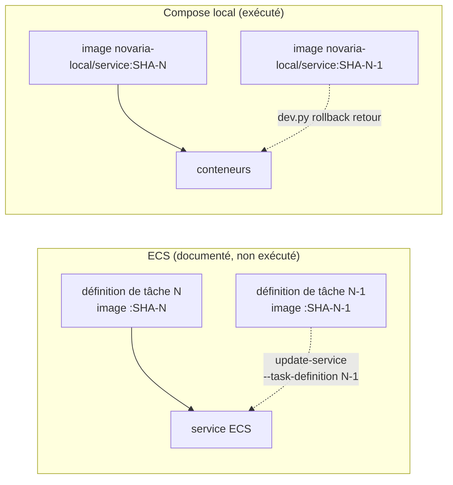

# Retour de version : remettre en service la révision précédente

Projet : Novaria Core, socle d'UrbanHub (bloc de compétences BC05)
Responsable : Manoa Robel (issue CLD-16), relecture croisée par Daddy Luciano
Dernière mise à jour : 20/11/2026
Issue de suivi : CLD-16 (#89), dépend de CLD-12 (#55) · Décisions : [ADR-021](../01-architecture/adr/ADR-021-docker-deploiement.md) (déploiement et retour arrière), [ADR-023](../01-architecture/adr/ADR-023-execution-locale-d-abord.md) et [ADR-025](../01-architecture/adr/ADR-025-equivalents-locaux-des-services-aws.md) (exécution locale, équivalents des services AWS)
Statut : à valider par les deux membres (relecture de la pull request)

Critère d'acceptation : **la révision précédente est de nouveau en service.** Preuve : la section 4 (essai sur la pile réelle, sortie versionnée dans [`sorties-rollback/`](sorties-rollback/essai-2026-11-20.txt)).

> **Ce document décrit un retour de version en local, sur Docker Compose.** Aucune ressource AWS (Amazon Web Services) n'existe ([ADR-023](../01-architecture/adr/ADR-023-execution-locale-d-abord.md)) : le rollback d'ECS (Elastic Container Service) **n'a pas été exécuté**. Les commandes ECS de la section 2 sont **documentées, non vérifiées**.

Abréviations : **SHA** (Secure Hash Algorithm, ici l'identifiant d'un commit Git), **ECS** (Elastic Container Service, service de conteneurs d'AWS), **ECR** (Elastic Container Registry, dépôt d'images), **API** (Application Programming Interface, interface de programmation), **ADR** (Architecture Decision Record, enregistrement de décision d'architecture), **JWT** (JSON Web Token, jeton signé), **CVE** (Common Vulnerabilities and Exposures, identifiant public d'une faille).

## 1. En bref

| Tâche de l'issue | Réalisé | Où |
|---|---|---|
| Redéployer la révision précédente | `dev.py rollback retour` remet en service l'image du commit précédent ; la révision est **vérifiée** par `/health` | Sections 3 et 4 |
| Documenter ce qu'un retour de code ne restaure pas (données) | Un tableau par type d'état, avec ce qui est **prouvé** et ce qui ne l'est pas | Section 5 |
| Critère : la révision précédente est de nouveau en service | Essai sur la pile réelle : la révision annoncée par quatre services **et par la passerelle** est l'ancienne | Section 4 |

Ce qui a été trouvé en chemin : **la passerelle (nginx) garde l'ancienne adresse d'un service recréé** et répond 503. C'est un défaut de la pile, pas du retour de version ; le retour le contourne (section 6).

## 2. Le même geste, sur ECS et en local

| Étape | ECS (AWS) | Compose local | Même vérification |
|---|---|---|---|
| Une révision | Définition de tâche, image `ecr/novaria-<service>:<SHA>` ([`deploy.yml`](../../.github/workflows/deploy.yml)) | Image `novaria-local/<service>:<SHA 12 caractères>`, construite depuis **les sources de ce commit** (`git archive`), avec `GIT_SHA` = SHA complet | La révision est le SHA du commit |
| Déployer | `amazon-ecs-deploy-task-definition` | `dev.py rollback deployer --ref <commit>` | — |
| Retour de version | `aws ecs update-service --cluster <c> --service <s> --task-definition <famille>:<N-1>` (**non exécuté**) | `dev.py rollback retour` | — |
| Attendre que ce soit stable | `wait-for-service-stability` | Attente (120 s au plus) que `/health` annonce la révision demandée | `/health` renvoie le SHA demandé (`deploy.yml`, dernière étape) |
| Échec du déploiement | L'ADR-021 annonce qu'un déploiement raté « revient seul » (disjoncteur de déploiement d'ECS) ; **ce réglage n'existe pas dans `infra/`** (recherche de `deployment_circuit_breaker` : aucune occurrence) | **Reprise automatique** : si la nouvelle révision ne répond pas comme annoncé, celle qui tournait avant est remise en service | Message d'erreur : « Reprise automatique : … remis en service » |

## 3. Procédure

| Besoin | Linux (bash) | Windows (PowerShell) |
|---|---|---|
| Voir la révision en service, la précédente, et ce que dit `/health` | `python3 scripts/dev/dev.py rollback etat` | `py -3 scripts/dev/dev.py rollback etat` |
| Construire les images d'un commit (sans le déployer) | `python3 scripts/dev/dev.py rollback construire --ref <commit>` | `py -3 scripts/dev/dev.py rollback construire --ref <commit>` |
| Mettre une révision en service | `python3 scripts/dev/dev.py rollback deployer --ref <commit>` | `py -3 scripts/dev/dev.py rollback deployer --ref <commit>` |
| **Revenir à la révision précédente** | `python3 scripts/dev/dev.py rollback retour` | `py -3 scripts/dev/dev.py rollback retour` |
| Un seul service | ajouter `--services traitement` (parmi `collecte`, `traitement`, `alerte`, `reponse`) | idem |
| Rejouer tout l'essai de la section 4 | `python3 scripts/dev/dev.py rollback essai --ancienne <commit> --nouvelle <commit>` ou `make rollback A=essai` | `py -3 scripts/dev/dev.py rollback essai --ancienne <commit> --nouvelle <commit>` |
| Tests, sans Docker | `python3 -m unittest discover -s scripts/dev -p "test_rollback.py"` | `py -3 -m unittest discover -s scripts/dev -p "test_rollback.py"` |

Ce que fait `retour` : pour chaque service demandé, il relit la révision précédente enregistrée (`var/rollback/etat.json`, ignoré par Git), génère un fichier Compose qui fixe l'image et la révision de ses conteneurs, lance `docker compose up -d --no-build --no-deps --force-recreate <conteneurs>`, fait relire ses adresses à la passerelle, puis **vérifie** que `/health` annonce la révision attendue, directement et par la passerelle. L'état n'est écrit qu'après cette vérification. La révision remplacée devient la « précédente » : un second `retour` **revient en avant**.

Ce que `retour` ne fait **jamais** : supprimer un conteneur ou un volume, toucher à PostgreSQL, MongoDB ou Kafka (`--no-deps`), lancer une migration, modifier `.env`. Les tests le vérifient (`test_rollback.py`, classe `Deploiement`).

## 4. Preuve : essai du 20/11/2026 sur la pile réelle

Pile Compose démarrée par `dev.py up`. Ancienne révision : **`56822eb`** (avant la PR #287). Nouvelle révision : **`d4c519b`** (`main`, PR #287, qui change le service `traitement` : le téléchargement d'un rapport sert les octets vérifiés). Quatre services : `collecte`, `traitement`, `alerte`, `reponse` (sept conteneurs : le traitement et l'alerte en ont chacun plusieurs).

| Étape | Résultat observé |
|---|---|
| Images construites depuis les sources de chaque commit | 8 images (4 services × 2 révisions) |
| Ancienne révision en service | `/health` des quatre services : `56822eb4358a…` |
| Nouvelle révision en service | `/health` des quatre services : `d4c519bb440b…` |
| Écriture pendant la nouvelle révision | une mesure simulée envoyée à la collecte : HTTP 202, **1 copie** dans `raw_events` |
| **Retour** | `/health` des quatre services **et de la passerelle** : `56822eb4358a…` : **la révision précédente est de nouveau en service** |
| Les données sont-elles revenues en arrière ? | **Non** : la mesure écrite par la nouvelle révision est toujours dans `raw_events` (1 copie) |
| Les neuf sondes de `dev.py health` après le retour | répondent |

Sortie complète, sans modification : [`sorties-rollback/essai-2026-11-20.txt`](sorties-rollback/essai-2026-11-20.txt). Trois contrôles de plus ont été faits à la main le même jour :

| Contrôle | Résultat |
|---|---|
| Une révision qui ne démarre pas (image d'une base de données étiquetée à la place de la collecte, **essai volontaire**) | La commande échoue après 120 s avec « collecte annonce la révision « None » au lieu de « cccccccccccc » », puis « **Reprise automatique : collecte 56822eb4358a remis en service** » ; l'état enregistré est inchangé (123 s au total) |
| `dev.py up` après un retour | Les services sont reconstruits depuis les sources et **écrasent** la révision retournée : `/health` annonce `local`. `dev.py rollback etat` le signale par « écart » |
| Premier essai, avant d'ajouter le rechargement de la passerelle | Après `dev.py up`, la passerelle répondait **503** vers le traitement (adresse périmée) ; `nginx -s reload` l'a corrigé. C'est ce qui a motivé l'étape de rechargement |

## 5. Ce qu'un retour de code ne restaure pas

Un retour de version change **le code qui tourne**. Tout ce que la nouvelle révision a **écrit, publié ou déclenché** reste.

| Élément | Après un retour | Prouvé ? | Comment revenir en arrière |
|---|---|---|---|
| Mesures brutes (`raw_events`, MongoDB) | **Restent** : la mesure écrite par la nouvelle révision est toujours là | **Oui** (section 4) | Le rôle de la collecte ne peut ni modifier ni supprimer : seule une restauration depuis une sauvegarde (compte administrateur) |
| Données PostgreSQL (fenêtres, alertes, comptes) | **Restent** | Non essayé ; même mécanisme (volume non touché) | [Restauration](restauration.md) d'une sauvegarde prise **avant** le déploiement (`dev.py sauvegarde`, puis `dev.py restauration`) |
| **Schéma** PostgreSQL | **Reste au schéma de la nouvelle révision** : une migration n'est pas défaite par le code | **Non essayé** : aucune migration ne sépare `56822eb` de `d4c519b` | Règle d'[ADR-021](../01-architecture/adr/ADR-021-docker-deploiement.md), section 4.4 : changements en deux temps (ajouter, migrer, retirer), pour que le code N-1 lise le schéma N ; sinon migration inverse ou restauration. **Une sauvegarde vérifiée est prise avant toute migration** |
| Messages déjà publiés sur Kafka | **Restent** dans les sujets ; les décalages des groupes ont avancé | Non essayé | Compatibilité ascendante des contrats, deux versions pendant une transition ([ADR-009](../01-architecture/adr/ADR-009-bus-evenements.md)) ; sinon rejeu depuis `raw_events` |
| Alertes créées, commandes de feux émises | **Restent** (c'est l'historique) | Non essayé | Aucun : une commande de feux déjà émise ne se rappelle pas |
| État en mémoire d'un service | **Perdu** : `--force-recreate` redémarre le conteneur | **Oui** pour le service des feux : au démarrage il applique le **plan fixe** puis reprend (cas F6 de [tests-integration.md](tests-integration.md)) | Aucun besoin : c'est le comportement voulu |
| Configuration et secrets (`.env`) | **Non versionnés avec l'image** : un retour ne les restaure pas | Par construction | Garder la configuration compatible avec N et N-1 |
| Jetons JWT (JSON Web Token) déjà émis | Restent valables (clé commune, HS256) | Non essayé | — |
| Modèle d'apprentissage | Aucun modèle appris n'est en service ([fiche du modèle](../06-ia-mlops/fiche-modele.md)) : sans objet | — | Registre des modèles ([ADR-017](../01-architecture/adr/ADR-017-mlops-mlsecops.md)) |
| **Failles corrigées entre les deux révisions** | **Réintroduites** : l'ancienne image est celle d'avant le correctif | **Oui** : `56822eb` contient encore le chemin de fichier relu que la PR #287 a supprimé | Un retour est un **repli provisoire** ; corriger vers l'avant dès que possible |

## 6. Limites et points ouverts pour la relecture croisée

| N° | Point | État |
|---|---|---|
| 1 | **Aucun essai sur AWS** : le rollback d'ECS n'a pas été exécuté. La correspondance de la section 2 vient de la documentation du service et de [`deploy.yml`](../../.github/workflows/deploy.yml), pas d'un essai | Non vérifié |
| 1 bis | Le retour automatique d'ECS promis par l'ADR-021 n'est **pas configuré** dans le code Terraform ; il faudrait activer le disjoncteur de déploiement du service ECS avant tout usage d'AWS | À corriger dans le code Terraform, ou à retirer de l'ADR |
| 2 | **La passerelle garde l'adresse d'un service recréé** : `proxy_pass http://traitement:8000` est résolu au démarrage de nginx ; un conteneur recréé reçoit parfois une autre adresse, et la passerelle répond 503. Vu le 20/11/2026 après `dev.py up`. Le retour lance `nginx -s reload`. **`dev.py up` seul n'a pas ce rechargement** : le défaut existe aussi hors retour de version | Défaut connu de la pile, contourné ici ; correction durable à décider (résolution dynamique dans `gateway/`) |
| 3 | **Un retour ne tient pas après `dev.py up`**, qui reconstruit depuis les sources | Voulu ; signalé par `rollback etat` |
| 4 | Couvre **quatre services** (sept conteneurs). Le simulateur, le front-end, la passerelle et les bases ne sont pas versionnés par SHA | Limite |
| 5 | La **migration** : aucun essai avec un schéma qui change entre les deux révisions (section 5) | Non essayé |
| 6 | L'essai a laissé **deux mesures simulées** (`cld16-ef2e52…`, `cld16-0dc604…`) dans `raw_events` : le rôle de la collecte ne peut pas les supprimer | Données simulées, inoffensives ; `dev.py db-reset` les efface avec tout le reste |
| 7 | Les images anciennes gardent les dépendances de leur époque, avec leurs failles connues (section 5) | Inhérent à un retour |
| 8 | Vérifié sous **Linux** ; non vérifié sous Windows (`git archive`, `docker build`, `docker compose exec` y sont les mêmes commandes) | À rejouer par le binôme |
| 9 | `var/rollback/` contient des copies des sources de chaque révision construite, et chaque révision laisse des images `novaria-local/*` : à effacer quand elles ne servent plus (`docker images "novaria-local/*"`, puis `docker image rm`) | Ignoré par Git (`var/`) |
