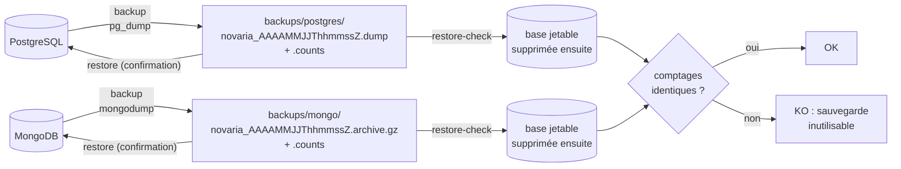

# Sauvegarde et restauration des bases locales

Une sauvegarde qui n'a jamais été restaurée n'est pas une sauvegarde. La procédure ci-dessous sauvegarde les deux bases, **prouve** que la sauvegarde se relit (restauration dans une base jetable, comparaison des comptages), et permet de revenir en arrière. Décision : [ADR-024](../01-architecture/adr/ADR-024-bases-de-donnees-locales.md). Équivalent AWS (Amazon Web Services) documenté mais non exécuté : [ADR-025](../01-architecture/adr/ADR-025-equivalents-locaux-des-services-aws.md).

## 1. Principe

| Élément | Valeur |
|---|---|
| Dossier | `backups/` à la racine du dépôt (ignoré par Git : jamais versionné) |
| Fichier `.counts` | Nombre de lignes (PostgreSQL) ou de documents (MongoDB) par table ou collection, relevé au moment de la sauvegarde |
| Rotation | Les 7 sauvegardes les plus récentes de chaque base sont conservées (`BACKUP_KEEP` dans `.env`) |
| Heure des noms | UTC (*Coordinated Universal Time*, temps universel coordonné), pour des noms identiques sur les deux postes |
| Contenu PostgreSQL | Tables, données et droits ; pas les propriétaires (rejoués par l'initialisation) |
| Contenu MongoDB | Collections, données, validateurs et index (dont les index de durée de vie) ; les utilisateurs sont recréés par l'initialisation |

## 2. Commandes

Préfixe : `python3 scripts/dev/dev.py` sous Linux, `py -3 scripts/dev/dev.py` sous Windows (PowerShell). Sous Linux, `make backup`, `make restore-check`, `make restore` font la même chose.

| Besoin | Commande | Résultat attendu |
|---|---|---|
| Sauvegarder | `backup` | « Sauvegarde créée : … » pour chaque base |
| Vérifier la dernière sauvegarde | `restore-check` | « OK : 15 tables restaurées, comptages identiques… » puis « OK : 6 collections restaurées… » |
| Vérifier un fichier précis | `restore-check novaria_20261020T093000Z.dump` (ou le fichier `.archive.gz`) | idem, pour la base correspondant au fichier |
| Revenir à la dernière sauvegarde | `restore` | Confirmation à taper (« restaurer »), arrêt du backend et du front-end, puis « OK » pour chaque base |
| Revenir à un fichier précis | `restore --postgres novaria_….dump --mongo novaria_….archive.gz` | idem |
| Repartir de zéro | `db-reset`, puis `db-up` | Bases vides, migrations rejouées |

Lister les fichiers :

| Linux | Windows (PowerShell) |
|---|---|
| `ls -lht backups/postgres backups/mongo` | `Get-ChildItem backups\postgres, backups\mongo \| Sort-Object LastWriteTime -Descending` |

## 3. Quand sauvegarder

| Moment | Raison |
|---|---|
| Avant toute migration que l'on n'a pas encore appliquée ailleurs | Retour arrière en une commande |
| Avant `db-reset` ou `restore` | Filet de sécurité |
| Avant une démonstration | Reprendre exactement le même jeu de données après un essai |
| Fin de journée de travail sur les données | Un jeu de données simulé ou transformé coûte du temps à reproduire |

Les sauvegardes sont locales : elles ne protègent pas contre la perte du poste. Les jeux de données importants se retrouvent par leur génération reproductible (graine et identifiant d'exécution, voir [ADR-027](../01-architecture/adr/ADR-027-jeux-de-donnees-et-provenance.md)), pas par ces fichiers.

## 4. Scénarios

| Situation | Marche à suivre |
|---|---|
| Une migration a abîmé des tables | `restore` (retour à l'état de la dernière sauvegarde), corriger la migration, `db-migrate` |
| Une valeur a été supprimée par erreur | `restore --postgres <fichier>` du jour concerné ; si une seule table compte, restaurer dans la base jetable puis copier la table (voir `restore-check`) |
| Volume Docker perdu ou corrompu | `db-reset`, `db-up`, puis `restore` |
| Les comptages diffèrent après `restore-check` | La sauvegarde est inutilisable : en refaire une, chercher la cause dans le message `<` / `>` affiché (`<` = sauvegarde, `>` = restauration) |
| Passer les données d'un poste à l'autre | Copier les deux fichiers de `backups/` (le fichier `.counts` voyage avec), puis `restore --postgres … --mongo …` sur l'autre poste |

> Les sauvegardes peuvent contenir des données issues de jeux publics : elles ne sont jamais ajoutées au dépôt. Aucun mot de passe n'y figure.

## 5. Limites assumées

| Limite | Conséquence |
|---|---|
| Sauvegarde à l'instant T, pas de journal de transactions | Perte possible des écritures faites depuis la dernière sauvegarde (acceptable pour un environnement d'étude) |
| Sauvegarde non chiffrée sur le disque du poste | Disque du poste chiffré recommandé ; aucun secret dans les données |
| Restauration MongoDB non testée sur ce poste de rédaction (pas de MongoDB disponible) | Premier essai à faire sur un poste avec Docker : `backup` puis `restore-check` (critère de LOC-03) |
| Équivalent AWS (instantanés RDS (Relational Database Service), sauvegardes S3) | Documenté dans [`docs/05-cloud-aws`](../05-cloud-aws/README.md), non exécuté |

## 6. Vérifié

| Test | Résultat |
|---|---|
| PostgreSQL réel (16.15) : sauvegarde ×3 avec rotation à 2, liste, `restore-check`, `restore` après sinistre (table vidée, table supprimée), droits conservés après restauration, refus sans confirmation, refus d'un fichier absent, détection d'un comptage altéré, base jetable supprimée | Tous conformes |
| MongoDB : scripts relus, syntaxe vérifiée, exécution réelle à faire sur un poste avec Docker | À valider (LOC-03) |
