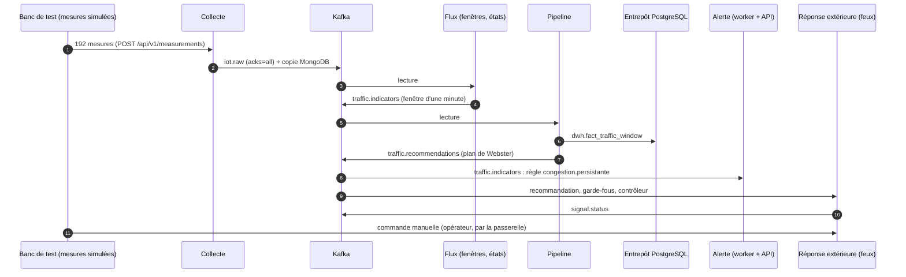

# Test de bout en bout du flux complet et cas d'échec (MS-15)

Projet : Novaria Core, socle d'UrbanHub (bloc de compétences BC05)
Responsables : Daddy Luciano et Manoa Robel (relecture croisée)
Dernière mise à jour : 18/11/2026
Issue de suivi : MS-15 (#134), dépend de MS-14 (#133, fermé)
Statut : à valider par les deux membres (relecture de la pull request)

Critère d'acceptation : **chaque cas d'échec a un résultat attendu, observé et consigné.** Preuve : ce document (sections 4 et 5, et le compte rendu de la section 8), **rejouable par une commande** sur la pile locale.

Abréviations : **API** (Application Programming Interface, interface de programmation), **CI** (Continuous Integration, intégration continue), **INT_0n** (carrefour n du réseau simulé, quatre approches N, E, S, W, un capteur par approche), **broker** (le bus de messages, ici Kafka).

## 1. En bref

| Tâche de l'issue | Réalisé | Où |
|---|---|---|
| Parcours nominal : capteur simulé, collecte, traitement, alerte, recommandation, commande de feux | Sept cas N1 à N7 sur la pile Docker réelle : 192 mesures de 4 capteurs deviennent 32 fenêtres, 4 alertes, des recommandations de plan de feux appliquées par le contrôleur, puis une commande manuelle d'opérateur | Section 4 |
| Cas d'échec : message invalide, service arrêté, broker indisponible, indicateurs en retard | F1 (message invalide), F2 (`alerte-worker` arrêté), F3 (Kafka arrêté), F4 (flux arrêté : indicateurs en retard) | Section 5 |
| Mode dégradé des feux et reprise après redémarrage, sans perte ni doublon | F5 (plan fixe après le silence maximal, puis retour automatique) et F6 (redémarrage du service des feux) ; F2, F3 et F4 comptent chaque fenêtre, chaque alerte et chaque mesure | Section 5 |
| Consigner résultats attendus et observés | Ce document | Sections 4, 5 et 8 |

**Résultat du 18/11/2026 : 13 cas sur 13 satisfaits** (section 8). Un premier passage complet en avait donné 12 sur 13 : le cas N7 dépendait de l'horloge du contrôleur de feux ; le test a été corrigé, pas le contrôleur (section 6).

Aucune valeur n'est simulée côté serveur : le test parle à la collecte, à la passerelle, aux bases et au bus, et lit l'entrepôt, MongoDB et les sujets Kafka. Seules les **mesures** sont fabriquées (provenance `SIMULATED`, scénario `ms15-flux-complet`).

## 2. Le rejouer

| Action | Linux (bash) | Windows (PowerShell) |
|---|---|---|
| Démarrer la pile (une fois) | `python3 scripts/dev/dev.py up` | `py -3 scripts/dev/dev.py up` |
| Tout rejouer (environ 10 minutes) | `python3 scripts/dev/dev.py flux-complet` ou `make flux-complet` | `py -3 scripts/dev/dev.py flux-complet` |
| Rejouer une partie | `python3 scripts/dev/dev.py flux-complet N1 N2 F3` ou `make flux-complet C="N1 N2 F3"` | `py -3 scripts/dev/dev.py flux-complet N1 N2 F3` |
| Tests du banc, sans pile | `python3 -m unittest discover -s scripts/dev -p "test_flux_complet.py"` | `py -3 -m unittest discover -s scripts/dev -p "test_flux_complet.py"` |

À savoir avant de lancer :

- **Les cas d'échec arrêtent puis redémarrent des conteneurs** de la pile locale (`alerte-worker`, `kafka`, `traitement-flux`, `reponse`). Ils attendent que la collecte et la passerelle répondent avant le cas suivant. La commande n'arrête rien d'autre et ne supprime aucune donnée.
- Chaque cas utilise son **propre `run_id`** et finit par des minutes fluides : les alertes se résolvent seules, et un compte jetable de rôle `operator` (`ms15-<hex>`) est créé puis supprimé.
- **Ne pas rejouer le parcours nominal dans les 10 minutes qui suivent un autre rejeu** : le service des feux ignore une recommandation plus ancienne que la dernière reçue (section 6). La commande le détecte et répond « rejouer ce cas dans N minute(s) » au lieu d'échouer sans explication.
- Un cas qui échoue ne bloque pas les cas d'échec suivants ; un cas du parcours nominal qui échoue rend les suivants « non joués » (jamais ignorés en silence).

## 3. Le flux testé

Les mesures de test sont choisies pour que **tout se recalcule de tête** :

| Minute | Par capteur et par mesure de 10 s | Fenêtre d'une minute attendue |
|---|---|---|
| Congestionnée | 3 véhicules, 9,0 km/h (ratio 0,18 sur 50 km/h), occupation 0,7, file 150 m | 18 véhicules, 9,0 km/h, occupation 0,7, file 150 m, 6 mesures |
| Fluide | 3 véhicules, 45,0 km/h, occupation 0,1, file 0 m | 18 véhicules, 45,0 km/h, occupation 0,1, file 0 m, 6 mesures |

Le plan du parcours nominal est de **4 minutes congestionnées puis 4 fluides**. L'état attendu de chaque minute vient du **classificateur du traitement** lui-même (hystérésis de l'ADR-028 : entrée au deuxième pas lent, sortie au troisième pas rapide), pas d'une copie : `FREE_FLOW`, `CONGESTED` × 5, `FREE_FLOW`, `FREE_FLOW`.

## 4. Parcours nominal

| Cas | Ce qui est fait | Résultat attendu | Résultat observé le 18/11/2026 | Verdict |
|---|---|---|---|---|
| N1 | Compte `operator` créé par l'application, connexion par la passerelle | Un jeton | Compte jetable créé, jeton reçu (1,8 s) | Satisfait |
| N2 | 192 mesures de 4 capteurs d'INT_01 (8 minutes) envoyées à la collecte | 192 réponses `202 ACCEPTED`, 192 copies dans `raw_events` | 192 `ACCEPTED`, 192 copies (9,9 s) | Satisfait |
| N3 | Lecture de `dwh.fact_traffic_window` | 32 fenêtres (4 tronçons × 8 minutes), 6 mesures chacune, valeurs du tableau ci-dessus, états de la règle de seuils | 32 fenêtres, valeurs égales au recalcul, 12 `FREE_FLOW` et 20 `CONGESTED` comme attendu (16,9 s après l'envoi) | Satisfait |
| N4 | Lecture de `alertes.alert` et de `GET /api/v1/alerts` | 4 alertes `congestion.persistante` (une par approche), gravité WARNING, résolues seules au retour à la normale, aucun doublon | 4 alertes, une par tronçon, toutes résolues automatiquement ; l'API en rend 4 avec la même provenance | Satisfait |
| N5 | Lecture de `traffic.recommendations` | Une recommandation `WEBSTER_REFERENCE` par minute dégradée, identifiants distincts, plans sûrs (cycle de 30 à 120 s, phases de 10 à 90 s, somme égale au cycle) | 5 recommandations, cycle de 43 s, phases de 22 et 21 s | Satisfait |
| N6 | `GET /api/v1/signals/INT_01`, `signal.status` et journal d'audit | Mode `AUTOMATIC`, décision `RECOMMENDATION` appliquée, un événement `signal.status` et une entrée d'audit pour cette recommandation | Mode `AUTOMATIC`, décision appliquée, un événement et une entrée d'audit, sans doublon | Satisfait |
| N7 | Commande dangereuse (phase de 5 s), commande sûre (`P2`, 30 s), puis `RESUME_AUTOMATIC` | `422 UNSAFE_COMMAND` (règle `PHASE_TOO_SHORT`) et état inchangé ; `202 APPLIED` et mode `MANUAL`, journalisée avec son motif ; reprise acceptée et mode non manuel | Commande dangereuse refusée, état inchangé ; commande sûre appliquée, mode `MANUAL`, journalisée ; reprise : 202, mode `AUTOMATIC` | Satisfait |

Ordre de grandeur des délais, **mesurés par sondage toutes les 3 à 4 s** (donc à quelques secondes près) : entre l'envoi des mesures et les fenêtres dans l'entrepôt, environ 10 à 17 s, dont les 15 s d'inactivité qui ferment la dernière fenêtre ; alertes et recommandations arrivent dans les secondes qui suivent. Ce n'est pas la mesure de latence de l'exigence EXG-NFR-02, qui reste à faire.

## 5. Cas d'échec

| Cas | Panne injectée | Résultat attendu | Résultat observé le 18/11/2026 | Verdict |
|---|---|---|---|---|
| F1 · Message invalide | Un message qui n'est pas du JSON, une mesure hors contrat (véhicules négatifs), une mesure envoyée deux fois | Refus à l'entrée (400 ou 422) pour les deux premiers, rejets tracés dans MongoDB, rien dans `raw_events` ; la mesure répétée donne `ACCEPTED` puis `DUPLICATE` et une seule copie ; aucune alerte | Illisible : HTTP 422. Hors contrat : `422 VALIDATION_ERROR`, absente de `raw_events`, deux rejets de plus (15 à 17). Répétée : `ACCEPTED` puis `DUPLICATE`, une copie. Aucune alerte (22,5 s) | Satisfait |
| F2 · Service arrêté | `docker compose stop alerte-worker`, envoi de 192 mesures, puis redémarrage | Pendant l'arrêt : la collecte accepte, les 32 fenêtres se calculent, aucune alerte n'est créée, l'API des alertes répond (200). Après : les 4 alertes arrivent, **sans perte ni doublon** | 192 mesures acceptées, 32 fenêtres justes, 0 alerte pendant l'arrêt, API 200 ; après le redémarrage 4 alertes, une par tronçon, résolues (59,1 s) | Satisfait |
| F3 · Broker indisponible | `docker compose stop kafka`, envoi de 8 mesures, puis redémarrage et renvoi des 48 mesures | Pendant l'arrêt : la collecte répond `503` et **ne garde aucune copie** (une mesure n'est jamais « acceptée » sans être publiée). Après : le renvoi donne 8 fenêtres, 144 véhicules, 48 copies brutes, sans perte ni doublon | 8 réponses `503`, 0 copie dans `raw_events`. Retour du broker : le renvoi donne 47 `ACCEPTED` et 1 `DUPLICATE` (la mesure qui avait servi de sonde), 8 fenêtres, 144 véhicules, 48 copies (81,4 s, dont la reprise de la collecte) | Satisfait |
| F4 · Indicateurs en retard | `docker compose stop traitement-flux` après avoir mis les feux d'INT_04 en automatique ; 96 mesures de plus envoyées pendant l'arrêt ; redémarrage | Pendant l'arrêt : la collecte accepte, **aucune fenêtre** n'est calculée. Après : toutes les fenêtres sont rattrapées avec les mêmes valeurs et états, sans perte ni doublon | Avant : feux en `AUTOMATIC`, 12 fenêtres. Pendant : 96 mesures acceptées, toujours 12 fenêtres. Après : 32 fenêtres (4 tronçons × 8 minutes), valeurs et états égaux à l'attendu, aucun doublon (228,6 s, dont les 181 s d'attente du retour au plan fixe, observé en F5) | Satisfait |
| F5 · Mode dégradé des feux | Les indicateurs ne reviennent plus : aucune recommandation pendant l'arrêt du flux de F4 | Après le silence maximal (180 s) : `DEGRADED_FIXED_PLAN`, décision `FIXED_PLAN_FALLBACK` annoncée sur `signal.status` et journalisée ; avec les indicateurs rattrapés, retour automatique en `AUTOMATIC` | Retour au plan fixe **181 s** après l'arrêt, décision `FIXED_PLAN_FALLBACK`, annoncée sur le bus, entrée d'audit `signal.fixed_plan_fallback` ; avec les indicateurs rattrapés, les feux repassent seuls en `AUTOMATIC` (14,4 s) | Satisfait |
| F6 · Redémarrage du service des feux | `docker compose stop reponse` (arrêt propre), 4 minutes congestionnées envoyées pendant l'arrêt, puis `start` | Au démarrage : plan fixe (`STARTUP`) journalisé. La recommandation arrivée pendant l'arrêt est **appliquée** (aucune perte). Aucune recommandation déjà traitée n'est rejouée : au plus une entrée d'audit par recommandation | `signal.startup` journalisé, la recommandation reçue pendant l'arrêt est appliquée ; les 2 recommandations d'avant l'arrêt et les 3 d'après ont chacune au plus une entrée d'audit (64 s) | Satisfait |

## 6. Ce que les essais ont appris

| Constat | Ce que cela change |
|---|---|
| **Le service des feux ignore une recommandation plus ancienne (ou de même instant) que la dernière reçue pour un carrefour** (`controller.py` : « rejouée, plus ancienne que la dernière ou déjà périmée : rien à dire »). C'est voulu : un rejeu ne défait pas un état plus récent | Premier essai de F6 en échec (« les feux ne passent pas en automatique »), cause trouvée dans le journal d'audit : aucune entrée entre le retour au plan fixe et le passage suivant. Chaque cas d'échec a donc **son carrefour** (INT_02 à INT_05), et une **garde d'horloge** refuse de rejouer des minutes déjà dépassées avec un message qui dit combien de minutes attendre. Le parcours nominal ne se rejoue qu'après environ 10 minutes |
| Un opérateur ne peut pas quitter une phase avant 10 s ni pendant ses 4 dernières secondes (garde-fous `MIN_DURATION_NOT_ELAPSED` et `CLEARANCE_IN_PROGRESS`) | Premier passage complet : N7 en échec (reprise refusée en 422). C'était le **test** qui visait un mauvais moment du cycle : il attend désormais le bon moment, cible explicitement `PHASE_TOO_SHORT` pour la commande dangereuse, et réessaie la reprise après un refus transitoire |
| Kafka arrêté : la collecte répond `503` et ne garde rien, **la reprise a demandé 47 s** dans l'essai de mise au point (le temps que le broker et la collecte se reconnectent ; une seule mesure, à ne pas prendre pour une garantie) | Le renvoi des mêmes mesures ne crée aucun doublon grâce à l'identifiant (`DUPLICATE`). Un client qui reçoit un 503 doit **renvoyer**, c'est le contrat |
| Les feux reviennent au plan fixe 181 s après la dernière recommandation, **y compris quand la cause est un flux d'indicateurs arrêté** et pas un carrefour sans problème | Le mode dégradé ne distingue pas « rien à recommander » et « chaîne coupée » (feux.md, section 5). Le test montre que les deux donnent le bon comportement (plan fixe) ; le signal d'alarme sur le flux arrêté vient de l'observatoire (CLD-14) |
| Un message illisible reçoit `422`, pas `400` | Écrit tel quel dans l'attendu de F1 (« 400 ou 422 ») : le contrat d'erreur de la collecte ne distingue pas les deux |

## 7. Limites

- **Arrêts propres seulement** (`docker compose stop`, signal d'arrêt). Un arrêt brutal (`docker kill`, coupure de courant) n'est pas joué ici ; la reprise du service des feux après un arrêt brutal (état perdu, plan fixe au démarrage) est prouvée au niveau du service ([feux.md](../03-donnees/feux.md), section 5).
- **Panne de PostgreSQL** : jouée dans CLD-13 (cas E3, [tests-integration.md de CLD-13](../04-devsecops/tests-integration.md)). **Panne de MongoDB** : prouvée au niveau du service des feux (commande refusée en `503`, [feux.md](../03-donnees/feux.md), section 10.2), pas rejouée ici.
- **Un seul service d'alerte arrêté** (`alerte-worker`) ; l'arrêt de l'API des alertes seule n'est pas joué.
- **Pas de charge** : 192 mesures par cas. La mesure de latence et de débit à plusieurs débits (ADR-011) reste à faire.
- **La CI ne rejoue pas ces cas** : ils demandent la pile complète (treize conteneurs, Kafka) et arrêtent des services. Les tests du banc (`test_flux_complet.py`) n'ont pas besoin de la pile et se lancent avec les autres tests de `scripts/dev` ; la preuve du flux est ce document et sa commande.
- **Délais indicatifs** : mesurés par sondage, à quelques secondes près ; les attentes maximales des cas (de 60 à 240 s) sont des marges, pas des engagements.
- Données **simulées** ; notifications d'alerte **simulées** (journal) ; recommandation de **référence** de Webster (aucun modèle appris). Rien ici ne dit comment le système se comporte sur du trafic réel.
- **Non vérifié sous Windows** (Docker Desktop).

## 8. Compte rendu de l'exécution du 18/11/2026

Pile locale démarrée par `dev.py up`, commande `dev.py flux-complet`, de 14:14 à 14:23 UTC environ. **13 cas sur 13 satisfaits.**

| Cas | Titre | Durée |
|---|---|---|
| N1 | Compte opérateur | 1,8 s |
| N2 | Capteurs simulés et collecte | 9,9 s |
| N3 | Traitement : fenêtres de l'entrepôt | 16,9 s |
| N4 | Alertes : créées puis résolues | 0,2 s |
| N5 | Recommandation de plan de feux | 14,0 s |
| N6 | Commande de feux par la recommandation | 14,5 s |
| N7 | Commande manuelle d'un opérateur | 25,8 s |
| F1 | Message invalide | 22,5 s |
| F2 | Service arrêté (`alerte-worker`) | 59,1 s |
| F3 | Broker indisponible (Kafka) | 81,4 s |
| F4 | Indicateurs en retard (flux arrêté) | 228,6 s |
| F5 | Mode dégradé des feux | 14,4 s |
| F6 | Redémarrage du service des feux | 64,0 s |

Historique des passages, pour ne rien cacher :

| Passage | Résultat | Cause de l'écart |
|---|---|---|
| Essais de mise au point des cas isolés | F6 en échec deux fois | Recommandations plus anciennes que la dernière reçue (section 6) : F6 passe sur son propre carrefour avec des minutes qui se suivent |
| Premier passage complet | 12 sur 13 | N7 : reprise automatique refusée en 422 (moment du cycle) : test corrigé |
| Deuxième passage de N1 à N7 | 6 sur 7 | N7 encore : la commande sûre refusée parce que la phase venait de commencer : le test attend maintenant le bon moment du cycle |
| Troisième tentative de N1 à N7, quelques minutes après | 1 sur 7 | Voulu : la garde d'horloge refuse de rejouer INT_01 avant la fin du délai et le dit (« rejouer ce cas dans 6 minute(s) ») ; on a attendu |
| Passage complet final | **13 sur 13** | — |

Aucun cas n'a été retiré, ni aucune attente raccourcie, pour obtenir ce résultat : les corrections portent sur le banc de test, jamais sur les services ni sur leurs garde-fous.

## 9. Fichiers

| Fichier | Rôle |
|---|---|
| `scripts/dev/flux_complet.py` | Les 13 cas, les mesures, les valeurs attendues, l'orchestration (réutilise `parcours.py` de CLD-13) |
| `scripts/dev/test_flux_complet.py` | 29 tests sans pile : mesures conformes au contrat, valeurs attendues, un cas en échec rend le suivant « non joué », compte jetable supprimé, commande `dev.py` |
| `scripts/dev/dev.py`, `Makefile` | Commande `flux-complet` |
| [feux.md](../03-donnees/feux.md), [alertes.md](../03-donnees/alertes.md), [diagnostic.md](diagnostic.md), [observabilite.md](observabilite.md) | Comportements que ces cas observent |
