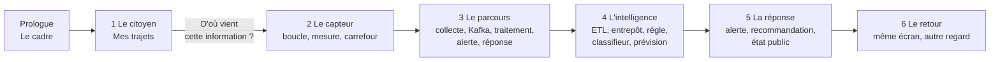

# Plan du site de soutenance : Behind the Intelligence

Projet : Novaria Core, socle d'UrbanHub (bloc de compétences BC05)
Issue : SIT-01 (récit, choix techniques, maquette des sections)
Responsables : Manoa Robel et Daddy Luciano (relecture croisée)
Dernière mise à jour : 26/11/2026

Ce document fixe le récit de la soutenance, les choix du site et la place de chaque preuve. Il répond au critère d'acceptation de SIT-01 : « le plan du site et le récit sont validés par les deux membres ». Le site lui-même est l'issue SIT-02 (dossier `site/`).

Abréviations : BC05 (bloc de compétences 5 : données décisionnelles et intelligence artificielle), ADR (Architecture Decision Record, fiche de décision d'architecture), ETL (Extract, Transform, Load : extraction, transformation, chargement), IA (intelligence artificielle), PDF (Portable Document Format), PSI (Population Stability Index, indice de stabilité de population), SIT (site de présentation).

## 1. Le principe

Une seule page qui défile comme un film : le lecteur suit une donnée de l'écran d'un citoyen jusqu'au capteur, traverse le système, puis revient à l'écran. Le défilement conduit le récit ; chaque scène a un **tiroir de preuves** et le menu « Questions du jury » mène à la bonne preuve.

| Décision | Choix | Raison |
|---|---|---|
| Forme | Page unique, statique (HTML, CSS, JavaScript), sans étape de construction | Critère de SIT-01 ; s'ouvre par un double-clic |
| Réseau | Aucune ressource externe, aucun service tiers | S'ouvre hors ligne ; testé par `scripts/dev/test_site.py` |
| Polices | Celles du système | Pas de fichier de police à télécharger ni à garder |
| Thèmes | Sombre (par défaut) et clair, au choix ou selon le système | Critère de SIT-02 |
| Effets | Défilement qui pilote la scène : zoom du téléphone, flux de la donnée, apparitions. Pas de 3D lourde | Léger ; respecte le réglage « réduire les animations » |
| Contenu | Un seul fichier, `site/contenu.js`, séparé de la mise en page | Changer un chiffre sans toucher au code |
| Langue | Français ; signature finale en anglais | Jury francophone |
| PDF | Feuille de style d'impression : tout à plat, en clair, tiroirs ouverts | Support à remettre si besoin |
| Documents | Chaque document cité s'ouvre dans le site, sur une page de lecture ; une question du jury qui a plusieurs documents les réunit sur la même page (copies exactes du dépôt, générées par `scripts/dev/site_docs.py`) | Répondre au jury sans quitter le site ni ouvrir le dépôt |

## 2. Le récit

| Partie | Durée | Message | Preuve principale | Ce qu'il faut reconnaître |
|---|---|---|---|---|
| Prologue : le cadre | 01:00 | Deux étudiants, une plateforme, tout en local, le simulé est dit simulé | `docs/00-cadrage/note-de-cadrage.md` | Aucune donnée réelle d'aujourd'hui |
| 1 · Le citoyen | 02:00 | Un mot (Libre, Ralenti, Bloqué), un conseil, sans durée promise | `docs/08-exploitation/application-citoyenne.md` §9 | Lecteur d'écran et téléphone réels non essayés |
| 2 · Le capteur | 02:00 | Un capteur voit passer des véhicules ; l'application sait si c'est un carrefour par les identifiants | `docs/03-donnees/dictionnaire-de-donnees.md` | Licence de METR-LA non établie ; modèle du capteur inconnu |
| 3 · Le parcours | 04:00 | Cinq services indépendants ; l'IA intervient à deux endroits et ne commande rien | `dev.py flux-complet`, `docs/06-ia-mlops/cadrage-ml.md` | Délais mesurés en local sur 6 essais |
| 4 · L'intelligence | 06:30 | La règle tourne ; le classifieur appris est rejeté ; la prévision bat la persistance | `ml/evaluation/resultats.md`, `ml/evaluation/prevision-reseau.md` | Test de METR-LA lu 3 fois ; prévision hors alertes |
| 5 · La réponse | 02:30 | Congestion confirmée, alerte, recommandation, état public en lecture seule | ADR-030, `docs/04-devsecops/securite-acces-public.md` | Notification simulée |
| 6 · Le retour | 02:00 | Même écran, autre regard ; signature | Captures de l'application | Aucune |
| **Total** | **20:00** | | | |

Le temps de chaque partie est réglable dans `site/contenu.js` (`secs`) ; le test du site exige que le total reste égal à 20:00. La scène 4 est la plus longue parce qu'elle porte les compétences d'apprentissage automatique.

## 3. Où l'IA intervient (scène 3)

| Où | Quoi | En service ? |
|---|---|---|
| Dans le traitement | Règle de seuils : classe l'état de chaque tronçon (ADR-028) | Oui |
| À côté du flux | Modèle de prévision de vitesse : lit l'entrepôt, répond à l'API | Oui, hors alertes |
| Hors ligne | Entraînement et évaluation (classifieur, prévision, anomalies) | Non : pas dans le flux |
| Garde-fous | Le modèle ne commande rien ; repli sur la règle ; dérive des entrées surveillée (PSI) ; fiche du modèle | Voir `docs/06-ia-mlops/cadrage-ml.md` |

Un modèle appris ne remplace la règle que s'il la bat sur des jours jamais vus. Le classifieur évalué remplit 3 conditions sur 5 : il est rejeté.

## 4. Matrice de preuves BC05

Source : `docs/00-cadrage/note-de-cadrage.md`, section 3. Le site la montre dans la section « BC05 ».

| Compétence | Niveau | Où dans le film | Preuve |
|---|---|---|---|
| Architectures de données décisionnelles | Implémenté | Scène 4 (entrepôt) | Entrepôt en étoile PostgreSQL, diagrammes C4 |
| ETL et intégration de données | Implémenté | Scène 4 (ETL), scène 2 | Scripts d'ingestion, rejeu sans doublon, rejets comptés |
| Processus décisionnels et modèles de données | Implémenté | Scène 4 (règle), démonstration (tableau de bord) | Indicateurs, API, dashboard |
| Machine Learning | Implémenté | Scène 4 (classifieur, prévision) | Cadrage, préparation, évaluation |
| Pipelines MLOps | Implémenté | Scène 3 (garde-fous) | Registre de modèles, surveillance de dérive |
| Documentation et spécifications | Implémenté | Tiroirs de preuves | Spécifications, OpenAPI, ADR |
| Big Data (Hadoop, Spark) | Prototype ciblé | **Pas dans le film** : matrice et questions du jury | Prototype Spark et son rapport |
| Flux temps réel (Kafka, Flink) | Prototype ciblé | Scène 3 (Kafka) ; Flink : matrice | Prototype Kafka et Flink et son rapport |
| RPA | Prototype ciblé | **Pas dans le film** : matrice et questions du jury | Robot dans `automation/rpa/` |

**Écart à décider :** le Big Data et la RPA n'ont pas de scène. Ils sont dans la matrice, mais personne ne les présentera si le jury ne les demande pas. Options : une question du jury dédiée avec une capture, ou 30 secondes prises sur la scène 4.

### 4.1 Questions du jury prévues

| Question | Scène | Preuve |
|---|---|---|
| Pourquoi votre classifieur appris est-il rejeté ? | 4 | `ml/evaluation/resultats.md` |
| Où intervient l'IA dans le flux ? | 3 | `docs/06-ia-mlops/cadrage-ml.md`, ADR-028 |
| Mesurez-vous un gain réel de la prévision ? | 4 | `ml/evaluation/prevision-reseau.md` |
| Vos données sont-elles réelles ? | 2 | ADR-027, ADR-032, `data/datasets/metr-la/PROVENANCE.md` |
| Comment sait-on qu'un capteur est sur un carrefour ? | 2 | Dictionnaire de données |
| Combien de temps entre la mesure et l'écran ? | 3 | `dev.py citoyen delai` |
| Que se passe-t-il si un service tombe ? | 3 | `dev.py observatoire` |
| Comment ajouter 100 capteurs ? | 4 | ADR-032, `data/etl/tests/test_vitesses.py` |

## 5. Honnêteté

- Un bandeau « Données simulées ou historiques » est visible à tout moment.
- Chaque écran de l'application porte l'étiquette « Données simulées ». La mesure de la scène 2 porte « Réel · Los Angeles · 2012 ».
- Chaque chiffre de la scène 4 vient d'un fichier de `ml/evaluation/` ; `scripts/dev/test_site.py` le vérifie.
- Le film ne promet rien que l'application ne fait pas : pas d'itinéraire alternatif, pas de durée.
- Choix du binôme (retour sur la maquette, 26/11/2026) : le film se limite à ce qui est démontré en local.

## 6. Ressources et licences

| Ressource | Source | Licence | Décision |
|---|---|---|---|
| Photo d'un compteur à boucles inductives | Louis van Senden, Wikimedia Commons | CC BY-SA 4.0 | Utilisée **non modifiée**, avec mention de l'auteur et lien ; légende : exemple du principe, pas le capteur de METR-LA |
| Captures de l'application et du tableau de bord | Ce dépôt | Celle du dépôt, non fixée | Utilisées |
| Valeur d'un capteur de METR-LA | Fichier `metr-la.h5`, licence non établie | Aucune trouvée | Une valeur citée, jamais le fichier |

## 7. Répétitions et plan B (SIT-03)

| Besoin | Réponse |
|---|---|
| Chronométrer | Mode orateur du site (touche `P`) : notes de la scène et chronomètre 20:00 |
| La pile ne démarre pas | Section « Démonstration » : captures de secours |
| Un autre poste | Le site s'ouvre sans installation ; copie hors du dépôt public si besoin |

| Action | Linux (bash) | Windows (PowerShell) |
|---|---|---|
| Ouvrir le site | `xdg-open site/index.html` | `Start-Process site/index.html` |
| Tester le site | `python3 -m unittest scripts/dev/test_site.py` | `py -3 -m unittest scripts/dev/test_site.py` |

## 8. Non vérifié

| Sujet | État |
|---|---|
| Validation de Daddy Luciano | À consigner (relecture croisée) |
| Windows | Commandes écrites, non essayées |
| Vidéoprojecteur, poste de soutenance, second poste | Non essayés (SIT-03) |
| Format ou durée imposés par le professeur | Durée de 20 minutes donnée par Manoa Robel ; format non demandé au professeur |
| Lecteur d'écran, impression PDF | Non essayés |
