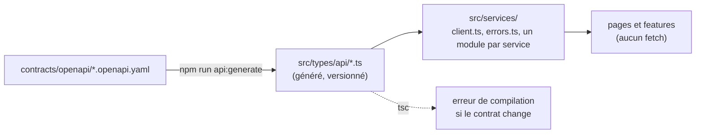
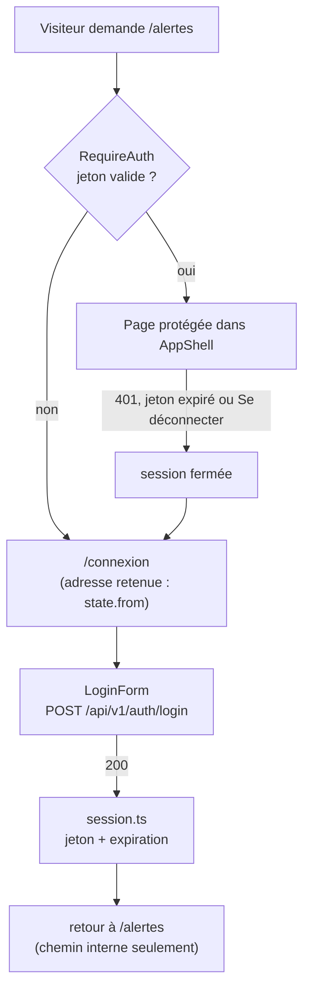
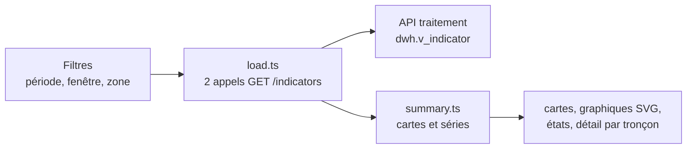

# Frontend (React + Vite + TypeScript)

Tableau de bord web de Novaria Core : React 19, Vite 6, TypeScript 5.7, Vitest 3. L'interface est en français et doit rester utilisable sur un téléphone (360 px de large) comme sur un ordinateur (1280 px et plus).

```bash
npm ci
npm run dev        # http://localhost:5173 (proxy /api vers le backend, port 8000)
npm test           # vitest + couverture (coverage/lcov.info)
npm run lint && npm run format:check
npm run build      # contrôle de types puis construction
npm run e2e        # parcours de bout en bout dans un navigateur (après npm run build ; voir « Tests du front-end »)
npm run a11y:audit # audit d'accessibilité dans Edge ou Chrome (après npm run build), rapport dans audit/
```

Formater : `npx prettier --write src`.

## Arborescence de `src/`

| Dossier | Rôle |
|---|---|
| `app/` | Assemblage : `App.tsx`, `router.tsx` (tableau de routes exporté), `bootstrap.tsx` (montage), `AppShell/` (mise en page) |
| `pages/` | Une page par route (`LoginPage`, `DashboardPage`, `AlertsPage`, `TrafficLightsPage`, `ForecastsPage`, `ReportsPage`, `NotFoundPage`) |
| `features/` | Fonctionnalités : `navigation/` (entrées du menu), `theme/` (thème et sélecteur), `api-status/` (état de l'API), `auth/` (connexion, session, routes protégées), `dashboard/` (tableau de bord des indicateurs), `forecasts/` (page des prévisions), `reports/` (page des rapports) |
| `components/` | Composants génériques sans logique métier (`PageHeader`, `SkipLink`, `IconButton`, `Container`, `VisuallyHidden`, `ComingSoon`, `StatCard`, `StateMessage`, `ScrollRegion`) |
| `hooks/` | `useMediaQuery`, `useDisclosure`, `useEscapeKey`, `useFocusTrap`, `useScrollLock`, `useAsyncResource` (chargement asynchrone avec clé) |
| `services/` | Tous les appels à l'API : un module par service (`apiMetier`, `traitement`, `alerte`, `reponse`), le client commun (`client.ts`), les erreurs (`errors.ts`) et le jeton de session (`session.ts`) |
| `styles/` | `tokens.css` (jetons), `global.css` (base), `breakpoints.ts` (points de rupture) |
| `types/` | Types partagés ; `types/api/` est **généré** depuis les contrats OpenAPI : ne pas le modifier à la main |

Les tests sont dans `tests/`, avec la même arborescence que `src/`. L'alias `@/` désigne `src/` (déclaré dans `vite.config.ts` et `tsconfig.json`).

## Règles de dépendance

Un dossier n'importe jamais un dossier « plus haut » dans cet ordre : `components` ← `features` ← `pages` ← `app`.

| Dossier | N'importe pas |
|---|---|
| `components/` | `features/`, `pages/`, `app/` |
| `features/` | `pages/`, `app/` |
| `hooks/`, `services/`, `types/` | `components/`, `features/`, `pages/`, `app/` |

ESLint impose ces règles (`no-restricted-imports` dans `eslint.config.js`) : une importation interdite fait échouer `npm run lint`. `tests/architecture/dependency-rules.test.ts` vérifie la règle sur des cas autorisés et interdits.

## Jetons de design et thème

Tout style passe par les variables CSS de `src/styles/tokens.css` : couleurs sémantiques (`--color-bg`, `--color-text`, `--color-primary`, `--color-danger`…), espacements (`--space-1` à `--space-8`, échelle de 4 px), typographie (polices du système, `--text-xs` à `--text-3xl`), rayons, ombres, `--tap-min` (zone tactile de 44 px) et niveaux de superposition. Un composant n'écrit aucune couleur ni taille en dur (un test le vérifie).

Le thème a trois modes : Clair, Sombre et Système (par défaut). L'attribut `data-theme` de `<html>` vaut `light` ou `dark` ; absent, il suit la préférence du système. Le choix est mémorisé dans `localStorage` (accès protégés : l'application fonctionne sans stockage) et appliqué avant le premier rendu. Les contrastes de chaque paire texte/fond respectent WCAG AA dans les deux thèmes (test dans `tests/styles/tokens.test.ts`).

## Points de rupture

Mobile d'abord, avec `min-width` : **40rem** (tablette) et **64rem** (ordinateur). Au-dessus de 64rem, la navigation est une barre latérale ; en dessous, c'est un tiroir. Les variables CSS ne fonctionnent pas dans les requêtes média : les valeurs sont écrites dans `tokens.css` (commentaire) et dans `breakpoints.ts`, et un test vérifie qu'elles restent identiques. N'utilisez pas d'autre valeur de `min-width` dans une feuille de style de composant.

## Ajouter une page et une entrée de menu

1. Créer `src/pages/MaPage.tsx` avec un `PageHeader` (titre et phrase d'introduction).
2. Ajouter la route dans `src/app/router.tsx`, **parmi les enfants de la coque** (`path: "/"`, dans la route `RequireAuth`) pour qu'elle soit protégée : `{ path: "ma-page", element: <MaPage />, handle: handle("Ma page") }`. Le titre sert à `document.title` et au repère de la page. Une page publique se place au même niveau que `/connexion`, hors de `RequireAuth` : à éviter sans raison.
3. Ajouter l'entrée dans `src/features/navigation/entries.ts` : `{ path: "/ma-page", label: "Ma page" }`. Un test vérifie que chaque entrée correspond à une route titrée.
4. Ajouter un test dans `tests/app/navigation.test.tsx` si la page a un comportement propre.

## Client d'API typé

Les types viennent des contrats de [`contracts/openapi/`](../contracts/openapi/README.md) (un par service). Le contrat est la source de vérité : on ne décrit jamais à la main une réponse de l'API.



| Étape | Commande (identique sous Linux et Windows, depuis `frontend/`) |
|---|---|
| Régénérer les types après un changement de contrat | `npm run api:generate` |
| Vérifier que les types correspondent aux contrats | `npm run api:check` |
| Voir les erreurs de compilation causées par un changement | `npm run build` (ou `npx tsc --noEmit`) |

**Services couverts** : `api-metier`, `traitement`, `alerte`, `reponse`. `collecte` est exclu : son point d'accès reste sur le réseau interne, le tableau de bord ne l'appelle pas. Un nouveau contrat exposé par la passerelle doit être ajouté à `SERVICES` dans `scripts/api-types.mjs` ; un test échoue sinon.

**Un changement de contrat devient une erreur visible**, à deux endroits :

1. `tests/services/api-types.test.ts` (donc `npm test` et la CI) échoue si les types générés ne correspondent plus aux contrats : on a modifié le contrat sans lancer `npm run api:generate`.
2. Après régénération, `npm run build` (et l'éditeur) signalent chaque ligne qui utilise un champ retiré ou renommé. Exemple vérifié : renommer `version` en `build` dans le schéma `Health` de `contracts/openapi/common.yaml` donne `ApiStatus.tsx: Property 'version' does not exist on type …`. Un code d'erreur ajouté au contrat fait aussi échouer la compilation de `src/services/errors.ts` tant que son message n'est pas écrit.

### Règles

| Règle | Contrôle |
|---|---|
| Aucun `fetch` hors de `src/services/` | ESLint (`no-restricted-globals`), testé dans `tests/architecture/dependency-rules.test.ts` |
| Toute défaillance (HTTP ou réseau) devient une `ApiError` : `status`, `code` du contrat, `correlationId`, `fieldErrors` | `client.ts` (un seul middleware), `tests/services/client.test.ts` |
| Le message affiché vient de `messageFor(error)`, jamais du détail du serveur | `errors.ts` : un message par code, liste exhaustive vérifiée par le compilateur |
| Chaque requête porte `X-Correlation-ID` ; la réponse en erreur le rapporte pour un signalement | `client.ts` |
| Le jeton est gardé dans `sessionStorage` (onglet), jamais dans `localStorage` ; voir « Connexion et routes protégées » | `session.ts`, `tests/services/session.test.ts` |

### Appeler l'API depuis une page

```tsx
import { listIndicators } from "@/services/traitement";
import { isApiError, messageFor } from "@/services/errors";

try {
  const page = await listIndicators({ congestion_state: "CONGESTED", limit: 20 });
  // page.items est typé d'après le contrat
} catch (error) {
  setMessage(messageFor(error)); // phrase en français ; isApiError(error) donne status et correlationId
}
```

Limites connues : le flux `GET /api/v1/events/stream` (SSE, Server-Sent Events) n'est pas un appel `fetch` ordinaire et n'a pas encore de module ; l'authentification complète (écran de connexion, stockage du jeton après `login`) relève d'une autre issue.

## Connexion et routes protégées

Toutes les pages, sauf `/connexion`, exigent une session. Sans jeton valide, la route renvoie à la page de connexion et **aucun composant protégé n'est rendu** ni aucun appel d'API envoyé.



| Élément | Où | Rôle |
|---|---|---|
| `RequireAuth` | `features/auth/RequireAuth.tsx` | Route de mise en page : sans session, `<Navigate to="/connexion">` en retenant l'adresse demandée |
| `AuthProvider`, `useAuth()` | `features/auth/` | État `isAuthenticated`, `user` (nom, rôle, lu par `GET /api/v1/auth/me`), `login`, `logout` |
| `LoginForm`, `LoginPage` | `features/auth/`, `pages/` | Formulaire (identifiant, mot de passe), erreur annoncée par `role="alert"`, bouton bloqué pendant l'envoi |
| `UserMenu` | `features/auth/UserMenu.tsx` | Compte connecté et bouton « Se déconnecter » dans l'en-tête |
| `session.ts` | `services/` | Jeton, expiration, abonnement aux changements |
| Redirection | `features/auth/redirect.ts` | Accepte seulement un chemin interne : `//hote`, `https://…` et la page de connexion renvoient au tableau de bord |

**Stockage du jeton.** `sessionStorage` : propre à l'onglet, vidé à sa fermeture, conservé au rechargement. Jamais `localStorage`. Un script injecté pourrait lire le jeton ; le risque est limité par sa durée de vie courte (`expires_in`, 1800 s par défaut) et l'absence de jeton de renouvellement en v1. Si le stockage est refusé, le jeton reste en mémoire seulement. Pour passer à « mémoire seule » (aucun stockage, reconnexion à chaque rechargement), il suffit de supprimer les lectures et écritures de `sessionStorage` dans `session.ts`.

**Fin de session**, dans tous les cas la même chose (jeton effacé, retour à la connexion, adresse retenue) :

| Cause | Mécanisme |
|---|---|
| Clic sur « Se déconnecter » | `logout()` |
| Jeton expiré (la date vient de `expires_in`) | Minuteur de `AuthProvider`, et refus de tout jeton expiré à la lecture |
| L'API répond 401 `UNAUTHENTICATED` à n'importe quel appel | Le client d'API (`client.ts`) ferme la session |

Une erreur de connexion (`INVALID_CREDENTIALS`) ne ferme rien : l'utilisateur reste sur la page, le mot de passe est vidé.

| Étape | Commande (identique sous Linux et Windows, depuis `frontend/`) |
|---|---|
| Tests de la connexion et des routes protégées | `npx vitest run tests/app/auth-routes.test.tsx tests/services/session.test.ts tests/features/auth` |
| Toute la suite | `npm test` |

Limites connues : l'API métier (`/api/v1/auth/*`, BE-02 et BE-03) n'est pas encore implémentée ; derrière la passerelle locale, `POST /api/v1/auth/login` répond 503 (`UPSTREAM_UNAVAILABLE`), donc une vraie connexion n'est possible qu'avec ce service. Les tests simulent l'API. Les rôles (`viewer`, `operator`, `admin`) sont affichés mais n'ouvrent ni ne ferment encore aucune page. Aucune capture dans un vrai navigateur à ce jour : **non vérifié visuellement**.

## Tableau de bord des indicateurs (FE-04)

Page d'accueil (`features/dashboard/`) : cartes, graphiques d'évolution, filtres de période et de zone, états de chargement, vide et erreur. Critère de l'issue : **les valeurs affichées sont celles de l'API**.



| Élément | Règle |
|---|---|
| Lecture | `loadDashboard` : un premier appel (`limit=1`) donne la dernière fenêtre et son run ; un second lit toutes les pages (500 par page, 10 pages au plus) de la période, du **même run**. Pas d'appel à `/indicators/latest` (fenêtres d'une minute seulement) |
| Période | 1 h, 6 h ou 24 h **avant la fin de la dernière fenêtre disponible**, pas avant l'heure actuelle : un jeu simulé ou historique serait sinon toujours hors période |
| Fenêtres | 1 minute (défaut de l'API) ou 5 minutes. Le jeu de démonstration du chargeur n'a que des fenêtres de 5 minutes : l'état vide propose de les choisir |
| Zone | Un carrefour (`intersection_id`). L'API n'a pas de route de carrefours utilisable ici : la liste vient des réponses déjà reçues pour « Tout le réseau » |
| Vitesse moyenne | Moyenne des `average_speed_kmh` pondérée par `vehicle_count`, comme le contrat définit la vitesse d'une fenêtre ; les fenêtres sans vitesse n'y entrent pas (un tiret, jamais un zéro) |
| Véhicules | Somme des `vehicle_count` |
| Débit moyen | Somme des `flow_veh_per_min` des tronçons dans une fenêtre, moyennée sur les fenêtres |
| États | `congestion_state` de la dernière fenêtre de chaque tronçon |
| Heures | UTC, comme l'API ; l'origine des données (simulées, historiques, en direct) est toujours écrite |
| Lecture tronquée | Au-delà de 5 000 indicateurs, un avertissement dit que les fenêtres les plus anciennes manquent |

Chaque graphique est un SVG écrit à la main (aucune bibliothèque de graphiques : pas de dépendance de plus à contrôler) et reprend toutes ses valeurs dans le tableau « Voir les valeurs ». Le tableau « Détail par tronçon » montre les valeurs brutes de l'API, sans calcul.

### Lancer le tableau de bord en local

Prérequis : `.env` créé (`init-env`), bases démarrées (`db-up`), Node.js 22. Les données de démonstration se chargent avec `etl-charger` (voir `docs/03-donnees/api-indicateurs.md`, section 5 : l'exécution doit être enregistrée dans `dwh.dim_run`, sinon l'API reste vide).

| Étape | Linux (bash) | Windows (PowerShell) |
|---|---|---|
| Paquets Python de l'API (une fois) | `make dev-deps` | `py -3 scripts/dev/dev.py dev-deps` |
| Créer un compte, mot de passe saisi sans écho | `make user-create U=robel ROLE=viewer` | `py -3 scripts/dev/dev.py user-create robel --role viewer` |
| API sur http://127.0.0.1:8000 (terminal 1) | `make api-run` | `py -3 scripts/dev/dev.py api-run` |
| Front-end sur http://localhost:5173 (terminal 2) | `make front-dev` | `py -3 scripts/dev/dev.py front-dev` |

Sous Linux, `make` utilise le `venv/` du dépôt s'il existe (`PY_API`), sinon `python3` : activer un venv ou en créer un évite l'erreur « externally-managed-environment ». Sous Windows, activer l'environnement Python voulu avant `py -3`. Le port 8000 est celui que vise le proxy de Vite (`vite.config.ts`) ; `api-run` n'affiche aucun mot de passe.

### Preuve que les valeurs affichées sont celles de l'API

| Preuve | Contenu |
|---|---|
| `tests/features/dashboard/api-values.test.tsx` | Rend la page sur des **réponses réelles** de l'API (`tests/fixtures/dashboard-api.json`, 231 Ko, données simulées) et compare chaque carte, chaque valeur des graphiques, la légende, les 24 lignes du détail et l'origine des données aux valeurs attendues. Le test vérifie aussi que le front-end envoie exactement les requêtes enregistrées |
| `scripts/dev/dashboard_fixture.py` | Interroge l'API, enregistre ses réponses et **recalcule les valeurs attendues en Python**, sans reprendre le code TypeScript : l'écran n'est donc pas comparé à son propre calcul |
| `scripts/dev/test_dashboard_fixture.py` | Tests de ce script, dont le recalcul des valeurs attendues sur les enregistrements |

Régénérer l'enregistrement (API locale démarrée, compte de lecture existant ; le mot de passe est lu dans `NOVARIA_PASSWORD` ou saisi sans écho) :

| Linux (bash) | Windows (PowerShell) |
|---|---|
| `python3 scripts/dev/dashboard_fixture.py --user <compte> --out frontend/tests/fixtures/dashboard-api.json` | `py -3 scripts/dev/dashboard_fixture.py --user <compte> --out frontend/tests/fixtures/dashboard-api.json` |

Limites : le jeu de démonstration n'a que des tronçons fluides à sa dernière fenêtre, donc « Tronçons congestionnés » vaut 0 sur les données enregistrées ; le comptage par état est couvert par les tests unitaires de `summary.ts`. Les captures de `docs/Capture d'ecran/FE-04-*.png` viennent de Chrome sur la pile locale.

## Page des prévisions (FE-05)

Page `Prévisions` (`features/forecasts/`) : la courbe **prévue contre observée** d'un tronçon, le modèle qui a produit la prévision, et un tableau prévu / observé / écart par horizon. Critère de l'issue : **la page affiche la prévision renvoyée par l'API** (`GET /api/v1/forecasts`, opération `listForecasts`).

> **État du serveur (10/11/2026) : la route `/api/v1/forecasts` est servie par une référence par persistance** (`model.kind` = `REFERENCE`, première tranche d'IA-06 #82 : [API des prévisions](../docs/03-donnees/api-previsions.md)). Le code de chargement et de comparaison de la page a été exécuté contre la pile réelle : 23 tronçons, 6 horizons, 10 fenêtres observées. **Ce qui reste ouvert** : aucun modèle entraîné n'existe (`ml/` est vide), donc la date du dernier entraînement et la métrique n'ont pas de sens et pas de champ au contrat ; la prévision par persistance est dans le futur de la dernière donnée, la courbe n'a donc pas de valeur observée à lui comparer (« Pas encore observé ») ; la page n'a pas été rouverte dans un navigateur sur cette API (captures de FE-05 prises sur la maquette).

| Élément | Règle |
|---|---|
| Lecture | Un premier appel (`horizon_min=15`, tous les tronçons) donne la liste des tronçons prévus. Pour le tronçon choisi : un appel par horizon (5, 10, 15, 30, 45, 60 minutes), car l'API rend une prévision par tronçon et par horizon ; puis les indicateurs observés du même tronçon et du même run (`provenance.run_id`), de 2 h avant l'émission à la fin du dernier horizon |
| Courbe | Ratio de vitesse (vitesse ÷ vitesse fluide) sur un axe de temps proportionnel : observé en trait plein et ronds, prévu en pointillés et losanges, repère d'émission. Les valeurs sont reprises dans « Voir les valeurs » |
| Prévu contre observé | Une ligne par horizon. L'écart (prévu − observé) n'existe que si l'instant prévu est déjà passé et observé : sinon « Pas encore observé » ou « Non disponible » ; jamais de valeur supposée |
| Modèle | `model.kind`, `name`, `version`, `run_id`, `provenance` et `issued_at`, tels que l'API les rend |
| Date du dernier entraînement et métrique | **Le contrat n'a aucun champ pour eux** (`model` = `kind`, `name`, `version`, `run_id`). La carte écrit « Sans objet » pour un modèle de référence (pas d'entraînement) et « Non communiqué par l'API » pour un modèle entraîné. Les afficher suppose d'ajouter des champs au contrat (décision du 31/10 : contrat inchangé, à reprendre avec IA-04 et IA-06) |
| Erreurs | 503 `FORECAST_UNAVAILABLE` : message du contrat. 404 : route non servie, dite comme telle. Réseau coupé : serveur injoignable. « Réessayer » relit l'API |

### Essayer la page avec la maquette

`scripts/dev/forecast_stub.py` se place devant l'API : tout passe tel quel sauf `/api/v1/forecasts`, servie par **persistance** (dernier ratio connu, `model.kind` = `REFERENCE`, nom « persistance (maquette locale) », en-tête `X-Novaria-Maquette`). Les données de démonstration s'arrêtent dans le passé : la maquette émet donc ses prévisions 60 minutes avant la fin des données (`--back-minutes`), pour que la page ait un observé à comparer. **Ce n'est pas un service du produit** ; elle ne prouve pas le serveur.

| Étape | Linux (bash) | Windows (PowerShell) |
|---|---|---|
| API (terminal 1) | `make api-run` | `py -3 scripts/dev/dev.py api-run` |
| Maquette des prévisions (terminal 2) | `make forecast-stub` | `py -3 scripts/dev/dev.py forecast-stub` |
| Front-end vers la maquette (terminal 3) | `make front-dev-stub` | `py -3 scripts/dev/dev.py front-dev --stub` |

Puis ouvrir http://localhost:5173/, menu **Prévisions**. Sur des fenêtres d'une minute, le jeu de démonstration n'a pas d'observé : la page le dit et propose les fenêtres de 5 minutes.

### Preuves

| Preuve | Contenu |
|---|---|
| `tests/features/forecasts/Forecasts.test.tsx` | Rend la page sur des réponses construites d'après le contrat (types générés : un champ manquant ne compile pas) et compare chaque horizon, le ratio prévu, l'instant, l'état, le modèle et l'origine aux valeurs de l'API ; états de chargement, vide et erreur |
| `compare.test.ts`, `load.test.ts`, `ForecastChart.test.tsx` | Écart prévu − observé (borne exclue, fenêtre sans vitesse, pas de « -0 »), requêtes envoyées (un appel par horizon, run et période de l'observé), échelle de temps et libellés de l'axe |
| `scripts/dev/test_forecast_stub.py` | La maquette contre une fausse API : persistance, champs du contrat, transmission du jeton et des autres routes, aucun jeton dans les journaux |
| Chrome, API réelle, maquette | 26 vérifications, 0 écart : tableau prévu/observé, 6 horizons, valeurs du graphique, carte du modèle, deux tronçons ; valeurs attendues recalculées en Python sur les réponses HTTP. Captures : `docs/Capture d'ecran/FE-05-*.png` |

## Page des rapports (FE-06)

Page `Rapports` (`features/reports/`) : la **liste des rapports générés** par le robot (titre, période couverte, date de génération, taille, empreinte SHA-256) et leur **téléchargement**. Critère de l'issue : **un rapport produit par le robot apparaît dans la liste** (`GET /api/v1/reports`, opération `listReports`).

> **État du serveur (10/11/2026) : la route est servie et un robot produit les rapports.** `GET /api/v1/reports` et `GET /api/v1/reports/{report_id}/content` sont servies par le service de traitement (lecture du dossier où le robot dépose ; contrat toujours en **Proposition**, à relire par Daddy). Le robot (IA-07, première tranche : partie API) existe dans `automation/rpa/`. **Le critère est vérifié de bout en bout sous Linux** : un rapport produit par le robot apparaît dans la liste et se télécharge (empreinte identique) : [Rapports automatiques](../docs/03-donnees/rapports-automatiques.md). Captures : `docs/Capture d'ecran/FE-06-API-*.png`. Restent : la planification hebdomadaire, l'étape d'interface du robot, Windows et macOS.

| Élément | Règle |
|---|---|
| Lecture | `listReports` par pages de 20, du plus récent au plus ancien (ordre de l'API, conservé). « Afficher la suite » lit la page suivante par `next_cursor` ; un rapport déjà affiché n'est pas doublé. « Actualiser » relit la première page |
| Colonnes | `title` et `file_name`, `period_start` → `period_end` (UTC), `generated_at` (UTC), `size_bytes` (ko, Mo : puissances de 1000), début de `sha256` (12 caractères, l'empreinte entière dans l'infobulle) |
| Téléchargement | Le jeton est un en-tête `Authorization` : un lien `<a href>` ne le porte pas. `downloadReport` (dans `src/services/`, seul endroit qui appelle le réseau) lit le PDF en `Blob` ; `save.ts` le propose à l'enregistrement sous `file_name`. Pendant la lecture, le bouton du rapport est désactivé |
| Erreurs | Liste : 404 = route non servie, dite comme telle ; autres erreurs avec la référence de corrélation ; « Réessayer ». Téléchargement : l'échec nomme le rapport ; 404 = « rapport introuvable, peut-être supprimé » (le contrat ne prévoit pas d'autre sens) |
| Non fait | Vérifier l'empreinte du fichier reçu (`crypto.subtle` n'existe que sur HTTPS ou localhost) ; filtrer par période ; afficher la provenance des données du rapport (absente du contrat proposé : question pour Daddy) ; Windows et macOS (captures prises avec Chrome sous Linux) |

La passerelle route `/api/v1/reports` vers `traitement` (`gateway/nginx.conf`). Mise en page : une carte par rapport sous 64 rem, un tableau à partir de 64 rem ; entre 64 et 80 rem environ, le tableau est plus large que la page et la colonne « Téléchargement » reste collée à droite.

### Essayer la page avec la maquette

`scripts/dev/report_stub.py` se place devant l'API : tout passe tel quel sauf `/api/v1/reports` et `/api/v1/reports/{id}/content`. Elle sert des rapports **fictifs** (PDF d'une page fabriqué à la volée, « maquette » dans le titre, le nom de fichier et le contenu ; taille et SHA-256 de la liste = ceux des octets servis), du plus récent au plus ancien, avec pagination par curseur. Elle contrôle le jeton en le présentant à l'API (`/auth/me`) et n'en garde aucun. **Ce n'est pas un service du produit** et ce n'est pas le robot : elle prouve la page, pas le serveur.

| Étape | Linux (bash) | Windows (PowerShell) |
|---|---|---|
| API (terminal 1) | `make api-run` | `py -3 scripts/dev/dev.py api-run` |
| Maquette des rapports (terminal 2) | `make report-stub` (liste vide : `make report-stub N=0` ; trois pages : `N=45`) | `py -3 scripts/dev/dev.py report-stub` (`--count 0`, `--count 45`) |
| Front-end vers la maquette (terminal 3) | `make front-dev-report-stub` | `py -3 scripts/dev/dev.py front-dev --report-stub` |

Puis ouvrir http://localhost:5173/, menu **Rapports**. Pour essayer aussi les prévisions : `report-stub --behind-forecast-stub` (Linux : `python3 scripts/dev/dev.py report-stub --behind-forecast-stub` ; Windows : `py -3 scripts/dev/dev.py report-stub --behind-forecast-stub`) après `forecast-stub`, puis `front-dev --report-stub`.

### Preuves

| Preuve | Contenu |
|---|---|
| `tests/features/reports/Reports.test.tsx` | Rend la page sur des réponses construites d'après le contrat (types générés : un champ manquant ne compile pas) : le rapport rendu par l'API apparaît avec chacune de ses valeurs, ordre conservé, pages suivantes par curseur sans doublon, actualisation, états vide et erreur ; téléchargement : requête `GET .../content` avec le jeton, octets reçus remis à l'enregistrement sous `file_name`, bouton désactivé pendant la lecture, échec nommé |
| `format.test.ts`, `save.test.ts` | Tailles (limites 999 o / 1,0 ko / 1,0 Mo), fusion des pages, adresse temporaire libérée même si le clic échoue |
| `scripts/dev/test_openapi.py` | Le découpage des contrats : les 25 opérations de BE-01 présentes, plus `ingestMeasurement`, `listReports` et `downloadReport` |
| `scripts/dev/test_report_stub.py` | La maquette contre une fausse API : champs identiques au schéma `Report` du contrat, taille et SHA-256 égaux à ceux des octets servis, PDF bien formé (table des références exacte), pagination sans trou ni doublon, 404 et 422, jeton présenté à l'API et absent des journaux |
| Chrome, API factice (connexion seulement), maquette | 23 vérifications, 0 écart : chaque ligne du tableau comparée à la réponse de la maquette (titre, fichier, période, date, empreinte), ordre, **fichier téléchargé = nom, taille et SHA-256 annoncés**, 20 puis 40 puis 45 rapports par pages, pas de défilement horizontal à 360 px, bouton visible à 1024 px, message de rapport supprimé. Captures : `docs/Capture d'ecran/FE-06-*.png` (01 liste, 02 après téléchargement, 03 mobile 360 px, 04 largeur 1024 px, 05 thème sombre, 06 chargement, 07 échec de téléchargement, 08 pagination, 09 liste vide, 10 route non servie) |

Limite des captures : la connexion vient d'une **API factice** (le service de traitement n'a pas été lancé) et les rapports de la **maquette**. Aucune ne montre un rapport produit par le robot : le critère de l'issue reste non vérifié. La capture 10 vient de l'API factice répondant 404, comme la passerelle pour une route inconnue ; ce n'est pas le serveur réel.

## Accessibilité de base et textes en français (FE-07)

Critère de l'issue : **aucune erreur bloquante dans l'audit d'accessibilité** (EXG-NFR-15). Preuve : [`audit/rapport-accessibilite.md`](audit/rapport-accessibilite.md), produit par `npm run build && npm run a11y:audit` (ou `make a11y-audit` à la racine), les mesures brutes étant dans `audit/resultats.json`. Le fichier est écrasé à chaque exécution ; l'option `-- --check` fait échouer la commande s'il reste une erreur bloquante.

| Élément | Ce qui est fait |
|---|---|
| Outil | **axe-core** (règles WCAG 2.0, 2.1 et 2.2, niveaux A et AA, plus les bonnes pratiques d'axe), exécuté dans **Edge ou Chrome** piloté par `playwright-core` : le contraste est mesuré sur le rendu réel, ce que jsdom ne sait pas faire. Les deux paquets sont des dépendances de développement (licences MPL-2.0 et Apache-2.0), absentes de l'image de production. L'API est simulée par le script : aucun service n'est à lancer |
| Étendue | 44 écrans : les 7 pages, en thème clair et sombre, sur ordinateur (1280 px) et mobile (375 px), la largeur de 320 px (reflux, WCAG 1.4.10), les états d'erreur (serveur en panne, route absente, identifiants refusés), le filtre « toutes les alertes » et le tiroir de navigation ouvert |
| Critère de « bloquant » | Toute violation rangée par axe sous une étiquette WCAG A ou AA, **quelle que soit sa gravité** (pas seulement « critique »). Les bonnes pratiques hors WCAG sont des avertissements |
| Clavier | Scénarios que l'outil automatique ne voit pas : lien d'évitement visible au premier Tab et menant au contenu, chaque arrêt de tabulation nommé, avec un indicateur de focus visible et à l'écran, tiroir mobile (focus dans le tiroir, piégé dans les deux sens, Échap qui rend le focus au bouton de menu), focus sur le titre après un changement de page, envoi du formulaire de connexion avec Entrée, texte agrandi à 200 % sans défilement horizontal. Lien d'évitement et tiroir sont rejoués avec « réduire les animations » |
| Textes de graphique | axe ne sait pas conclure sur le texte d'un SVG : le script mesure lui-même le contraste de chacun (157 textes, seuil 4,5:1) |
| Français | `index.html` déclare `lang="fr"`, chaque page est relue à la recherche de mots anglais (`scripts/audit-francais.mjs` : une liste de mots qui n'existent pas en français, cherchés comme mots entiers ; les chemins d'API cités dans un message sont ignorés) : aucun. Ce contrôle repère les libellés restés en anglais, il ne juge pas la qualité du français |
| Dans la CI | Le job `frontend` lance déjà `npm test`, qui contient `tests/accessibility/` : axe-core dans jsdom sur chaque page (structure, noms, libellés, titres : pas les couleurs), la recherche de textes en anglais, et un test par défaut trouvé ci-dessous. L'audit dans un navigateur **n'est pas lancé par la CI** (il demande Edge ou Chrome) : à exécuter avant de fusionner un changement d'interface |

**Défauts trouvés par l'audit et corrigés** (le premier passage sur le code existant donnait 8 violations et 4 échecs de scénario clavier, de même cause que le défaut 2) :

1. **Tableaux qui défilent sans accès au clavier** (WCAG 2.1.1, `scrollable-region-focusable`, tableau de bord et prévisions sur mobile) : un tableau plus large que l'écran ne pouvait pas être défilé sans souris. `components/ScrollRegion` (rôle `region`, nom repris de la légende du tableau, `tabindex="0"`) entoure maintenant les quatre tableaux. Effet de bord assumé : un arrêt de tabulation de plus par tableau, même quand il ne défile pas.
2. **Focus perdu à l'ouverture du tiroir de navigation quand l'utilisateur demande moins d'animations** : la règle globale `prefers-reduced-motion` mettait les transitions à 0,01 ms, et une transition de 0,01 ms démarre à l'ancienne valeur ; le tiroir restait donc `visibility: hidden` au moment où le focus devait y entrer, et le clavier retombait sur `<body>`. Les transitions sont maintenant à 0 s. C'est précisément le public visé par ce réglage.

Le script a été éprouvé en cassant le code exprès (puis restauré) : un contraste de texte réduit (25 violations de contraste, dont 7 dans les graphiques), un champ sans libellé (7), un tableau sans focus (8), la règle de mouvement remise à 0,01 ms (6 échecs clavier) : tous détectés, la commande sort en erreur.

**Non fait ou non vérifié** (aussi dans le rapport) : **aucun essai avec un lecteur d'écran** (NVDA, VoiceOver) : les noms et rôles sont contrôlés par axe, pas écoutés ; un seul navigateur (Edge, moteur Chromium), ni Firefox ni Safari ; données simulées ; la lisibilité des graphiques SVG sur un téléphone (texte d'axe d'environ 9 px à 360 px, voir `TimeSeriesChart.module.css`) n'est pas un critère WCAG et n'a pas été changée ; l'équivalence entre un graphique et son tableau de valeurs n'est pas vérifiée automatiquement ; le thème « Système » n'a pas été mesuré séparément (il applique l'un des deux jeux, que les tests de jetons gardent identiques).

## Tests du front-end (FE-08)

Rapport complet, chiffres et limites : [`rapport-tests.md`](rapport-tests.md).

| Niveau | Outil | Où | Commande |
|---|---|---|---|
| Composants, hooks, services, pages | Vitest + Testing Library (jsdom) | `tests/` (403 tests) | `npm test` |
| Accessibilité (structure) | axe-core sous jsdom | `tests/accessibility/` | `npm test` |
| Parcours de bout en bout : connexion → tableau de bord | Playwright (`@playwright/test` 1.64.1) | `e2e/` | `npm run build`, puis `npm run e2e` |

- **Couverture** : mesurée sur `src/` seulement ; `npm test` **échoue sous 70 %** (instructions, branches, fonctions, lignes : `vite.config.ts`). Mesure du 12/11/2026 : 98,96 % / 94,28 % / 99,19 % / 99,56 %.
- **Parcours Playwright** : un vrai navigateur ouvre l'application construite (`vite preview`, port 4173) ; **seule l'API est simulée** (`e2e/support.ts`), avec les réponses réelles enregistrées de `tests/fixtures/dashboard-api.json`. Le parcours vérifie la redirection sans session, un mot de passe refusé, la connexion, le jeton (`sessionStorage` seulement, `Authorization: Bearer` sur chaque appel), les valeurs affichées contre celles de l'API, le changement de zone et de période, la navigation, le rechargement et la déconnexion ; deux autres tests couvrent une session refusée par le serveur et une panne de l'API suivie de « Réessayer ». Ce n'est pas un essai contre le service, la passerelle et les bases.
- **Navigateur** : en CI, Chromium de Playwright (`npx playwright install --with-deps chromium`). Sur un poste qui a déjà Edge ou Chrome, `E2E_CHANNEL=msedge` (ou `chrome`) évite le téléchargement. Playwright 1.52 se bloquait sous Node 24 : ne pas redescendre sous 1.64.
- **Sorties** : `e2e-report/` (rapport HTML et `resultats.json`) et `test-results/` (captures et traces d'un échec), ignorés par Git.
- **CI** : le job `frontend` exécute `npm test` (donc le seuil de 70 %). L'étape du parcours de bout en bout est **proposée dans un commit séparé** de `ci.yml`, à valider par les deux membres (CLAUDE.md, §6) ; tant qu'elle n'est pas fusionnée et exécutée, le parcours ne tourne qu'en local.
- **Poste à faible mémoire** : si des délais sont dépassés, `npx vitest run --maxWorkers=2 --testTimeout=30000`.

## Vérifier avant une pull request

```bash
npm ci && npm run lint && npm run format:check && npm test && npm run build
```

Le job `frontend` de la CI exécute ces mêmes commandes. Pour le conteneur : `docker build -t novaria-frontend:test frontend`, puis lancer l'image avec le service `backend` accessible (par exemple `docker compose up --build`) ; `nginx.conf` renvoie toute route inconnue vers `index.html`, donc un rechargement direct de `/alertes` fonctionne.

## Décisions

- **Routeur** : `react-router` 7 (`createBrowserRouter` dans l'application, `createMemoryRouter` dans les tests). Les routes sont un tableau exporté pour être testées sans navigateur. `RouterProvider` est importé depuis `react-router` et non depuis `react-router/dom` : ce sous-chemin charge une seconde copie du routeur dans Vitest et casse les contextes ; la seule fonction perdue est `flushSync` pour les transitions de vue, inutilisée ici.
- **Styles** : CSS Modules (`*.module.css`) pour les composants et variables CSS pour les jetons, sans bibliothèque de composants ni de styles.
- **Thème** : un attribut `data-theme` sur `<html>` et deux jeux de variables, plutôt qu'une classe par composant. Le jeu sombre existe deux fois (choix explicite et préférence du système) car le CSS n'a pas de moyen de le partager ; un test vérifie qu'ils restent identiques.
- **Tiroir mobile** : l'élément `inert` rend le fond non interactif ; un piège à focus minimal garde le clavier dans le tiroir, sans bibliothèque.
