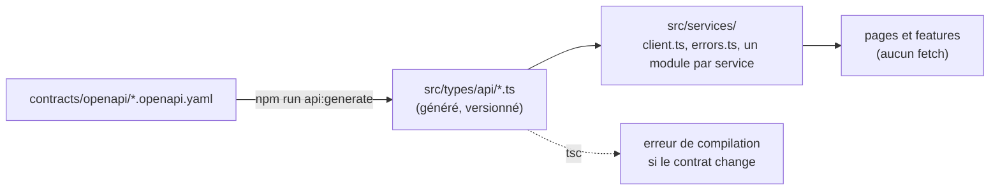
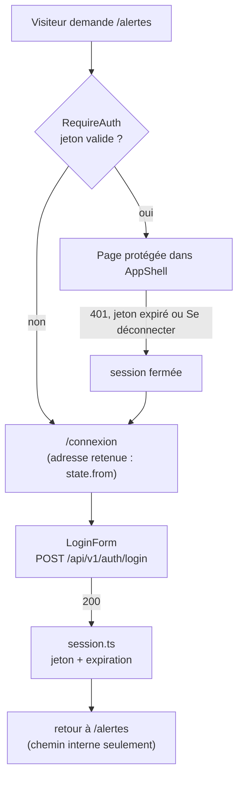

# Frontend (React + Vite + TypeScript)

Tableau de bord web de Novaria Core : React 19, Vite 6, TypeScript 5.7, Vitest 3. L'interface est en français et doit rester utilisable sur un téléphone (360 px de large) comme sur un ordinateur (1280 px et plus).

```bash
npm ci
npm run dev        # http://localhost:5173 (proxy /api vers le backend, port 8000)
npm test           # vitest + couverture (coverage/lcov.info)
npm run lint && npm run format:check
npm run build      # contrôle de types puis construction
```

Formater : `npx prettier --write src`.

## Arborescence de `src/`

| Dossier | Rôle |
|---|---|
| `app/` | Assemblage : `App.tsx`, `router.tsx` (tableau de routes exporté), `bootstrap.tsx` (montage), `AppShell/` (mise en page) |
| `pages/` | Une page par route (`LoginPage`, `DashboardPage`, `AlertsPage`, `TrafficLightsPage`, `ForecastsPage`, `ReportsPage`, `NotFoundPage`) |
| `features/` | Fonctionnalités : `navigation/` (entrées du menu), `theme/` (thème et sélecteur), `api-status/` (état de l'API), `auth/` (connexion, session, routes protégées) |
| `components/` | Composants génériques sans logique métier (`PageHeader`, `SkipLink`, `IconButton`, `Container`, `VisuallyHidden`, `ComingSoon`) |
| `hooks/` | `useMediaQuery`, `useDisclosure`, `useEscapeKey`, `useFocusTrap`, `useScrollLock` |
| `services/` | Tous les appels à l'API : un module par service (`apiMetier`, `traitement`, `alerte`, `reponse`), le client commun (`client.ts`), les erreurs (`errors.ts`) et le jeton de session (`session.ts`) |
| `styles/` | `tokens.css` (jetons), `global.css` (base), `breakpoints.ts` (points de rupture) |
| `types/` | Types partagés ; `types/api/` est **généré** depuis les contrats OpenAPI : ne pas le modifier à la main |

Les tests sont dans `tests/`, avec la même arborescence que `src/`. L'alias `@/` désigne `src/` (déclaré dans `vite.config.ts` et `tsconfig.json`).

## Règles de dépendance

Un dossier n'importe jamais un dossier « plus haut » dans cet ordre : `components` ← `features` ← `pages` ← `app`.

| Dossier | N'importe pas |
|---|---|
| `components/` | `features/`, `pages/`, `app/` |
| `features/` | `pages/`, `app/` |
| `hooks/`, `services/`, `types/` | `components/`, `features/`, `pages/`, `app/` |

ESLint impose ces règles (`no-restricted-imports` dans `eslint.config.js`) : une importation interdite fait échouer `npm run lint`. `tests/architecture/dependency-rules.test.ts` vérifie la règle sur des cas autorisés et interdits.

## Jetons de design et thème

Tout style passe par les variables CSS de `src/styles/tokens.css` : couleurs sémantiques (`--color-bg`, `--color-text`, `--color-primary`, `--color-danger`…), espacements (`--space-1` à `--space-8`, échelle de 4 px), typographie (polices du système, `--text-xs` à `--text-3xl`), rayons, ombres, `--tap-min` (zone tactile de 44 px) et niveaux de superposition. Un composant n'écrit aucune couleur ni taille en dur (un test le vérifie).

Le thème a trois modes : Clair, Sombre et Système (par défaut). L'attribut `data-theme` de `<html>` vaut `light` ou `dark` ; absent, il suit la préférence du système. Le choix est mémorisé dans `localStorage` (accès protégés : l'application fonctionne sans stockage) et appliqué avant le premier rendu. Les contrastes de chaque paire texte/fond respectent WCAG AA dans les deux thèmes (test dans `tests/styles/tokens.test.ts`).

## Points de rupture

Mobile d'abord, avec `min-width` : **40rem** (tablette) et **64rem** (ordinateur). Au-dessus de 64rem, la navigation est une barre latérale ; en dessous, c'est un tiroir. Les variables CSS ne fonctionnent pas dans les requêtes média : les valeurs sont écrites dans `tokens.css` (commentaire) et dans `breakpoints.ts`, et un test vérifie qu'elles restent identiques. N'utilisez pas d'autre valeur de `min-width` dans une feuille de style de composant.

## Ajouter une page et une entrée de menu

1. Créer `src/pages/MaPage.tsx` avec un `PageHeader` (titre et phrase d'introduction).
2. Ajouter la route dans `src/app/router.tsx`, **parmi les enfants de la coque** (`path: "/"`, dans la route `RequireAuth`) pour qu'elle soit protégée : `{ path: "ma-page", element: <MaPage />, handle: handle("Ma page") }`. Le titre sert à `document.title` et au repère de la page. Une page publique se place au même niveau que `/connexion`, hors de `RequireAuth` : à éviter sans raison.
3. Ajouter l'entrée dans `src/features/navigation/entries.ts` : `{ path: "/ma-page", label: "Ma page" }`. Un test vérifie que chaque entrée correspond à une route titrée.
4. Ajouter un test dans `tests/app/navigation.test.tsx` si la page a un comportement propre.

## Client d'API typé

Les types viennent des contrats de [`contracts/openapi/`](../contracts/openapi/README.md) (un par service). Le contrat est la source de vérité : on ne décrit jamais à la main une réponse de l'API.



| Étape | Commande (identique sous Linux et Windows, depuis `frontend/`) |
|---|---|
| Régénérer les types après un changement de contrat | `npm run api:generate` |
| Vérifier que les types correspondent aux contrats | `npm run api:check` |
| Voir les erreurs de compilation causées par un changement | `npm run build` (ou `npx tsc --noEmit`) |

**Services couverts** : `api-metier`, `traitement`, `alerte`, `reponse`. `collecte` est exclu : son point d'accès reste sur le réseau interne, le tableau de bord ne l'appelle pas. Un nouveau contrat exposé par la passerelle doit être ajouté à `SERVICES` dans `scripts/api-types.mjs` ; un test échoue sinon.

**Un changement de contrat devient une erreur visible**, à deux endroits :

1. `tests/services/api-types.test.ts` (donc `npm test` et la CI) échoue si les types générés ne correspondent plus aux contrats : on a modifié le contrat sans lancer `npm run api:generate`.
2. Après régénération, `npm run build` (et l'éditeur) signalent chaque ligne qui utilise un champ retiré ou renommé. Exemple vérifié : renommer `version` en `build` dans le schéma `Health` de `contracts/openapi/common.yaml` donne `ApiStatus.tsx: Property 'version' does not exist on type …`. Un code d'erreur ajouté au contrat fait aussi échouer la compilation de `src/services/errors.ts` tant que son message n'est pas écrit.

### Règles

| Règle | Contrôle |
|---|---|
| Aucun `fetch` hors de `src/services/` | ESLint (`no-restricted-globals`), testé dans `tests/architecture/dependency-rules.test.ts` |
| Toute défaillance (HTTP ou réseau) devient une `ApiError` : `status`, `code` du contrat, `correlationId`, `fieldErrors` | `client.ts` (un seul middleware), `tests/services/client.test.ts` |
| Le message affiché vient de `messageFor(error)`, jamais du détail du serveur | `errors.ts` : un message par code, liste exhaustive vérifiée par le compilateur |
| Chaque requête porte `X-Correlation-ID` ; la réponse en erreur le rapporte pour un signalement | `client.ts` |
| Le jeton est gardé dans `sessionStorage` (onglet), jamais dans `localStorage` ; voir « Connexion et routes protégées » | `session.ts`, `tests/services/session.test.ts` |

### Appeler l'API depuis une page

```tsx
import { listIndicators } from "@/services/traitement";
import { isApiError, messageFor } from "@/services/errors";

try {
  const page = await listIndicators({ congestion_state: "CONGESTED", limit: 20 });
  // page.items est typé d'après le contrat
} catch (error) {
  setMessage(messageFor(error)); // phrase en français ; isApiError(error) donne status et correlationId
}
```

Limites connues : le flux `GET /api/v1/events/stream` (SSE, Server-Sent Events) n'est pas un appel `fetch` ordinaire et n'a pas encore de module ; l'authentification complète (écran de connexion, stockage du jeton après `login`) relève d'une autre issue.

## Connexion et routes protégées

Toutes les pages, sauf `/connexion`, exigent une session. Sans jeton valide, la route renvoie à la page de connexion et **aucun composant protégé n'est rendu** ni aucun appel d'API envoyé.



| Élément | Où | Rôle |
|---|---|---|
| `RequireAuth` | `features/auth/RequireAuth.tsx` | Route de mise en page : sans session, `<Navigate to="/connexion">` en retenant l'adresse demandée |
| `AuthProvider`, `useAuth()` | `features/auth/` | État `isAuthenticated`, `user` (nom, rôle, lu par `GET /api/v1/auth/me`), `login`, `logout` |
| `LoginForm`, `LoginPage` | `features/auth/`, `pages/` | Formulaire (identifiant, mot de passe), erreur annoncée par `role="alert"`, bouton bloqué pendant l'envoi |
| `UserMenu` | `features/auth/UserMenu.tsx` | Compte connecté et bouton « Se déconnecter » dans l'en-tête |
| `session.ts` | `services/` | Jeton, expiration, abonnement aux changements |
| Redirection | `features/auth/redirect.ts` | Accepte seulement un chemin interne : `//hote`, `https://…` et la page de connexion renvoient au tableau de bord |

**Stockage du jeton.** `sessionStorage` : propre à l'onglet, vidé à sa fermeture, conservé au rechargement. Jamais `localStorage`. Un script injecté pourrait lire le jeton ; le risque est limité par sa durée de vie courte (`expires_in`, 1800 s par défaut) et l'absence de jeton de renouvellement en v1. Si le stockage est refusé, le jeton reste en mémoire seulement. Pour passer à « mémoire seule » (aucun stockage, reconnexion à chaque rechargement), il suffit de supprimer les lectures et écritures de `sessionStorage` dans `session.ts`.

**Fin de session**, dans tous les cas la même chose (jeton effacé, retour à la connexion, adresse retenue) :

| Cause | Mécanisme |
|---|---|
| Clic sur « Se déconnecter » | `logout()` |
| Jeton expiré (la date vient de `expires_in`) | Minuteur de `AuthProvider`, et refus de tout jeton expiré à la lecture |
| L'API répond 401 `UNAUTHENTICATED` à n'importe quel appel | Le client d'API (`client.ts`) ferme la session |

Une erreur de connexion (`INVALID_CREDENTIALS`) ne ferme rien : l'utilisateur reste sur la page, le mot de passe est vidé.

| Étape | Commande (identique sous Linux et Windows, depuis `frontend/`) |
|---|---|
| Tests de la connexion et des routes protégées | `npx vitest run tests/app/auth-routes.test.tsx tests/services/session.test.ts tests/features/auth` |
| Toute la suite | `npm test` |

Limites connues : l'API métier (`/api/v1/auth/*`, BE-02 et BE-03) n'est pas encore implémentée ; derrière la passerelle locale, `POST /api/v1/auth/login` répond 503 (`UPSTREAM_UNAVAILABLE`), donc une vraie connexion n'est possible qu'avec ce service. Les tests simulent l'API. Les rôles (`viewer`, `operator`, `admin`) sont affichés mais n'ouvrent ni ne ferment encore aucune page. Aucune capture dans un vrai navigateur à ce jour : **non vérifié visuellement**.

## Vérifier avant une pull request

```bash
npm ci && npm run lint && npm run format:check && npm test && npm run build
```

Le job `frontend` de la CI exécute ces mêmes commandes. Pour le conteneur : `docker build -t novaria-frontend:test frontend`, puis lancer l'image avec le service `backend` accessible (par exemple `docker compose up --build`) ; `nginx.conf` renvoie toute route inconnue vers `index.html`, donc un rechargement direct de `/alertes` fonctionne.

## Décisions

- **Routeur** : `react-router` 7 (`createBrowserRouter` dans l'application, `createMemoryRouter` dans les tests). Les routes sont un tableau exporté pour être testées sans navigateur. `RouterProvider` est importé depuis `react-router` et non depuis `react-router/dom` : ce sous-chemin charge une seconde copie du routeur dans Vitest et casse les contextes ; la seule fonction perdue est `flushSync` pour les transitions de vue, inutilisée ici.
- **Styles** : CSS Modules (`*.module.css`) pour les composants et variables CSS pour les jetons, sans bibliothèque de composants ni de styles.
- **Thème** : un attribut `data-theme` sur `<html>` et deux jeux de variables, plutôt qu'une classe par composant. Le jeu sombre existe deux fois (choix explicite et préférence du système) car le CSS n'a pas de moyen de le partager ; un test vérifie qu'ils restent identiques.
- **Tiroir mobile** : l'élément `inert` rend le fond non interactif ; un piège à focus minimal garde le clavier dans le tiroir, sans bibliothèque.
