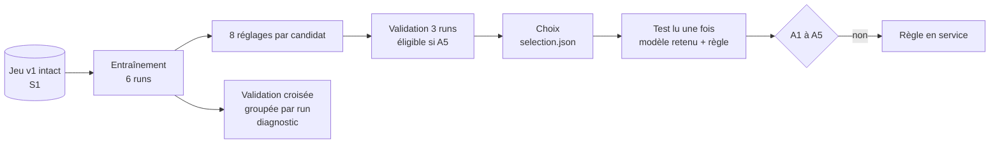

# Comparaison de la règle de seuils et de deux modèles : choix argumenté (IA-03)

Dernière mise à jour : 12/11/2026 · Issue IA-03 (#79) · Exigence : EXG-IA-03 · Cadre : [cadrage ML](../../docs/06-ia-mlops/cadrage-ml.md) · Chiffres : [resultats.md](resultats.md) (généré), `selection.json` et `resultat-test.json`

Abréviations : F1 (moyenne harmonique de la précision et du rappel), CV (validation croisée, *cross-validation*), SHA-256 (Secure Hash Algorithm, empreinte de 256 bits).

> **Données simulées.** Un modèle entraîné sur le simulateur apprend le simulateur : ces résultats prouvent la chaîne (données, modèle, évaluation), pas la précision en conditions réelles.

## 1. Résultat en une page

| Question | Réponse |
|---|---|
| Quel candidat a été retenu ? | **Régression logistique**, avec confirmation sur 2 fenêtres, réglage `C = 10`, classes pondérées |
| Bat-il la règle de seuils sur le test ? | **Non, pas au seuil fixé avant l'entraînement** : 3 conditions sur 5 remplies (A1, A3, A4), **2 manquées (A2, A5)** |
| Décision | **Modèle rejeté. La règle de seuils reste le classificateur en service** (ADR-015, section 6). L'écart est documenté ci-dessous |
| Le test a-t-il été lu une seule fois ? | Oui. Un second essai est refusé par le code (`resultat-test.json` existe) |

| Sur le test (3 runs, 14 tronçon-jours) | Règle de seuils | Régression logistique + confirmation | Exigé |
|---|---|---|---|
| F1 macro | 0,968 | **0,981** | ≥ 0,9781 (A1) : **remplie** |
| Rappel de `CONGESTED` | 0,979 | 0,980 | ≥ 0,9885 (A2) : **manquée** |
| Délai médian / maximum (minutes) | 1 / 1 | 1 / 1 | ≤ 1 (A3) : **remplie** |
| Épisodes manqués | 0 sur 9 | 0 sur 9 | 0 (A4) : **remplie** |
| Fausses alertes par tronçon et par jour | 0,07 (1 alerte sur 10) | **0,21** (3 alertes sur 12) | ≤ 0,10 (A5) : **manquée** |

Le modèle gagne **1,3 point de F1 macro** mais pas assez sur le rappel (+0,001 pour +0,01 exigé), et il **crie au loup trois fois** là où la borne en tolère une.

## 2. La démarche

| Élément | Ce qui a été fait |
|---|---|
| Référence | la règle de l'ADR-028 (code du traitement en flux), seuils inchangés |
| Candidat 1 | `LogisticRegression` multiclasse, variables centrées et réduites ; 8 réglages (`C` 0,01 à 10, classes pondérées ou non) |
| Candidat 2 | `HistGradientBoostingClassifier` ; 8 réglages (taux d'apprentissage, feuilles, classes pondérées), 200 itérations |
| Variables | celles du cadrage (section 3) : mesures, historique, tronçon ; ni calendrier, ni clés, ni réponses de prévision |
| Valeurs absentes | médiane de l'entraînement (logistique) ou prise en charge native (gradient boosting) |
| Réglage | sur la **validation**, pas sur le test ; 8 réglages par candidat, sous le plafond de 12 |
| Validation croisée groupée par run | 3 plis sur entraînement + validation : chaque pli met de côté **un run de chaque scénario**. Elle **ne choisit rien**, elle mesure la stabilité |
| Validation croisée temporelle (prévision) | prête (`plis_temporels`, IA-02, avec délai de garde) ; **non appliquée ici**, elle sert la prévision (IA-10) |
| Reproductibilité | graine 42 ; deux entraînements du réglage retenu donnent les mêmes prédictions (vérifié) |
| Sécurité (S1) | le jeu est vérifié contre son manifeste avant l'entraînement et avant le test, et son empreinte doit être celle de la sélection |

## 3. Le choix argumenté

| Étape | Constat sur la validation | Conséquence |
|---|---|---|
| Sortie brute, tous réglages | **aucun des 16 réglages n'est éligible** : 0,14 à 0,36 fausse alerte par tronçon et par jour (borne : 0,10), alors que leur F1 macro est excellent (0,989 à 0,995) | un modèle qui se prononce minute par minute **clignote** ; c'est le cas prévu par le cadrage (« le modèle qui clignote ») |
| Avec confirmation sur 2 fenêtres | **logistique : 8 réglages sur 8 éligibles** (1 fausse alerte sur 14 tronçon-jours, comme la règle) ; **gradient boosting : 0 sur 8** (2 fausses alertes) | le gradient boosting ne peut pas être retenu |
| Meilleur réglage logistique confirmé | `C = 10`, classes pondérées : F1 macro **0,984** contre 0,975 pour la règle ; rappel 0,971 (égal) ; délai médian 1 minute | retenu |
| Règle de départage (moins de 0,002) | non utilisée : le gradient boosting n'était pas éligible | la logistique gagne sur le fond |

Pourquoi la logistique et pas le gradient boosting : **la simplicité n'a pas eu à trancher**. Le modèle non linéaire fait légèrement mieux en brut (rappel jusqu'à 0,988 contre 0,985) mais **ne tient pas la borne de fausses alertes**, même confirmé. Un modèle plus riche ne réduit pas ici le clignotement ; il est aussi moins explicable (ADR-015).

Le choix n'a **pas** été fait avec la validation croisée : ses chiffres sont consignés pour juger la stabilité.

## 4. Ce que dit la validation croisée groupée par run (diagnostic)

| | F1 macro | Rappel `CONGESTED` | Fausses alertes par tronçon et jour |
|---|---|---|---|
| Logistique + confirmation | 0,983 ± 0,006 | 0,981 ± 0,009 | **0,10 ± 0,11** |
| Règle de seuils (mêmes plis) | 0,976 ± 0,003 | 0,975 ± 0,013 | 0,02 ± 0,04 |

| Pli (un run de chaque scénario à part) | Fausses alertes du modèle | de la règle |
|---|---|---|
| 1 : runs `s11`, `s21`, `s31` | 0 sur 9 alertes | 0 sur 9 |
| 2 : runs `s12`, `s22`, `s32` | **3 sur 12 (0,21)** | 0 sur 9 |
| 3 : runs `s13`, `s23`, `s33` | 1 sur 10 (0,07) | 1 sur 10 |

**Le résultat du test était annoncé par le pli 2** : la moyenne de fausses alertes (0,10) touche la borne, avec un écart-type (0,11) aussi grand que la moyenne. Le gain de F1 (+0,007 en moyenne) est réel mais mince, et le gain de rappel (+0,006) est sous la marge exigée.

## 5. Pourquoi le test échoue : ce qui est établi et ce qui ne l'est pas

**Établi sur les données d'entraînement et de validation** (pli 2, runs du jeu, pas le test) : les 3 fausses alertes du modèle ont deux causes.

| Cause | Observation | Sens |
|---|---|---|
| **Minutes sans mesure** | deux alertes tombent sur des minutes **sans vitesse** (`speed_ratio` absent) d'un capteur muet (`ds1-calme-s12`) ou de messages en retard refusés (`ds1-pointe-s22`) : le modèle annonce `CONGESTED` | la règle compte une route sans mesure comme fluide ; le modèle, lui, extrapole, et le jeu ne lui dit pas qu'une mesure manque (la complétude n'est pas une colonne du dictionnaire : limite déjà notée dans la fiche de provenance) |
| **État qui rebondit dans un épisode** | une alerte répétée dans un épisode déjà annoncé (`ds1-pointe-s22`, `ROAD_008` : `SLOW` puis `CONGESTED` en pleine congestion) | une alerte de plus dans le même épisode compte comme fausse (cadrage, section 4) |

**Non établi** : le détail des trois fausses alertes du **test**. Il n'a pas été examiné : le test est scellé (lu une fois, pour mesurer) et en chercher les causes ligne à ligne pour corriger le modèle reviendrait à régler sur lui. Les trois runs du test portent des anomalies (doublons, retards, capteur muet) comme ceux du pli 2 : **c'est cohérent avec la cause « minutes sans mesure », sans le prouver**.

**Matrice de confusion du modèle sur le test**

| Réel \ Annoncé | `FREE_FLOW` | `SLOW` | `CONGESTED` |
|---|---|---|---|
| `FREE_FLOW` | 17 916 | 6 | 3 |
| `SLOW` | 0 | 1 473 | 17 |
| `CONGESTED` | 0 | 8 | 737 |

Les erreurs sont **rares et voisines** : 17 minutes `SLOW` prises pour `CONGESTED` (1,1 % de `SLOW`) et 8 minutes `CONGESTED` prises pour `SLOW` (1,1 %). Jamais une congestion annoncée fluide : le modèle ne rate pas les congestions, il en **annonce parfois de trop**.

## 6. Ce que cela veut dire

| Point | Lecture |
|---|---|
| Valeur du modèle | un gain de F1 macro de 1,3 point **ne suffit pas** : la référence est déjà à 0,968 à 0,976 sur un jeu simulé où les états sont bien séparés (cadrage, section 6 : « le modèle peut échouer ») |
| Le F1 seul trompe | sans confirmation, le modèle a un F1 macro de 0,99 et 0,14 à 0,36 fausse alerte par tronçon et jour : c'est exactement ce que le cadrage voulait empêcher en exigeant les fausses alertes |
| Conséquence produit | la **règle de seuils reste servie** ; le pipeline MLOps (suivi, barrière, surveillance de la dérive) se démontre avec elle (ADR-015, plan de repli) |
| Conséquence pour IA-05 | un document `model_runs` de cet entraînement porterait `status = rejected` : aucun fichier de modèle n'est enregistré, par conception |
| Résultat présentable | oui : une comparaison honnête qui dit non vaut plus qu'un modèle qui gagne parce que le critère a été ajusté |

## 7. Ce qui n'a pas été fait, et pourquoi

Ces pistes **ne sont pas exécutées** : changer le modèle ou le critère après avoir lu le test est interdit par le cadrage. Une piste ne vaut que décidée dans un **avenant** (cadrage, section 12) et **évaluée sur un test neuf**, parce que celui du jeu v1 est consommé.

| Piste | Raison d'y penser | Condition |
|---|---|---|
| Ajouter la complétude (ou un indicateur « mesure absente ») aux colonnes du jeu | cause établie des fausses alertes sur fenêtres vides | nouvelle version du jeu (v2), accord de Daddy sur le dictionnaire de données |
| Confirmation sur 3 fenêtres, ou seuil sur la probabilité de `CONGESTED` | réduire le rebond dans un épisode | avenant avant l'essai ; compromis sur le délai de détection |
| Nouveaux runs de test (autres graines, un quatrième scénario) | le test v1 est lu ; les runs d'un même scénario ont le même calendrier d'états (fiche de provenance, section 8) | extension du catalogue du simulateur |

## 8. Écarts à signaler

| Écart | Détail |
|---|---|
| Déclenchement de la confirmation | le cadrage (section 6) la prévoit quand A1 et A2 sont remplies et A5 manquée. Le code l'essaie dès que **aucun réglage brut n'est éligible** sur la validation, ce qui est plus large. Cette règle est écrite dans le code et la sélection **avant** la lecture du test ; elle est consignée ici et en section 12 du cadrage |
| Révision du code | l'évaluation a tourné sur la révision `880fa90` **avec le code d'IA-03 non commité** (`code_modifie_non_commite` vaut vrai dans les deux fichiers de résultats). Pour le registre (IA-05), refaire un entraînement depuis un commit propre |
| Ordre des commits | `resultat-test.json` cite l'empreinte SHA-256 de `selection.json` : c'est ce lien, et non l'historique Git, qui prouve que le choix précède la lecture du test. Ne pas relancer l'étape `validation` : elle réécrirait `selection.json` (la révision du code y est inscrite) et casserait ce lien |
| Entraînement final | le modèle évalué sur le test est entraîné sur l'entraînement seul (6 runs), pas sur entraînement + validation |
| Dépendances | scikit-learn et ses dépendances sont verrouillées avec empreintes (`ml/requirements.txt`, condition S4) ; l'**analyse Snyk de ces dépendances n'a pas été faite** (pas de jeton sur le poste, et le job de la CI ne parcourt pas `ml/`) |
| Systèmes | essai sous Linux, Python 3.14.4 ; Windows non vérifié |

## 9. Refaire

Prérequis : le jeu v1 existe (`python3 ml/src/construire_jeu.py`).

| Action | Linux (bash) | Windows (PowerShell) |
|---|---|---|
| Créer l'environnement (scikit-learn, empreintes exigées) | `python3 scripts/dev/dev.py ml-env` ou `make ml-env` | `py -3 scripts/dev/dev.py ml-env` |
| Réglage, validation croisée, choix (environ 1 minute) | `make ml-train ETAPE=validation` | `py -3 scripts/dev/dev.py ml-train validation` |
| Lecture unique du test | `make ml-train ETAPE=test` | `py -3 scripts/dev/dev.py ml-train test` |
| Tableaux (`resultats.md`) | `make ml-train ETAPE=rapport` | `py -3 scripts/dev/dev.py ml-train rapport` |
| Tests (avec scikit-learn) | `ml/.venv/bin/python -m unittest discover -s ml/tests -t ml` | `ml\.venv\Scripts\python.exe -m unittest discover -s ml\tests -t ml` |

L'étape `test` ne se relance pas : `resultat-test.json` existe. La supprimer pour rejouer est un avenant du cadrage, pas une commodité.
