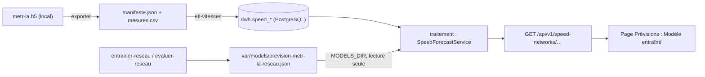

# Prévision de vitesse : un réseau spatio-temporel, servi par l'API (IA-16)

Dernière mise à jour : 22/11/2026 · Chiffres : [prevision-reseau.json](prevision-reseau.json) (écrit par `entrainer_reseau.py`, ne pas modifier à la main) · Décision : [ADR-032](../../docs/01-architecture/adr/ADR-032-donnees-d-entrainement-et-reseau-extensible.md) · Étapes précédentes : [IA-10](prevision-comparaison.md), [HGB à voisins](prevision-ia16.md)

Abréviations : MAE (*Mean Absolute Error*, erreur absolue moyenne), RMSE (*Root Mean Square Error*), mph (miles par heure), GRU (*Gated Recurrent Unit*, cellule récurrente), HGB (HistGradientBoosting), DCRNN (réseau à graphe publié avec le jeu).

> **Donnée réelle historique, Los Angeles, 2012.** Licence non établie : le fichier reste local, jamais redistribué ; le modèle appris n'est pas commité (`var/models/`). Un modèle appris ici ne sert que ce réseau.

## 1. Résultat en une page

| Question | Réponse |
|---|---|
| Quel modèle ? | Un **réseau de neurones spatio-temporel** (PyTorch) : un graphe des 207 capteurs (les 10 voisins de chacun, appris sur l'apprentissage), un GRU par capteur sur la dernière heure, et six horizons prévus d'un coup (5 à 30 minutes). **38 854 poids**, 4,5 Mo |
| De combien bat-il la persistance ? | **19,9 % à 5 min, 21,8 % à 15 min, 25,2 % à 30 min** (HGB à voisins : 17,1 / 16,8 / 19,5 % ; IA-10 : 13,1 / 9,6 / 8,0 %) |
| Est-ce sûr ? | Les intervalles à 95 % de l'écart de MAE sont entièrement sous zéro : −0,554 [−0,576 ; −0,529], −0,755 [−0,794 ; −0,710], −1,046 [−1,133 ; −0,949] mph |
| Face au réseau à graphe publié ? | Le dépôt DCRNN publie 2,18 / 2,67 / 3,08 mph ; ce modèle fait 2,230 / 2,702 / 3,099 : **2,3 %, 1,2 % et 0,6 % au-dessus** (protocole différent, comparaison d'orientation) |
| Est-il servi par l'application ? | **Oui** : `GET /api/v1/speed-networks/metr-la/forecasts` lit les vitesses de l'entrepôt et rend les prévisions du modèle, de la persistance et de l'observé. Mesuré à travers l'API sur 68 instants de la période de test : gain de **22,7 % / 22,1 % / 26,9 %**, 150 ms par requête |
| Est-ce un test vierge ? | **Non.** La période de test avait déjà été lue par IA-10 et par le HGB à voisins. Le réglage (10 époques, 64 unités cachées, taux 0,002) a été fixé avant, sur la validation seulement ; la meilleure époque est choisie sur la validation |

## 2. Test sur METR-LA (MAE / RMSE en mph)

| Méthode | 5 min | 15 min | 30 min |
|---|---|---|---|
| Persistance | 2,784 / 4,59 | 3,457 / 6,37 | 4,145 / 7,97 |
| HGB d'IA-10 (capteur seul) | 2,418 | 3,123 | 3,811 |
| HGB à voisins (IA-16) | 2,307 | 2,876 | 3,337 |
| **Réseau spatio-temporel** | **2,230 / 3,90** | **2,702 / 5,21** | **3,099 / 6,20** |
| Gain sur la persistance | 19,9 % | 21,8 % | 25,2 % |

## 3. Comment il est construit

| Élément | Choix |
|---|---|
| Entrée, par capteur et par pas (12 pas = 1 heure) | Vitesse centrée réduite, mesure présente ou absente, vitesse **habituelle** du créneau de la semaine (hors la semaine de la ligne, pour ne pas se fuir à elle-même) |
| Graphe | Les 10 capteurs dont l'écart à l'habituel varie comme celui du capteur, appris sur l'apprentissage ; relation symétrisée et normalisée par ligne |
| Réseau | Mélange du capteur et de la moyenne de ses voisins, GRU (64 unités), second mélange, puis une tête qui reçoit l'état, l'habituel des 6 pas à venir et l'heure |
| Cible | L'écart à la persistance (`vitesse(t+h) − vitesse(t)`), erreur absolue sur les mesures présentes seulement |
| Apprentissage | 12 semaines de METR-LA (23 973 pas × 207 capteurs), 10 époques, AdamW, cycle de taux, validation à chaque époque (la meilleure est gardée) ; **environ 30 minutes sur 6 cœurs** |
| Validation (30 min) | 25,8 % de gain, contre 18,8 % pour le HGB à voisins : le test confirme le sens |

La durée d'apprentissage se réduit en apprenant sur moins de semaines : un essai sur 4 semaines et 3 époques donne déjà 17,8 / 19,8 / 22,9 % sur la validation (4 minutes).

## 4. Comment l'application le sert

- **Format du modèle** : JSON (`novaria-modele-reseau`), jamais de `pickle`. Le service le relit et exécute le passage avant avec **numpy seul** (`services/traitement/app/forecast/reseau.py`, fichier unique : `ml/src/registre/lecteur_reseau.py` le charge par son chemin, sans second exemplaire). Écart avec PyTorch : 0,0005 mph.
- **Un modèle ne sert que son réseau** : sans fichier de modèle, ou si les capteurs du modèle ne sont pas dans le réseau chargé, ou si le pas n'est pas de 5 minutes, l'API répond **503** et le dit. Elle ne rend jamais une persistance présentée comme un modèle. Un capteur du réseau que le modèle ne connaît pas n'a pas de prévision : il est compté (`sensors_without_model`).
- **Des données sans comptage** : `dwh.speed_*` (migration 0009), à part de `fact_traffic_window` qui exige un comptage (inventer des comptages fausserait la donnée). Seules les vitesses mesurées ont une ligne.
- **De nouveaux capteurs sans toucher au code** : on les ajoute en fin de liste dans `manifeste.json` et leurs lignes dans `mesures.csv`, puis `etl-vitesses`. Un capteur déjà connu ne change jamais de rang. Un test charge 3 capteurs puis 100 de plus avec le même code.

## 5. Rejouer

| Action | Linux (bash) | Windows (PowerShell) |
|---|---|---|
| Installer PyTorch (CPU) dans `ml/.venv` (**non verrouillé par empreintes**) | `ml/.venv/bin/python -m pip install torch --index-url https://download.pytorch.org/whl/cpu` | `ml\.venv\Scripts\python.exe -m pip install torch --index-url https://download.pytorch.org/whl/cpu` |
| Écrire METR-LA pour l'entrepôt | `python3 scripts/dev/dev.py ml-prevision exporter` | `py -3 scripts/dev/dev.py ml-prevision exporter` |
| Entraîner (validation seulement, environ 30 min) | `python3 scripts/dev/dev.py ml-prevision entrainer-reseau` | `py -3 scripts/dev/dev.py ml-prevision entrainer-reseau` |
| Lire le test une fois, écrire le modèle dans `var/models/` | `python3 scripts/dev/dev.py ml-prevision evaluer-reseau` | `py -3 scripts/dev/dev.py ml-prevision evaluer-reseau` |
| Charger le réseau dans l'entrepôt (la pile doit tourner) | `python3 scripts/dev/dev.py etl-vitesses --reseau metr-la` | `py -3 scripts/dev/dev.py etl-vitesses --reseau metr-la` |
| Voir le résultat | page **Prévisions** de l'administration, section « Modèle entraîné » | idem |

## 6. Limites

| N° | Limite | État |
|---|---|---|
| 1 | Appris sur METR-LA (autoroutes de Los Angeles, 2012, vitesses seules) : ne sert pas le réseau fictif | Assumé (ADR-032, 3.2) ; un modèle pour le réseau fictif demande le jeu v2 (IA-13) |
| 2 | Test déjà lu deux fois avant ce modèle | Dit plus haut |
| 3 | Données **historiques** : l'avenir de l'instant choisi existe déjà, ce qui permet de comparer prévu et observé ; ce n'est pas du temps réel | Dit à l'écran |
| 4 | PyTorch n'est pas verrouillé par empreintes ; les tests du réseau sont ignorés sans lui (donc par la CI, qui ne l'installe pas) | Documenté |
| 5 | Pas d'enregistrement dans `model_runs` : `run_id` vaut `null` dans l'API | À faire |
| 6 | Vitesses seules : ni incident ni météo | Limite du jeu |

## 7. Essai sur la pile complète (22/11/2026)

Pile construite par `dev.py up` depuis cette branche (13 conteneurs, 9 sondes), puis :

| Étape | Résultat |
|---|---|
| Migration 0009 par `db-migrate` | Appliquée ; les droits par défaut de `dwh` donnent au compte du traitement les écritures et à `svc_lecture` la lecture |
| `etl-vitesses --reseau metr-la` avec le compte `svc_traitement` | 207 capteurs, 1 924 971 lignes lues, chargées, 0 refusée, 1 min 40 s. **Premier essai refusé** (`InsufficientPrivilege`) : ce compte n'a pas le droit de créer des tables temporaires ; le chargeur écrit maintenant par `INSERT … SELECT … FROM unnest(…) ON CONFLICT` |
| Modèle | Monté en lecture seule dans `/srv/models` du service |
| API par la passerelle et par le front-end | `GET /api/v1/speed-networks` : réseau, couverture, fiche du modèle ; 200 aux deux ports |
| Navigateur (page Prévisions, compte de lecture jetable, supprimé ensuite) | La fiche du modèle et le tableau d'erreurs de test s'affichent ; « Le modèle face au réel » : sur 200 capteurs, **erreur moyenne du modèle 2,55 km/h contre 3,96 km/h pour la persistance**, modèle plus proche du réel pour 64,5 % des capteurs (instant : 27/06/2012 22:55, horizon 15 min) |
| `dev.py acces` | API : 76/76 accès accordés, 44/44 refusés (70/42 avant : les deux nouvelles routes sont dans la matrice) ; 0 accès interdit accordé ; les 3 échecs MongoDB connus sont inchangés |
| `dev.py parcours N1 à N5` | 5/5 (le flux existant n'est pas touché) ; N6 (navigateur) non joué : il demande `npm ci` dans `frontend/` |

**Défaut trouvé et corrigé par cet essai** : à l'ouverture, la page proposait la fin des mesures, dont l'avenir n'existe pas : « rien à comparer ». Elle propose maintenant une heure avant la fin.

