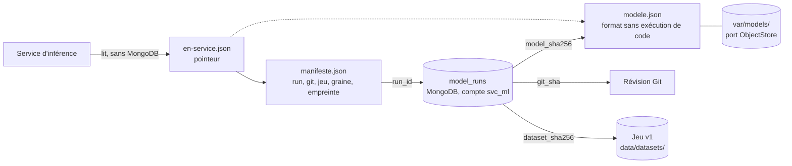
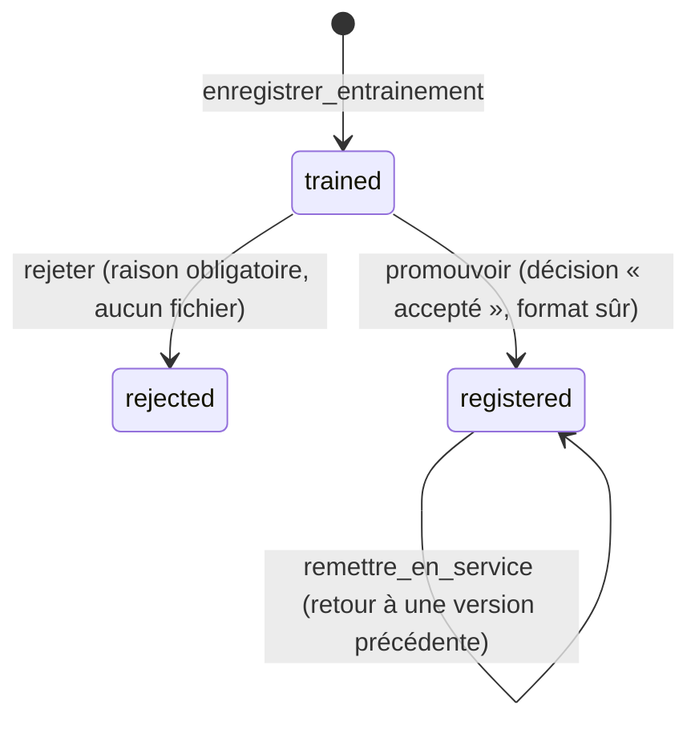

# Registre des modèles et suivi des expériences (IA-04)

Dernière mise à jour : 12/11/2026 · Issue IA-04 (#80) · Exigence : EXG-IA-04 (en partie) · Cadre : [cadrage ML](../../docs/06-ia-mlops/cadrage-ml.md), sections 8 et 9 · Décisions : [ADR-017](../../docs/01-architecture/adr/ADR-017-mlops-mlsecops.md), [ADR-025](../../docs/01-architecture/adr/ADR-025-equivalents-locaux-des-services-aws.md)

Abréviations : MLOps (Machine Learning Operations, exploitation des modèles), MLSecOps (Machine Learning Security Operations, sécurité de cette exploitation), SHA-256 (Secure Hash Algorithm, empreinte de 256 bits), S3 (Simple Storage Service, stockage d'objets d'AWS, Amazon Web Services), JSON (JavaScript Object Notation).

> **Données simulées.** Le jeu v1 vient du simulateur. Un modèle enregistré ici apprend le simulateur : la lignée prouve d'où il vient, pas qu'il vaut quelque chose en conditions réelles.

## 1. Ce que le registre garantit

**Critère de l'issue : un modèle en service est relié à son entraînement et à son jeu de données.** Le registre rend cette chaîne **vérifiable** : on remonte du modèle qui sert à son document `model_runs`, à la révision Git du code et à l'empreinte du jeu, et on recalcule chaque maillon.



| Maillon | Où il est écrit | Comment on le vérifie (`lignee`) |
|---|---|---|
| Entraînement | document `model_runs` : paramètres, métriques, graine, date | le document existe et est `registered` |
| Révision Git | `git_sha`, `git_dirty` | `git cat-file` : la révision existe dans ce dépôt ; code non commité signalé |
| Jeu de données | `dataset_id`, `dataset_sha256` | avec `--jeu` : les SHA-256 du disque sont recalculés (`construire_jeu.py --verifier`) |
| Modèle | `model_sha256`, `model_uri`, `model_format` | le SHA-256 du fichier du magasin est celui du document |
| Manifeste | `var/models/<run>/manifeste.json` | ses champs sont ceux du document |
| « En service » | `var/models/en-service.json` | le pointeur désigne ce run |

La vérification rend quatre listes : ce qui est **vérifié**, les **écarts** (faux : code de sortie 1), les **avertissements** (douteux) et le **non vérifié** (pas contrôlé : jamais déclaré bon).

## 2. Cycle de vie d'un entraînement



| Règle | Où elle est tenue |
|---|---|
| Un `run_id` = un document | index unique `uniq_run_id` (MongoDB), `RunDejaEnregistre` |
| Un changement d'état est une **mise à jour conditionnelle** (`status` attendu) : deux promotions simultanées ne s'écrasent pas | `RunStore.mettre_a_jour` |
| Un modèle sous le seuil n'entre pas au registre | `promouvoir` exige `metrics.decision == « accepté »` : **garde minimale** ; le calcul de cette décision (conditions A1 à A5, S1 à S5) est IA-05 |
| Seul un fichier au format sûr s'enregistre | `ModeleLineaire.depuis_octets` à la promotion |
| Un document `registered` ne change plus, sauf `registered_at` | aucune autre méthode d'écriture |
| Le magasin n'est écrit qu'**une fois** par version | `StockageLocal.put` : lien dur, jamais d'écrasement ; fichiers en lecture seule |
| Reprise après une promotion interrompue | les mêmes octets passent, d'autres octets échouent |

## 3. Les trois pièces du code (`ml/src/registre/`)

| Module | Rôle |
|---|---|
| `stockage.py` | **port `ObjectStore`** (`put`, `get`, `exists`) et adaptateur `StockageLocal` (`var/models/`, `STORAGE_BACKEND=local`). Clés strictes `<run_id>/modele.json`, jamais de chemin ; écriture atomique |
| `documents.py`, `runs.py` | le document `model_runs` ([dictionnaire](../../docs/03-donnees/dictionnaire-de-donnees.md), section 10.6) ; port `RunStore`, adaptateurs mémoire (essais) et MongoDB (`svc_ml`) |
| `format_lineaire.py` | format `novaria-modele-lineaire` : une régression logistique en JSON, relue sans exécuter de code |
| `registre.py` | `Registre` : enregistrer, rejeter, promouvoir, remettre en service |
| `service.py` | côté inférence : charge le modèle du pointeur depuis le magasin, sans MongoDB ni scikit-learn |
| `lignee.py` | la chaîne et sa vérification |
| `importer_ia03.py` | écrit dans `model_runs` le run d'IA-03 (`ml/evaluation/`) |

### Disposition de `var/models/` (non versionné, `.gitignore`)

```
var/models/
├── en-service.json              pointeur : { run_id, manifeste_sha256 }
└── <run_id>/
    ├── modele.json              le modèle (écrit une fois, lecture seule)
    └── manifeste.json           run, git_sha, dataset_sha256, seed, model_sha256 (écrit une fois)
```

### Le format sans exécution de code

Un fichier `pickle` **exécute du code quand on le lit** ; il n'est jamais chargé ici. Le modèle est du JSON : états, nom des variables, moyenne et écart de chaque variable, un vecteur de coefficients et une ordonnée par état, et la préparation apprise sur l'entraînement (médianes, catégories). La lecture (bibliothèque standard) refuse tout ce qui n'est pas **exactement** ce format : champs en plus ou en moins, nombre non fini, longueurs incohérentes, écart nul, variables différentes de celles de la préparation, fichier de plus d'un Mo.

Vérifié : sur les 20 160 lignes de validation du jeu v1, ce format prédit **comme scikit-learn**, ligne pour ligne (0 écart, 12/11/2026).

## 4. Les contrôles de sécurité (cadrage ML, section 9)

| Menace | Contrôle dans ce registre | Preuve |
|---|---|---|
| **M3** fichier de modèle piégé | **S2** : le SHA-256 du fichier doit être celui du manifeste (lui-même fixé par le pointeur) et de `model_runs` ; **S3** : aucun `pickle` ; une seule forme de fichier | tests : modèle altéré refusé et journalisé ; attaquant qui refait manifeste **et** pointeur avec un `pickle` : refusé, code **non exécuté** |
| **M4** registre altéré | un seul compte écrit `model_runs` (`svc_ml`) ; changements d'état conditionnels ; magasin en écriture unique | tests, MongoDB réel (index unique, validateur) |
| Traversée de chemin | clés strictes + confinement sous la racine (liens symboliques compris) ; `run_id` validé | tests : 14 clés dangereuses, lien symbolique vers l'extérieur |

### Décision de conception : le service lit le magasin, pas MongoDB

`dev.py db-check` vérifie que `svc_traitement` **ne lit pas** `model_runs`. Au lieu de lui donner ce droit (ce que le cadrage envisageait, M4), le service d'inférence lit `en-service.json`, le manifeste et le modèle dans le magasin, et le manifeste porte la lignée. `model_runs` reste la référence pour l'entraînement et l'audit (`svc_ml`). Conséquence : l'empreinte du modèle est comparée au **manifeste**, pas à MongoDB, côté service ; la comparaison avec `model_runs` se fait avec `lignee`.

## 5. Utiliser le registre

Prérequis : `ml-env` (pymongo et scikit-learn, empreintes exigées) et, pour MongoDB, la pile des bases (`db-up`).

| Action | Linux (bash) | Windows (PowerShell) |
|---|---|---|
| Créer l'environnement | `python3 scripts/dev/dev.py ml-env` ou `make ml-env` | `py -3 scripts/dev/dev.py ml-env` |
| Écrire le run d'IA-03 dans `model_runs` (rejeté, sans fichier) | `make ml-registre C=importer-ia03` | `py -3 scripts/dev/dev.py ml-registre importer-ia03` |
| Lister les runs | `make ml-registre C=lister` | `py -3 scripts/dev/dev.py ml-registre lister` |
| Le modèle en service et sa lignée | `make ml-registre C=en-service` | `py -3 scripts/dev/dev.py ml-registre en-service` |
| La chaîne d'un modèle, jeu recalculé | `make ml-registre C="lignee <run> --jeu"` | `py -3 scripts/dev/dev.py ml-registre lignee <run> --jeu` |
| Charger le modèle comme le ferait le service | `make ml-registre C=charger` | `py -3 scripts/dev/dev.py ml-registre charger` |
| Tests contre un **MongoDB jetable** (Docker ; supprimé ensuite) | `make ml-registre-essai` | `py -3 scripts/dev/dev.py ml-registre-essai` |
| Tests sans MongoDB | `ml/.venv/bin/python -m unittest discover -s ml/tests -t ml -p "test_registre.py"` | `ml\.venv\Scripts\python.exe -m unittest discover -s ml\tests -t ml -p "test_registre.py"` |

L'adresse MongoDB (compte `svc_ml`) est lue dans `.env` par `dev.py` et passée par l'environnement : elle n'apparaît ni dans les arguments, ni dans les sorties.

## 6. Preuves

| Preuve | Contenu |
|---|---|
| `ml/tests/test_registre.py` | 93 tests : magasin, document, format, cycle de vie, service, lignée, import, ligne de commande ; **18 mutations** des contrôles essayées : 15 détectées, 2 survivantes **équivalentes** (la réécriture d'un objet est aussi bloquée par le lien dur, `NaN` aussi par le test de nombre fini) et un contrôle redondant supprimé |
| MongoDB réel (`ml-registre-essai`) | le cycle complet sur le vrai `model_runs` (index unique, validateur de la base qui refuse un document mal formé, dates BSON), avec `svc_ml` : 2 tests, projet Compose jetable supprimé |
| [`lignee-essai-2026-11-12.txt`](lignee-essai-2026-11-12.txt) | transcription brute d'un essai de bout en bout : import du run d'IA-03, aucun modèle en service (la règle reste), modèle d'**essai** enregistré, lignée vérifiée avec le jeu recalculé, fichier altéré **refusé**, restauration |

**Ce que montre l'essai d'IA-03** : le run `ia03-logistique-876c217f3f` entre dans `model_runs` avec le statut `rejected` (A2 et A5 manquées), **sans fichier de modèle**, avec le jeu (`5fc6f183…`), la graine 42 et la révision `880fa90…` (code non commité : `git_dirty` vrai). `en-service` répond : aucun modèle, **la règle de seuils reste le classificateur en service**.

**Le modèle de l'essai n'est pas un résultat.** `essai-ia04-demo` est une régression logistique entraînée pour montrer la chaîne ; sa décision « accepté » est **posée à la main**. Il n'a été écrit que dans un MongoDB jetable et un magasin jetable, pas dans `var/models/` du poste.

## 7. Limites

| Limite | Conséquence |
|---|---|
| **Seul un modèle linéaire a un format sûr.** `HistGradientBoostingClassifier` n'en a pas (skops et ONNX n'ont pas été essayés) | un modèle de ce type ne peut pas être enregistré. Le candidat d'IA-03 (logistique) l'était |
| Aucun modèle n'est réellement en service | le modèle d'IA-03 est rejeté ; l'API sert la règle. Le branchement du **service d'inférence** au magasin (`charger_le_modele_en_service`) n'est pas fait (services) |
| La garde de promotion se limite à la décision | le calcul de la décision et les contrôles de sécurité sont dans le [pipeline MLSecOps](../../docs/06-ia-mlops/pipeline-mlsecops.md) (IA-05) ; `promouvoir` seul ne refait pas ces contrôles |
| Pas de signature cryptographique | qui peut réécrire le modèle, le manifeste **et** le pointeur dans `var/models/` fait servir ce qu'il veut, tant que le format est valide. Les empreintes protègent d'une altération, pas d'un attaquant qui contrôle tout le magasin |
| `svc_ml` garde `update` sur `model_runs` | la base n'interdit pas de réécrire un document `registered` ; seul le code s'en abstient (mises à jour conditionnelles) |
| Le registre n'écrit que dans un dossier local | **S3 est documenté, non exécuté** : le port `ObjectStore` se transpose (une clé = un objet ; `put` sans écrasement = écriture conditionnelle), l'adaptateur n'est pas écrit ; la prise en charge de l'écriture conditionnelle par le S3 visé est **à vérifier** |
| Le champ `created_at` du run d'IA-03 est la date de lecture du test | l'entraînement n'avait pas été daté séparément (noté dans `params.date`) |
| Révision de l'essai d'IA-03 | `880fa90` est un commit d'avant fusion par squash : il peut disparaître d'un dépôt cloné ; la lignée le signale (« introuvable ») sans échouer |
| Anciens volumes MongoDB | le validateur de `model_runs` a de nouveaux champs **facultatifs** (`dataset_id`, `git_dirty`, `model_uri`, `model_format`, `registered_at`, `reason`) : un volume existant les accepte déjà (champs inconnus permis) ; le validateur à jour s'applique à la création d'un volume (`db-reset`) |
| Windows et macOS | non vérifiés (essai sous Linux, Python 3.14 ; la CI vise 3.12) ; les droits de fichier en lecture seule n'existent pas sous Windows |
