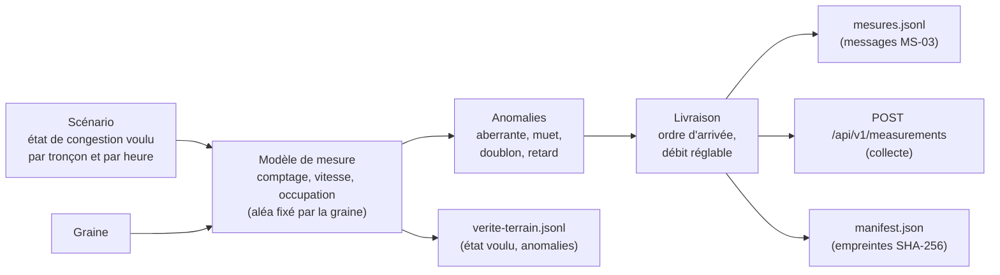

# Simulateur de capteurs IoT du trafic routier (MS-07)

> Issue #126. Critère d'acceptation : **un même scénario rejoué avec la même graine produit les mêmes messages ; chaque anomalie se déclenche à la demande.** Preuve : ce fichier. Les preuves exécutables sont dans [`tests/`](tests/) (section 11).

Le simulateur joue le réseau fixe de la migration 0005 (6 carrefours, 24 tronçons, 24 capteurs) et émet une mesure par capteur toutes les 10 s. IoT (Internet of Things) désigne ici les capteurs de comptage. Il n'utilise que la bibliothèque standard de Python.

| Sujet | Réponse | Section |
|---|---|---|
| Mêmes messages avec la même graine | Oui, à l'octet près, vérifié entre deux processus, deux versions de Python (3.14 et 3.15) et deux configurations de `PYTHONHASHSEED` | 5 |
| Anomalies à la demande | Quatre : valeur aberrante, capteur muet, doublon, retard. Programmées au lancement ou injectées pendant une exécution | 6 |
| Débit réglable | `--rate` (messages par seconde) | 7 |
| Format émis, conforme à MS-03 | Chaque message est validé par `contracts/validate_events.py` dans les tests | 3 |
| Vérité terrain | Fichier séparé ; l'état de congestion voulu n'est **jamais** dans un message | 4 |
| Mode fichier pour IA-08 | Dossier de run : messages, vérité terrain, manifeste avec empreintes SHA-256 | 8 |

## 1. Démarrage rapide

Depuis la racine du dépôt. Aucune installation : bibliothèque standard seulement (les tests de conformité demandent `pip install jsonschema referencing`, voir section 11).

| Action | Linux (bash) | Windows (PowerShell) |
|---|---|---|
| Lister les scénarios | `python3 simulator/app.py scenarios` | `py -3 simulator/app.py scenarios` |
| Écrire un run complet (pour IA-08) | `python3 simulator/app.py run --scenario heure-de-pointe --seed 42 --out var/runs/run-heure-de-pointe-42` | `py -3 simulator/app.py run --scenario heure-de-pointe --seed 42 --out var/runs/run-heure-de-pointe-42` |
| Même chose avec `make` (même dossier) | `make sim-run SCENARIO=heure-de-pointe SEED=42` | `make` n'existe pas sous Windows |
| Voir les messages (JSON, un par ligne) | `python3 simulator/app.py run --scenario incident-ponctuel --seed 7 --duration 2m --stdout` | `py -3 simulator/app.py run --scenario incident-ponctuel --seed 7 --duration 2m --stdout` |
| Envoyer à la collecte, à 50 messages par seconde | `python3 simulator/app.py run --scenario heure-de-pointe --collecte-url http://127.0.0.1:8001 --rate 50` | idem avec `py -3` |
| Lancer les tests | `make test-simulator` ou `python3 -m unittest discover -s simulator/tests` | `py -3 -m unittest discover -s simulator/tests` |

Le résumé d'un run (nombre de messages, empreintes) s'écrit sur la sortie d'erreur, pour que `--stdout` ne contienne que des messages. Code de sortie : 0 si tout va bien, 1 si la collecte n'a pas répondu ou a répondu autrement que par 202 ou 422 à au moins un message, 2 pour une erreur de saisie (le message dit quoi corriger). Un 422 (message hors contrat) est compté dans le résumé sans changer le code de sortie.

> **Non vérifié sous Windows ni macOS** : tout a été exécuté sous Linux. Les commandes de la colonne Windows sont la transposition directe, non essayée.

## 2. Ce que fait le simulateur



### Réseau fixe

Même table que `scripts/dev/gen_reseau.py`, qui génère `db/postgres/migrations/0005_reseau_demo.sql`. Un test compare les deux : une dérive est détectée.

| Carrefours | Type de route | Voies | Longueur d'approche | Vitesse limite | Tronçons | Capteurs |
|---|---|---|---|---|---|---|
| INT_01, INT_02 | ARTERIAL | 2 | 300 m | 50 km/h | ROAD_001 à ROAD_008 | SENSOR_001 à SENSOR_008 |
| INT_03, INT_04 | COLLECTOR | 1 | 250 m | 50 km/h | ROAD_009 à ROAD_016 | SENSOR_009 à SENSOR_016 |
| INT_05, INT_06 | LOCAL | 1 | 150 m | 30 km/h | ROAD_017 à ROAD_024 | SENSOR_017 à SENSOR_024 |

Chaque carrefour a quatre approches (N, E, S, W). Un capteur par tronçon, de même numéro. La vitesse en circulation fluide est la vitesse limite (hypothèse de la migration).

### Scénarios (ADR-027, règle 8)

L'état de congestion de chaque tronçon est **défini par le scénario**, pas calculé depuis les mesures : c'est la vérité terrain ([ADR-027](../docs/01-architecture/adr/ADR-027-jeux-de-donnees-et-provenance.md), section 3.3). Les heures sont des heures du jour en UTC (réseau fictif : pas de fuseau local). La graine ne change pas ce calendrier, seulement le bruit des mesures.

| Scénario | Début et durée par défaut | Calendrier des états |
|---|---|---|
| `journee-calme` | 00:00, 24 h | Tous les tronçons restent `FREE_FLOW` |
| `heure-de-pointe` | 06:00, 5 h | Approches Nord et Ouest : `SLOW` dès 06:50, `CONGESTED` de 07:20 à 08:50, `SLOW` jusqu'à 09:20. Approches Est et Sud : `SLOW` de 07:10 à 08:40, jamais saturées. Voies locales : `SLOW` de 07:40 à 08:30 sur Nord et Ouest. Décalage de 0, 4, 8 ou 12 minutes selon le tronçon |
| `incident-ponctuel` | 07:30, 3 h | Incident sur ROAD_005 : `CONGESTED` de 08:10 à 08:35, `SLOW` jusqu'à 08:50. Les trois autres approches de INT_02 : `SLOW` de 08:15 à 08:40. Le reste du réseau reste fluide |

Les scénarios « capteur muet » et « messages en retard ou en doublon » de l'ADR-027 sont des **anomalies** injectables (section 6), combinables avec n'importe quel scénario.

### Du scénario à la mesure

| Grandeur | Règle |
|---|---|
| Comptage | Loi de Poisson dont l'espérance suit la demande horaire (creux de nuit, pointes du matin et du soir, selon le type de route) et l'état voulu (un tronçon saturé écoule 55 % de la demande, un tronçon ralenti 85 %). Plafonné à 6 véhicules par voie et par intervalle |
| Vitesse moyenne | Ratio vitesse sur vitesse fluide tiré autour de l'état voulu : `FREE_FLOW` 0,90 ± 0,07, `SLOW` 0,50 ± 0,09, `CONGESTED` 0,20 ± 0,07. `null` si aucun véhicule n'est passé |
| Taux d'occupation | Véhicules × 6 m ÷ vitesse ÷ (10 s × voies), borné à 0,98 ; 0 sans véhicule |
| File | Nulle en `FREE_FLOW`, sinon proportionnelle à la longueur d'approche et à l'écart de vitesse |

Les états voisins **se chevauchent** volontairement (un tronçon `SLOW` peut mesurer un ratio de 0,23 ou de 0,81) : la règle de seuils de l'[ADR-028](../docs/01-architecture/adr/ADR-028-etats-de-congestion-et-alertes.md) ne retrouve donc pas la vérité terrain à coup sûr, comme sur des mesures réelles. Les seuils de l'ADR-028 sont des valeurs de départ, non finales.

Le plafond de 6 véhicules par intervalle (36 par minute et par voie) place le trafic normal sous le seuil de 40 véhicules par minute et par voie de la règle DQ-05 du dictionnaire : seule une anomalie « aberrante » produit une valeur douteuse. Vérifié sur 276 480 mesures (runs complets des trois scénarios, graine 42) : aucune ne déclenche DQ-05 ; un test en couvre une partie.

## 3. Format émis (conforme à MS-03)

Un message = un événement `novaria.iot.measurement.v1` complet (enveloppe et `data`), décrit par [`contracts/events/iot-measurement.schema.json`](../contracts/events/iot-measurement.schema.json). Même forme et même ordre de champs que l'exemple `contracts/events/examples/mesure-valide.json`.

```json
{
  "id": "run-demo-0001:SENSOR_001:1792483210000",
  "source": "simulateur/run-demo-0001",
  "type": "novaria.iot.measurement.v1",
  "time": "2026-10-20T08:00:10Z",
  "subject": "INT_01",
  "schema_version": "1.0",
  "correlation_id": "corr-1792483210000",
  "domain": "iot",
  "data": {
    "sensor_id": "SENSOR_001",
    "road_segment_id": "ROAD_001",
    "intersection_id": "INT_01",
    "interval_s": 10,
    "vehicle_count": 5,
    "average_speed_kmh": 8.5,
    "occupancy_rate": 0.635,
    "queue_length_m": 120.7,
    "quality": { "status": "VALID" },
    "provenance": { "source_type": "SIMULATED", "run_id": "run-demo-0001", "scenario_id": "heure-de-pointe", "seed": 42 }
  }
}
```

(Message réel : `heure-de-pointe`, graine 42, `--run-id run-demo-0001`, début 08:00.) Sur ce tronçon saturé, 8,5 km/h pour une limite de 50 km/h, soit un ratio de 0,17.

| Champ | Valeur émise |
|---|---|
| `id` | `<run_id>:<sensor_id>:<instant en millisecondes>` : clé d'idempotence (règle DQ-03). Vérifiée par `validate_events.py` |
| `time` | **Fin** de l'intervalle de 10 s, UTC. Le premier message d'un run commence à `début + 10 s`, le dernier est à `fin` |
| `source` | `simulateur/<run_id>` |
| `subject` | Le carrefour (clé de partition Kafka) |
| `correlation_id` | `corr-<instant en millisecondes>`, comme dans les exemples du contrat |
| `interval_s` | 10 |
| `average_speed_kmh` | `null` si `vehicle_count` vaut 0 (règle du contrat) |
| `queue_length_m` | Toujours fournie (champ facultatif du contrat) |
| `quality` | `VALID` ; `SUSPECT` + `IMPLAUSIBLE_VALUE` pour une valeur aberrante ; `VALID` + `GAP_BEFORE` pour le premier message après un silence |
| `provenance` | `SIMULATED`, `run_id`, `scenario_id`, `seed` : une donnée simulée n'est jamais présentée comme réelle |

Le simulateur **ne produit pas** de qualité `PARTIAL`, ni le drapeau `LATE` (voir section 9).

## 4. Vérité terrain

L'état de congestion voulu est conservé **à part**. Le contrat refuse tout champ inconnu : il ne peut pas être dans un message, et un test le vérifie. Le fichier `verite-terrain.jsonl` a une ligne par capteur et par intervalle, **y compris les messages jamais émis** (capteur muet).

```json
{"event_id": "run-demo-0001:SENSOR_001:1792483210000", "run_id": "run-demo-0001", "scenario_id": "heure-de-pointe", "sensor_id": "SENSOR_001", "road_segment_id": "ROAD_001", "intersection_id": "INT_01", "time": "2026-10-20T08:00:10Z", "label_state": "CONGESTED", "emitted": true, "emit_at": "2026-10-20T08:00:10Z", "anomalies": []}
```

| Champ | Sens |
|---|---|
| `event_id` | Identifiant du message : la clé de jointure avec `mesures.jsonl` |
| `label_state` | `FREE_FLOW`, `SLOW` ou `CONGESTED` : la **vérité terrain**, réponse à retrouver (ADR-027). Jamais `UNKNOWN` : le simulateur connaît toujours l'état |
| `emitted` | `false` si le capteur était muet à cet intervalle |
| `emit_at` | Instant simulé de livraison ; plus tardif que `time` pour un message en retard ; `null` si non émis |
| `anomalies` | Liste vide, ou `OUTLIER`, `SILENT`, `DUPLICATE`, `LATE` : de quoi évaluer une détection d'anomalies (IA-09) |

## 5. Même graine, mêmes messages

**Garantie.** Même scénario, même graine, même début, même fin, mêmes anomalies : les mêmes messages, dans le même ordre, identiques à l'octet près, quelle que soit la vitesse d'exécution (`--rate`).

**Mécanisme.** Aucun générateur ne « avance » : chaque valeur est une fonction pure de (graine, capteur, instant), calculée par BLAKE2b. Conséquences :

- l'ordre de calcul ne compte pas, et reprendre un run plus tard donne les mêmes valeurs sur les instants communs ;
- **une anomalie ne change aucun autre message** : seules les valeurs de sa cible bougent ;
- le résultat ne dépend ni de la version de Python ni de `PYTHONHASHSEED`.

L'aléa n'utilise que BLAKE2b et des additions (loi normale de Irwin-Hall) ; la seule fonction transcendante est `exp`, pour la loi de Poisson.

**Preuves** (voir section 11) :

| Preuve | Ce qu'elle établit |
|---|---|
| Deux exécutions, mêmes messages | `tests/test_determinisme.py` |
| Deux processus lancés avec `PYTHONHASHSEED` différents écrivent des fichiers identiques octet pour octet | idem (ordre des ensembles et des dictionnaires jamais en cause) |
| Empreinte SHA-256 épinglée d'un run de référence | idem : elle échoue si le format, le modèle ou l'aléa changent |
| Valeurs de l'aléa recalculées par un code indépendant | `tests/test_fondations.py` |
| **Run produit dans le conteneur (Python 3.15, image `python:3.15-slim`) et en local (Python 3.14.4) : même empreinte** | `mesures.jsonl` du run `incident-ponctuel`, graine 42, `--run-id run-conteneur`, début 08:10, 5 min : SHA-256 `656486fd…dceb` des deux côtés |
| Régressions volontaires détectées | Six altérations du code (aléa lié à `hash()`, anomalie qui perturbe les autres messages, drapeau `GAP_BEFORE` supprimé, retard sans effet, plafond de débit supprimé, état voulu qui fuit dans un message) : chacune fait échouer des tests |

**Limites, non vérifiées** : Windows et macOS, et d'autres versions de Python que 3.14 et 3.15. Les fonctions mathématiques de la bibliothèque C (`exp`) pourraient, en théorie, différer d'un dernier bit sur une autre plateforme ; l'empreinte épinglée le détecterait. Un changement du modèle (section 2) change les messages : l'empreinte épinglée est alors à mettre à jour, et les runs déjà produits ne se rejouent plus à l'identique.

## 6. Anomalies à la demande

Une anomalie vise **un capteur** sur une suite d'intervalles. Elle se déclenche de deux façons, avec les mêmes paramètres.

| Anomalie | Ce qui est émis | Règle du dictionnaire visée | Valeurs par défaut |
|---|---|---|---|
| `aberrante` | Valeur plausible en forme mais douteuse, qualité `SUSPECT` + `IMPLAUSIBLE_VALUE`. Variantes : `vitesse` (1,8 × la vitesse fluide, avec au moins un véhicule), `debit` (78 véhicules par minute sur une voie, soit plus de 40 par voie), `vitesse-nulle` (0 km/h alors que des véhicules sont passés) | DQ-05 | `variant=vitesse`, 1 intervalle |
| `muet` | Aucun message du capteur pendant la durée. Le premier message après le silence porte `GAP_BEFORE`. La vérité terrain note chaque message manquant | DQ-08 (capteur muet plus de 60 s) | `duration=5m` |
| `doublon` | Le même message (même `id`, même contenu) est livré `copies` fois de plus, `lag` secondes plus tard | DQ-03 (même `id` reçu deux fois) | `copies=1`, `lag=0` |
| `retard` | Le message est livré `delay` secondes après son instant, après des messages plus récents ; son `time` ne change pas. Rien n'est perdu | DQ-04 (retard autorisé de 30 s) | `delay=45` (au-delà de 30 s : la collecte doit le rejeter) |

Un retard et un doublon sur le même capteur et le même intervalle se combinent : les copies sont retardées aussi.

### Programmées au lancement

```
--anomaly TYPE:sensor=SENSOR_nnn,at=INSTANT[,duration=DURÉE][,variant=…][,copies=…][,lag=…][,delay=…]
```

`at` est l'instant de fin du premier intervalle touché : une date UTC (`2026-10-20T08:05:00Z`) ou `+N` secondes depuis le début du run, sur un multiple de 10 s. `duration` : `90`, `90s`, `5m`, `1h`. L'option se répète.

| Exemple | Effet |
|---|---|
| `--anomaly aberrante:sensor=SENSOR_003,at=+30,variant=vitesse` | Une vitesse de 90 km/h sur SENSOR_003, à `début + 30 s` (exemple réel : `average_speed_kmh` vaut 90,0 pour une limite de 50) |
| `--anomaly muet:sensor=SENSOR_007,at=+60,duration=5m` | SENSOR_007 se tait 5 minutes (30 intervalles) |
| `--anomaly doublon:sensor=SENSOR_001,at=+20,copies=2` | Le message de +20 s arrive trois fois |
| `--anomaly retard:sensor=SENSOR_010,at=+40,delay=45` | Le message de +40 s arrive 45 s plus tard |
| `--anomalies-file anomalies.json` | Liste JSON d'anomalies, par exemple le champ `anomalies` d'un `manifest.json` : **rejoue un run avec ses anomalies** |

### Injectées pendant l'exécution

Le service du conteneur (section 10) accepte une anomalie **pendant qu'un run tourne**. Sans `at`, elle touche le **prochain intervalle** : le passé n'est jamais modifié, une date passée est refusée.

```bash
curl -X POST http://127.0.0.1:8005/api/v1/run -H 'Content-Type: application/json' \
  -d '{"scenario":"heure-de-pointe","seed":42,"duration":"10m","rate":24,"sink":"fichier","run_id":"essai"}'
curl -X POST http://127.0.0.1:8005/api/v1/anomalies -H 'Content-Type: application/json' \
  -d '{"kind":"muet","sensor":"SENSOR_007","duration":"1m"}'
```

La réponse donne l'anomalie résolue, avec sa date de début (`start`). Le manifeste du run la garde : on peut rejouer le run à l'identique avec `--anomalies-file`.

**Preuves** (`tests/test_anomalies.py`, `tests/test_service.py`) : pour chaque anomalie, l'effet ci-dessus ; **les autres messages sont identiques** à ceux du run sans anomalie (sauf le message qui suit un silence, qui porte `GAP_BEFORE`) ; l'injection en cours de run touche le prochain intervalle et jamais le passé ; un run avec injections se rejoue à l'identique depuis ses anomalies ; chaque anomalie sur chaque scénario donne des messages valides au contrat. Un défaut a été trouvé par ces tests : une vitesse aberrante sur un intervalle sans véhicule disparaissait (le contrat impose une vitesse `null` sans véhicule), corrigé.

## 7. Débit réglable

`--rate N` (ligne de commande) ou `"rate": N` (service) : **N messages par seconde**, indépendamment du temps simulé. Le débit ne freine que l'envoi, il ne change aucune valeur. `--rate 0` (défaut) : sans frein. `--rate realtime` : 2,4 messages par seconde (24 capteurs toutes les 10 s).

| Mesure (Linux, un poste, 31/10/2026) | Résultat |
|---|---|
| Génération et écriture d'un run de 24 h en fichier, sans frein | 207 360 messages en 15 s (environ 13 700 messages par seconde), 26 Mo de mémoire |
| Envoi HTTP vers un faux serveur local de la bibliothèque standard, sans frein | environ 2 000 messages par seconde (1 443 messages en 0,66 s) |
| Débit tenu à la demande | Testé avec une horloge simulée (n messages à r par seconde prennent (n − 1) ÷ r secondes) et pour de vrai (borne basse) |

**Limites.** Un seul fil, une connexion HTTP persistante : les chiffres ci-dessus sont des ordres de grandeur sur un poste, pas un banc d'essai. **Non mesuré contre la vraie collecte** : son point d'entrée `POST /api/v1/measurements` n'est pas implémenté (la collecte n'expose que la sonde de santé). Au-delà de quelques milliers de messages par seconde, lancer plusieurs instances.

## 8. Mode fichier : un run complet pour IA-08

`--out DOSSIER` (ou `make sim-run`) écrit un dossier, par défaut sous `var/runs/` (ignoré par Git) :

| Fichier | Contenu |
|---|---|
| `mesures.jsonl` | Les messages MS-03, un par ligne, **dans l'ordre de livraison** (un message en retard n'est pas à sa place chronologique) |
| `verite-terrain.jsonl` | Une ligne par capteur et par intervalle (section 4) |
| `manifest.json` | Run, provenance, version du générateur, période, nombre d'intervalles joués, anomalies (relisibles), nombre de lignes et **SHA-256 de chaque fichier** |

Le manifeste n'a aucune horloge : deux exécutions identiques écrivent trois fichiers identiques. Fichiers en UTF-8, fins de ligne LF, écrits par l'outil lui-même. Le champ `intervals_played` est inférieur à `intervals` si le run a été arrêté.

| Mesure | Valeur |
|---|---|
| `journee-calme`, 24 h, graine 42 | 207 360 messages, 15 s, `mesures.jsonl` 123 Mo, `verite-terrain.jsonl` 67 Mo, 26 Mo de mémoire |
| `heure-de-pointe`, 5 h, avec les quatre anomalies | 43 172 messages pour 43 200 intervalles (43 200 − 30 intervalles de silence + 2 copies), 3 s |

Le format Parquet de l'ADR-027 est une affaire d'IA-08 : le simulateur n'écrit que du JSON Lines (JSONL, un document JSON par ligne), lisible sans dépendance. Le découpage entraînement, validation et test se fait **par run et par scénario** (règle 4 de l'ADR-027) : un `run_id` par exécution.

## 9. Décisions et points ouverts

| Sujet | Décision | À confirmer |
|---|---|---|
| Drapeau `LATE` | Le simulateur **ne le pose pas** : c'est la collecte qui juge du retard à la réception (DQ-04 et section 12 du dictionnaire, « à clarifier »). Un message retardé garde sa qualité d'origine | Les deux membres, avec MS-05 |
| Qualité d'une valeur aberrante | Posée par le simulateur (`SUSPECT` + `IMPLAUSIBLE_VALUE`), comme un capteur qui contrôle ses valeurs. La collecte peut la recontrôler (DQ-05) | Les deux membres |
| `GAP_BEFORE` | Posé sur le premier message après un silence (proposition : le contrat prévoit le drapeau, pas qui le pose) | Les deux membres |
| `PARTIAL` | Non produit : seules les quatre anomalies de l'issue sont injectables | Si IA-08 ou la collecte en ont besoin |
| Incident | Fixe : ROAD_005 de 08:10 à 08:35 (pas de paramètre) | Si IA-08 veut varier le tronçon |
| Heures | UTC | — |
| Collecte | `--collecte-url` suit le contrat de `collecte.openapi.yaml` (202 `ACCEPTED`, 202 `DUPLICATE`, 422) mais **n'a été essayé que contre un faux serveur** : la vraie route n'existe pas encore | MS-05 |
| Démarrage automatique | Aucun run ne démarre seul dans le conteneur (la collecte n'a pas son point d'entrée) | Quand la collecte sera prête |

## 10. Service HTTP du conteneur

Image `simulator/Dockerfile` : Python 3.15, bibliothèque standard, utilisateur non-root, sonde de santé. Port interne 8000, publié par `docker-compose.yml` sur `127.0.0.1:${SIMULATOR_PORT:-8005}`. Variables : `COLLECTE_URL` (déjà fournie par Compose), `SIMULATOR_OUT_DIR` (défaut `/tmp/simulateur`). Les erreurs sont des objets `{"detail": …}`.

| Route | Rôle |
|---|---|
| `GET /api/v1/health` | Sonde de santé, inchangée depuis la première version du simulateur (MS-06) : `status`, `version`, `revision`, `environment` |
| `GET /api/v1/scenarios` | Les scénarios |
| `GET /api/v1/run` | État du run en cours ou du dernier : avancement, messages livrés, anomalies, réponses de la collecte |
| `POST /api/v1/run` | Démarre un run : `scenario` (obligatoire), `seed` (42), `rate` (0), `sink` (`collecte`, `fichier` ou `aucun`), `run_id`, `start`, `duration`, `anomalies` (liste). 202, ou 409 si un run tourne |
| `DELETE /api/v1/run` | L'arrête (le manifeste est écrit, avec `intervals_played`) |
| `POST /api/v1/anomalies` | Injecte une anomalie dans le run en cours (section 6). 202, 400 si mal formée ou dans le passé, 409 sans run |

Un seul run à la fois. Éprouvé dans le conteneur : démarrage, run en fichier (30 intervalles, 720 messages), exécution sous `appuser`.

### Sécurité

L'API de pilotage n'a **ni authentification, ni CORS, ni limitation de débit** : elle est publiée sur `127.0.0.1` seulement par Compose, comme les autres services de la pile locale (voir `docs/04-devsecops/securite-applicative.md`, section 9). Ce qu'elle garantit, vérifié par `tests/test_securite.py` :

| Protection | Détail |
|---|---|
| Pas d'écriture hors du dossier de sortie | `run_id` de 1 à 80 caractères parmi lettres, chiffres, point, tiret et souligné, **jamais fait de points seuls** (`.` et `..` auraient écrit dans le dossier parent) ; le chemin final est en plus contrôlé |
| Journal sans secret | Jamais la query string (un jeton collé dans l'adresse), jamais le corps d'une requête. Seuls la méthode, le chemin et le statut sont écrits |
| Bornes d'un run demandé par HTTP | Corps de 64 Ko au plus (413 au-delà), durée de 7 jours au plus, débit de 1 000 000 de messages par seconde au plus, 100 anomalies au lancement, 1 000 par run |
| Un seul run, arrêt réactif | 409 si un run tourne ; `DELETE` est pris en compte avant chaque message, même à 1 message par seconde |
| Aucun secret | Le simulateur n'en lit, n'en émet et n'en journalise aucun ; `COLLECTE_URL` est une adresse sans identifiant |

La ligne de commande n'a pas ces bornes (sauf le `run_id`) : elle sert à produire des jeux d'entraînement de plusieurs semaines.


## 11. Tests

| Action | Linux (bash) | Windows (PowerShell) |
|---|---|---|
| Tous les tests du simulateur | `python3 -m unittest discover -s simulator/tests` | `py -3 -m unittest discover -s simulator/tests` |
| Dépendance de la conformité au contrat (une fois) | `python3 -m pip install jsonschema referencing` | `py -3 -m pip install jsonschema referencing` |

Sans `jsonschema`, les tests de conformité au contrat sont **ignorés** (et le disent) ; tous les autres passent. La CI ne lance pas ce dossier : `make test` le fait, à lancer avant une pull request.

| Fichier | Prouve |
|---|---|
| `test_fondations.py` | Aléa stable (valeurs recalculées par un code indépendant), loi de Poisson et loi normale correctes, réseau identique à la migration 0005 |
| `test_determinisme.py` | Même graine, mêmes messages ; entre deux processus, `PYTHONHASHSEED` différents ; le débit ne change rien ; empreinte épinglée |
| `test_contrat.py` | Chaque message, de chaque scénario et de chaque anomalie, passe `contracts/validate_events.py` ; même forme que l'exemple du contrat ; l'état voulu n'est jamais dans un message ; le validateur refuse bien un message abîmé |
| `test_scenarios.py` | Calendrier des états de chaque scénario, vérité terrain, ratios de vitesse par état, aucune mesure normale ne déclenche DQ-05, trafic plus fort aux heures de pointe |
| `test_anomalies.py` | Chaque anomalie, isolation (les autres messages ne changent pas), injection à la demande, rejeu depuis les anomalies, erreurs de saisie |
| `test_sorties.py` | Dossier de run (empreintes exactes, UTF-8, LF, vérité terrain à part), débit réglable, envoi à la collecte (accepté, doublon, injoignable), ligne de commande |
| `test_service.py` | Service HTTP : sonde, runs, arrêt, injection d'anomalies pendant un run, requêtes invalides |
| `test_securite.py` | `run_id` sans points seuls ni chemin, aucun fichier écrit hors du dossier de sortie, journal sans query string ni corps, bornes de durée, de débit, d'anomalies et de corps |

136 tests, une vingtaine de secondes. `scripts/dev/test_compose.py` contrôle aussi l'image (non-root, sonde de santé, paquet embarqué).

## 12. Fichiers

```
simulator/
  app.py              point d'entrée : service (sans argument), ou run / scenarios
  Dockerfile          image du conteneur
  novaria_sim/        rng, network, scenarios, model, anomalies, events, run, runner, sinks, pacing, cli, service
  tests/              les tests ci-dessus
```
